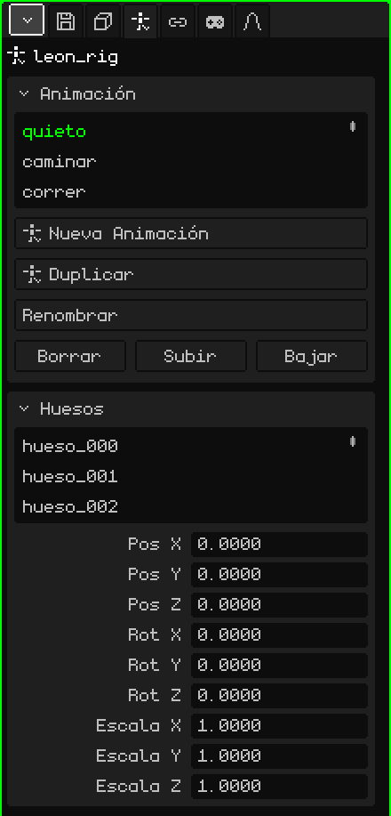

# Esqueleto

Un **esqueleto** es un objeto hecho de **huesos** que sirve para animar personajes y cosas que se doblan. Los huesos se mueven y la malla los sigue, deformándose: se anima un brazo girando un par de huesos en vez de mover cientos de vértices. Este artículo es la referencia de sus propiedades; cómo se agregan y se mueven los objetos está en el tutorial [El Modo Objeto](modo-objeto.md).

Añadir → Esqueleto crea uno con un solo hueso, listo para sumarle más. En la Vista 3D cada hueso se dibuja como una línea azul por encima de todo, para verlo aunque esté adentro de la malla.

## Reposo y pose

Cada hueso tiene dos maneras de estar:

- **Reposo:** donde se lo puso al armar el esqueleto. Es la postura en la que la malla está sin deformar (un personaje con los brazos abiertos, por ejemplo).
- **Pose:** cómo está en un frame de la animación: el brazo levantado, la cabeza girada. Posar no cambia el reposo: siempre se puede volver a él.

## Los modos

Un esqueleto tiene tres modos, que se eligen en el menú **Modo** de la Vista 3D:

| Modo | Para qué sirve |
|---|---|
| Modo Objeto | Mover, rotar y escalar el esqueleto entero, como cualquier objeto. |
| Modo Edición | Armar el esqueleto: crear huesos desde las puntas, moverlos, emparentarlos. Cambia el reposo. |
| Modo Pose | Posar y animar: girar los huesos y guardar keyframes. |

 <kbd>Tab</kbd> alterna entre Modo Objeto y Modo Pose (y desde Modo Edición pasa a Modo Pose).

Las herramientas y los atajos de cada modo están en [Esqueletos](../editor/esqueletos.md), en el manual.

## Las pestañas

| Pestaña | Qué tiene |
|---|---|
| Objeto | Posición, rotación, escala, nombre y visibilidad del esqueleto entero, igual que en todos los objetos: ver [Malla 3D](objeto-malla.md#la-pestaña-objeto). |
| Esqueleto | Las animaciones y los huesos: las dos tarjetas de abajo. |
| Restricciones | Ver [Restricciones](restricciones.md). |
| Scripts | Los scripts Lua del objeto. Se ven más adelante. |

## La pestaña Esqueleto

### Animación

Las animaciones del esqueleto (los **clips**): caminar, correr, saltar. Cada clip guarda las poses de los huesos en el tiempo.

| Propiedad | Qué hace |
|---|---|
| La lista | Los clips del esqueleto. El elegido es el que se edita y se reproduce. |
| Nueva Animación | Crea un clip vacío, con los huesos en reposo. |
| Duplicar | Copia el clip elegido, para hacer una variante sin tocar el original (aparece si hay clips). |
| Renombrar | Le cambia el nombre al clip. No se puede repetir dentro del mismo esqueleto. |
| Borrar / Subir / Bajar | Borra el clip o lo mueve en la lista. |

Cómo se anima se ve en el tutorial de animación.

### Huesos

La lista de los huesos del esqueleto. Al elegir uno, la tarjeta muestra sus datos:

| Propiedad | Qué hace |
|---|---|
| Nombre | El nombre del hueso. Al cambiarlo se renombra también su grupo de vértices en las mallas del esqueleto, así la malla lo sigue igual. |
| Padre | De qué hueso cuelga (**Ninguno** si es la raíz). Al mover el padre se mueven sus hijos. El menú no ofrece al propio hueso ni a los que cuelgan de él, para que no se forme un círculo. |
| Conectado | Solo si tiene padre. Tildado, el principio del hueso queda soldado a la punta del padre: mover una mueve la otra. Tildarlo con el hueso separado lo mueve para pegarlo. Destildado, sigue siendo hijo pero con la punta suelta (se ve una línea punteada). |
| Pos X, Y, Z | Dónde está el hueso en la pose actual, medido desde su padre. |
| Rot X, Y, Z | Cuánto está girado en la pose actual, en grados. |
| Escala X, Y, Z | Su tamaño en la pose actual: 1 es el original. |

Pos, Rot y Escala editan la **pose** y se ven al instante, pero no quedan guardadas en la animación hasta insertar un keyframe (Insertar Keyframe, en Modo Pose).

## Que una malla siga al esqueleto

Para que una malla se deforme con los huesos hacen falta dos cosas:

1. **El modificador Esqueleto** en la malla (Propiedades → pestaña Modificadores → Añadir → Esqueleto), con el esqueleto elegido en **Objetivo**. Ver [Esqueleto (modificador)](modificador-esqueleto.md).
2. **Grupos de vértices** con los nombres de los huesos (Propiedades → pestaña Malla 3D → [Grupos de Vértices](objeto-malla.md#grupos-de-vértices)). Cada grupo dice qué vértices mueve su hueso y cuánto; los pesos se pintan con la [Pintura de pesos](../editor/pintura.md#pintura-de-pesos).

Para un objeto rígido, como una espada en la mano o un sombrero, no hace falta nada de eso: alcanza con una restricción [Child Of](restricciones.md#child-of) con el esqueleto de fuente y el hueso de la mano o de la cabeza. Es mucho más liviano que deformar una malla, y en el Nokia N95 se nota.

## Importar un personaje

Añadir → Importar → glTF o GLB trae un personaje armado de una vez. Por ejemplo, Leon:

- la **malla**, como hija del esqueleto;
- el **esqueleto**, con el nombre del archivo y `_rig` al final;
- los **grupos de vértices**, uno por cada hueso que mueve la malla, con los pesos que traía el archivo;
- las **animaciones**, como clips en la tarjeta Animación;
- y, si trae animaciones, el **modificador Esqueleto** ya puesto en la malla, apuntando a su esqueleto.

Elegí un clip de la lista, dale Play en la Línea de tiempo y el personaje se mueve.
