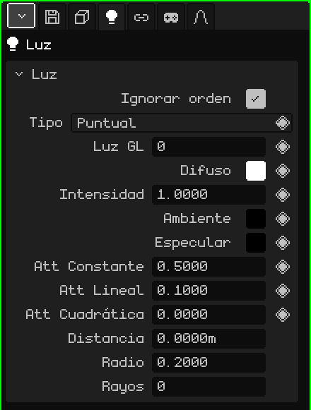

# Luz

Una **luz** ilumina la escena: los materiales que tienen Iluminación prendida se ven más claros o más oscuros según las luces que les llegan. Este artículo es la referencia de sus propiedades; cómo se agregan y se mueven los objetos está en el tutorial [El Modo Objeto](modo-objeto.md).

## Los tres tipos

| Tipo | Cómo alumbra | Para qué |
|---|---|---|
| **Puntual** | Desde un punto, para todos lados, como una lamparita. | Lámparas, velas, fogatas, el brillo de un objeto. |
| **Sol** | Con rayos paralelos que vienen todos del mismo lado. Importa hacia dónde apunta, no dónde está. | La luz del día en exteriores. |
| **Foco** | En un cono, como una linterna. | Linternas, faros de un auto, reflectores de un escenario. |

Añadir → Luz crea una luz Puntual; Añadir → Sol y Añadir → Foco crean directo los otros dos. El tipo se puede cambiar después en la propiedad **Tipo**.

El sol y el foco se orientan rotando el objeto. El sol dibuja siempre una línea hasta el piso, hacia donde alumbra; con la luz seleccionada, el foco muestra su cono y la puntual una esfera del tamaño de su **Distancia**.

## Las pestañas

| Pestaña | Qué tiene |
|---|---|
| Objeto | Posición, rotación, nombre y visibilidad, igual que en todos los objetos: ver [Malla 3D](objeto-malla.md#la-pestaña-objeto). |
| Luz | La tarjeta de abajo. |
| Restricciones | Ver [Restricciones](restricciones.md). |
| Scripts | Los scripts Lua del objeto. Se ven más adelante. |

## La tarjeta Luz

| Propiedad | Qué hace |
|---|---|
| Ignorar orden | Tildado (como viene), la luz alumbra toda la escena, esté donde esté en el Outliner. Destildado, solo alumbra lo que se dibuja **después** de ella en el Outliner: sirve para iluminar ciertas cosas con ciertas luces. |
| Tipo | Puntual, Sol o Foco. |
| Luz GL ◆ | Cuál de las 8 luces de OpenGL usa (de 0 a 7). Ver [Más de 8 luces](#más-de-8-luces). |
| Difuso ◆ | El color de la luz. |
| Intensidad ◆ | Qué tan fuerte alumbra. 1 es el color tal cual; más es más fuerte. |
| Ambiente ◆ | Una luz pareja que llega a todas partes, también a las caras que no miran a la luz. Arranca en negro (sin ambiente). Subila un poco para que las sombras no queden negras. |
| Especular ◆ | El color del brillo que la luz deja en los materiales. Arranca en negro (sin brillo). |
| Att Constante, Att Lineal, Att Cuadrática ◆ | La **atenuación**: cómo se apaga la luz con la distancia. Constante la debilita pareja en todos lados; Lineal la apaga de a poco al alejarse; Cuadrática la apaga mucho más rápido lejos. No aparecen en el Sol. |
| Ángulo Spot ◆ | Solo en el Foco: qué tan abierto es el cono, en grados, desde el centro hasta el borde. Con 45 el cono abre 90° en total. |
| Exponente Spot ◆ | Solo en el Foco: cómo se reparte la luz en el cono. 0 alumbra parejo; más alto la concentra en el centro y oscurece los bordes. |
| Distancia | Hasta dónde alumbra una luz Puntual o un Foco en el trazado de rayos, en metros; también es el largo del cono que se dibuja. 0 es sin límite. No aparece en el Sol. |
| Radio | Para el trazado de rayos: el tamaño de la lámpara. 0 da sombras duras, de borde filoso; más grande da sombras de borde suave. En el Sol son grados. |
| Rayos | Para el trazado de rayos: cuántos rayos de sombra manda esta luz. Más rayos, sombras suaves más limpias pero más lentas. 0 usa los de la pestaña Archivo / Render. |

### Distancia y atenuación

Las dos cambian hasta dónde se nota una luz, pero no igual:

- La **atenuación** vale siempre, en la Vista 3D, en el juego y en el trazado de rayos: la luz se va apagando con la distancia, pero nunca se corta del todo.
- La **Distancia** es un corte para el trazado de rayos: la luz se apaga suave hasta llegar a cero justo ahí, y más allá no alumbra. En OpenGL no corta: ahí manda la atenuación. Sirve también como guía, porque la esfera o el cono muestran dónde termina.

## Más de 8 luces

OpenGL dibuja hasta **8 luces a la vez**, numeradas de 0 a 7: es la propiedad **Luz GL**. La escena puede tener muchas más; pasadas las 8, las nuevas comparten número con alguna de las anteriores. El trazado de rayos, en cambio, usa todas.

Con **Ignorar orden** destildado se puede reusar un número a propósito: una luz con la Luz GL 0 alumbra lo que se dibuja después de ella en el Outliner, y otra luz más abajo con la misma Luz GL 0 la reemplaza para lo que sigue. Así un escenario largo puede tener luces distintas en cada zona sin pasarse de 8.

## Ejemplos

| Escena | Cómo se arma |
|---|---|
| Un exterior de día | Un Sol, con Difuso apenas amarillo, y algo de Ambiente celeste para que las sombras no queden negras. |
| Una habitación con una lámpara | Una Puntual en la lámpara, con Att Lineal un poco más alta para que se apague hacia las paredes. Para el trazado de rayos, una Distancia del tamaño de la habitación. |
| Una linterna | Un Foco con un Ángulo Spot chico y un Exponente Spot alto, pegado a la mano del personaje con una restricción [Child Of](restricciones.md#child-of). |
| Una luz que titila | Keyframes en la Intensidad (◆), con valores que suben y bajan. |
