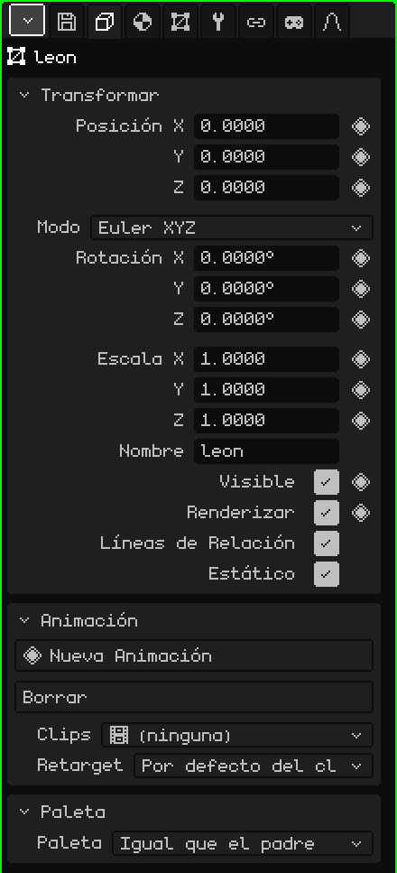
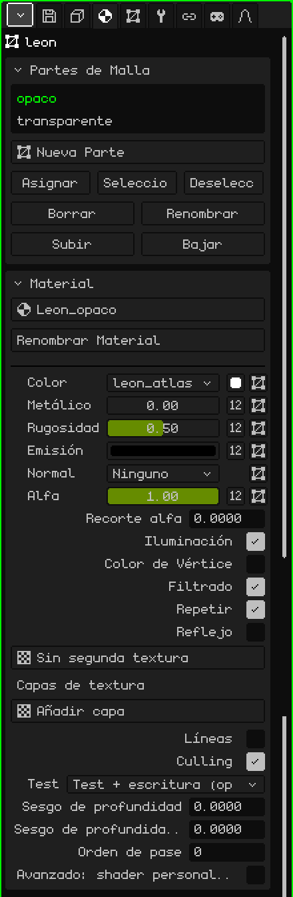
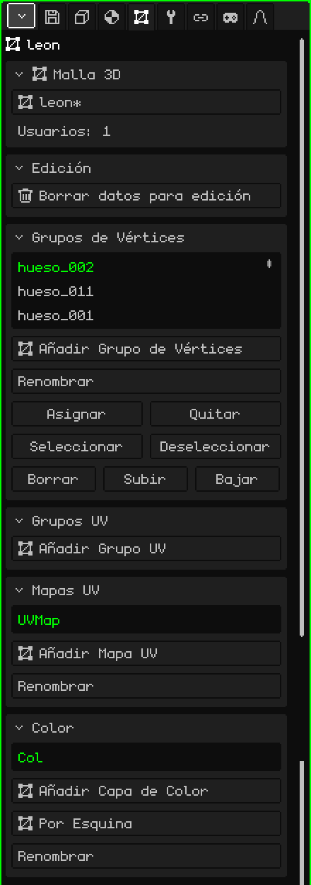
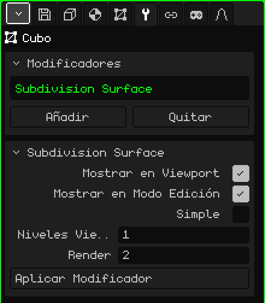

# Malla 3D

Una **malla 3D** es el objeto que tiene forma: está hecha de vértices, aristas y caras, y es lo que se modela, se pinta y se anima. Un cubo, un personaje o un escenario entero son mallas. Este artículo es la referencia de sus propiedades; cómo se crean, se mueven y se emparentan los objetos está en el tutorial [El Modo Objeto](modo-objeto.md).

## Las pestañas

Con una malla seleccionada, Propiedades muestra estas pestañas, además de Archivo / Render y Animación, que están siempre:

| Pestaña | Qué tiene |
|---|---|
| Objeto | Lo común a todos los objetos: posición, rotación, escala, nombre y visibilidad. |
| Material | Las partes de la malla y el material de cada una. |
| Malla 3D | Los datos de la malla: cuál usa, sus grupos de vértices, sus mapas UV y sus capas de color. |
| Modificadores | Los modificadores, que cambian la forma sin destruirla. |
| Transformar | Solo en Modo Edición: el centro de lo seleccionado, para escribirlo con números. |
| Restricciones | Ver [Restricciones](restricciones.md). |
| Scripts | Los scripts Lua del objeto. Se ven más adelante. |

## La pestaña Objeto

Es igual para todos los tipos de objeto: cámaras, luces, esqueletos y sonidos también la tienen.

### Transformar

| Propiedad | Qué hace |
|---|---|
| Posición X, Y, Z ◆ | Dónde está el objeto, en metros. Z es la altura. |
| Modo | Cómo se escribe la rotación: **Euler XYZ** (tres ángulos en grados, el más fácil de leer), **Cuaternión (WXYZ)** o **Ángulo de Eje**. Con los dos últimos aparece **Rotación W**. Cambiar el modo no gira el objeto: solo cambia cómo se muestran los números. |
| Rotación X, Y, Z ◆ | El giro sobre cada eje. |
| Escala X, Y, Z ◆ | El tamaño en cada eje: 1 es el tamaño original, 2 el doble y 0.5 la mitad. |
| Nombre | El nombre del objeto, el mismo que muestra el Outliner. No se puede repetir: si ya existe, se le agrega un número (`.001`). |
| Visible ◆ | Si el objeto se ve. Es el mismo ojo del Outliner. |
| Renderizar ◆ | Si sale en los renders. Destildado, se sigue viendo en la Vista 3D pero no aparece en la imagen ni en el video. |
| Líneas de Relación | La línea que une al objeto con su padre. Sirve apagarla cuando un objeto tiene muchos hijos y las líneas tapan la vista. |
| Estático | Marca que el objeto no se mueve nunca. Solo importa adentro de un objeto Culling con el método de grilla: un objeto estático se ubica en su celda una sola vez, en vez de medirlo en cada cuadro. |

### Animación y Paleta

- **Animación:** las animaciones propias del objeto, como una animación de vértices, y sus clips. Se ven en el tutorial de animación.
- **Paleta:** qué paleta de colores usa el objeto. Con **Igual que el padre** (como viene) la hereda; elegir una paleta del proyecto lo repinta a él y a todo lo que cuelga de él.

## La pestaña Material

### Partes de Malla

Una malla puede estar dividida en **partes**, y cada parte tiene su material. Una casa, por ejemplo, puede tener las paredes en una parte y el vidrio de las ventanas en otra.

| Propiedad | Qué hace |
|---|---|
| La lista | Las partes de la malla. La elegida es la que muestra la tarjeta Material de abajo. |
| Nueva Parte | Crea una parte vacía. |
| Asignar | Pasa a la parte elegida las caras seleccionadas en Modo Edición. |
| Seleccionar / Deseleccionar | Selecciona o deselecciona las caras de esa parte. Si hace falta, Seleccionar pasa a Modo Edición para mostrarlas. |
| Borrar / Renombrar | Borra la parte (sus caras pasan a la anterior) o le cambia el nombre. Borrar aparece si hay más de una. |
| Subir / Bajar | Cambian el orden. Las partes se dibujan en ese orden: conviene dejar lo transparente al final. |

### Material

El material decide cómo se ve la parte: su color, su textura y cómo le pega la luz. El material por defecto no se edita: para cambiar algo, primero se crea uno con el selector de arriba (**Nuevo Material**), que también sirve para elegir otro material del proyecto. Las opciones más usadas:

| Propiedad | Qué hace |
|---|---|
| Renombrar Material | Le cambia el nombre al material. |
| Color | La textura de la parte, el cuadradito del **Color Base** y el mapa UV que usa la textura. |
| Metálico, Rugosidad, Emisión, Normal, Alfa | Cada uno puede ser un número o una textura (el botón **Número / textura**). Alfa es la transparencia: con menos de 1, o con una textura de alfa, el material pasa a ser transparente. |
| Recorte alfa | Corta lo que tiene alfa bajo, sin mezclar: para rejas, alambrados u hojas. 0 lo apaga. |
| Transmisión, IOR | Vidrio y refracción. Solo con el **Trazado de rayos** prendido (pestaña Archivo / Render). |
| Iluminación | Si las luces de la escena le pegan. Apagada, el color se ve plano, siempre igual. Si el backend gráfico tiene shaders, aparece **Sombreado**: Por vértice o Por píxel. |
| Color de Vértice | Usa los colores pintados en la malla (ver [Pintura de vértices](../editor/pintura.md#pintura-de-vértices)) en vez del color base. |
| Filtrado / Repetir | Suaviza la textura de cerca (destildado se ven los píxeles) / la repite como un mosaico. |
| Reflejo | Un reflejo del entorno, como cromo. |
| Capas de textura | Hasta cuatro texturas más encima de la primera, cada una con su mapa UV y su mezcla. |
| Líneas / Grosor de línea | Dibuja las aristas de la parte, con el grosor en píxeles. |
| Culling | No dibuja las caras de atrás. |
| Test, Sesgo de profundidad, Orden de pase | Opciones avanzadas de profundidad, para calcomanías y cosas que se apoyan sobre otras. |
| Avanzado: shader personalizado | Un archivo que dibuja el material a medida: ver [Shaders escritos](../editor/shaders.md). |

Si el objeto tiene física (Añadir → Física), su tarjeta **Física** aparece también en esta pestaña.

## La pestaña Malla 3D

### Malla 3D

La forma del objeto es un recurso del proyecto, y varios objetos pueden **compartir** la misma malla (eso hace Duplicar vinculado): editar una edita todas.

| Propiedad | Qué hace |
|---|---|
| El selector | La malla que usa el objeto (con un `*` si tiene cambios sin guardar). Desde ahí se elige otra malla del proyecto o **Nueva copia**. |
| Usuarios | Cuántos objetos de la escena usan esta malla. |
| Hacer única | Aparece si la malla está compartida: le da al objeto su propia copia, para editarla sin tocar a los demás. |

Si la malla es de una librería aparece el aviso "Es de una librería (solo lectura): abrí la librería para editarlo", y lo que la cambiaría desaparece del panel.

### Edición

**Borrar datos para edición** sirve para un escenario que no se va a modelar más: le saca a la malla los datos que usa el Modo Edición, así carga más rápido y ocupa menos memoria (importa en el Nokia N95). Mientras tanto no se puede entrar a Modo Edición. **Convertir en malla editable** los vuelve a calcular.

### Grupos de Vértices

Un **grupo de vértices** es una lista de vértices con un peso cada uno. Es lo que usa un [esqueleto](objeto-esqueleto.md) para saber qué vértices mueve cada hueso: el grupo se llama igual que el hueso. Los pesos se pintan con la [Pintura de pesos](../editor/pintura.md#pintura-de-pesos).

| Propiedad | Qué hace |
|---|---|
| Añadir Grupo de Vértices / Renombrar | Crea un grupo o le cambia el nombre. |
| Asignar / Quitar | Mete en el grupo (con peso 1) o saca los vértices seleccionados en Modo Edición. |
| Seleccionar / Deseleccionar | Selecciona o deselecciona los vértices del grupo, para ver qué agarra. |
| Borrar / Subir / Bajar | Borra el grupo o lo mueve en la lista. |

**Grupos UV** funciona igual, pero sus pesos son para los esqueletos 2D del [Editor UV](../editor/editor-uv.md).

### Mapas UV

Un **mapa UV** dice cómo se apoya la textura sobre la malla. Una malla puede tener varios: por ejemplo, uno para la textura de color y otro para una capa de textura que se repite distinto. Cada textura del material elige cuál usa.

**Añadir Mapa UV** crea uno, **Renombrar** le cambia el nombre, y Borrar, Subir y Bajar aparecen cuando hay más de uno.

### Color

Las **capas de color** guardan los colores pintados en la malla con la Pintura de vértices. **Añadir Capa de Color** crea una; **Modo de Color** alterna entre **Por Vértice** (las caras que comparten un vértice comparten su color) y **Por Esquina** (cada cara puede tener el suyo, para bordes duros). Renombrar, Borrar, Subir y Bajar, como en los mapas UV.

## La pestaña Modificadores

Un **modificador** cambia la malla sin destruirla: se puede apagar, reordenar o borrar cuando se quiera, y la malla original sigue ahí.

La tarjeta **Modificadores** tiene la lista (se aplican en orden, de arriba hacia abajo), **Añadir** (el menú con los tipos), **Quitar** y **Subir / Bajar**. Debajo, la tarjeta del modificador elegido (con su nombre como título) trae **Mostrar en Viewport** (apagado no se calcula), **Mostrar en Modo Edición** (apagado, editar es más rápido y se recalcula al salir), sus propiedades y **Aplicar Modificador**, que lo hornea en la malla y lo saca de la lista.

Cada modificador tiene su artículo:

| Modificador | Para qué sirve |
|---|---|
| [Tornillo](modificador-screw.md) | Gira un perfil alrededor de un eje: tornillos, jarrones, resortes. |
| [Espejo](modificador-espejo.md) | Refleja la malla: se modela una mitad y la otra sale sola. |
| [Array](modificador-array.md) | Copias en fila: escaleras, cercas, cadenas. |
| [Superficie de Subdivisión](modificador-subdivision.md) | Suaviza la malla subdividiéndola. |
| [Booleano](modificador-booleano.md) | Une, intersecta o resta otro objeto. |
| [Culling](modificador-culling.md) | Optimización: no dibuja lo que no se ve desde la cámara. |
| [Esqueleto](modificador-esqueleto.md) | Deforma la malla con un esqueleto. |
