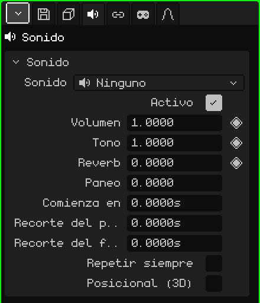

# Sonido

Un objeto **Sonido** es un audio puesto en la escena: una música, un efecto, el ruido de una máquina. En la Vista 3D se ve como un parlante. Puede sonar igual en todos lados, como una música, o desde donde está, más fuerte cuanto más cerca. Este artículo es la referencia de sus propiedades; cómo se agregan y se mueven los objetos está en el tutorial [El Modo Objeto](modo-objeto.md).

Un objeto Sonido nuevo arranca sin audio: **Ninguno**. El archivo se elige en la tarjeta Sonido.

## Con el sonido ya elegido

-  Arrastrar un sonido de la [Biblioteca](../editor/outliner.md#vista-biblioteca) a la Vista 3D crea un objeto Sonido donde cae, con ese sonido.
-  Soltar un archivo de sonido (por ejemplo un `.wav`) sobre la Vista 3D lo suma al proyecto y crea ahí el objeto.

## Las pestañas

| Pestaña | Qué tiene |
|---|---|
| Objeto | Posición, nombre y visibilidad, igual que en todos los objetos: ver [Malla 3D](objeto-malla.md#la-pestaña-objeto). Un sonido oculto no suena, y ocultar una colección calla los sonidos que tiene adentro. |
| Sonido | La tarjeta de abajo. |
| Restricciones | Ver [Restricciones](restricciones.md). |
| Scripts | Los scripts Lua del objeto, que pueden hacerlo sonar o callarlo en un juego. Se ven más adelante. |

## La tarjeta Sonido

| Propiedad | Qué hace |
|---|---|
| Sonido | El archivo que suena, con su duración. El menú lista los sonidos del proyecto, **Ninguno** y **Cargar sonido desde el explorador...**, que trae uno del disco al proyecto. |
| Activo | Destildado, no suena. Sirve para apagarlo sin borrarlo. |
| Volumen ◆ | Qué tan fuerte suena: 1 es el volumen del archivo, 0 es mudo y 2 el doble. |
| Tono ◆ | Más agudo o más grave. 1 es el original; 2 suena una octava más agudo y el doble de rápido, 0.5 una octava más grave y a la mitad de velocidad. Por eso cambiar el tono también cambia cuánto dura. |
| Reverb ◆ | Cuánto de este sonido va al eco de la reverberación: 0 nada, 1 todo. Da sensación de cueva, de iglesia o de pasillo. |
| Paneo | De qué lado suena: -1 a la izquierda, 0 al medio, 1 a la derecha. Solo sin Posicional (3D): con él, el lado lo decide dónde está. |
| Comienza en | En qué segundo de la escena arranca. |
| Recorte del principio | Cuántos segundos se le cortan al archivo al principio. |
| Recorte del final | Cuántos segundos se le cortan al archivo al final. |
| Repetir siempre | El tramo que queda entre los dos recortes se repite sin parar, sin cortes. Para músicas de fondo y ruidos continuos. |
| Posicional (3D) | Suena desde donde está el objeto. Ver abajo. |
| Radio a volumen pleno | Solo con Posicional (3D): hasta esta distancia, en metros, suena entero. |
| Alcance audible | Solo con Posicional (3D): desde esta distancia, en metros, ya no se escucha. |

## Los tiempos van en segundos

Los tiempos del sonido se miden en **segundos**, no en frames. Así, si la escena pasa de 30 a 60 cuadros por segundo, los sonidos siguen enganchados al mismo momento y no hay que reacomodar nada.

En la [Línea de tiempo](../editor/linea-de-tiempo.md#sonidos), cada sonido seleccionado tiene su **tira**: dónde arranca y cuánto dura. Arrastrar la tira cambia **Comienza en**, y agarrar una de sus puntas cambia los recortes. Suena con el Play de la línea de tiempo y se calla al parar.

En un juego, el sonido arranca cuando aparece (por ejemplo, el de una explosión que es parte de un prefab), más lo que diga **Comienza en**.

## Posicional (3D)

Sin tildar, el sonido se escucha igual esté donde esté, como una música. Tildado, se escucha **desde donde está**, respecto de quien escucha:

- Más cerca, más fuerte: hasta el **Radio a volumen pleno** suena entero, y de ahí baja hasta apagarse en el **Alcance audible**.
- Si está a la derecha, suena por la derecha; si está a la izquierda, por la izquierda.
- Si está atrás, suena más bajo y más al medio.

Quien escucha es la cámara activa en el juego y la Vista 3D activa en el editor (o la cámara, si se está mirando por ella). Con el sonido seleccionado, la Vista 3D dibuja dos esferas: la del radio a volumen pleno y la del alcance audible.

## Ejemplos

| Sonido | Cómo se arma |
|---|---|
| Música de fondo | Sin Posicional (3D), con Repetir siempre. |
| Una cascada | Posicional (3D) y Repetir siempre, con un Radio a volumen pleno chico y un Alcance audible grande: se empieza a oír de lejos y crece al acercarse. |
| Un golpe a los 4 segundos de una animación | Comienza en 4, o la tira movida hasta ahí en la Línea de tiempo. A 30 FPS es el frame 121: el frame 1 es el segundo 0. |
| Una música que se apaga al final | Keyframes en el Volumen (◆): 1 un poco antes del final y 0 al final. |
