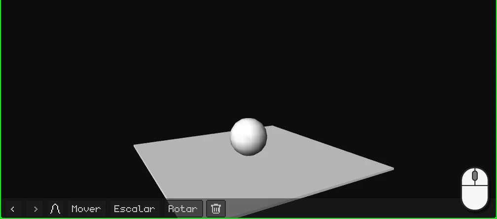
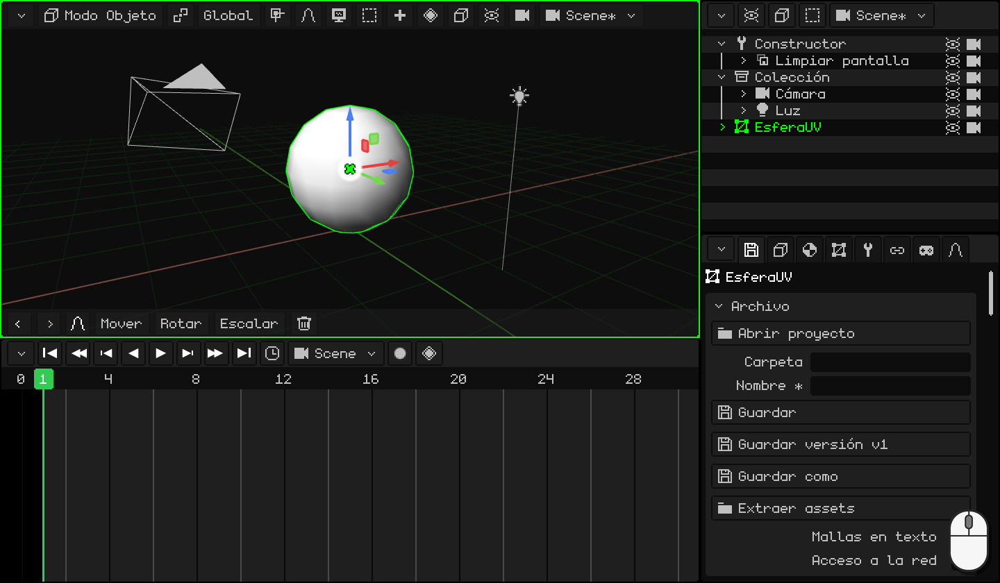
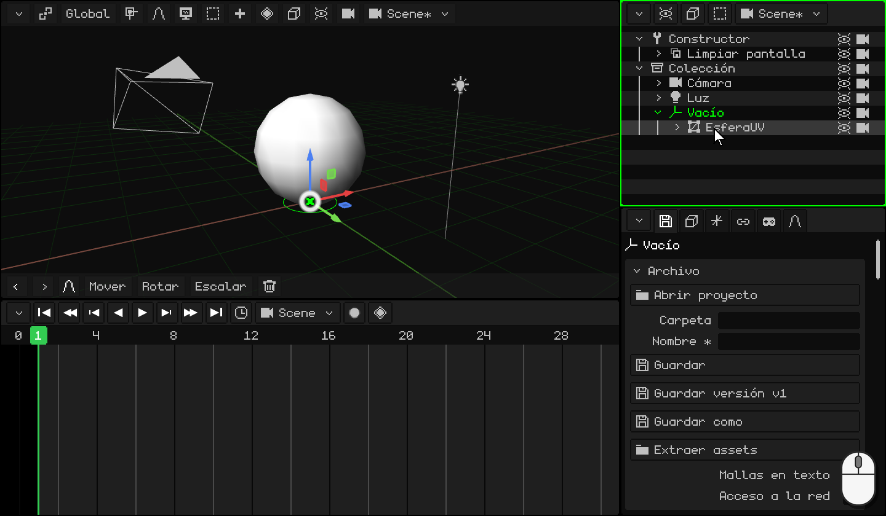
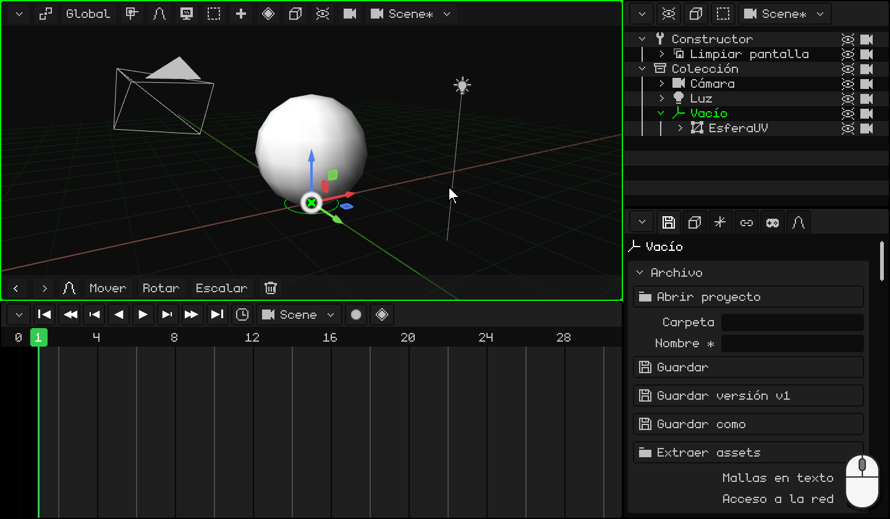
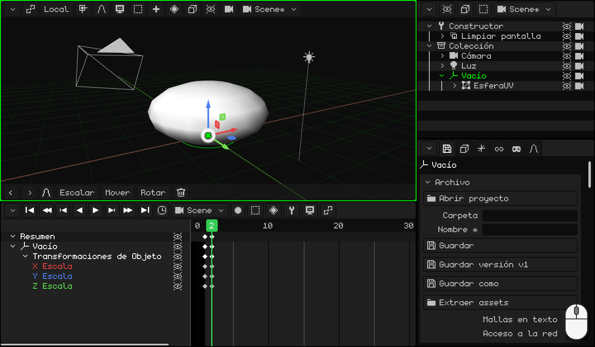
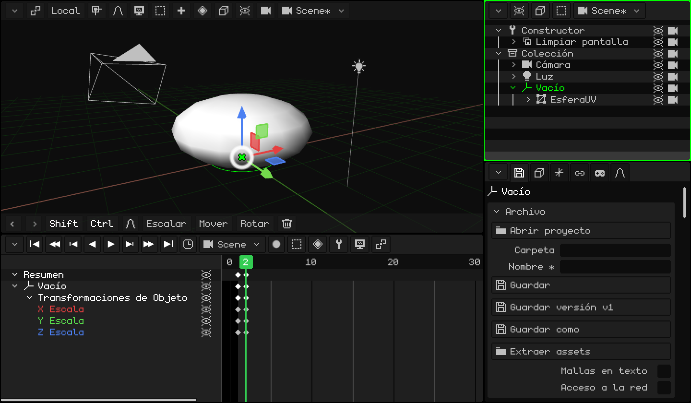
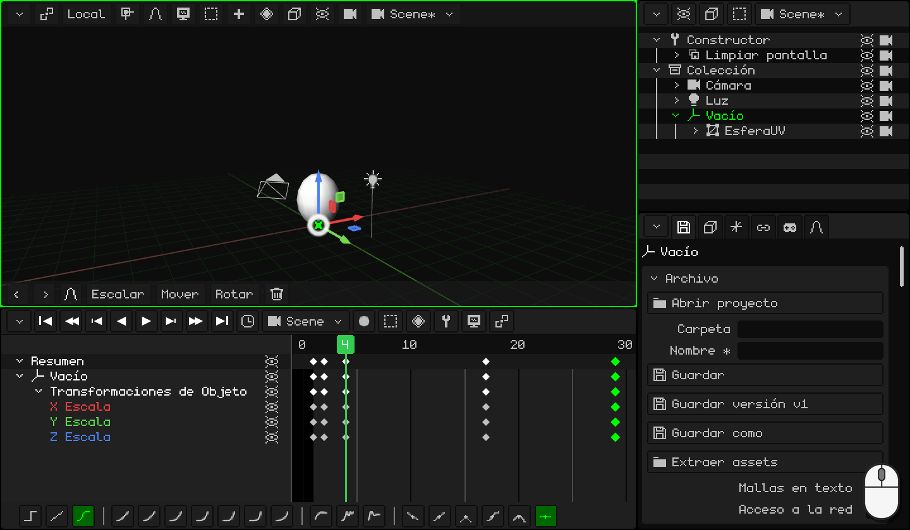
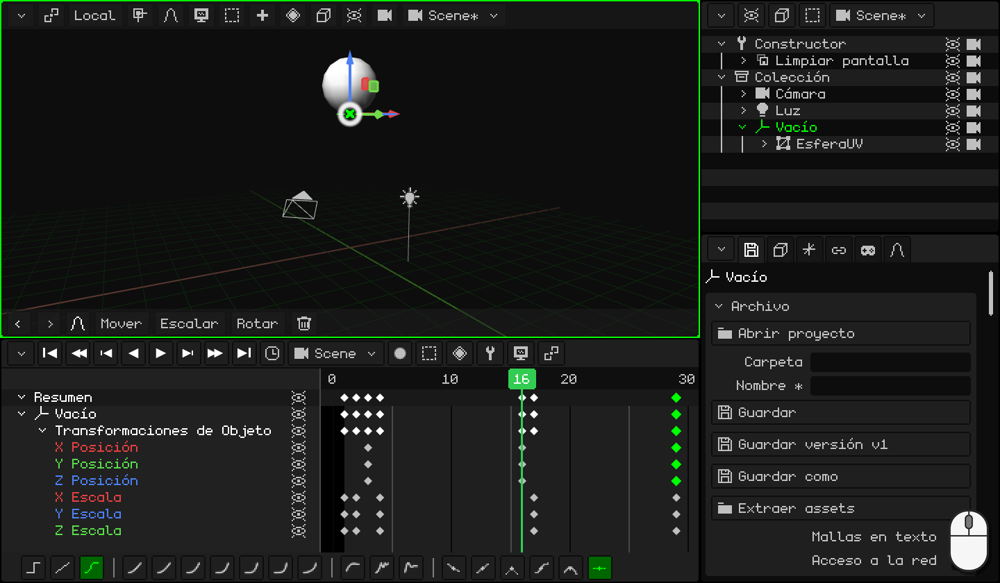
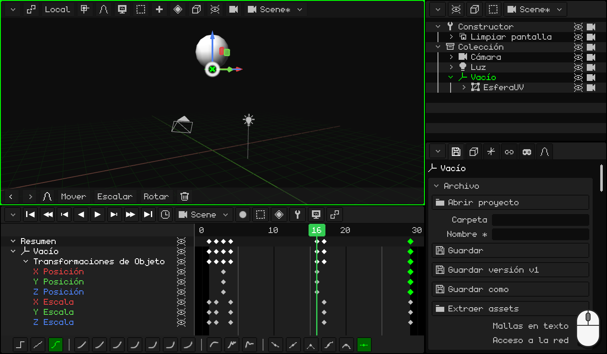
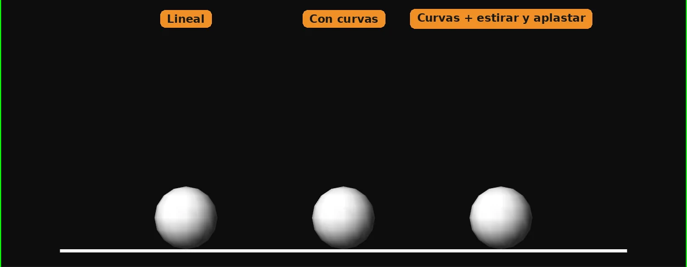

# Hacer picar una pelota

Una pelota que pica y pica, para siempre: es el ejercicio con el que empieza cualquier animador. Parece fácil, pero para que se vea bien hacen falta dos de los principios más importantes de la animación:

- **estirar y aplastar**: la pelota se aplasta contra el piso y se estira al salir. Eso le da peso y elasticidad;
- **acelerar y frenar**: sube cada vez más despacio y cae cada vez más rápido, como con la gravedad.

En el camino vas a aprender a:

- poner un **Vacío** en el piso para aplastar la pelota contra el piso y no hacia su centro;
- **duplicar** keyframes para volver a una pose que ya tenés;
- hacer un **loop**: una animación que se repite sin que se note el corte;
- usar las **curvas** para que la pelota tenga peso.

Si todavía no animaste nada, empezá por [Animar la puerta](animar-puerta.md): ahí están los keyframes, la Línea de tiempo y las curvas.

## 1. La pelota y su Vacío

1. Borrá el cubo y agregá una esfera: <kbd>Shift</kbd> + <kbd>A</kbd> → **Malla → Esfera UV**. Mide 2 metros de alto y nace con el centro en el piso: subila para que quede apoyada, <kbd>G</kbd> <kbd>Z</kbd> `1` <kbd>Enter</kbd>.
2. Entrá al **Modo Edición** (<kbd>Tab</kbd>) y elegí **Vértice** en el botón **Vértice / Arista / Cara**. El vértice de abajo de todo queda tapado por la esfera: prendé **Superposiciones → Rayos X** para verlo a través de ella y hacé click en él.
3. <kbd>Shift</kbd> + <kbd>S</kbd> → **Cursor a lo seleccionado**: el cursor 3D va al punto de abajo de la pelota, en el piso.
4. Volvé al **Modo Objeto** (<kbd>Tab</kbd>) y apagá los **Rayos X**.
5. <kbd>Shift</kbd> + <kbd>A</kbd> → **Vacío**. Nace donde está el cursor 3D: en el piso, justo debajo de la pelota.
6. **Emparentá** la pelota al Vacío. En el **Outliner**, click en **EsferaUV** y <kbd>Ctrl</kbd> + click en **Vacío** (el último que elegís es el padre). Con el mouse sobre la Vista 3D, <kbd>Ctrl</kbd> + <kbd>P</kbd> → **Objeto (Mantener Transform.)**. En el Outliner, la esfera queda adentro del Vacío.

### ¿Para qué el Vacío?

Escalar achica o agranda desde el **origen**. El de la esfera está en su centro: si la aplastás, se achica hacia el centro y queda flotando. El Vacío está en el piso: si lo aplastás a él, la pelota se aplasta **contra el piso**, como cuando pica.

Desde ahora se anima **el Vacío**, nunca la esfera.

  En táctil y en el N95: el vértice, con un toque (o con el mouse virtual); el cursor, con **Malla → Imán → Cursor a lo seleccionado**; el Vacío, con **Añadir → Vacío**; y para emparentar, la esfera y el Vacío elegidos (el Vacío activo), **Objeto → Emparentar → Objeto (Mantener Transform.)**.

## 2. Aplastar

Cuando la pelota toca el piso se **aplasta**: queda más baja y más ancha. Para que no parezca que se achica, lo que pierde de alto lo gana de ancho.

1. Elegí el **Vacío**. En el cuadro **1**, la pelota está redonda y tocando el piso: <kbd>I</kbd> → **Solo Escala**.
2. <kbd>→</kbd> (la flecha a la derecha) pasa al cuadro **2**. Aplastala: <kbd>S</kbd> <kbd>Z</kbd> `0.75` <kbd>Enter</kbd> la deja más baja, y <kbd>S</kbd> <kbd>Shift</kbd> + <kbd>Z</kbd> `1.6` <kbd>Enter</kbd>, más ancha. <kbd>Shift</kbd> + <kbd>Z</kbd> es *todos los ejes menos Z*: X e Y juntos.
3. <kbd>I</kbd> → **Solo Escala**.

 En una pantalla táctil: el keyframe se pone con el botón del rombo de la barra de menús de la Vista 3D, **Animación → Insertar Keyframe → Solo Escala**; el cuadro se cambia con un toque en los números de la Línea de tiempo. Para aplastarla, **Escalar** **Z** `0.75`, **Escalar** **X** `1.6` y **Escalar** **Y** `1.6`, con los números en el teclado de la barra de arriba.

 En el Nokia N95: <kbd>3</kbd>, <kbd>3</kbd> (el eje Z), el lápiz + `0.75` y <kbd>OK</kbd>; después <kbd>3</kbd>, <kbd>1</kbd> (X) y `1.6`, y <kbd>3</kbd>, <kbd>2</kbd> (Y) y `1.6`. El keyframe, con **Animación → Insertar Keyframe → Solo Escala**.

## 3. Estirar

Al salir del piso, la pelota se **estira** para el lado al que va: más alta y más finita. Y cuando llega arriba vuelve a estar redonda.

1. La pelota redonda ya la tenés, en el keyframe del cuadro 1: duplicalo. En la Línea de tiempo, click en el rombo del cuadro **1**, <kbd>Shift</kbd> + <kbd>D</kbd>, llevá la copia al cuadro **4** y hacé click. Mirá el rombo de la copia, no el puntero: sale un cuadro a la derecha del mouse.
2. Hacé lo mismo para los cuadros **17** y **29**: ahí la pelota vuelve a estar redonda.
3. Andá al cuadro **4** (un click en los números de la Línea de tiempo). Estirala: <kbd>S</kbd> <kbd>Z</kbd> `1.1` <kbd>Enter</kbd> y <kbd>S</kbd> <kbd>Shift</kbd> + <kbd>Z</kbd> `0.9` <kbd>Enter</kbd>.
4. <kbd>I</kbd> → **Solo Escala**.

  En táctil y en el N95 (con el mouse virtual), en vez de duplicar se copia y se pega: un toque en el keyframe del cuadro 1 y, en el menú **Key** de la Línea de tiempo (el botón del rombo), **Copiar**; un toque en los números para ir al cuadro 4 y **Key → Pegar**. Lo mismo para el 17 y el 29. Para estirarla, **Escalar** **Z** `1.1`, **Escalar** **X** `0.9` y **Escalar** **Y** `0.9`.

## 4. El salto

1. Andá al cuadro **3**: la pelota todavía está en el piso, es el momento en que sale. <kbd>I</kbd> → **Solo Localización**.
2. Andá al cuadro **16** y subila: <kbd>G</kbd> <kbd>Z</kbd> `5` <kbd>Enter</kbd> (5 metros). <kbd>I</kbd> → **Solo Localización**.
3. Para que vuelva al piso, duplicá el keyframe del cuadro **3** al **29**.

Dale **Play** (<kbd>Espacio</kbd>): la pelota pica. Pero algo no está bien: frena antes de tocar el piso, como si flotara. Eso lo arreglan las curvas, en la parte 6.

 En una pantalla táctil: **Mover** **Z** `5` y **Animación → Insertar Keyframe → Solo Localización**. El keyframe del 3 se lleva al 29 con **Key → Copiar** y **Key → Pegar**, como en la parte 3.

 En el Nokia N95: <kbd>1</kbd>, <kbd>3</kbd> (el eje Z), el lápiz + `5` y <kbd>OK</kbd>; y **Animación → Insertar Keyframe → Solo Localización**.

## 5. El loop

El cuadro **29** es igual al **1**: la pelota redonda, tocando el piso. Si la animación llegara hasta el 29, se verían dos cuadros iguales seguidos y la pelota se quedaría quieta un instante: se notaría el corte. Por eso termina en el **28**: después del 28 viene el 1, que es igual al 29.

Hacé click en el **reloj** de la Línea de tiempo y, en **Fin**, escribí `28` <kbd>Enter</kbd>.

En el mismo reloj están los **FPS** de esta animación. La pelota va a 30: cada pique dura 28 cuadros, casi un segundo. Si la querés con estilo de cine, ponela en 24, pero **antes** de animar: con los mismos cuadros, a 24 iría más lenta. Qué FPS conviene en cada caso está en [Animar la puerta](animar-puerta.md), en la parte del tiempo.

## 6. Las curvas: la gravedad

**Solo Localización** guardó los tres ejes, pero la pelota solo se mueve en Z: las filas **X Posición** e **Y Posición** son líneas planas. Borralas: click en cada una y <kbd>X</kbd>.

Ahora pasá al editor de curvas (**Vista → Curvas**). La curva de Z es el salto: sube y baja. Pensá en una pelota de verdad:

- **Al subir**, sale del piso a toda velocidad y se va frenando hasta quedar quieta arriba: **sale rápido y se va frenando**. Elegí el keyframe del cuadro **3** y, en la barra de herramientas de la Línea de tiempo, **Cúbica** y **Al llegar**.
- **Al bajar**, arranca despacio y cae cada vez más rápido, hasta el golpe contra el piso: **acelera y frena de golpe**. Elegí el keyframe del cuadro **16**: **Cúbica** y **Al arrancar**.

(Con el teclado: <kbd>E</kbd> para el **Modo de Interpolación** y <kbd>Ctrl</kbd> + <kbd>E</kbd> para el **Suavizado**.)

La curva queda como los arcos de una pelota de verdad: redondeada arriba y en punta abajo, donde golpea el piso. Dale **Play**: ahora tiene peso.

¿Querés que pique más alto o más bajo? En el editor de curvas, agarrá el keyframe de arriba (el del cuadro 16) y movelo.

## 7. Mirala

Para verla sin la grilla ni el Vacío, apagá **Superposiciones → Mostrar Superposiciones** y dale **Play**.

Las tres pelotas de abajo pican en el mismo tiempo. La primera tiene curvas lineales: sube y baja siempre a la misma velocidad, como una máquina. La segunda tiene las curvas de la gravedad: frena arriba y golpea el piso. La tercera, además, se estira y se aplasta: es la de este tutorial.

