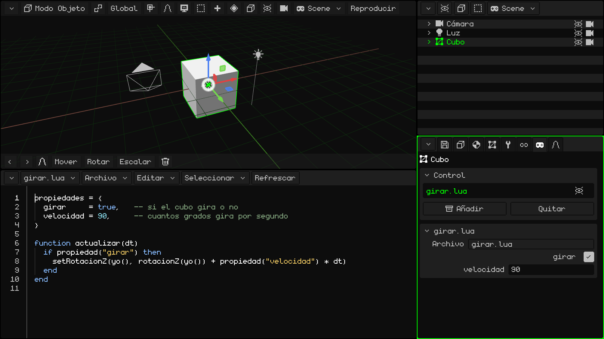
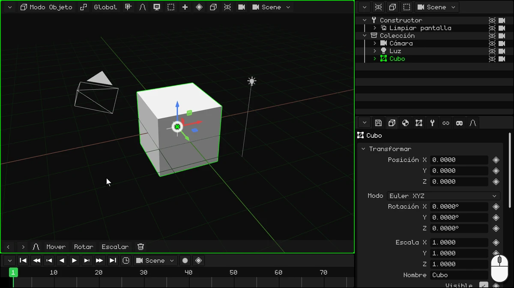
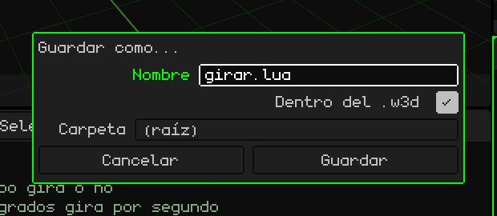
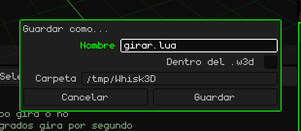
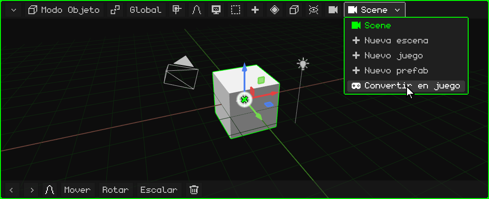
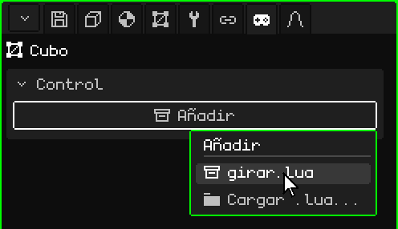
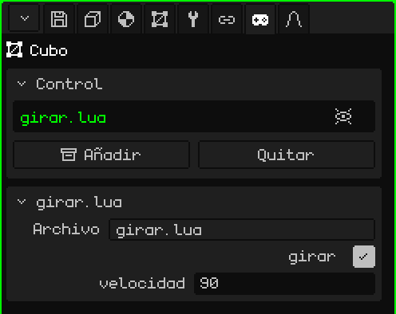
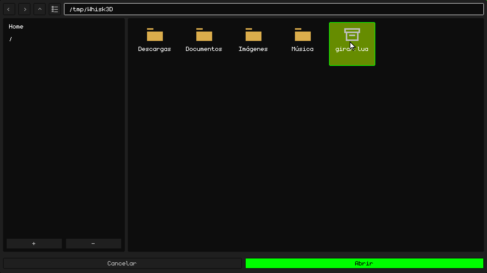
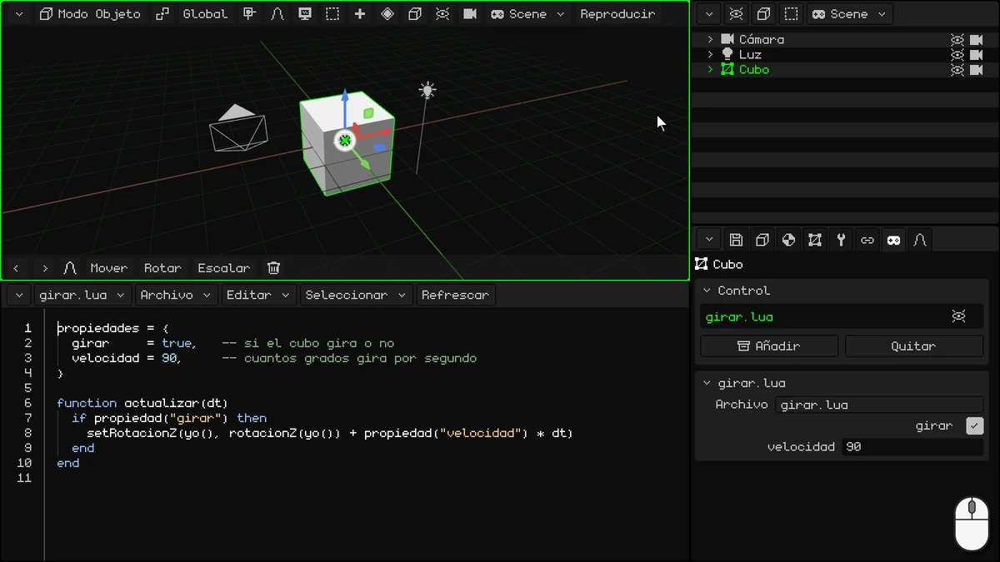

# Tu primer script: un cubo que gira

En este tutorial vas a escribir tu primer script de **Lua**: uno que hace girar al cubo.



## 1. El IDE

En este tutorial no vas a usar la Línea de tiempo: convertila en el IDE, el editor de scripts. Tocá el botón de la esquina de la Línea de tiempo (arriba a la izquierda) y elegí **IDE**.

El IDE arranca vacío. Para escribir más cómodo, agrandalo: arrastrá el mismo botón de la esquina para arriba.



> [!NOTE]
> También se pueden usar otros editores o IDE externos y cargar los scripts. Los scripts pueden estar fuera o dentro de los proyectos W3D.

## 2. Escribí el script

El script tiene dos partes: arriba, las **propiedades**, y abajo, la **función** que hace girar al cubo.

### Las propiedades

```lua
propiedades = {
  girar     = true,   -- si el cubo gira o no
  velocidad = 90,     -- cuantos grados gira por segundo
}
```

- **`propiedades`** son los valores del script que se pueden cambiar desde el panel de Propiedades, uno por línea. `girar = true` es un valor **booleano** (verdadero o falso: `true` o `false`), y en el panel se ve como una casilla. `velocidad = 90` es un número, y se ve como un campo numérico. Lo que escribís acá es el valor **de fábrica**: cada objeto que use el script puede tener el suyo.
- Lo que va después de `--` es un **comentario**: Lua no lo lee, es para vos.

### La función

```lua
function actualizar(dt)
  if propiedad("girar") then
    setRotacionZ(yo(), rotacionZ(yo()) + propiedad("velocidad") * dt)
  end
end
```

Una **función** es un bloque de código con un nombre: empieza con `function nombre()` y termina con `end`. Lo que tiene adentro no se hace cuando lo escribís, sino cada vez que alguien **llama** a la función.

Whisk3D tiene **funciones reservadas**: si tu script tiene una función con uno de esos nombres, el motor la llama solo, en el momento justo. Por ejemplo:

- **`inicio()`**: una sola vez, al darle Play. Sirve para preparar las cosas.
- **`actualizar(dt)`**: en **cada cuadro**, mientras el juego anda.

Hay más, como las que avisan cuando un objeto choca con otro. Están todas en el manual de Lua: [Cuándo llama el motor a tu script](../lua/ciclo-del-script.md).

`actualizar` es ideal para un videojuego. Un juego dibuja la pantalla muchas veces por segundo, y cada una de esas imágenes es un **cuadro**: todo lo que se mueve, se mueve un poquito en cada cuadro. Acá, en cada cuadro el cubo gira un poco más.

- Corre mientras el objeto está **visible**: si lo ocultás, su script deja de correr hasta que vuelva a verse.
- `dt` son los segundos que pasaron desde el cuadro anterior. Multiplicar la velocidad por `dt` hace que el cubo gire 90 grados **por segundo**, ande el juego a 30 o a 60 cuadros por segundo.

Lo que hace adentro:

**`if propiedad("girar") then` … `end`** es una **condición**. Un `if` («si») hace el código que tiene adentro solo si lo que va entre `if` y `then` es verdadero. Puede tener un `elseif` («si no es cierto, hace esto si…»), que prueba otra condición, y un `else` («si no»), que se hace cuando no se cumplió ninguna; los dos son opcionales. Siempre termina con `end`. Por ejemplo:

```lua
if puntos >= 100 then
  premio = "oro"
elseif puntos >= 50 then
  premio = "plata"
else
  premio = "nada"
end
```

Con 120 puntos el premio es oro; con 70, plata, y con 10, nada. Se hace solo la primera parte que se cumple. (En Lua, `elseif` va todo junto.)

En el script, el `if` no tiene `elseif` ni `else`: si **girar** es verdadero (la casilla está tildada), el cubo gira; si es falso, no pasa nada y la función termina. `propiedad("girar")` lee el valor que tiene ese objeto en el panel. Como se lee en cada cuadro, si lo cambiás con el juego andando, el script se entera en ese momento.

- **`yo()`** es el objeto que tiene el script: el cubo. **`rotacionZ(yo())`** da su rotación en grados sobre la Z (la vertical, la misma Z que ves en el panel de Propiedades), y **`setRotacionZ`** le pone una nueva: la misma, un poco más. Así el cubo gira como un trompo.

`propiedad`, `yo`, `rotacionZ` y `setRotacionZ` también son funciones, pero al revés: las trae Whisk3D y las llamás vos. Están en el [manual de Lua](../lua/README.md).

### El script completo

Tocá adentro del IDE y escribí todo junto:

```lua
propiedades = {
  girar     = true,   -- si el cubo gira o no
  velocidad = 90,     -- cuantos grados gira por segundo
}

function actualizar(dt)
  if propiedad("girar") then
    setRotacionZ(yo(), rotacionZ(yo()) + propiedad("velocidad") * dt)
  end
end
```

## 3. Guardalo

Primero guardá el proyecto, si todavía no lo guardaste: el script se puede guardar adentro del proyecto solo si el proyecto ya está guardado. En Propiedades, en la pestaña del **disquete** (la tarjeta **Archivo**), escribí un **Nombre**, por ejemplo `girar-cubo`, y tocá **Guardar**. Se guarda en la **Carpeta** que muestra la tarjeta.

Después, en la barra de menús del IDE, **Archivo → Guardar como...**:

1. En **Nombre**, poné `girar.lua`.
2. Tildá **Dentro del .w3d**: el script queda guardado adentro del proyecto, en el mismo archivo `.w3d`. La **Carpeta** pasa a ser una de adentro del proyecto: **(raíz)** es la principal.
3. Tocá **Guardar**.



Si no tildás **Dentro del .w3d**, el script se guarda como un archivo suelto, afuera del proyecto, en la **Carpeta** que elijas. Sirve, por ejemplo, para editarlo con otro programa.



## 4. Convertí la escena en un juego

Una **escena** es para modelar y animar; los scripts corren en un **juego**. Un juego no tiene animaciones propias: las animaciones se hacen en una escena o en un modelo 3D con esqueleto, y se importan en el juego para usarlas ahí. En la barra de menús de la Vista 3D (o del Outliner), tocá el botón de la escena, el que muestra su nombre, y elegí **Convertir en juego**.



**Convertir en juego** no cambia tu escena: hace una copia, que es un juego, con todo tal como se ve en el cuadro actual de la Línea de tiempo. En el juego no quedan las animaciones de la escena: ese cuadro queda grabado como la posición y el estado inicial del juego. La escena original sigue igual, con sus animaciones, y la volvés a encontrar en el menú del botón de la escena.

Ahora estás en el juego: el botón de la escena muestra un joystick, y en la barra de menús de la Vista 3D aparece **Reproducir**.

## 5. Ponéselo al cubo

1. Elegí el **Cubo** del juego (en el Outliner o en la Vista 3D).
2. En Propiedades, andá a la pestaña del **joystick**.
3. En la tarjeta **Control**, tocá **Añadir**: se despliega un menú con los scripts del proyecto. Elegí `girar.lua`.



El script aparece en la lista de la tarjeta Control, y abajo se agrega su propia tarjeta, **girar.lua**, con las propiedades que escribiste: la casilla **girar** (tildada) y la **velocidad** (90).

En la lista, a la derecha del script, hay un **ojo**: tocándolo, el script se apaga (el motor no lo usa) sin quitarlo del objeto ni ocultar el objeto. Otro toque lo prende.



### Un script de afuera

Si escribiste el script con otro editor, o lo guardaste afuera del `.w3d`, tocá **Añadir → Cargar .lua...**. Se abre el explorador, **Cargar script**: elegí el archivo y tocá **Abrir**.



## 6. Dale Play

Tocá **Reproducir**: el cubo gira. Mientras el juego anda, la barra de menús de la Vista 3D muestra **Parar** y **Pausa**.

Con el juego andando, probá cambiar las propiedades en la tarjeta **girar.lua**:

- poné **velocidad** en 360: gira cuatro veces más rápido;
- destildá **girar**: se queda quieto. Tildala otra vez y sigue.

Para terminar, tocá **Parar**: el cubo vuelve a como estaba antes de darle Play.



> [!NOTE]
> Todo lo que pasa con el juego andando se pierde al tocar **Parar**: el cubo vuelve a su lugar, y **girar** y **velocidad** vuelven a los valores que tenían antes de darle Play. Para cambiarlos de verdad, cambialos con el juego parado.

## Para seguir

- [Lua en Whisk3D](../lua/README.md): el manual de Lua, con todas las funciones.
- [Un script es un componente de un objeto](../lua/scripts-y-objetos.md): las propiedades (también listas, textos y objetos de la escena).
- [Cuándo llama el motor a tu script](../lua/ciclo-del-script.md): `actualizar`, `inicio` y las demás.

## Descargá el ejemplo

Acá está el proyecto terminado, para que lo pruebes o lo compares con el tuyo: **[girar-cubo.w3d](ejemplos/girar-cubo.w3d)**. Abrilo en Whisk3D y dale **Reproducir**. El script está adentro del `.w3d` y se ve en el IDE.
