# Propiedades

> [!NOTE]
>  El Nokia N95 soporta mouse y teclado (por Bluetooth). Las partes de esta página sobre el Nokia explican cómo se usa sin mouse ni teclado, solo con las teclas del teléfono.

**Propiedades** es el viewport con los datos del **objeto activo**, el último que elegiste: su posición, su nombre, su material, el color de una luz, los modificadores de una malla. Está organizado en **pestañas**, y cada pestaña tiene **tarjetas** con filas de valores. Casi todo lo que cambiás acá se ve en el momento en la Vista 3D.

Como se explicó en [Los viewports](viewports.md#el-viewport-activo), las teclas van al viewport activo, el del borde verde.

 En el Nokia N95, Propiedades está a la derecha de la Vista 3D: la **tecla verde**  lo hace el viewport activo. Al volver, sigue en la fila donde lo dejaste.

## Las pestañas

Las pestañas son los íconos de la barra de menús de Propiedades. Cada una muestra un grupo de tarjetas.

Las pestañas **cambian según el objeto activo**: cada tipo de objeto muestra solo las que le sirven. Una malla tiene Material, Malla 3D y Modificadores; una luz tiene, en el lugar del material, la pestaña Luz; una cámara, la pestaña Cámara.

| Pestaña | Cuándo aparece |
|---|---|
| Archivo / Render (el disquete) | Siempre, aunque no haya nada elegido. |
| Objeto | Con cualquier objeto 3D: posición, rotación, escala, nombre y visibilidad. |
| La del tipo de objeto | Material en una malla, Luz en una luz, Cámara en una cámara, y así con cada tipo. Su ícono cambia con el tipo. |
| Malla 3D y Modificadores | Solo con una malla. |
| Transformar | Solo con una malla en Modo Edición. |
| Restricciones | Con cualquier objeto 3D. |
| Scripts | Con cualquier objeto. |
| Animación | Siempre. |

La pestaña del tipo queda en su lugar: si estabas en el material de una malla y elegís una luz, pasás a la pestaña Luz. Si la pestaña en la que estabas no existe para el objeto nuevo (Modificadores, al elegir una luz), Propiedades vuelve a la pestaña Objeto.

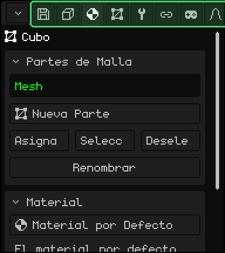

| | Cómo se cambia de pestaña |
|---|---|
|  PC | Un click en la pestaña. Si no entran todas, girá la rueda encima de la barra. |
|  Pantalla táctil | Un toque en la pestaña. Si no entran todas, arrastrá la barra de costado. |
|  Nokia N95 | Subí con la flecha **arriba** hasta el título de la primera tarjeta y una vez más: la pestaña actual se pone verde. **Izquierda** y **derecha** cambian de pestaña, y **abajo** vuelve a las tarjetas. En la primera pestaña, la izquierda abre el menú del botón de la esquina. |

## Las tarjetas

Las **tarjetas** son los recuadros de cada pestaña: un título y sus filas. La flecha del título dice si la tarjeta está abierta o plegada. Plegar las que no usás deja a mano las que sí.

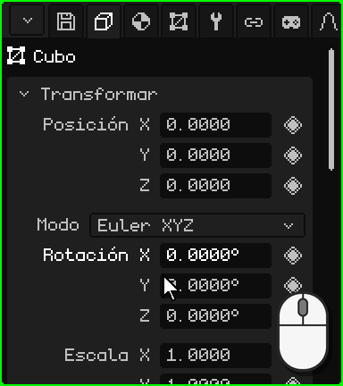

| | Cómo se pliega y se despliega |
|---|---|
|  PC | Un click en el título. |
|  Pantalla táctil | Un toque en el título. |
|  Nokia N95 | <kbd>OK</kbd> sobre el título. La flecha **izquierda** pliega la tarjeta desde cualquiera de sus filas, y la **derecha**, sobre el título, la despliega. |

Si las tarjetas no entran en el viewport, el panel se desplaza: con la rueda del mouse en la PC, o arrastrando el dedo para arriba o para abajo en una pantalla táctil. En el Nokia, el panel sigue solo a la fila elegida.

### Moverse con las teclas

 En el Nokia N95 hay una **fila elegida**: su nombre se ve en verde y su valor, con un borde blanco. **Arriba** y **abajo** pasan de una fila a otra y de una tarjeta a la siguiente, y <kbd>OK</kbd> usa la fila: edita el número, tilda la casilla, abre el desplegable. Mientras se edita, el borde se pone verde.

 En la PC, con el mouse encima de Propiedades, las flechas y <kbd>Enter</kbd> hacen lo mismo, y <kbd>Esc</kbd> cancela lo que estás editando.

## Los números

La mayoría de las filas son **números**: el nombre a la izquierda y el valor a la derecha, como la Posición, la Rotación y la Escala de la tarjeta Transformar. Un número se puede **escribir** o **arrastrar**. Cada uno tiene su ritmo, y algunos tienen tope: la Luz GL de una luz va de 0 a 7.

### Escribir un número

 Un click en el número, sin mover el mouse: el valor queda marcado y lo que tipeás lo reemplaza. <kbd>Enter</kbd> lo aplica y <kbd>Esc</kbd> lo deja como estaba. Un click en cualquier otro lado también lo aplica.

 Un toque en el número abre abajo el **teclado numérico** de Whisk3D, con el nombre de la fila y su valor. Tiene los números, el punto, **DEL** para borrar y las flechas para mover el cursor. **OK** aplica el valor y **X** lo cancela; tocar afuera del teclado también lo aplica.

 El teclado numérico también hace **cuentas**: con <kbd>+</kbd>, <kbd>-</kbd>, <kbd>\*</kbd>, <kbd>/</kbd> y los paréntesis podés escribir `2*3` o `1.5+0.25`, y al tocar OK queda el resultado. El <kbd>-</kbd> también sirve para escribir un número negativo.

 Llegá a la fila con las flechas y apretá <kbd>OK</kbd>: el valor queda marcado y las teclas del teléfono escriben números (la barra de Propiedades muestra **123**). El primer número que escribas reemplaza al que estaba. La <kbd>\*</kbd> es el punto decimal, <kbd>C</kbd> borra, **izquierda** y **derecha** mueven el cursor, <kbd>OK</kbd> lo aplica y la **soft izquierda** lo cancela.

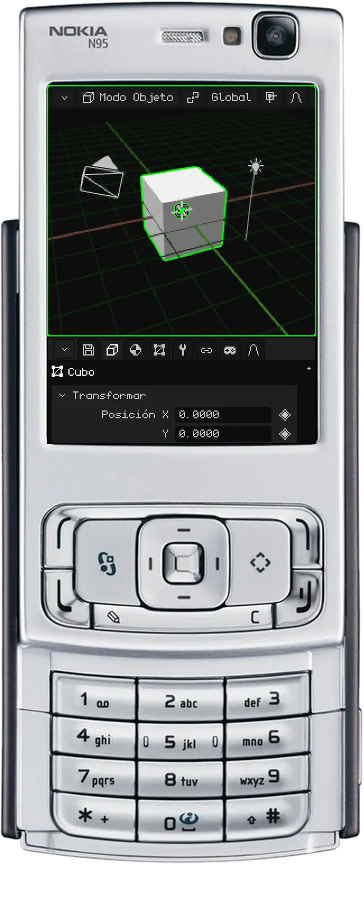

### Arrastrar un número

 Mantené apretado el click sobre el número y mové el mouse de costado: para la derecha el valor sube y para la izquierda baja. Si el puntero llega al borde del viewport, aparece del otro lado y podés seguir arrastrando. Al soltar, el valor queda.

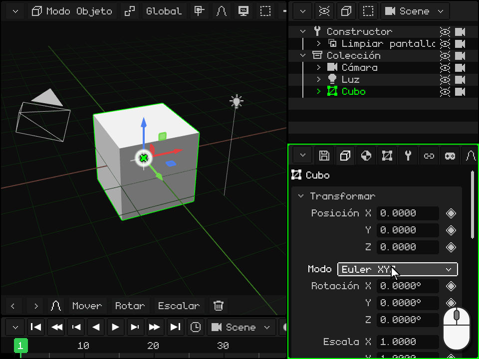

 Apoyá el dedo sobre el número (no sobre su nombre) y arrastralo de costado. Si lo arrastrás para arriba o para abajo, en vez de cambiar el valor se desplaza el panel.

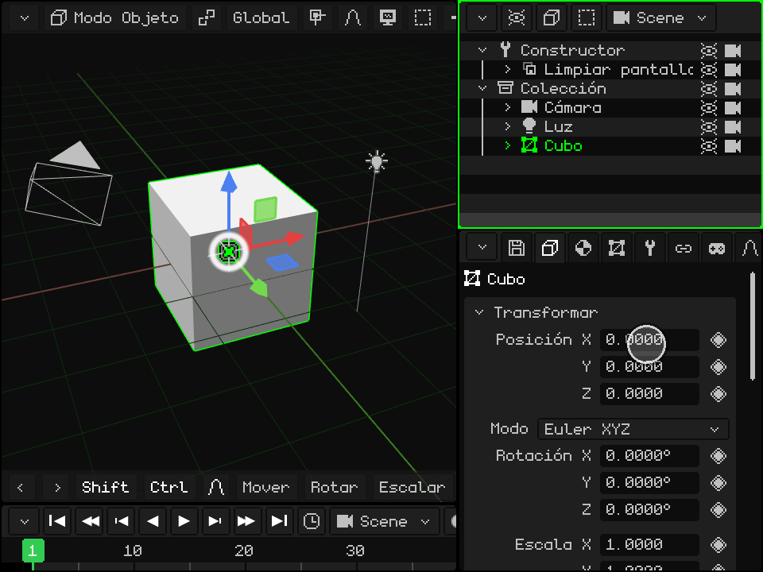

## Los desplegables

Un **desplegable** es un botón que muestra la opción elegida, como el **Tipo** de una luz (Puntual, Sol o Foco) o el **Modo** de la rotación. Al activarlo se abre la lista de opciones, con la actual en verde; al elegir otra, la lista se cierra.

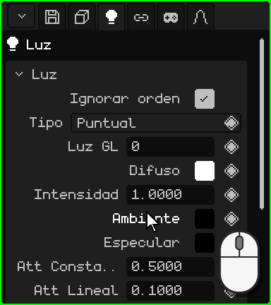

| | Cómo se abre y se elige |
|---|---|
|  PC | Un click en el botón y otro en la opción. |
|  Pantalla táctil | Un toque en el botón y otro en la opción. |
|  Nokia N95 | <kbd>OK</kbd> lo abre, **arriba** y **abajo** recorren las opciones y <kbd>OK</kbd> elige. <kbd>C</kbd> lo cierra sin cambiar nada. |

## Las casillas

Una **casilla** se prende o se apaga: tildada es sí y vacía es no. Va a la derecha de la fila, como **Iluminación** en el material: apagada, el objeto no recibe las luces y se ve de su color, plano. Un click o un toque en la fila (en la casilla o en su nombre) la cambia, y en el Nokia, <kbd>OK</kbd>.

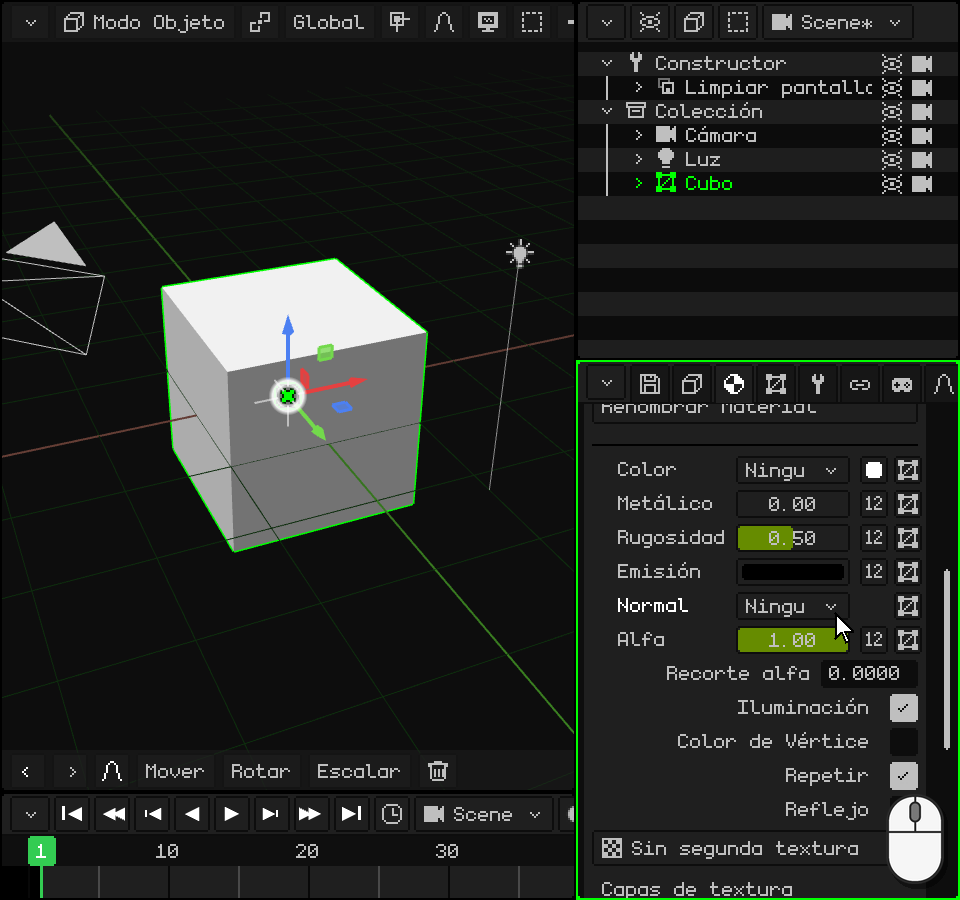

## Los textos

Un **campo de texto** guarda un nombre o una ruta, como el **Nombre** del objeto, al final de la tarjeta Transformar. Al activarlo aparece el cursor al final del texto. El nombre nuevo se ve también en el Outliner.

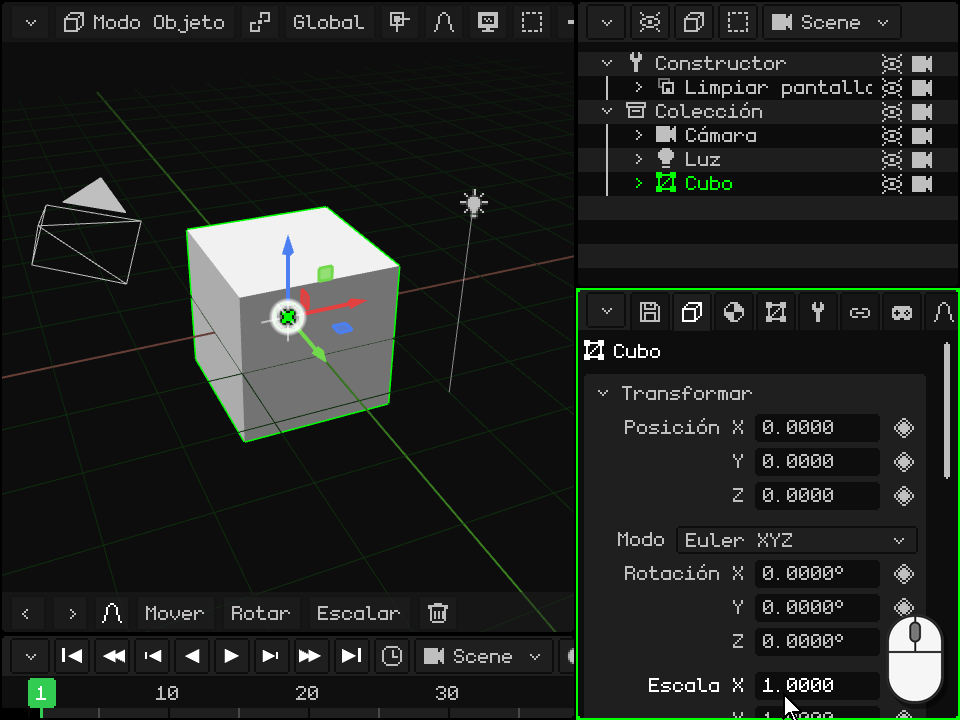

-  **En la PC:** un click en el campo y tipeá. <kbd>Enter</kbd> (o un click en otro lado) lo confirma y <kbd>Esc</kbd> vuelve al texto de antes.
-  **En una pantalla táctil:** un toque abre el teclado de Whisk3D, con la ñ. **Aa** pasa a mayúsculas, **123** a los números y símbolos, **DEL** borra y **OK** confirma. En la versión web se abre el teclado del teléfono.
-  **En el Nokia N95:** <kbd>OK</kbd> y se escribe con el teclado del teléfono, como un mensaje de texto: cada tecla da sus letras apretándola varias veces. <kbd>#</kbd> cambia entre Abc, abc y ABC, y mantenida pasa a 123 (la barra de Propiedades muestra el modo). El <kbd>0</kbd> es el espacio, el <kbd>1</kbd> los signos de puntuación y la <kbd>\*</kbd> abre más símbolos. <kbd>C</kbd> borra, **izquierda** y **derecha** mueven el cursor, <kbd>OK</kbd> confirma y la **soft izquierda** cancela.

## Los colores

Una fila de **color** muestra un cuadradito con el color, a la derecha, como **Difuso**, **Ambiente** y **Especular** en la tarjeta de una luz. Al activarla se abre el **selector de color**:

- el **círculo** elige el matiz y la saturación, y la barra de al lado, el valor (qué tan claro es);
- las pestañas **RGB**, **HSV** y **Hex** muestran el color en números: Rojo, Verde y Azul; Matiz, Saturación y Valor; o el código hexadecimal (`#FF8800`), con Copiar y Pegar;
- **Alfa** es la transparencia;
- **OK** deja el color y **Cancelar** vuelve al de antes.

El color cambia mientras lo movés, así que se ve en la escena antes de confirmarlo. Un click o un toque afuera del selector también lo cierra y deja el color.

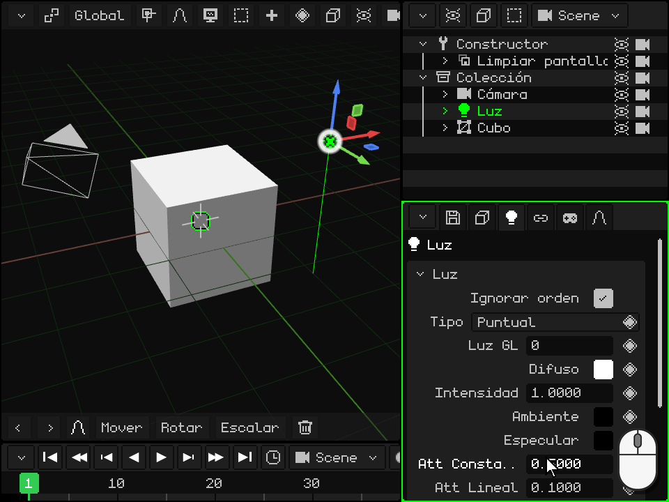

  Con el mouse o con el dedo, se arrastra adentro del círculo y de la barra, y los números se arrastran de costado, como en Propiedades.

 En el Nokia N95, **arriba** y **abajo** pasan por el círculo, la barra, las pestañas, las filas de números y OK / Cancelar. En una fila de números, **izquierda** y **derecha** la cambian (mantenidas, cada vez más rápido). Sobre el círculo, <kbd>OK</kbd> entra a editarlo: **izquierda** y **derecha** giran el matiz, **arriba** y **abajo** cambian la saturación, y <kbd>OK</kbd> sale. La barra se edita igual, con arriba y abajo. <kbd>C</kbd> cierra el selector y vuelve al color de antes.

## Las listas

Algunas tarjetas tienen una **lista**: los modificadores de una malla, sus partes, sus mapas UV. El elegido se marca, y lo que está debajo muestra sus datos o actúa sobre él. Debajo de la lista hay filas de **botones**.

**Subir** y **Bajar** cambian el lugar del elegido. El orden importa: los modificadores se aplican de arriba para abajo, y las partes de una malla se dibujan en ese orden. Estos dos botones aparecen cuando la lista tiene dos o más.

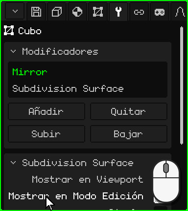

| | Cómo se usa la lista |
|---|---|
|  PC | Un click elige. Si no entran todos, girá la rueda encima de la lista. |
|  Pantalla táctil | Un toque elige. Si no entran todos, arrastrá el dedo para arriba o para abajo sobre la lista. |
|  Nokia N95 | <kbd>OK</kbd> sobre la lista, **arriba** y **abajo** eligen y <kbd>OK</kbd> sale. En una fila de botones, **izquierda** y **derecha** pasan de un botón a otro (el borde marca cuál) y <kbd>OK</kbd> lo aprieta. |

## El rombo: animar una propiedad

A la derecha de las propiedades que se pueden animar hay un **rombo**; las que no lo tienen, no se animan. Un click o un toque en el rombo pone un **keyframe**: guarda el valor de esa propiedad en el frame actual de la Línea de tiempo. Con keyframes en distintos frames, la propiedad cambia sola al reproducir la animación.

El color del rombo dice cómo está la propiedad **en el frame actual**:

| Rombo | Qué quiere decir | Qué hace un click |
|---|---|---|
| Gris | La propiedad no está animada. | Pone el primer keyframe, con el valor de ahora. |
| Verde tenue | Está animada, pero no tiene keyframe en este frame. | Pone un keyframe con el valor de ahora. |
| Verde | Tiene un keyframe en este frame. | Lo saca. |

Cambiar un valor no cambia el color del rombo: el valor nuevo no queda en la animación hasta que ponés el keyframe, y si antes cambiás de frame, la propiedad vuelve a lo que dice la animación. En un frame que ya tiene keyframe (rombo verde), un valor nuevo se guarda con dos clicks: el primero saca el keyframe y el segundo lo vuelve a poner con el valor de ahora.

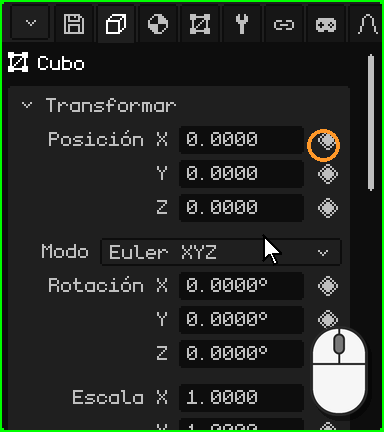

 En el Nokia N95, parado en la fila, la flecha **derecha** pasa al rombo (lo marca un borde blanco), <kbd>OK</kbd> pone o saca el keyframe e **izquierda** vuelve al valor.

En la pestaña Animación, la tarjeta **Cámara activa** elige qué cámara manda en cada momento de la animación: los cortes de una escena. Su rombo tiene un color más, un **verde más claro**: la cámara elegida no es la que dice la animación en este frame, un cambio que todavía no se guardó. Un click guarda el corte en el frame actual.

La animación tiene su propio tutorial más adelante.

Todas las pestañas y sus tarjetas están en el manual: [Propiedades](propiedades.md). Volver a [Los viewports](viewports.md).

## Qué tiene cada pestaña

| Pestaña | Qué tiene |
|---|---|
| Archivo / Render (diskette) | **Archivo**: abrir, guardar, guardar como, guardar versión, extraer assets. **Render**: ruta, tamaño, pases extra, fondo, **Trazado de rayos** (rayos, muestras, pases), Renderizar imagen y Renderizar animación. **Juego**: plataforma (Windows, Symbian, Linux .deb, AppImage, WebGL, Android, Android 2.3), ventana, orientación, icono, física, sonido, volumen, **resolución** (el porcentaje de la pantalla al que dibuja el juego: en Android 2.3 el sistema lo estira, y en esos teléfonos dibujar menos píxeles da más cuadros) y Compilar juego (con un teléfono conectado por adb lo instala y lo abre). **Exportar**: OBJ, glTF, GLB, STL (solo los triángulos, para imprimir en 3D o pasar a un programa de CAD). **Ajustes**: idioma, antialiasing, gráficos, skin, logs, escala, **Atajos de teclado…** y Guardar cambios. |
| Objeto | Posición, rotación (Euler, cuaternión o eje-ángulo), escala, nombre, visible, renderizar; animaciones y paleta del objeto. |
| Contextual | Depende del tipo: partes de malla y **material** (textura, iluminación, color de vértice, transparencia, reflejos, normal map, mezcla, profundidad, capas de textura, **Avanzado: shader personalizado** — ver [Shaders escritos](../editor/shaders.md); Rugosidad, Metálico, Transmisión e IOR con trazado de rayos), luz, cámara, niebla, partículas, física, hitbox, esqueleto y huesos, elementos 2D, prefabs, rutinas. |
| Malla 3D | La malla usada (y cuántos la comparten), mapas UV, capas de color, grupos de vértices, grupos UV. Con un recurso elegido en la Biblioteca: sus datos y su ubicación (dentro o fuera del .w3d). |
| Modificadores | Ver [Modificadores](../editor/objeto-malla.md#la-pestaña-modificadores). |
| Transformar | Solo en Modo Edición: centro de la selección y de sus UV, editables. |
| Esqueleto 2D | Esqueletos y huesos 2D de la malla. |
| Restricciones | Copiar posición, Copiar rotación, Billboard (mirar a la cámara), Child Of. |
| Scripts | Los scripts Lua del objeto y sus propiedades (ver el [documento de Lua](../lua/README.md)). |
| Animación | La animación activa, capas de mezcla (Mix), valores exactos del keyframe elegido y cortes de cámara. |

## Rutinas

Una rutina es una lista de pasos de dibujo (trasladar, rotar, fijar textura, dibujar una malla, llamar a otra rutina, Llamar Lua…) que se arma en Propiedades. Es la forma más rápida de dibujar en el N95.

| Función | Descripción | Atajo |
|---|---|---|
| Añadir / Quitar paso | Agrega pasos agrupados por tema, o quita el elegido. | Botones; <kbd>X</kbd> o <kbd>Supr</kbd> quita |
| Agarrar paso | Reordena el paso con las flechas; <kbd>Enter</kbd> confirma. | <kbd>G</kbd> |
| Insertar keyframe | Anima los valores del paso en el frame actual. | <kbd>I</kbd> |
| Repetir | Cuántas veces corre la lista seguida (bucle de rutina). 1 = rutina normal. | Campo Repetir |
| Modo de render / Usa | Una lista distinta por modo de sombreado, o la misma para todos. | Desplegables |
