# Cambiar el origen: una puerta

En este tutorial vas a hacer que una puerta se abra desde la bisagra. Para eso hay que cambiar su **origen**: el punto desde donde gira el objeto (ver [El origen](modo-objeto.md#el-origen) en el tutorial del Modo Objeto).

Partimos de la puerta del tutorial anterior, [Modelar una puerta](modelar-puerta.md), con el origen en el centro. Si la hiciste corriendo un costado, el origen quedó corrido: **Objeto → Definir Origen → Origen a Geometría** lo vuelve al centro.

## La puerta gira mal

Probá girarla. La puerta gira sobre su centro, como una puerta giratoria, y no desde la bisagra:

 Con el gizmo: un click en su centro lo pasa a **Rotar**, y el anillo azul la gira sobre el eje vertical.

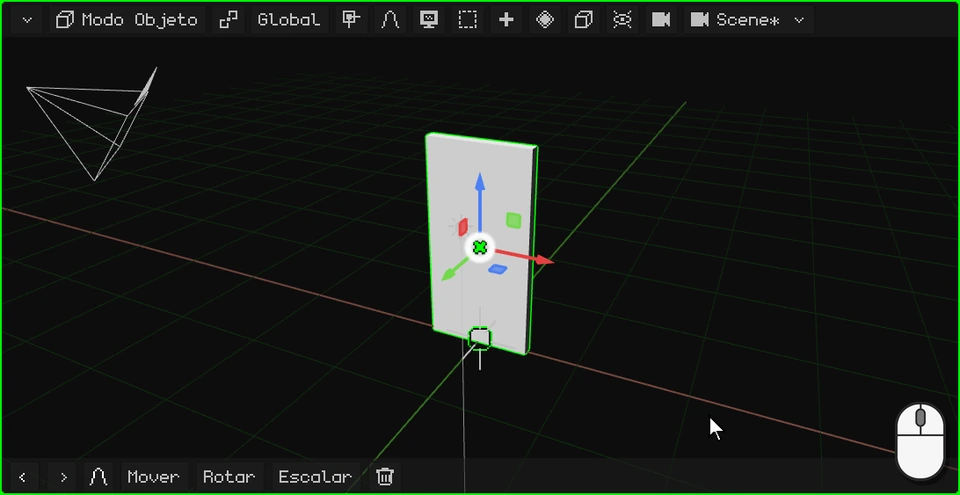

 Con el dedo: un toque en el centro del gizmo lo pasa a **Rotar**, y el anillo azul se arrastra.

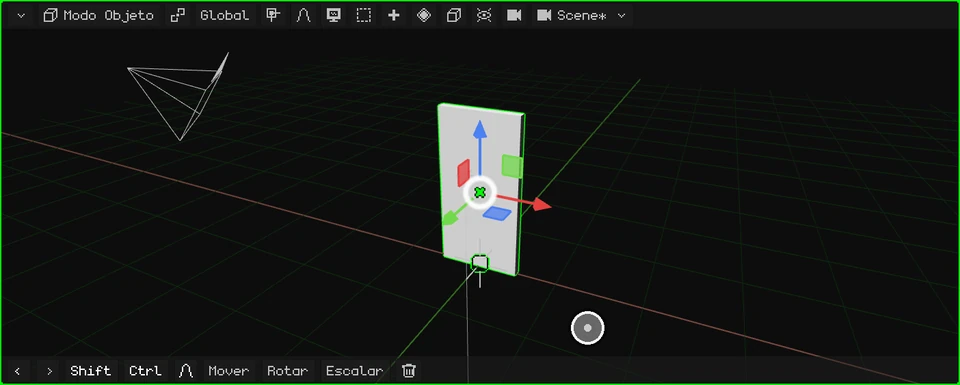

 En el Nokia N95 el gizmo viene apagado: <kbd>2</kbd> (rotar), <kbd>3</kbd> (el eje Z, el vertical) y las flechas; <kbd>OK</kbd> confirma.

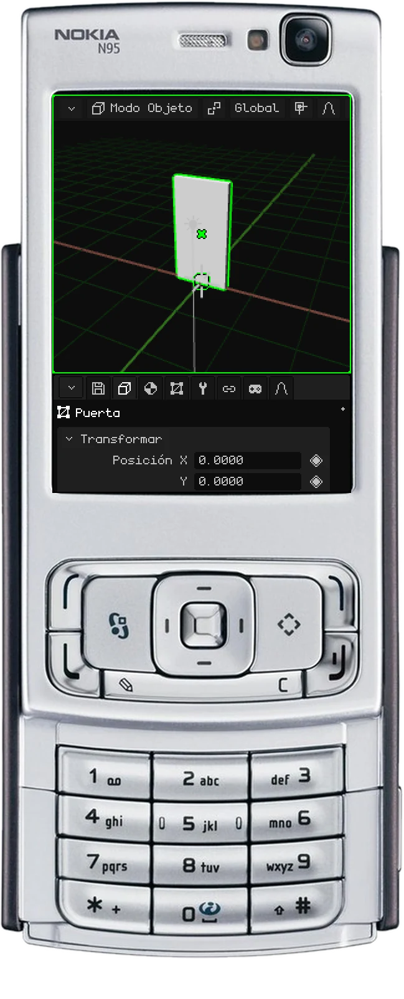

Gira mal porque su origen está en el centro. Vamos a llevarlo a la bisagra.

## Llevar el origen a la bisagra

1. **Entrá al Modo Edición.** Un click en el botón del modo y otro en **Modo Edición** (en la PC, también con <kbd>Tab</kbd>).

   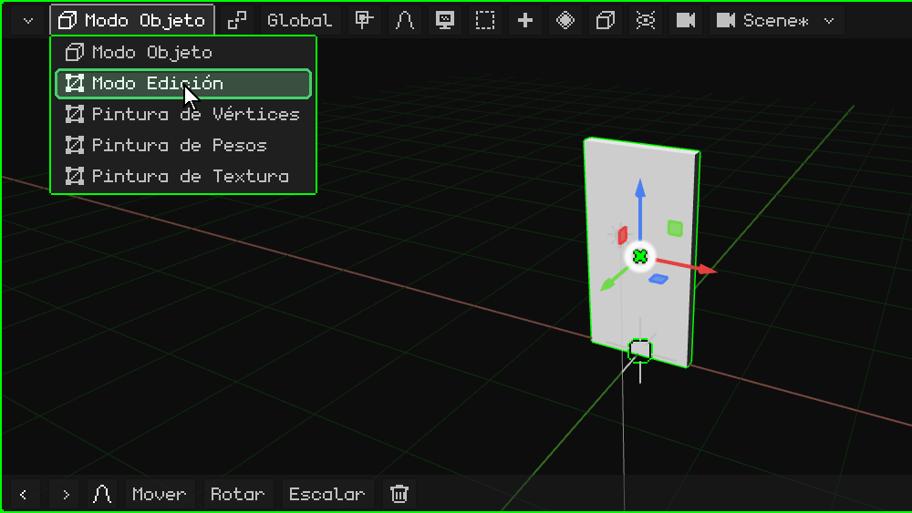

2. **Elegí las caras.** En el Modo Edición aparece el botón **Vértice / Arista / Cara**: un click y elegí **Cara**.

   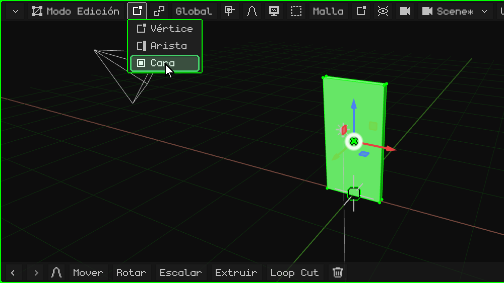

3. **Elegí la cara de la bisagra.** Un click en la cara angosta del costado de la puerta, del lado donde va la bisagra: se pone verde.

   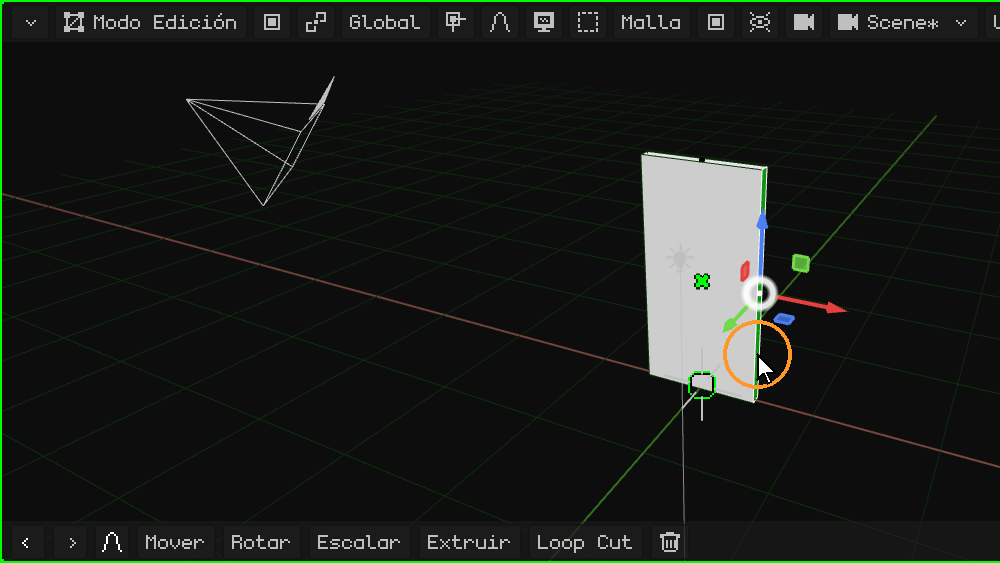

4. **Llevá el cursor 3D ahí.** En el menú **Malla**, **Imán** → **Cursor a lo seleccionado**: el cursor 3D queda sobre la bisagra.

   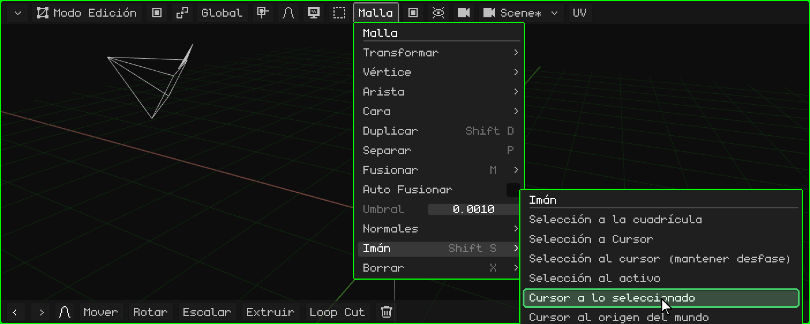

5. **Volvé al Modo Objeto.** Un click en el botón del modo y otro en **Modo Objeto** (o <kbd>Tab</kbd>).

   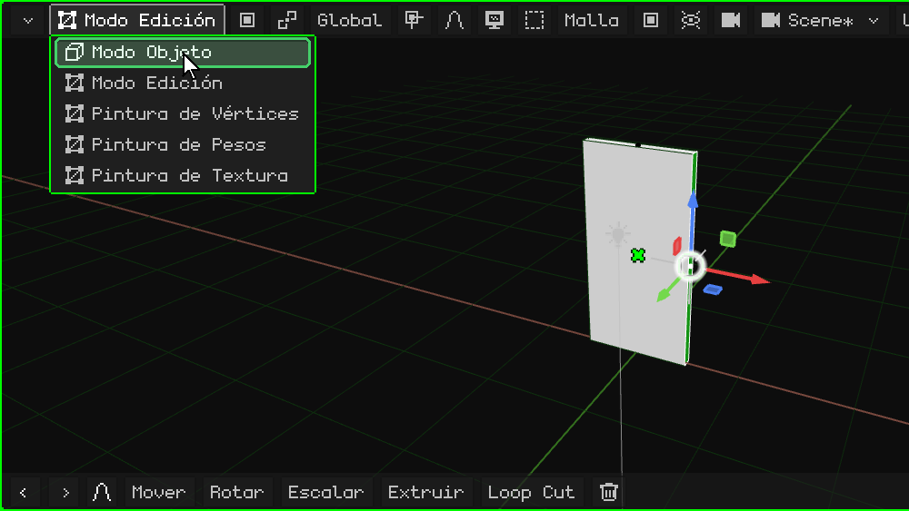

6. **Llevá el origen al cursor 3D.** En el menú **Objeto**, **Definir Origen** → **Origen al Cursor 3D**. La puerta no se mueve: el que se mueve es su origen, y con él el gizmo, que queda en la bisagra.

   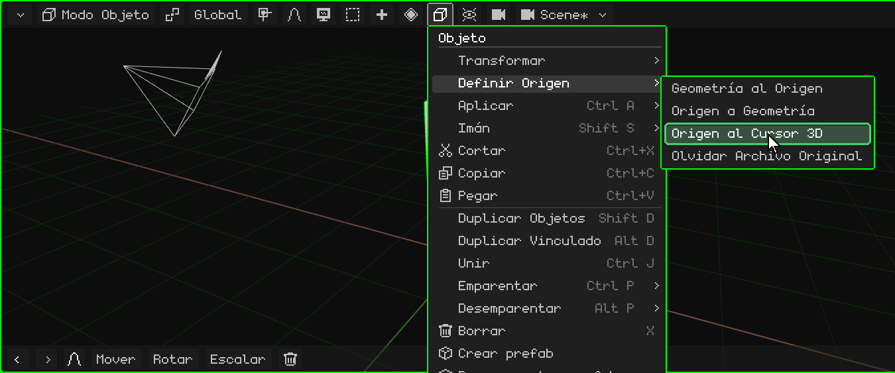

## Ahora gira bien

Girala otra vez con el gizmo: ahora se abre y se cierra desde la bisagra.

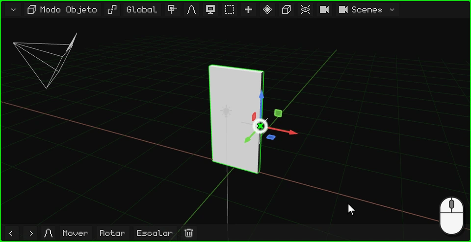

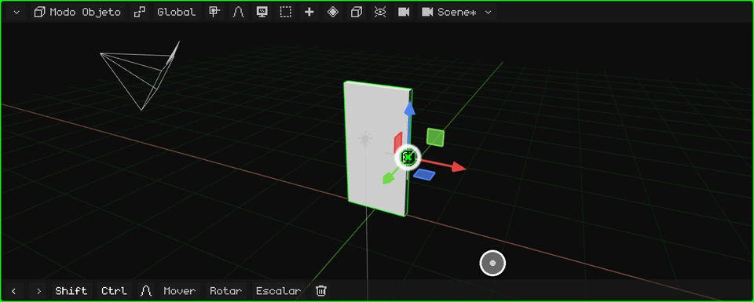

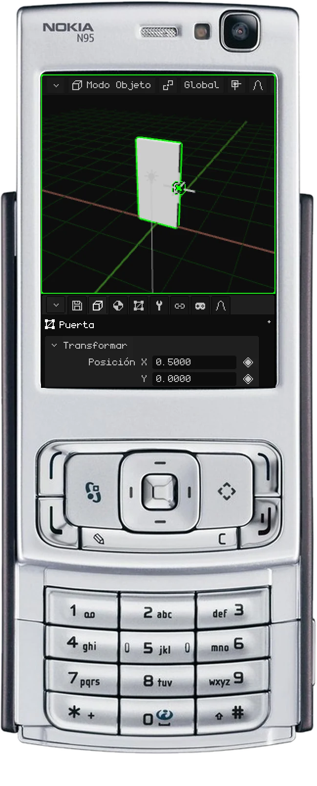

 En una pantalla táctil, los pasos de arriba son iguales, con toques: los menús se abren y se eligen con un toque.

 En el Nokia N95, <kbd>OK</kbd> pasa del Modo Objeto al Modo Edición y los menús se abren con la soft izquierda.

## Las opciones de Definir Origen

| Opción | Qué hace |
|---|---|
| **Origen a Geometría** | Lleva el origen al centro de la malla. |
| **Origen al Cursor 3D** | Lleva el origen a donde está el cursor 3D. |
| **Geometría al Origen** | Al revés: deja el origen y mueve la malla hasta que su centro quede en él. |

En el próximo tutorial le hacemos el picaporte: [Modelar el picaporte](modelar-picaporte.md).
