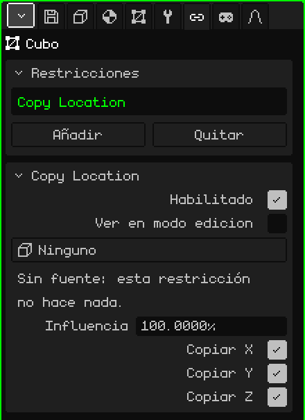
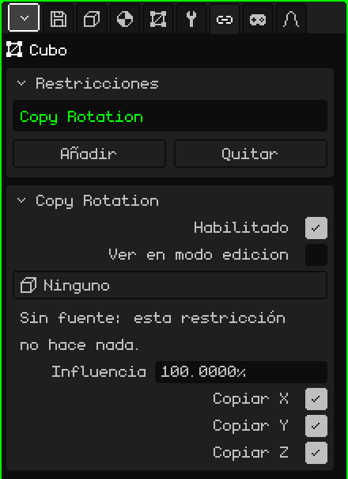
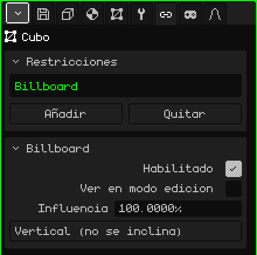
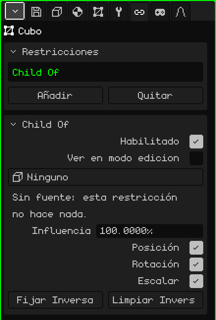

# Restricciones

Una **restricción** (en inglés, *constraint*) hace que un objeto tome algo de otro: su posición, su rotación, que mire siempre a la cámara o que lo siga como si fuera su hijo. Sirve para que las cosas se acomoden solas, sin animarlas a mano: una sombra que va debajo del personaje, un árbol plano que siempre da la cara, una espada pegada a la mano. Este artículo explica cada una y todos sus parámetros; cómo se agregan y se mueven los objetos está en el tutorial [El Modo Objeto](modo-objeto.md).

## Dónde están

En Propiedades → pestaña **Restricciones**. La tiene cualquier objeto 3D: mallas, cámaras, luces, esqueletos, sonidos, vacíos. Los elementos 2D de una interfaz no la tienen.

Antes de ver cada una, tres cosas que valen para todas:

- **No cambian los números del objeto.** La restricción se aplica encima al dibujar. La tarjeta Transformar de la pestaña Objeto sigue mostrando la posición y la rotación propias del objeto, y si la restricción se apaga o se borra, el objeto vuelve exactamente ahí.
- **Se calculan para cada vista.** Las que dependen de la cámara (Billboard, o una fuente **Vista**) usan la cámara que está dibujando: con dos Vistas 3D abiertas, cada una ve el resultado con su propio punto de vista. En el juego, la cámara activa.
- **Andan igual en todos lados:** en el editor, en el juego compilado, en Android y en el Nokia N95.

## La tarjeta Restricciones

| Propiedad | Qué hace |
|---|---|
| La lista | Las restricciones del objeto. La elegida es la que muestra la tarjeta de abajo. |
| Añadir | El menú con los cuatro tipos: **Copy Location**, **Copy Rotation**, **Billboard** y **Child Of**. |
| Quitar | Borra la restricción elegida. |
| Subir / Bajar | Cambian el orden (aparecen con dos o más). |

El **orden** importa: se aplican de arriba hacia abajo, y cada una trabaja sobre lo que dejaron las de arriba. Si dos tocan lo mismo, gana la de más abajo.

## Lo común a todas

Debajo aparece la tarjeta de la restricción elegida, con su nombre como título. Estas tres filas están en todos los tipos:

| Propiedad | Qué hace |
|---|---|
| Habilitado | Prende o apaga la restricción sin borrarla. Sirve para comparar cómo queda con y sin ella. |
| Ver en modo edicion | Apagado (como viene), mientras se editan los vértices del objeto la restricción no se aplica: la malla se ve y se edita donde está de verdad. Prendido, se aplica también en Modo Edición. |
| Influencia | Cuánto pesa, de 0 a 100 %. Con 100 se aplica entera; con 0 no hace nada; en el medio, el objeto queda entre donde estaría solo y donde lo lleva la restricción (con 50, a mitad de camino). |

**Ver en modo edicion** viene apagado a propósito: editar un árbol que gira persiguiendo a la cámara, o una malla que se escapa a otro lugar, es muy incómodo.

## Copy Location

**Copia la posición** de otro objeto: el objeto se pone exactamente donde está la fuente, en los ejes que se elijan.

| Propiedad | Qué hace |
|---|---|
| Fuente | De dónde copia. **Ninguno**, **Vista** (la cámara que está dibujando) o cualquier objeto de la escena menos el propio y los que cuelgan de él. |
| Copiar X, Copiar Y, Copiar Z | Qué ejes copia. Los ejes son los mismos de la tarjeta Transformar: Z es la altura. Un eje sin tildar queda con el valor propio del objeto. |

Copia la posición tal cual, sin dejar distancia: con los tres ejes, el objeto queda encima de la fuente. Para que quede corrido, se destilda el eje que no tiene que seguir, o se corre la malla en Modo Edición (ver [Child Of](#child-of) para seguir a algo manteniendo la distancia).

Avisos de la tarjeta:

- "Sin fuente: esta restricción no hace nada." Aparece con la fuente en Ninguno, y también si se borra el objeto fuente: el botón pasa a decir Ninguno solo.
- "Sin ejes: esta restricción no hace nada." Aparece con los tres ejes destildados.

**Ejemplos:**

- **Una sombra redonda debajo del personaje:** un plano con una mancha oscura, con Copiar X y Copiar Y tildados y Copiar Z sin tildar. Va debajo del personaje por todo el piso, y cuando salta la sombra se queda en el suelo.
- **Un cielo que nunca se alcanza:** una esfera grande con el cielo pintado y la fuente en **Vista**. El cielo va siempre centrado en la cámara, así que por más que se camine nunca se llega al borde.
- **Una luz que acompaña al personaje:** una luz con el personaje de fuente y solo Copiar X y Copiar Y. Lo sigue desde arriba, a la altura propia de la luz.

## Copy Rotation

**Copia la rotación** de otro objeto: el objeto gira igual que la fuente, sin moverse de su lugar.

| Propiedad | Qué hace |
|---|---|
| Fuente | De dónde copia: **Ninguno**, **Vista** (la cámara que está dibujando) o un objeto de la escena menos el propio y los que cuelgan de él. |
| Copiar X, Copiar Y, Copiar Z | Qué giros copia, con los mismos ejes que la rotación de la tarjeta Transformar. Con los tres, el objeto queda con la misma orientación exacta de la fuente; con uno o dos, copia solo esos ángulos y los demás quedan los propios. |

Tiene los mismos avisos que Copy Location ("Sin fuente…" y "Sin ejes…"). Con una influencia intermedia el giro va siempre por el camino más corto.

**Ejemplos:**

- **Los ventiladores de techo de un bar:** se anima el giro de las aspas de uno solo, y las aspas de los demás copian su rotación. Como todos cuelgan derechos, alcanza con los tres ejes tildados. Para cambiar la velocidad de todos, se cambia la animación de uno.
- **Algo pegado a la pantalla en primera persona** (las manos y el arma de un juego, la cabina de una nave): dos restricciones en el mismo objeto, Copy Location y Copy Rotation, las dos con la fuente en **Vista**. El objeto va donde va la cámara y gira con ella. La malla se corre en Modo Edición para que quede adelante, abajo y a la derecha.

## Billboard

Hace que el objeto **dé la cara a la cámara**: se gira solo para quedar de frente a la pantalla. No tiene fuente: siempre es la cámara que está dibujando.

| Propiedad | Qué hace |
|---|---|
| Modo | **Vertical (no se inclina)**: gira solo de costado, como una persona que se da vuelta, y se queda siempre derecho. **Mirar a la cámara**: además se inclina para mirar a la cámara cuando está arriba o abajo. |

El billboard se alinea con el **plano** de la pantalla, no con el punto donde está la cámara: todos los billboards de la vista quedan paralelos a la pantalla.

Con influencia 100, la rotación la decide el billboard y la de la tarjeta Transformar no cuenta. Si el plano queda de canto, se lo gira en Modo Edición (como Ver en modo edicion viene apagado, ahí se ve sin la restricción).

Aviso de la tarjeta: "Con influencia entre 0 y 100 el billboard puede girar 180 grados al cruzar la cámara. Con 100% no pasa." Es así por cómo se mezcla con una orientación que va girando: si molesta ese giro, se usa 100 %.

**Ejemplos:**

- **Árboles baratos:** un plano con la foto de un árbol (con transparencia) y el modo Vertical (no se inclina). Desde cualquier lado parece un árbol entero, y es un solo plano: ideal para llenar un bosque en el Nokia N95.
- **Humo, chispas, el brillo de una lámpara, un sol de fondo:** un plano con la textura y el modo Mirar a la cámara, para que se vea de frente también desde arriba.
- **Un cartel con el nombre de un personaje o una barra de vida** sobre la cabeza: Mirar a la cámara, y emparentado al personaje para que lo siga.

## Child Of

Hace que el objeto se comporte como **hijo** de otro objeto, o de un **hueso** de un esqueleto, aunque en el Outliner cuelgue de otro lado. Lo sigue cuando se mueve, gira o se escala, como si estuviera pegado.

| Propiedad | Qué hace |
|---|---|
| Fuente | El objeto que hace de padre: **Ninguno** o un objeto de la escena menos el propio y los que cuelgan de él. Acá no está la opción Vista. |
| Hueso | Solo si la fuente es un esqueleto: el hueso del que cuelga. **Ninguno** sigue al esqueleto entero. |
| Posición | Si sigue los movimientos de la fuente. |
| Rotación | Si gira cuando la fuente gira. |
| Escalar | Si se agranda o se achica con la fuente. |
| Fijar Inversa | Deja el objeto donde estaba antes de la restricción y, desde ese momento, lo hace seguir a la fuente. |
| Limpiar Inversa | Vuelve a medir la posición del objeto desde la fuente: con Posición 0, 0, 0 queda justo en la fuente (o en la base del hueso). |

Si la fuente se borra aparece el aviso "Sin fuente: esta restricción no hace nada.", igual que en las otras.

### Fijar o limpiar la inversa

Al elegir la fuente, el objeto salta: su posición pasa a medirse desde la fuente. Hay dos maneras de trabajar:

- **Ubicarlo primero y fijar:** poné el objeto donde tiene que ir (la espada en la mano, por ejemplo), elegí la fuente y el hueso, y tocá **Fijar Inversa**: vuelve a donde lo pusiste y desde ahí sigue a la fuente.
- **Limpiar y escribir:** con **Limpiar Inversa**, la tarjeta Transformar del objeto pasa a ser la distancia a la fuente. Sirve cuando se sabe el número exacto: Posición 0, 0, 0 lo pone justo en el hueso.

La restricción viene con la inversa limpia, por eso el salto al elegir la fuente.

### La influencia en Child Of

Con 0 manda el padre real del objeto (el del Outliner) y con 100 manda la fuente. Por eso una espada puede ser hija del personaje en el Outliner (así se mueve con él cuando se lo lleva a otro lado) y tener además Child Of a la mano: la sigue sin moverse dos veces.

**Ejemplos:**

- **Un arma en la mano de Leon:** Child Of con el esqueleto de Leon de fuente y el hueso de la mano derecha en Hueso; se acomoda el arma en la mano y se toca Fijar Inversa. Para un objeto rígido es mucho más liviano que deformar una malla con el esqueleto, y en el Nokia N95 se nota.
- **Un sombrero o unos anteojos:** igual, con el hueso de la cabeza.
- **Una cámara que acompaña sin girar:** solo Posición tildada. La cámara va con el personaje a la misma distancia, pero no da vueltas cuando él se da vuelta.
- **Un objeto sobre una plataforma que se mueve:** Child Of a la plataforma, con Posición y Rotación, para que viaje con ella sin cambiarlo de lugar en el Outliner.

## Cuándo usar cada una

| Para que el objeto… | Restricción |
|---|---|
| vaya a donde está otro objeto, o la cámara | Copy Location |
| gire igual que otro objeto, o que la cámara | Copy Rotation |
| dé siempre la cara a la cámara | Billboard |
| siga a otro objeto o a un hueso, manteniendo la distancia | Child Of |

Si dos objetos se copian entre sí (A copia de B y B copia de A), Whisk3D corta el círculo para que no se cuelgue y lo avisa en la [Consola](../editor/consola.md): uno de los dos se queda con su propia posición. La solución es sacar una de las dos restricciones.
