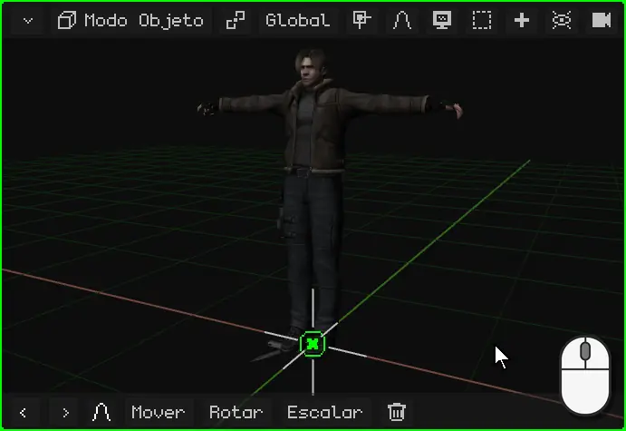
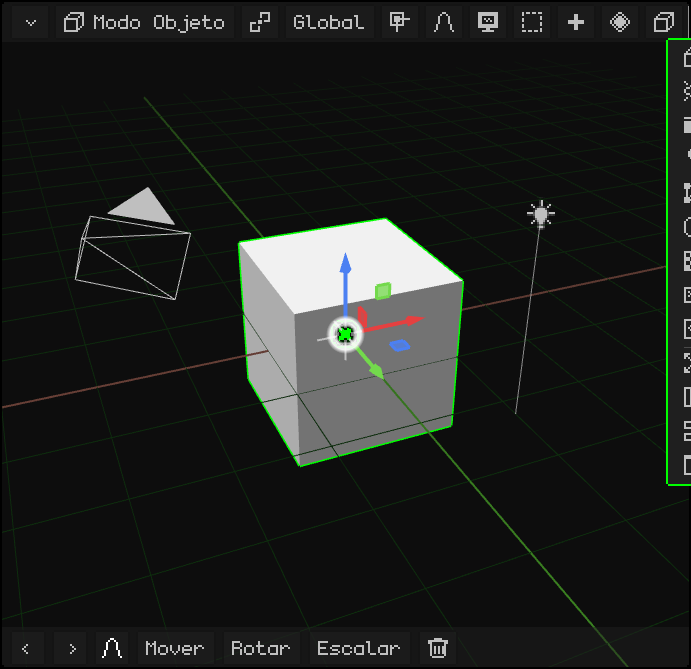

# La Vista 3D

La **Vista 3D** es el viewport donde se ve y se edita la escena: ahí se modela, se mueven los objetos, se pinta, se posa y se anima. Como todos los viewports (ver [Los viewports](viewports.md)), tiene arriba su barra de menús, y además tiene otra barra abajo.

Este tutorial es un mapa para ubicarse: qué hay en cada lugar. Lo que se nombra acá tiene después su propio tutorial.

## La barra de arriba

Los botones cambian según el modo y según lo que esté elegido. Con el cubo elegido, en el Modo Objeto, son estos, de izquierda a derecha:

| Botón | Para qué sirve |  En la PC |
|---|---|---|
| La esquina | Cambia el tipo de viewport, lo divide o lo maximiza ([Las opciones del viewport](viewports.md#las-opciones-del-viewport)). | — |
| **Modo Objeto** | El modo: Modo Objeto, Modo Edición y los de pintura; con un esqueleto, el Modo Pose. Solo aparece si el objeto activo es una malla o un esqueleto. | <kbd>Tab</kbd>: Objeto ↔ Edición |
| El pivote | El [punto de pivote](modo-objeto.md#el-punto-de-pivote): desde dónde se rota y se escala. Su ícono cambia según el elegido. | — |
| **Global** | La [orientación](modo-objeto.md#global-y-local) de los ejes: Global, Local, Normal o Vista. | — |
| El imán | El **Imán**: lo que movés se pega a vértices, aristas o caras. Se pone verde cuando está prendido. | <kbd>Shift</kbd> + <kbd>Tab</kbd> lo prende |
| La curva | La **Edición Proporcional**: al mover algo, lo que está cerca lo acompaña. Verde = prendida. | <kbd>O</kbd> la prende |
| **Vista** (el monitor) | Cámaras, Punto de Vista, Encuadrar Selección, Vista local, Perspectiva/Orto, Bloquear Órbita: lo de [navegar](navegacion.md). | — |
| **Seleccionar** | Todo, Ninguno, Invertir, Selección por caja. | <kbd>A</kbd>: todo |
| **Añadir** (+) | Objetos nuevos, que aparecen en el cursor 3D ([Los tipos de objetos](modo-objeto.md#los-tipos-de-objetos)). | <kbd>Shift</kbd> + <kbd>A</kbd> |
| **Animación** (el rombo) | Insertar, borrar y limpiar keyframes, y el Rastro de Movimiento. | <kbd>I</kbd>: un keyframe |
| **Objeto** (el cubo) | Lo que se le hace a lo elegido: Transformar, Definir Origen, Aplicar, Imán, Duplicar, Emparentar, Borrar... | Click derecho en la vista |
| **Superposiciones** (el ojo) | Las ayudas que se dibujan encima de la escena (ver abajo). | <kbd>K</kbd> las prende y apaga |
| **Render** (la cámara) | El modo de sombreado (ver abajo). | <kbd>Z</kbd>: el siguiente |
| La escena | Su nombre: qué escena, juego o prefab del proyecto se edita. | — |

**Animación** y **Objeto** aparecen solo con algo elegido. En el **Modo Edición** la barra cambia: aparecen **Vértice / Arista / Cara**, **Malla** y **UV**, se va **Añadir**, y el cubo pasa a ser el menú de lo que elegiste. En los modos de pintura se esconden los botones que no sirven para pintar. Si la barra no entra entera, se desplaza: [Cuando la barra no entra](viewports.md#cuando-la-barra-no-entra).

 En el N95, la **soft izquierda** entra a la barra y las flechas la recorren. Con una malla elegida, <kbd>OK</kbd> pasa del Modo Objeto al Modo Edición y vuelve.

## La barra de abajo

  Abajo están Deshacer y Rehacer (las flechas) y **los últimos comandos que usaste**, como se ve en [El Modo Objeto](modo-objeto.md#la-barra-de-abajo-los-últimos-comandos). Mientras movés, rotás o escalás, la barra cambia: la tilde verde confirma, la cruz roja cancela, y **X**, **Y** y **Z** dejan el movimiento en esos ejes.

 En una pantalla táctil tiene además **Shift** y **Ctrl**: quedan prendidos (en verde) y hacen de esas teclas, por ejemplo para elegir varios objetos.

 En el N95 esta barra viene apagada: todo se hace con las teclas del teléfono.

## Los modos de sombreado

El **sombreado** es cómo se dibuja la escena en la Vista 3D. No cambia los modelos ni lo que sale en el render: es solo para mirar mientras trabajás.

| Modo | Qué se ve |
|---|---|
| **Vista Material** | El que viene. Los materiales y las texturas, con una luz pareja desde la vista: no hace falta iluminar la escena para ver los modelos. |
| **Vista Sólido** | La misma luz, sin texturas ni materiales: todo gris. Sirve para mirar la forma. |
| **Vista Normal** | Cada cara pintada de un color según para dónde mira. |
| **Vista Alámbrica** | Solo las aristas, como un modelo de alambre. |
| **Vista ZBuffer** | La distancia: lo cercano en blanco y lo lejano en negro. |
| **Vista Alpha** | La transparencia, en blanco y negro. |
| **Vista Render** | Con las luces de la escena. |
| Vectores de movimiento | Cuánto se movió cada píxel desde el cuadro anterior. |

| | Cómo se cambia |
|---|---|
|  PC | <kbd>Z</kbd> pasa al siguiente, en el orden de la tabla (Vectores de movimiento, solo desde el menú) |
|  Nokia N95 | <kbd>6</kbd> pasa al siguiente, en el mismo orden |
| Menú | El botón **Render** (la cámara) de la barra |

La misma escena, de un modo al siguiente:

## Las superposiciones

Las **superposiciones** son las ayudas que se dibujan encima de la escena para trabajar, y que no salen en el render. Se eligen en el menú **Superposiciones**, el ojo de la barra; cuando están apagadas, el ojo se ve cerrado.

| Opción | Qué dibuja |
|---|---|
| Mostrar Superposiciones | Prende o apaga todas juntas. Apagadas, las de abajo quedan en gris. |
| Piso | La cuadrícula del piso. |
| Eje X / Eje Y | Las líneas roja y verde que cruzan el piso. |
| Orígenes | El punto del origen de cada objeto. |
| Gizmo | Las flechas para mover, rotar y escalar. |
| Objetos | Un submenú para mostrar u ocultar el dibujo de las cámaras, luces, esqueletos, vacíos, partículas, curvas, hitbox y sonidos. |
| Cursor 3D | El círculo con la cruz. |
| Líneas de Relación | La línea que une a cada hijo con su padre. |
| Normales | Para dónde mira cada vértice o cada cara. |
| Estadísticas | FPS, vértices, caras y tiempos, arriba a la derecha. |
| Rayos X | En el Modo Edición, la malla se ve transparente y se pueden elegir los vértices de atrás. |

 En el N95 el Gizmo viene apagado: se mueve con las teclas.

## El gizmo y el cursor 3D

- El **gizmo** son las flechas de colores sobre lo elegido: se agarran para mover, rotar y escalar. Ver [El gizmo](modo-objeto.md#el-gizmo).
- El **cursor 3D** es el círculo con una cruz: ahí aparece lo que se agrega con Añadir. Ver [El cursor 3D](modo-objeto.md#el-cursor-3d).

## Navegar

Para moverte por la escena (orbitar, desplazarte, hacer zoom, mirar de frente o por la cámara) está el tutorial [Navegar en la Vista 3D](navegacion.md). Todo eso está también en el menú **Vista**.

Cada menú, opción por opción, está en el manual: [Vista 3D](../editor/vista-3d.md).

Siguiente: [El Outliner](outliner.md).
