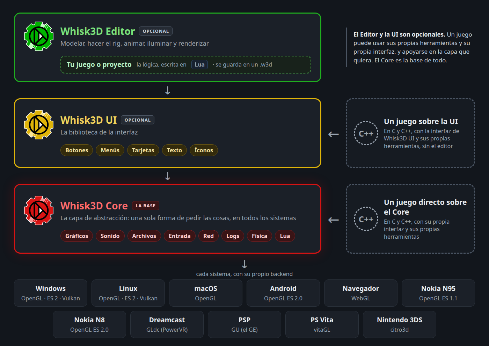

# Qué es Whisk3D UI

**Whisk3D UI** es una biblioteca de C++ para armar interfaces: botones, pestañas, menús desplegables, tarjetas de propiedades, texto e íconos. Tiene su propio repositorio, [Whisk3D-UI](https://github.com/Dante-Leoncini/Whisk3D-UI), con licencia MIT. Está construida sobre [Whisk3D Core](../core/README.md), y el editor de Whisk3D está hecho con ella.

## Dónde corre

En los mismos sistemas que el Core: **Windows**, **Linux**, **macOS**, **Android**, el **navegador**, los **Nokia N95** y **N8**, la **Sega Dreamcast**, la **Sony PSP**, la **PS Vita** y la **Nintendo 3DS**. El editor la compila en todos.

La UI no tiene código propio por sistema. No llama a OpenGL: todo lo dibuja con las funciones de `w3dEngine` ([Gráficos](../core/graficos.md)) y el backend de cada sistema hace el resto. Lo poco que cambia es de compilación:

- Los headers incluyen `GL/gl.h`, o `GLES/gl.h` en Symbian, por los tipos (`GLfloat`, `GLshort`, `GLubyte`).
- En Android, `loadColorsW3d` actualiza la tabla de colores en bytes pero no la de `float`.
- El código es C++03, porque el compilador de Symbian no conoce C++11: los enums van adentro de un `struct` (`IconType::camera`) y se usa `W3D_OVERRIDE` en vez de `override`.

## Por qué atlas y no vectores

Casi todas las bibliotecas de interfaz dibujan con vectores. Muchos equipos viejos no aceleran eso: la interfaz se dibuja por software y anda lenta. Lo que sí aceleran equipos como el N95 es lo 3D: triángulos con textura.

Por eso Whisk3D UI dibuja todo con triángulos que leen de una textura, un **atlas**. Las letras, los bordes redondeados de las tarjetas y los íconos están en la misma textura: un solo `BindTexture` alcanza para toda la interfaz. Un texto se dibuja con una llamada por atlas, no con una por letra.

El precio: las letras son de píxeles y crecen de a múltiplos enteros ([Colores y escala](tema.md)), y solo hay las letras que están dibujadas en el atlas ([Texto](texto.md)).

## Qué hay adentro

| Carpeta | Qué resuelve |
|---|---|
| `core/` | Las medidas de la interfaz y su escala (`UI.h`): [Colores y escala](tema.md) |
| `theme/` | La paleta de colores (`colores.h`): [Colores y escala](tema.md) |
| `draw/` | El dibujo 2D (`glesdraw`), los rectángulos, los íconos y el empaquetador de atlas: [Dibujo y atlas](dibujo.md), [Íconos](iconos.md) |
| `text/` | La fuente bitmap, el atlas extendido y el texto con fuentes TTF horneadas: [Texto](texto.md) |
| `widgets/` | Las tarjetas con borde, los botones, las pestañas, los menús y las cajas de texto: [Botones, pestañas y casillas](botones.md), [Menús desplegables](menus.md), [Entrada y cajas de texto](entrada.md) |
| `Propieties/` | Las tarjetas de propiedades y sus filas: [Tarjetas y propiedades](propiedades.md) |
