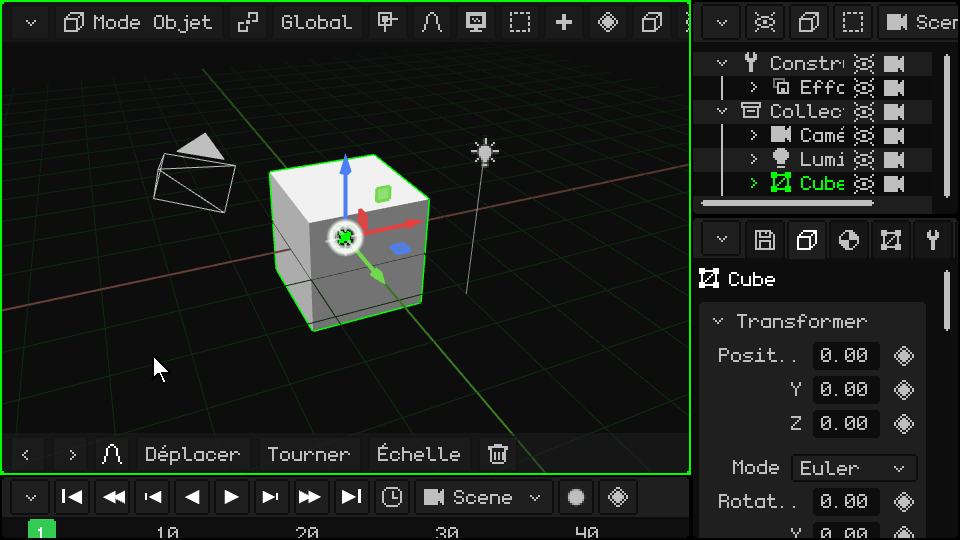
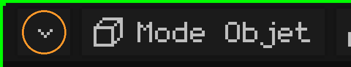
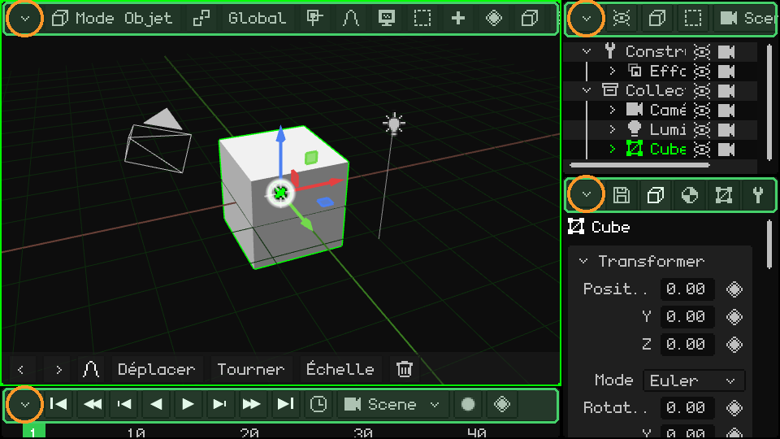
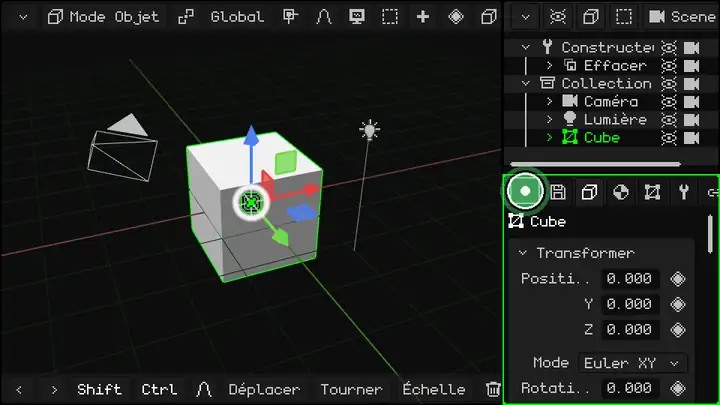
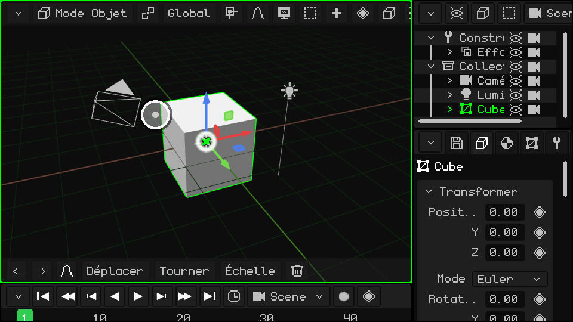
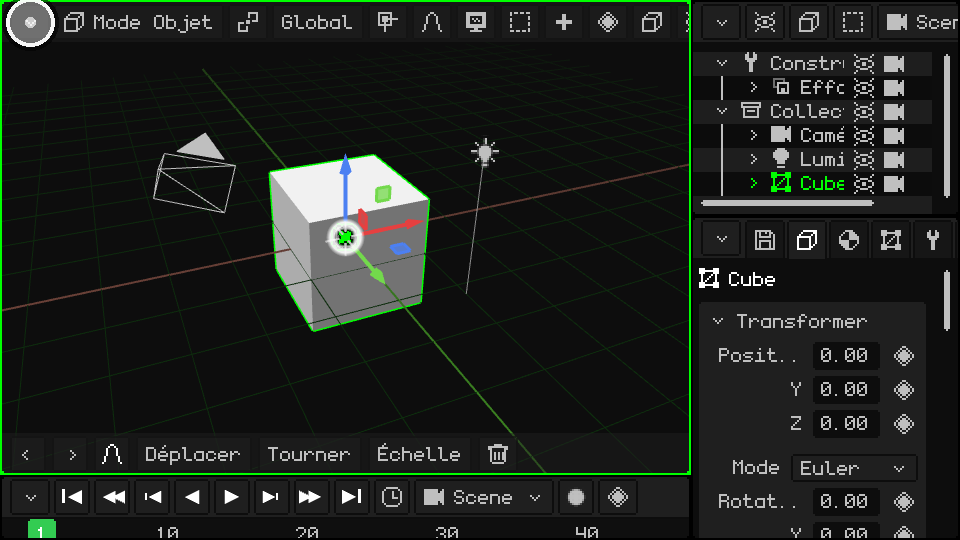
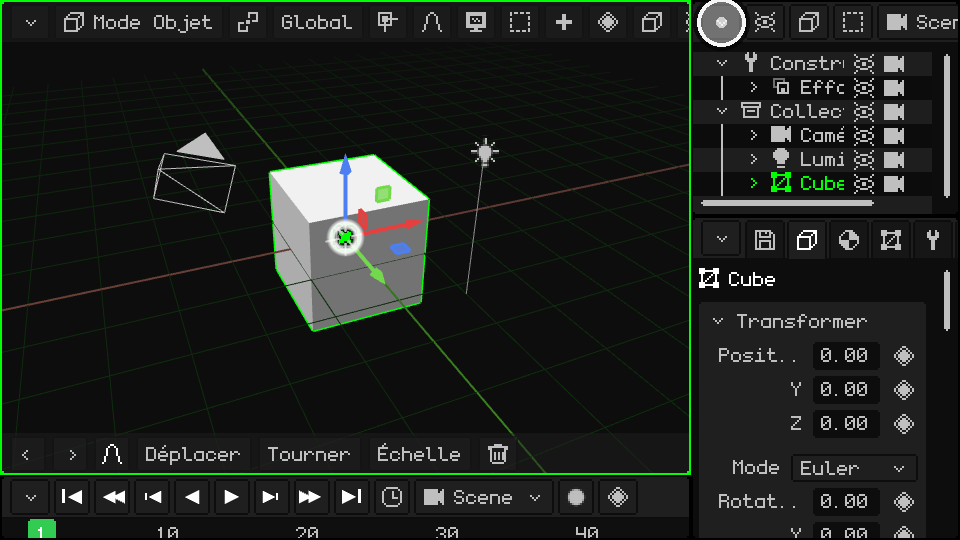
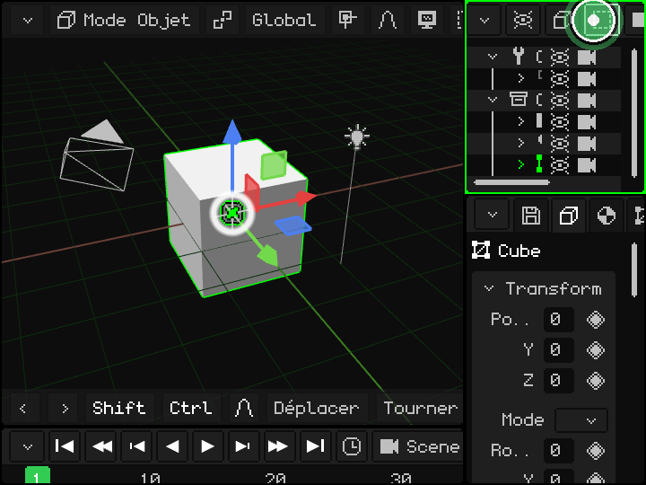
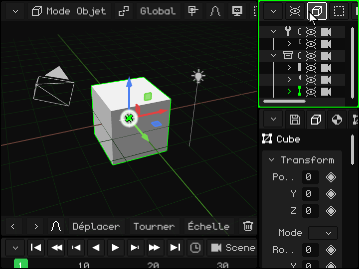
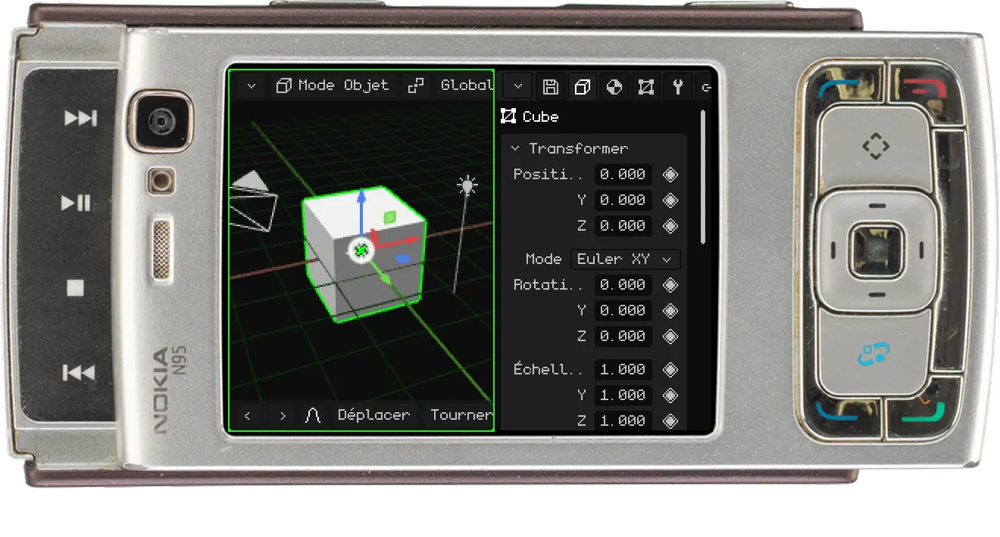

# L'interface

> [!NOTE]
>  Le Nokia N95 prend en charge une souris et un clavier (en Bluetooth). Les parties de cette page consacrées au Nokia expliquent comment l'utiliser sans souris ni clavier, uniquement avec les touches du téléphone.

La fenêtre de Whisk3D est divisée en **viewports** : des panneaux, chacun avec son éditeur (la Vue 3D, l'Outliner, Propriétés...). Vous pouvez les diviser, changer leur taille et choisir ce que chacun affiche. Cela fonctionne de la même façon à la souris, au doigt sur un écran tactile et avec le clavier d'un Nokia.

Voici ce que l'on voit au premier lancement du programme :

## Le viewport actif

Le viewport qui se trouve sous la souris est le **viewport actif** : il est marqué d'une bordure verte. C'est lui qui reçoit les commandes du clavier, les manettes et tout autre périphérique. Quand vous passez la souris d'un viewport à l'autre, la bordure verte la suit :

 **Sur un Nokia N95 :** chaque appui sur la **touche verte** d'appel  passe au viewport suivant. Sur l'écran du N95, il y en a deux : la Vue 3D à gauche et Propriétés à droite.

## La barre de menus et le bouton du coin

Tous les viewports ont en haut une **barre de menus** (en vert sur l'image) avec les menus et les boutons de cet éditeur. En haut à gauche se trouve toujours le **bouton du coin** (en orange) : c'est lui qui change ou modifie le viewport.

Il est identique dans tous les viewports, et c'est le seul bouton qu'ils ont tous.

## Redimensionner

  **Maintenez appuyé** le bouton du coin (avec le doigt ou la souris) et faites-le glisser pour redimensionner : cela déplace la bordure gauche et la bordure du haut de ce viewport, et ses voisins s'ajustent. Un **simple toucher**, sans glisser, ouvre le menu déroulant avec les options du viewport. Ici, on fait glisser en cercles celui d'en bas à droite, et les trois changent de taille :

 **Sur un Nokia :** maintenez enfoncée la **touche verte** d'appel  et appuyez sur une flèche : la bordure du viewport actif (celui qui a le cadre vert) se déplace de ce côté, ce qui l'agrandit ou le réduit. La touche verte seule, sans flèche, passe au viewport suivant.

## Les options du viewport

Un toucher sur le bouton du coin ouvre ce menu :

En haut se trouvent les **types de viewport** : en choisir un transforme le viewport en cet éditeur. Sous la ligne se trouve ce que vous pouvez en faire :

| Option | Ce qu'elle fait |
|---|---|
| Développer | Le viewport prend la place de son voisin, qui se ferme (si le voisin est divisé, tout ce groupe se ferme). |
| Diviser en colonnes | Le coupe en deux, l'un à côté de l'autre. |
| Diviser en lignes | Le coupe en deux, l'un au-dessus de l'autre. |
| Agrandir | L'agrandit à toute la fenêtre. Tant qu'il est agrandi, le menu ne propose que **Réduire**, qui le remet à sa place. |

### Changer le type

La Vue 3D transformée en Éditeur UV :

### Diviser en colonnes et en lignes

### Développer

L'Outliner prend la place de Propriétés :

### Agrandir et réduire

## Quand toutes les options de la barre de menus ne sont pas visibles

Si le viewport est étroit, sa barre de menus ne tient pas en entier. C'est pareil pour la barre d'outils en bas de la Vue 3D. Pour voir le reste :

-  **Au doigt :** faites-la glisser sur le côté.
-  **À la souris :** maintenez le clic sur la barre et faites glisser, ou tournez la **molette** au-dessus.
-   **Au clavier :** <kbd>M</kbd> sur PC, ou la **touche de sélection gauche** sur le Nokia, entre dans la barre du viewport actif. Parcourez-la avec les flèches gauche et droite : chaque menu s'ouvre quand vous l'atteignez. Avec haut et bas, vous vous déplacez dans le menu, et avec OK (<kbd>Enter</kbd> sur PC) vous choisissez. La barre défile toute seule pour montrer où vous êtes.

 Sur un Nokia N95 : la touche de sélection gauche entre dans la barre et les flèches la parcourent.

## Les types de viewport

| Viewport | À quoi il sert |
|---|---|
| [Vue 3D](vista-3d.md) | Là où l'on voit et modifie la scène : modéliser, déplacer des objets, peindre, poser et animer. |
| [Outliner](outliner.md) | La liste de tout ce qui se trouve dans la scène. |
| [Bibliothèque](outliner.md#vue-bibliothèque) | Les ressources du projet : maillages, matériaux, textures, animations, sons, scripts et plus encore. |
| [Propriétés](propiedades.md) | Les données de l'objet actif, en onglets. |
| [Éditeur UV](editor-uv.md) | Comment la texture se pose sur le maillage. |
| [Timeline](linea-de-tiempo.md) | L'animation : les keyframes et les courbes. |
| [Éditeur 2D](editor-2d.md) | Interfaces de jeu, HUD et jeux 2D. |
| [Console](consola.md) | Le journal du moteur : erreurs, avertissements et informations. |
| [IDE](editor-de-scripts.md) | L'éditeur de scripts Lua et de shaders. |

Whisk3D continue de grandir : avec le temps, de nouveaux viewports s'ajouteront et ceux d'aujourd'hui pourront changer. Ils fonctionneront tous de la même façon, avec la barre de menus en haut et le bouton dans le coin.

## Autres éléments de l'interface

| Fonction | Description | Utilisation |
|---|---|---|
| Barre de menus au clavier | Ouvre la barre de menus du viewport actif pour la parcourir avec les flèches. | <kbd>M</kbd> (en Mode Édition, <kbd>M</kbd> correspond à Fusionner). |
| Annuler / Rétablir | Annule ou rétablit la dernière action. | <kbd>Ctrl+Z</kbd> / <kbd>Ctrl+Y</kbd> ou <kbd>Ctrl+Shift+Z</kbd> ; flèches de la barre d'outils. |
| Enregistrer projet | Enregistre le .w3d ouvert (s'il est nouveau, demande un nom). | <kbd>Ctrl+S</kbd>, ou Propriétés → onglet Fichier/Rendu → carte Fichier (voir [Le projet](proyecto.md)). |
| Plein écran | Entre en plein écran et en sort. | <kbd>F11</kbd>. Sur Android, c'est automatique si le téléphone n'a pas d'encoche. |
| Lire / Pause | Lit l'animation (ou le jeu) depuis n'importe quel panneau. | <kbd>Space</kbd> ou le bouton Play de la Timeline. |

 **Sur Android** : en portrait, la disposition place la Vue 3D en haut et Propriétés en bas ; en paysage, la Timeline s'y ajoute. Quand le clavier à l'écran s'ouvre (par exemple dans l'Éditeur de scripts), le viewport actif s'agrandit dans la partie visible et reprend sa place quand le clavier se ferme.
