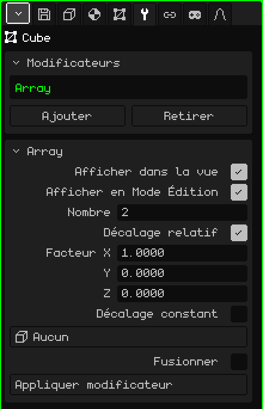

# Array

Le modificateur **Array** fait des copies du maillage en rangée, chacune décalée par rapport à la précédente. Il sert pour tout ce qui se répète : les poteaux d'une clôture, les marches d'un escalier, les colonnes d'un couloir ou les maillons d'une chaîne. Vous modélisez une seule pièce et l'Array construit le reste ; si vous modifiez la pièce, toutes les copies changent.

## Comment l'ajouter

1. Sélectionnez le maillage.
2. Dans Propriétés, ouvrez l'onglet **Modificateurs** (l'icône de la clé).
3. Touchez **Ajouter** et choisissez **Array**.

Il apparaît dans la liste sous le nom **Array**, et sa carte de paramètres s'ouvre en dessous. Comme tous les modificateurs, il ne détruit pas le maillage : vous pouvez le désactiver, le déplacer avec **Monter** et **Descendre**, le retirer avec **Retirer** ou l'intégrer définitivement avec **Appliquer modificateur**.

## Paramètres

| Paramètre | Ce qu'il fait |
|---|---|
| Afficher dans la vue | Désactivé, les copies ne sont pas calculées : ni dans la vue ni au rendu. |
| Afficher en Mode Édition | Désactivé, pendant l'édition vous ne voyez que la pièce d'origine. |
| Nombre | Le nombre total de pièces, l'originale comprise (2 par défaut). Avec 1, il ne reste que l'originale. |
| Décalage relatif | Décale chaque copie selon la **taille** de la pièce. Activé par défaut, avec Facteur X à 1 : chaque copie est collée à la précédente, sans espace et sans chevauchement. |
| Facteur X / Y / Z | De combien de fois sa propre taille chaque copie est décalée sur cet axe : 1 = collées, 2 = avec un espace de la taille d'une pièce, 0.5 = chevauchées de moitié. Y est la profondeur et Z la hauteur, comme dans l'onglet Objet. Visibles uniquement avec le Décalage relatif activé. |
| Décalage constant | Décale chaque copie d'une distance fixe, quelle que soit la taille de la pièce. Désactivé par défaut. Si les deux décalages sont activés, ils s'additionnent. |
| Distance X / Y / Z | Les mètres dont chaque copie est décalée sur chaque axe. Visibles uniquement avec le Décalage constant activé. |
| Décalage d'objet | Un objet de la scène (le plus pratique est un Vide) qui déplace, fait pivoter et met à l'échelle chaque copie un peu plus que la précédente. Voir plus bas. Sur **Aucun**, il n'est pas utilisé. |
| Fusionner | Soude les sommets qui se touchent entre une copie et la suivante, pour qu'ils forment une seule surface : une rampe continue au lieu de tronçons séparés. Désactivé par défaut. |
| Distance de fusion | La distance maximale entre deux sommets pour qu'ils se soudent (0.001 m par défaut). Visible uniquement avec Fusionner activé. |
| Appliquer modificateur | Intègre définitivement les copies au maillage. Voir la note plus bas. |

## Exemples

- **Une clôture :** un poteau (un Cube étroit et haut), Nombre à 10 et Facteur X à 3 : dix poteaux avec un espace de deux poteaux entre chacun.
- **Un escalier :** une marche (un Cube aplati), Facteur X à 0, Facteur Y à 1 et Facteur Z à 1 : chaque marche se retrouve un pas plus loin et un pas plus haut.

## Le Décalage d'objet

Avec un objet choisi, chaque copie reprend la façon dont cet objet est **déplacé, tourné et mis à l'échelle par rapport au maillage**, et l'accumule : la deuxième copie l'applique une fois, la troisième deux fois, et ainsi de suite.

- Si le Vide est au même endroit que le maillage et tourné de 30° autour de la verticale, chaque copie tourne de 30° de plus que la précédente : avec 12 copies, on fait un tour complet.
- S'il est en plus un peu plus haut, chaque copie monte un peu plus : un escalier en colimaçon.
- S'il est mis à l'échelle à 0.9, chaque copie est un peu plus petite que la précédente : une spirale qui se resserre.

Avec le Vide au même endroit que le maillage, les copies tournent autour de l'origine du maillage. Pour qu'elles forment un cercle au lieu de tourner sur elles-mêmes, éloignez la pièce de l'origine en Mode Édition et désactivez le Décalage relatif. Quand vous déplacez ou faites pivoter l'objet, les copies se mettent à jour immédiatement.

## L'ordre compte

Le Décalage relatif mesure le maillage **tel qu'il le reçoit** du modificateur du dessus : s'il y a un [Miroir](modificador-espejo.md) au-dessus, il mesure l'objet déjà reflété. Avec une [Surface de subdivision](modificador-subdivision.md) en dessous, les copies soudées avec Fusionner sont lissées comme une seule pièce ; sans Fusionner, chaque copie est lissée séparément.

> [!NOTE]
> Appliquer modificateur sur un Array intègre définitivement **tous** les modificateurs activés de la liste, pas seulement l'Array (avec les valeurs de la vue), et vide la liste : ceux qui étaient désactivés et ceux qui ne génèrent pas de géométrie, comme une [Armature](modificador-esqueleto.md), disparaissent aussi. Cela peut être annulé.

Retour à [Maillage 3D](objeto-malla.md)
