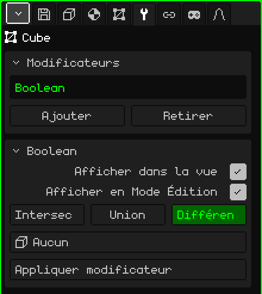

# Booléen

Le modificateur **Booléen** combine le maillage avec un autre : il lui soustrait le volume de l'autre, le lui ajoute ou ne garde que ce qu'ils ont en commun. Il sert pour ce qui serait long à modéliser à la main : l'ouverture d'une fenêtre dans un mur, le creux d'une tasse, une rainure, ou deux pièces fusionnées en une seule.

## Comment l'ajouter

1. Sélectionnez le maillage qui va changer (par exemple, le mur).
2. Dans Propriétés, ouvrez l'onglet **Modificateurs** (l'icône de la clé).
3. Touchez **Ajouter** et choisissez **Booléen**.

Il apparaît dans la liste sous son nom interne, **Boolean**, et sa carte de paramètres s'ouvre en dessous. Comme tous les modificateurs, il ne détruit pas le maillage : le mur reste entier en dessous, et si vous retirez le modificateur, le trou disparaît. Vous pouvez le désactiver, le déplacer avec **Monter** et **Descendre**, le retirer avec **Retirer** ou l'intégrer définitivement avec **Appliquer modificateur**.

## Paramètres

| Paramètre | Ce qu'il fait |
|---|---|
| Afficher dans la vue | Désactivé, l'opération n'est pas faite : on voit le maillage d'origine, ni dans la vue ni au rendu. |
| Afficher en Mode Édition | Désactivé, pendant l'édition vous voyez le maillage sans l'opération. |
| Intersection | Ne garde que la partie qui est à l'intérieur des deux maillages à la fois. |
| Union | Réunit les deux en une seule surface et retire les faces restées à l'intérieur. |
| Différence | Soustrait à ce maillage le volume de l'autre : c'est elle qui fait les trous. Choisie par défaut. |
| Objet | L'autre maillage, l'**objet de coupe**. Sur **Aucun**, il ne fait rien. La liste affiche tous les objets de la scène, mais seul un maillage fonctionne. |
| Appliquer modificateur | Intègre définitivement le résultat au maillage. Voir la note plus bas. |

L'opération choisie apparaît en vert.

## Exemple : une fenêtre dans un mur

1. Ajoutez un **Cube** et mettez-le à l'échelle pour en faire un mur : large, haut et fin.
2. Ajoutez un autre **Cube** (ou un **Cylindre**, pour une fenêtre ronde) et placez-le là où va la fenêtre, en traversant le mur de part en part.
3. Sélectionnez le mur, ajoutez-lui un **Booléen**, laissez **Différence** et, dans **Objet**, choisissez l'objet de coupe.
4. Masquez l'objet de coupe (Masquer / Afficher du [Mode Objet](modo-objeto.md), ou décochez **Visible** dans l'onglet Objet). Il reste le trou.

L'objet de coupe masqué continue de couper. Pour le déplacer, affichez-le de nouveau ou sélectionnez-le dans l'Outliner.

## Bon à savoir

- Les deux maillages doivent être **fermés**, sans trous dans la surface : sinon, le Booléen ne peut pas savoir ce qui est à l'intérieur et ce qui est à l'extérieur.
- Déplacer, faire pivoter, mettre à l'échelle ou modifier l'objet de coupe met à jour la découpe immédiatement. Vous pouvez ainsi ajuster la fenêtre en regardant le résultat.
- Les faces que la découpe ne touche pas restent telles quelles : un quadrilatère reste un quadrilatère. Celles qui sont coupées deviennent des polygones à plusieurs côtés, pas des triangles, pour que le maillage reste facile à modifier après l'avoir appliqué.
- Les faces apportées par l'objet de coupe (par exemple, le bord intérieur de la fenêtre) prennent le premier matériau du maillage.
- Les UV et les couleurs de sommet sont conservés ; là où il y a une coupe, ils sont interpolés.
- Les parties qui se trouvent dans le même plan ne sont pas fusionnées : l'union de deux boîtes posées l'une contre l'autre laisse le dessus découpé en plusieurs morceaux.

 Sur le Nokia N95, la découpe est recalculée chaque fois que vous déplacez ou modifiez l'objet de coupe. Avec de gros maillages, ajustez-le, appliquez le modificateur et continuez à travailler avec le maillage déjà découpé.

> [!NOTE]
> Appliquer modificateur sur le Booléen intègre définitivement **tous** les modificateurs activés de la liste, pas seulement celui-ci, et vide la liste : ceux qui étaient désactivés et ceux qui ne génèrent pas de géométrie, comme une [Armature](modificador-esqueleto.md), disparaissent aussi. Cela peut être annulé. L'objet de coupe n'est pas supprimé : il reste un objet comme les autres.

Retour à [Maillage 3D](objeto-malla.md)
