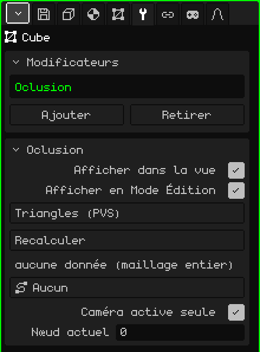

# Culling

Le modificateur **Culling** ne dessine que les triangles du maillage qui sont visibles depuis la zone où se trouve la caméra. Il utilise des listes de visibilité calculées à l'avance, une par zone, comme le faisaient les jeux PlayStation 1 (un **PVS**, *ensemble potentiellement visible*). Il sert pour les grands décors : d'un niveau entier, seul ce qui est visible depuis le couloir où vous êtes est dessiné.

 Il est conçu pour le Nokia N95, où chaque triangle qui n'est pas dessiné est de la vitesse gagnée. Changer de zone ne coûte presque rien : les listes sont construites une seule fois et, quand on passe d'une zone à l'autre, seule change celle qui est utilisée. Il n'y a aucun calcul par image.



## Comment l'ajouter

1. Sélectionnez le maillage du décor.
2. Dans Propriétés, ouvrez l'onglet **Modificateurs** (l'icône de la clé).
3. Touchez **Ajouter** et choisissez **Culling**.

Il apparaît dans la liste sous son nom interne, **Oclusion**, et sa carte de paramètres s'ouvre en dessous. Il ne touche pas au maillage : il choisit seulement quels triangles dessiner, donc le maillage reste entier et modifiable. C'est pourquoi il n'a pas d'Appliquer modificateur.

Ne le confondez pas avec l'objet **Culling** du menu Ajouter de la Vue 3D, qui travaille sur des objets entiers et non sur les triangles d'un maillage.

## D'où viennent les données

Le modificateur ne calcule pas ce qui est visible : il le lit dans un fichier qui accompagne le modèle. Pour un maillage importé depuis `nivel.obj`, il cherche `nivel.pvs.json` dans le même dossier :

```json
{ "sectores": 2, "tris": [[0, 1], [2, 3]] }
```

`sectores` est le nombre de zones, et `tris` contient, pour chaque zone, les triangles à dessiner, numérotés à partir de 0 dans l'ordre des faces du `.obj`. En général, il provient du jeu d'origine ou d'un outil à part. Chaque zone est un **nœud** : le nœud 1 est la première liste, et le nœud 0 dessine le maillage complet.

## Paramètres

| Paramètre | Ce qu'il fait |
|---|---|
| Afficher dans la vue | Désactivé, le maillage complet est dessiné. |
| Afficher en Mode Édition | Ne change rien : en Mode Édition, le maillage est toujours dessiné en entier. |
| Méthode | **Triangles (PVS)** utilise les listes du `.pvs.json`. **BSP (en attente)** apparaît en gris : il ne peut pas encore être choisi. |
| Recalculer | Relit le `.pvs.json`, par exemple après l'avoir régénéré. Affiche "PVS recalculé" ou, s'il ne le trouve pas, "PVS : <modèle>.pvs.json manquant à côté du .obj source". |
| (ligne d'état) | Sous Recalculer : "4 nœuds \| nœud actif : 2", "aucune donnée (maillage entier)" s'il n'y a pas de fichier, ou "sidecar non chargé (Recalculer)". |
| Chemin | Un chemin de la scène (**Ajouter → Chemin**), par exemple le rail que suit la caméra. Chaque nœud du chemin est une zone, et le moteur choisit tout seul le nœud le plus proche de l'œil. Sur **Aucun**, la zone se règle à la main ou depuis un script. |
| Caméra active seule | Activé (par défaut), c'est la caméra active qui commande pendant la lecture de la scène ; en pause, rien n'est choisi automatiquement et le nœud se règle à la main. Désactivé, c'est la vue du viewport qui commande : vous pouvez voler librement dans le décor et voir les triangles apparaître et disparaître. |
| Branches | N'apparaît que si le chemin a plus d'une branche, par exemple le parcours principal et un parcours bonus. Choisit les branches prises en compte pour chercher le nœud le plus proche ; chaque branche activée apparaît en vert. Le bouton indique, par exemple, "Branches : 3 (toutes)" ou "Branches : 2/3". |
| Nœud actuel | La zone en cours de dessin ; 0 = le maillage complet. Vous pouvez le changer à la main pour vérifier chaque zone. Quand le Chemin choisit le nœud tout seul, le moteur l'écrase. |

Depuis un script, `setSector(objeto, n)` change le nœud actif (0 = le maillage complet). Voir [Particules, brouillard et visibilité](../lua/api-particulas-niebla.md).

## Bon à savoir

- Tant que le maillage est en Mode Édition, il est dessiné en entier, pour que vous puissiez tout modifier.
- S'il y a dans la liste un autre modificateur activé qui génère de la géométrie ([Miroir](modificador-espejo.md), [Array](modificador-array.md), [Surface de subdivision](modificador-subdivision.md)…), le Culling n'est pas utilisé et tout est dessiné : les numéros de triangle du `.pvs.json` sont ceux du maillage d'origine.
- Les listes désignent les triangles par leur numéro. Si vous modifiez le maillage en ajoutant ou en supprimant des faces, les numéros changent et les listes peuvent pointer vers d'autres triangles : le Culling est fait pour les décors terminés, pas pour ceux qui sont encore en cours de modélisation.

Retour à [Maillage 3D](objeto-malla.md)
