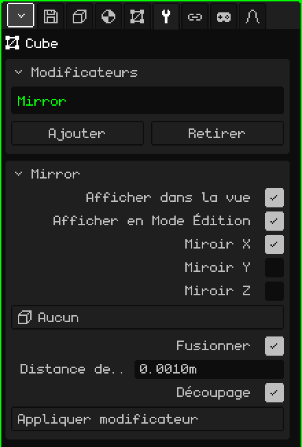

# Miroir

Le modificateur **Miroir** reflète le maillage de l'autre côté d'un plan. Il sert pour tout ce qui est symétrique : vous modélisez la moitié d'un personnage, d'un visage ou d'une voiture, et l'autre moitié apparaît toute seule, reflétée. Ce que vous changez d'un côté se répète de l'autre pendant que vous travaillez.

## Comment l'ajouter

1. Sélectionnez le maillage.
2. Dans Propriétés, ouvrez l'onglet **Modificateurs** (l'icône de la clé). Il n'apparaît que si l'objet actif est un maillage.
3. Touchez **Ajouter** et choisissez **Miroir**.

Il apparaît dans la liste de la carte Modificateurs sous son nom interne, **Mirror**, et une carte avec ses paramètres s'ouvre en dessous.

Un modificateur ne détruit pas le maillage : l'original reste intact et vous continuez à le modifier, et ce que vous voyez est le résultat. Vous pouvez le désactiver à tout moment, changer sa place dans la liste avec **Monter** et **Descendre** (ils apparaissent quand il y en a deux ou plus), le retirer avec **Retirer** ou l'intégrer définitivement au maillage avec **Appliquer modificateur**.

## Paramètres

| Paramètre | Ce qu'il fait |
|---|---|
| Afficher dans la vue | Désactivé, le reflet n'est pas calculé : ni dans la vue ni au rendu. Pratique pour comparer avec et sans. |
| Afficher en Mode Édition | Désactivé, pendant que vous modifiez le maillage vous ne voyez que la moitié d'origine ; en revenant au Mode Objet, le reflet apparaît. |
| Miroir X | Reflète de gauche à droite. Activé par défaut : c'est celui qui sert pour un personnage ou une voiture. |
| Miroir Y | Reflète de l'avant vers l'arrière. |
| Miroir Z | Reflète de haut en bas. |
| Objet miroir | Sur **Aucun**, le plan du miroir passe par l'origine du maillage. Si vous choisissez un autre objet (par exemple un Vide), le plan passe par l'origine de cet objet et tourne avec lui ; son échelle ne compte pas. Quand vous le déplacez ou le faites pivoter, le reflet se met à jour immédiatement. |
| Fusionner | Soude la jointure : les sommets qui sont presque sur le plan s'y collent et deviennent communs aux deux moitiés. Ainsi, il ne reste pas de trait au milieu et l'ombrage lisse passe d'un côté à l'autre sans coupure : une demi-sphère ressemble à une sphère entière. Activé par défaut. |
| Distance de fusion | La distance maximale au plan pour qu'un sommet se soude (0.001 m par défaut). Si la jointure reste ouverte, augmentez-la un peu ; si des sommets que vous ne vouliez pas se collent, diminuez-la. C'est aussi la marge du Découpage. |
| Découpage | Pendant que vous déplacez des sommets en Mode Édition, il les empêche de passer de l'autre côté du plan : celui qui atteint le plan y reste collé et ne fait que glisser dessus. Les sommets du centre ne se décollent pas, et la jointure ne s'ouvre donc pas par accident. Activé par défaut. |
| Appliquer modificateur | Intègre définitivement le reflet au maillage : les deux moitiés deviennent de vrais sommets et le modificateur quitte la liste. Les faces à quatre côtés restent à quatre côtés. Cela peut être annulé. |

Si vous activez plusieurs axes, chaque reflet se fait sur le résultat du précédent. Avec X et Y activés, vous modélisez un quart de l'objet et les quatre parties apparaissent.

## L'ordre compte

Les modificateurs s'appliquent de haut en bas : chacun travaille sur ce qu'a laissé le précédent. Le Miroir vient presque toujours en premier :

- **Miroir au-dessus de la [Surface de subdivision](modificador-subdivision.md) :** le modèle entier est d'abord construit, puis tout est lissé ensemble, sans marque au centre. Dans l'ordre inverse, chaque moitié est lissée séparément et un pli reste à la jonction.
- **Miroir au-dessus de l'[Array](modificador-array.md) :** l'Array copie l'objet déjà complet, et son Décalage relatif utilise la taille de l'objet entier.

Appliquer modificateur sur le Miroir n'intègre que le Miroir, quelle que soit sa place dans la liste : les autres modificateurs restent là.

## Conseils

- Travaillez avec l'origine du maillage au centre du modèle, car le plan du miroir passe par là. Placez les sommets qui vont au milieu exactement sur le plan.
- Pour modéliser confortablement, regardez de face en orthographique (voir [Naviguer dans la Vue 3D](../tutoriales/navegacion.md#les-vues-de-face-de-côté-et-de-dessus)) : le plan du Miroir X apparaît comme une ligne verticale au milieu.
- Quand le modèle est terminé, appliquez le Miroir si vous voulez retoucher chaque moitié séparément, par exemple pour qu'un personnage ne soit pas parfaitement symétrique.

Retour à [Maillage 3D](objeto-malla.md)
