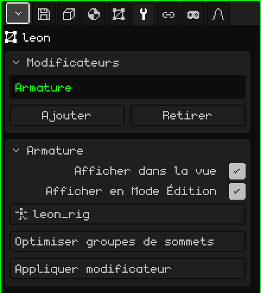

# Armature

Le modificateur **Armature** fait suivre au maillage les os d'une armature : quand vous posez ou animez l'armature, le maillage se plie avec elle. C'est ce qui transforme un modèle immobile en un personnage qui marche, saute ou salue.

## Comment l'ajouter

1. Sélectionnez le maillage.
2. Dans Propriétés, ouvrez l'onglet **Modificateurs** (l'icône de la clé).
3. Touchez **Ajouter** et choisissez **Armature**.

Il apparaît dans la liste sous son nom interne, **Armature**, et sa carte de paramètres s'ouvre en dessous. Comme tous les modificateurs, il ne détruit pas le maillage : la pose de repos reste intacte. Vous pouvez le désactiver, le retirer avec **Retirer** ou l'intégrer définitivement avec **Appliquer modificateur**.

Quand vous importez un FBX ou un glTF avec armature, le modificateur est déjà en place et pointe vers son armature.

## Paramètres

| Paramètre | Ce qu'il fait |
|---|---|
| Afficher dans la vue | Désactivé, le maillage ne se déforme pas : il reste dans sa pose de repos. |
| Afficher en Mode Édition | Désactivé, pendant que vous modifiez les sommets, le maillage reste au repos, sans déformation. |
| Cible | L'armature qui le déplace. La liste n'affiche que les armatures de la scène. Sur **Aucun**, il ne se déforme pas. |
| Optimiser groupes de sommets | Laisse chaque sommet avec un seul os, celui qui le déplaçait le plus, avec le poids complet. Demande une confirmation, car les poids intermédiaires sont perdus. |
| Appliquer modificateur | Fige dans le maillage la pose de l'image actuelle et retire le modificateur : le maillage reste figé dans cette pose. L'armature n'est pas touchée. Cela peut être annulé. |

## Comment le maillage sait quel os le déplace

Grâce aux **groupes de sommets**. Chaque groupe porte le **même nom qu'un os** et indique quels sommets cet os déplace et dans quelle mesure : le **poids**, de 0 (pas du tout) à 1 (entièrement). Un sommet peut appartenir à plusieurs groupes ; dans un coude, moitié dans le bras et moitié dans l'avant-bras, pour qu'il se plie en douceur.

Les groupes se trouvent dans l'onglet **Maillage 3D**, carte **Groupes de sommets** :

| Bouton | Ce qu'il fait |
|---|---|
| Ajouter groupe de sommets / Renommer | Crée un groupe et lui donne un nom. Il doit être identique à celui de l'os, lettre pour lettre. |
| Assigner / Retirer | En Mode Édition, met dans le groupe les sommets sélectionnés (avec un poids de 1) ou les en retire. |
| Sélectionner / Désélectionner | Montre quels sommets contient le groupe. |

Pour les poids fins, comme les transitions des épaules et des genoux, utilisez la [Peinture de poids](pintura.md#peinture-de-poids) : elle peint le poids du groupe choisi, du bleu (pas du tout) au rouge (entièrement).

## Pas à pas

1. Construisez l'armature (**Ajouter → Armature**) et placez les os à l'intérieur du modèle (voir [Armatures](esqueletos.md)).
2. Ajoutez au maillage le modificateur **Armature** et, dans **Cible**, choisissez l'armature.
3. Créez un groupe par os, avec le même nom, et assignez ou peignez les poids.
4. Sélectionnez l'armature, passez en **Mode Pose** et déplacez un os : le maillage le suit.

## Bon à savoir

- La place de l'Armature dans la liste ne change rien : elle n'est pas calculée avec les autres, elle déforme le maillage à chaque image, au moment de le dessiner.
- Elle déforme le maillage d'origine. Si d'autres modificateurs activés génèrent de la géométrie ([Miroir](modificador-espejo.md), [Array](modificador-array.md), [Surface de subdivision](modificador-subdivision.md), [Vis](modificador-screw.md), [Booléen](modificador-booleano.md)), ce que vous voyez est le maillage généré, qui ne suit pas les os. Appliquez-les avant d'animer.
- Appliquer l'un de ces modificateurs (sauf le Miroir) vide toute la liste, et l'Armature disparaît aussi. Les groupes de sommets restent : ajoutez de nouveau l'Armature et choisissez de nouveau la Cible.

 Sur le Nokia N95, déformer le maillage à chaque image a un coût, d'autant plus élevé que les os qui influencent chaque sommet sont nombreux. **Optimiser groupes de sommets** n'en laisse qu'un par sommet et le skinning va beaucoup plus vite ; en contrepartie, les articulations se plient de façon plus raide. Faites-le à la fin, quand les poids sont prêts.

Retour à [Maillage 3D](objeto-malla.md)
