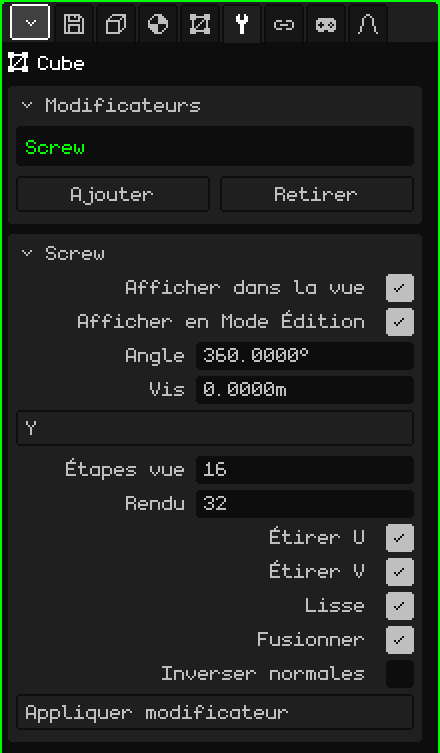

# Vis

Le modificateur **Vis** (*Screw*, en anglais) fait tourner un profil autour d'un axe et construit la surface qu'il décrit en tournant, comme un tour. Vous dessinez la moitié de la silhouette d'un vase, d'un verre ou d'une bouteille, et la Vis la transforme en objet entier. Si en plus le profil monte en tournant, vous obtenez un filetage ou un ressort.

## Comment l'ajouter

1. Sélectionnez le maillage qui contient le profil.
2. Dans Propriétés, ouvrez l'onglet **Modificateurs** (l'icône de la clé).
3. Touchez **Ajouter** et choisissez **Vis**.

Il apparaît dans la liste sous son nom interne, **Screw**, et sa carte de paramètres s'ouvre en dessous. Comme tous les modificateurs, il ne détruit pas le maillage : le profil reste là et vous pouvez le modifier en voyant le résultat. Vous pouvez le désactiver, le déplacer avec **Monter** et **Descendre**, le retirer avec **Retirer** ou l'intégrer définitivement avec **Appliquer modificateur**.

## Le profil

Le profil est une ligne : des sommets reliés par des arêtes, sans faces. L'axe de rotation passe par l'**origine** du maillage, donc la distance de chaque sommet à l'origine est le rayon de l'objet à cette hauteur. Une façon de le dessiner :

1. **Ajouter → Maillage → Sommet** crée un sommet isolé à l'origine et passe directement en Mode Édition.
2. Regardez de face (voir [Naviguer dans la Vue 3D](../tutoriales/navegacion.md#les-vues-de-face-de-côté-et-de-dessus)).
3. Avec **Extruder sommets** (menu Maillage → Sommet), tirez le sommet suivant sur le côté pour faire le fond, puis vers le haut pour la paroi, point par point.

Les sommets qui se trouvent sur l'axe ferment l'objet : le premier, à l'origine, est le centre du fond du vase.

## Paramètres

| Paramètre | Ce qu'il fait |
|---|---|
| Afficher dans la vue | Désactivé, il n'y a pas de rotation : on ne voit que le profil, ni dans la vue ni au rendu. |
| Afficher en Mode Édition | Désactivé, pendant que vous modifiez le profil, vous ne voyez que la ligne. |
| Angle | De combien de degrés tourne le profil, de la première étape à la dernière (360 par défaut, le tour complet). Avec 180, on obtient un demi-objet. Une valeur négative tourne dans l'autre sens. Elle peut dépasser 360 : avec 1080, il fait trois tours. |
| Vis | De combien de mètres le profil monte le long de l'axe, du début à la fin de la rotation. À 0, c'est un tour (vase, verre, bouteille) ; avec une autre valeur, un filetage ou un ressort. |
| Axe | L'axe autour duquel il tourne : X, Y ou Z. Par défaut, c'est **Z**, la verticale : un profil dessiné dans la vue de face se retrouve debout, comme un vase posé sur la table. |
| Étapes vue | Combien de copies du profil sont faites le long de la rotation dans la vue, de 2 à 512 (16 par défaut). Plus il y a d'étapes, plus c'est rond et plus c'est lourd. |
| Rendu | Les étapes utilisées pour **Rendu image** ou **Rendu animation** (32 par défaut). |
| Étirer U | Construit les coordonnées UV autour de la rotation, pour qu'une texture enveloppe l'objet comme une étiquette. |
| Étirer V | Construit les coordonnées UV le long du profil, de haut en bas. Si les deux sont désactivés, il n'y a pas d'UV. |
| Lisse | Ombrage lisse sur la surface générée : elle paraît ronde et non facettée. Activé par défaut. |
| Fusionner | Soude les sommets qui tombent au même endroit : ceux du profil qui touchent l'axe (le fond, le goulot d'une bouteille fermée) et la jointure où le tour se referme. Activé par défaut. |
| Inverser normales | Retourne la direction vers laquelle regardent les faces. Utilisez-le si l'objet paraît à l'envers, sombre ou comme vu de l'intérieur. |
| Appliquer modificateur | Intègre définitivement le résultat au maillage avec les **Étapes vue**. Voir la note plus bas. |

Le tour ne se referme tout seul, sans jointure, qu'avec l'Angle à 360 et la Vis à 0. Avec un autre angle, ou avec un profil qui monte, le début et la fin restent ouverts.

## Exemples

- **Un vase :** le profil de la demi-silhouette, Angle 360, Vis 0 et entre 16 et 32 étapes.
- **Un filetage :** un profil court éloigné de l'axe, Angle 1080 et Vis à 3 : trois tours qui montent d'un mètre chacun. Augmentez les étapes pour que la spirale ne soit pas anguleuse.

 Sur le Nokia N95, chaque étape est une copie de plus du profil à dessiner. Utilisez peu d'Étapes vue pendant que vous modélisez et gardez les valeurs élevées pour Rendu.

> [!NOTE]
> Appliquer modificateur sur la Vis intègre définitivement **tous** les modificateurs activés de la liste, pas seulement celui-ci, et vide la liste : ceux qui étaient désactivés et ceux qui ne génèrent pas de géométrie, comme une [Armature](modificador-esqueleto.md), disparaissent aussi. Cela peut être annulé.

Retour à [Maillage 3D](objeto-malla.md)
