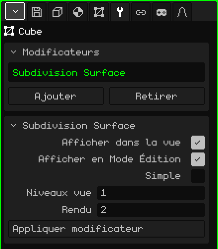

# Surface de subdivision

Le modificateur **Surface de subdivision** divise chaque face en faces plus petites et, par défaut, arrondit la forme. Il permet de modéliser avec peu de polygones, ce qui est rapide à modifier et léger, tout en voyant un résultat lisse : un cube donne quelque chose qui ressemble à une sphère, et un personnage low-poly, un personnage aux formes arrondies.

## Comment l'ajouter

1. Sélectionnez le maillage.
2. Dans Propriétés, ouvrez l'onglet **Modificateurs** (l'icône de la clé).
3. Touchez **Ajouter** et choisissez **Surface de subdivision**.

Il apparaît dans la liste sous son nom interne, **Subdivision Surface**, et sa carte de paramètres s'ouvre en dessous. Comme tous les modificateurs, il ne détruit pas le maillage : vous pouvez le désactiver, le déplacer avec **Monter** et **Descendre**, le retirer avec **Retirer** ou l'intégrer définitivement avec **Appliquer modificateur**.

## Paramètres

| Paramètre | Ce qu'il fait |
|---|---|
| Afficher dans la vue | Désactivé, il n'y a pas de subdivision : ni dans la vue ni au rendu. |
| Afficher en Mode Édition | Désactivé, pendant l'édition vous voyez le maillage sans subdivision et l'édition est plus rapide ; en revenant au Mode Objet, il redevient lisse. |
| Simple | Désactivé (par défaut), chaque niveau lisse la forme et arrondit les coins. Activé, il ne fait que diviser les faces sans déplacer les sommets : la forme reste la même mais avec plus de sommets, par exemple pour peindre des couleurs de sommet avec plus de détail. |
| Niveaux vue | Combien de fois il subdivise dans la vue, de 0 à 6 (1 par défaut). Chaque niveau multiplie les faces par 4 : un cube de 6 faces passe à 24 avec 1 niveau, à 96 avec 2 et à 384 avec 3. À 0, il n'y a pas de subdivision. |
| Rendu | Les niveaux utilisés pour **Rendu image** ou **Rendu animation** (2 par défaut). Ainsi, la vue reste légère et l'image finale est plus lisse. |
| Appliquer modificateur | Intègre définitivement la subdivision au maillage avec les **Niveaux vue** (et non avec ceux de Rendu). Voir la note plus bas. |

## Travailler avec la subdivision

- Elle fonctionne mieux avec des faces à quatre côtés. Un triangle est divisé en 3 quadrilatères et une face à cinq côtés, en 5.
- Subdiviser ne change pas l'ombrage : un maillage plat reste facetté. Pour le voir lisse, en Mode Édition, sélectionnez les faces et utilisez le menu Face → **Ombrage lisse**.
- Pour qu'un bord soit plus marqué, ajoutez une coupe tout près avec **Coupe en boucle et glisser** (voir [Mode Édition](modo-edicion.md)) : plus elle est proche du bord, plus il est net.
- Les bords ouverts, dans un maillage qui n'est pas fermé, sont lissés en suivant le bord.

## L'ordre compte

Les modificateurs s'appliquent de haut en bas. Placez le [Miroir](modificador-espejo.md) **au-dessus** de la Subdivision : ainsi, le modèle entier est lissé d'un coup. Si le Miroir est en dessous, chaque moitié est lissée séparément et un pli reste au milieu. Avec un [Array](modificador-array.md), c'est la même chose : les copies soudées avec Fusionner sont lissées ensemble.

 Sur le Nokia N95, chaque niveau pèse : avec 1 niveau, il y a déjà quatre fois plus de faces à dessiner, et avec 2, seize fois plus. Laissez les Niveaux vue à 0 ou 1, désactivez Afficher en Mode Édition pendant que vous modélisez, et gardez les niveaux élevés pour Rendu.

> [!NOTE]
> Appliquer modificateur sur la Subdivision intègre définitivement **tous** les modificateurs activés de la liste, pas seulement celui-ci, et vide la liste : ceux qui étaient désactivés et ceux qui ne génèrent pas de géométrie, comme une [Armature](modificador-esqueleto.md), disparaissent aussi. Cela peut être annulé.

Retour à [Maillage 3D](objeto-malla.md)
