# Navigation dans la Vue 3D

> [!NOTE]
>  Le Nokia N95 prend en charge une souris et un clavier (en Bluetooth). Les parties de cette page consacrées au Nokia expliquent comment l'utiliser sans souris ni clavier, uniquement avec les touches du téléphone.

Cette page explique comment naviguer dans la Vue 3D. Naviguer, c'est déplacer votre point de vue : tourner autour de la scène, vous décaler sur le côté, vous rapprocher ou vous éloigner.

Savoir naviguer est important : pour créer des modèles 3D et des animations de façon confortable et rapide, il faut savoir se déplacer dans la scène et se placer dans une position confortable pour travailler.

Pour utiliser les commandes qui suivent, la Vue 3D doit être le [viewport actif](interfaz.md#le-viewport-actif), celui qui a la bordure verte.

Les trois gestes que vous utiliserez le plus sont **orbiter**, **déplacer la vue** et **zoomer**. Chacun se fait à la souris, avec les doigts sur un écran tactile ou avec le clavier du Nokia N95. Dans les vidéos sur PC, la souris en bas à droite montre en vert le bouton enfoncé.

## Orbiter

Orbiter, c'est faire tourner la vue autour de la scène, comme si vous faisiez le tour d'une table pour voir sous tous les angles ce qu'il y a dessus.

 **À la souris :** maintenez enfoncé le **bouton du milieu** (on l'actionne en appuyant sur la molette) et faites glisser. Sur un trackpad, ou avec une souris sans bouton du milieu, maintenez <kbd>Alt</kbd> et faites glisser avec le **clic principal** (le gauche).

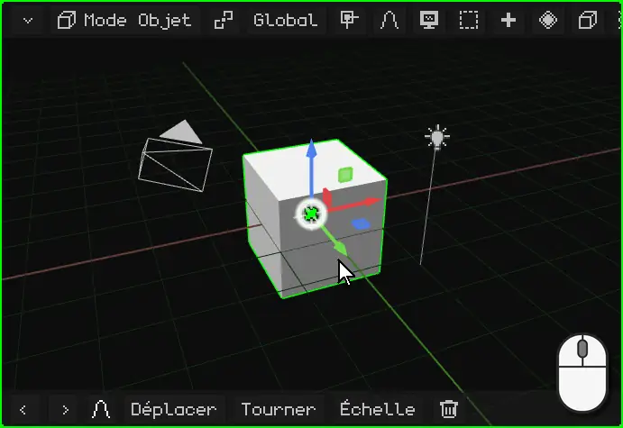

 **Au doigt :** faites glisser un doigt sur la Vue 3D. Commencez sur le fond : si vous le posez sur le gizmo (les flèches de couleur de l'objet), c'est le gizmo que vous allez déplacer.

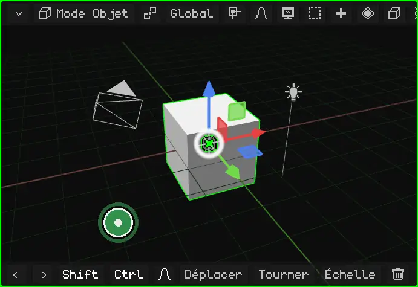

 **Sur le Nokia N95 :** maintenez enfoncée une **flèche** du pavé directionnel. La vue tourne de ce côté tant que vous la maintenez.

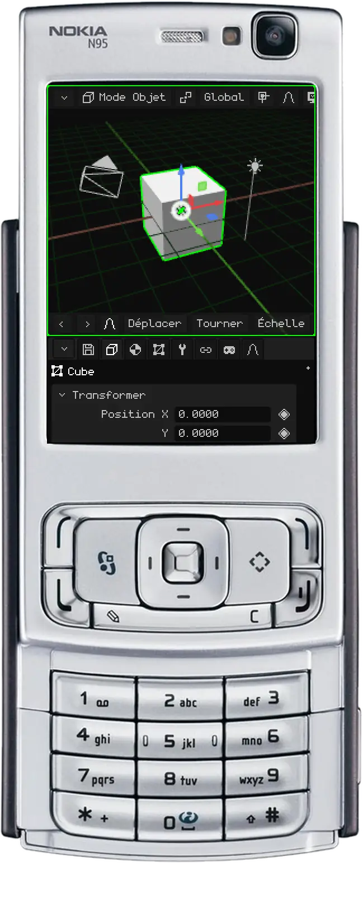

## Déplacer la vue

Déplacer la vue (ou faire un *panoramique*), c'est la faire glisser sur le côté, vers le haut ou vers le bas, sans la faire tourner.

 **À la souris :** maintenez <kbd>Shift</kbd> et faites glisser avec le **bouton du milieu**. Sur un trackpad : <kbd>Alt</kbd> + <kbd>Shift</kbd> et faites glisser avec le clic principal.

 **Avec les doigts :** posez **deux doigts** et déplacez-les ensemble dans la même direction.

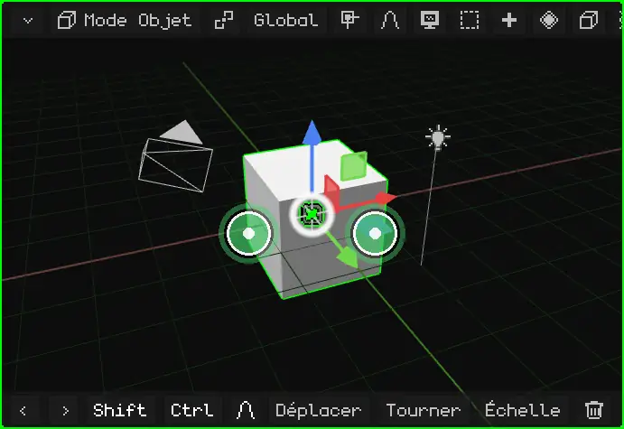

 **Sur le Nokia N95 :** maintenez enfoncée la touche <kbd>\*</kbd> et utilisez les flèches.

## Zoom

Le zoom vous rapproche ou vous éloigne. Le pas s'adapte à la distance : près d'un petit objet, il avance lentement, et de loin, il avance vite. Il convient donc aussi bien pour regarder toute la scène que pour regarder un sommet.

 **À la souris :** tournez la **molette**. Vers l'avant, elle rapproche ; vers l'arrière, elle éloigne. Sur un trackpad, faites glisser deux doigts vers le haut ou vers le bas.

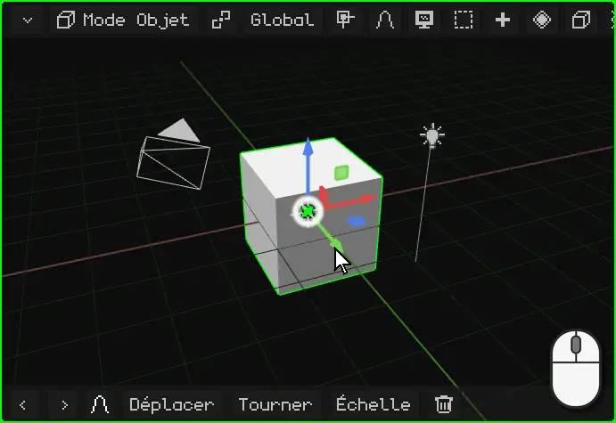

 **Avec les doigts :** pincez. Écarter les doigts rapproche, les resserrer éloigne.

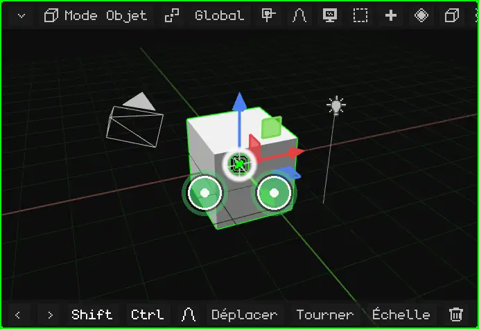

 **Sur le Nokia N95 :** maintenez enfoncé le <kbd>0</kbd> et utilisez la flèche **haut** pour vous rapprocher ou la flèche **bas** pour vous éloigner.

## Cadrer la sélection

Si vous êtes perdu, ou si vous voulez travailler sur quelque chose en particulier, **cadrez-le** : la vue se centre sur ce qui est sélectionné et ajuste le zoom pour que cela tienne tout juste. À partir de là, orbiter fait tourner la vue autour.

| | Comment cadrer |
|---|---|
|  PC | <kbd>Num .</kbd> (le point du pavé numérique) |
|  Nokia N95 | Un appui bref sur le <kbd>0</kbd>, sans flèche (maintenu avec une flèche, c'est le zoom) |
|  Écran tactile | Double toucher à deux doigts |
| Menu | Vue → Cadrer la sélection |

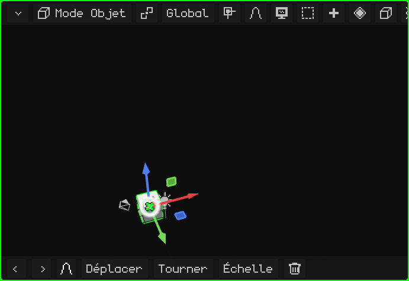

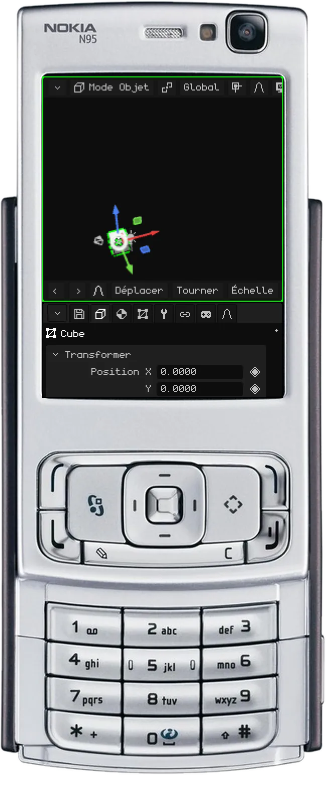

### En Mode Édition

En [Mode Édition](modo-edicion.md), c'est la partie sélectionnée du maillage qui est cadrée : les sommets, arêtes ou faces que vous avez choisis, pas l'objet entier. C'est utile pour travailler sur un détail d'un grand modèle : vous le sélectionnez, vous le cadrez et vous orbitez autour.

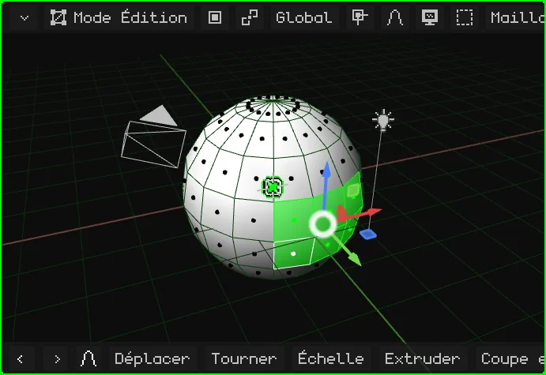

## La vue locale

Quand la scène contient beaucoup de choses, travailler sur l'une d'elles n'est pas pratique : celles de devant gênent, et quand vous orbitez, elles passent devant. La **vue locale** n'affiche que ce qui est sélectionné (un ou plusieurs objets) et le cadre. Le reste n'est ni supprimé ni masqué dans la scène : il n'est simplement plus affiché dans ce viewport. En haut à gauche apparaît l'étiquette « Vue locale ».

Pour revenir, refaites la même chose : tout réapparaît et la vue redevient comme vous l'aviez laissée.

| | Comment entrer et sortir |
|---|---|
|  PC | <kbd>/</kbd> |
|   Nokia N95 et écran tactile | Menu Vue → Vue locale |

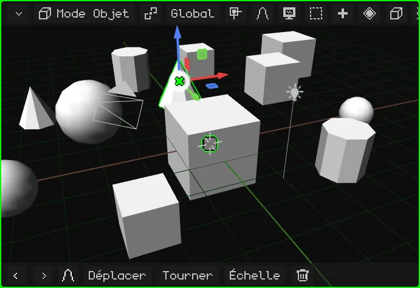

## Les vues de face, de côté et de dessus

Pour regarder la scène bien en face depuis l'un de ses côtés, sans régler l'orbite à la main :

| Vue |  PC | Menu |
|---|---|---|
| Face / Arrière | <kbd>Num 1</kbd> / <kbd>Ctrl</kbd> + <kbd>Num 1</kbd> | Vue → Point de vue → Avant / Arrière |
| Droite / Gauche | <kbd>Num 3</kbd> / <kbd>Ctrl</kbd> + <kbd>Num 3</kbd> | Vue → Point de vue → Droite / Gauche |
| Dessus / Dessous | <kbd>Num 7</kbd> / <kbd>Ctrl</kbd> + <kbd>Num 7</kbd> | Vue → Point de vue → Haut / Bas |

 Avec <kbd>Ctrl</kbd>, chaque touche donne la vue opposée.

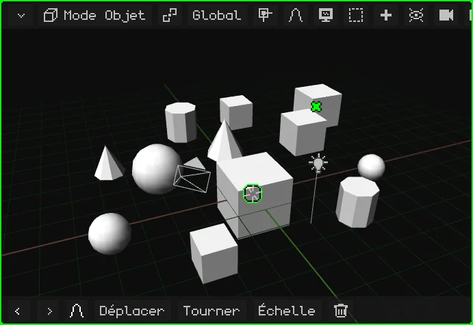

 **Sur le Nokia N95 :** maintenez enfoncée la touche <kbd>#</kbd> et appuyez sur une flèche. Gauche et droite font tourner la vue de 90° en 90° autour de la scène. Haut passe à la vue de dessus ; bas revient à la vue de côté, et bas une seconde fois passe à la vue de dessous. Si vous orbitiez librement, la première flèche se contente de redresser la vue sur la plus proche.

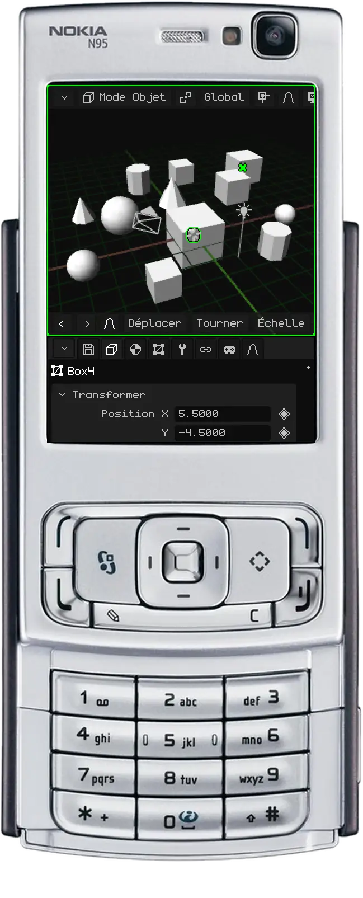

## Perspective et orthographique

La Vue 3D a deux façons d'afficher la scène :

- **Perspective :** comme la voit l'œil ou une caméra. Ce qui est loin paraît plus petit, et les lignes parallèles (les bords d'une rue, les rangées de boîtes de la vidéo) se rejoignent en un point de l'horizon : le **point de fuite**. C'est ainsi que l'on voit vraiment, avec de la profondeur.
- **Orthographique :** sans perspective. Tout garde sa taille, que ce soit près ou loin, et les lignes parallèles ne se touchent jamais. C'est comme un plan d'architecte ou un dessin technique.

La vue orthographique sert à modéliser avec précision : aligner des éléments, comparer des tailles et mesurer sans que la distance ne trompe. Combinée aux vues de face, de côté et de dessus, c'est comme travailler sur un plan. La perspective sert à voir à quoi ressemblera le résultat.

| | Comment basculer |
|---|---|
|  PC | <kbd>Num 5</kbd> |
|  Nokia N95 | Un appui bref sur le <kbd>#</kbd>, sans flèche |
| Menu | Vue → Perspective/Ortho |

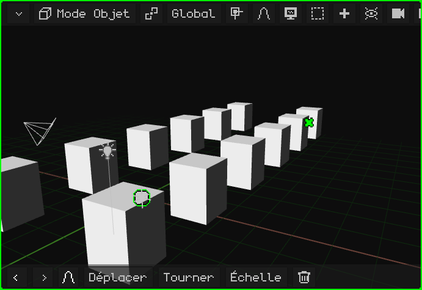

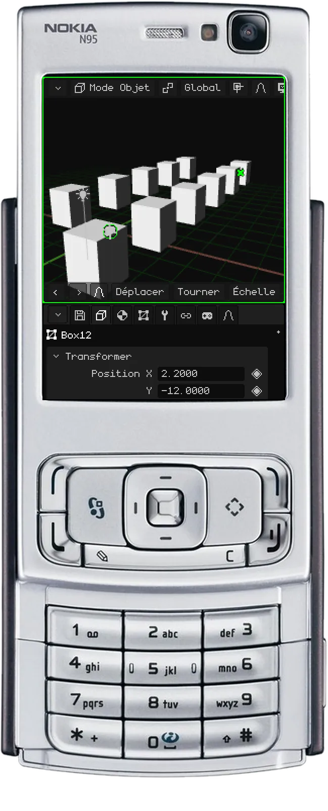

## Verrouiller l'orbite

Avec l'**orbite verrouillée**, la vue ne tourne plus : ce qui la faisait orbiter la déplace désormais, comme si vous faisiez glisser une feuille sur une table. C'est idéal pour travailler confortablement sur des modèles qui se dessinent comme un plan 2D, par exemple le plan d'une maison ou une pièce mécanique : en regardant de dessus et en orthographique, vous vous déplacez sur tout le plan sans qu'il bascule jamais.

| | Comment verrouiller et déverrouiller |
|---|---|
|  PC | Menu Vue → Verrouiller orbite |
|  Écran tactile | Menu Vue → Verrouiller orbite |
|  Nokia N95 | <kbd>9</kbd> |

Une notification s'affiche quand vous la verrouillez ou la déverrouillez et, tant qu'elle est verrouillée, Verrouiller orbite apparaît en vert dans le menu.

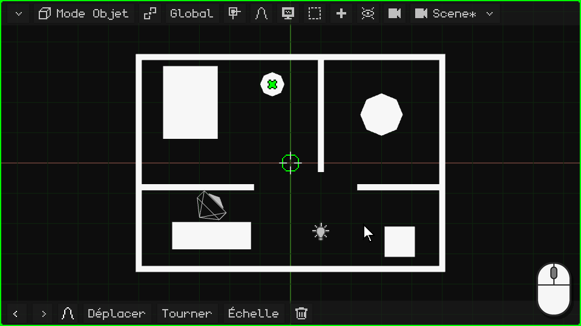

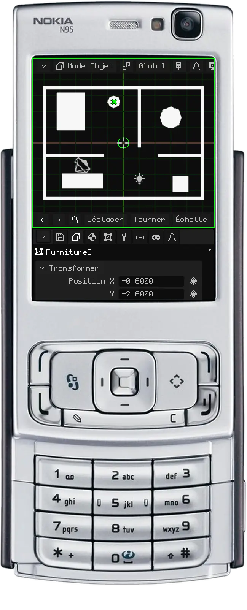

## La caméra active

La scène peut avoir plusieurs caméras, mais une seule est la **caméra active** : celle qui sert pour le jeu et pour les rendus. Ce que voit cette caméra, c'est ce que l'on voit en jouant et ce qui sort quand vous faites le rendu d'une image ou d'une vidéo. La vue avec laquelle vous naviguez ne sert qu'à travailler : elle n'apparaît ni dans le jeu ni dans les rendus.

Pour regarder à travers la caméra active :

| | Comment entrer et sortir |
|---|---|
|  PC | <kbd>Num 0</kbd> |
|  Nokia N95 | <kbd>8</kbd> (hors Mode Édition : là, le 8 est Coupe en boucle) |
| Menu | Vue → Caméras → Caméra active |

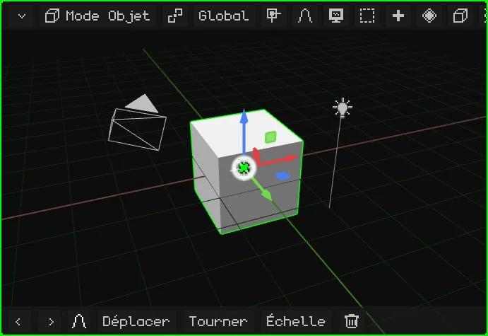

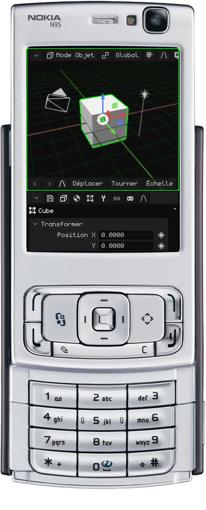

Le rectangle est le cadrage : ce qui est à l'intérieur, c'est ce qui sort. En bas au centre, il y a un **cadenas** :

- **Ouvert** (au départ) : le zoom et le déplacement de la vue ne font que vous rapprocher pour vérifier le cadrage, sans toucher à la caméra. Orbiter vous fait sortir de la vue caméra, et vous continuez à naviguer depuis l'endroit où elle se trouvait.
- **Fermé :** orbiter, déplacer la vue et zoomer déplacent la **caméra**. C'est ainsi que l'on règle le plan.

### Verrouiller la caméra sur la vue

Cadenas fermé, la caméra active est verrouillée sur la vue : vous orbitez, déplacez la vue et zoomez comme en navigation normale, et la caméra se déplace avec vous. C'est le moyen le plus commode de placer une caméra exactement où vous le voulez : regardez à travers elle, verrouillez-la et naviguez jusqu'à obtenir le plan que vous cherchez.

| | Comment verrouiller et déverrouiller |
|---|---|
|  PC | Un clic sur le cadenas |
|  Écran tactile | Un toucher sur le cadenas |
|  Nokia N95 | La touche de sélection gauche ouvre la barre de menus (voir [Quand toutes les options de la barre de menus ne sont pas visibles](interfaz.md#quand-toutes-les-options-de-la-barre-de-menus-ne-sont-pas-visibles)) ; là, Vue → Verrouiller la caméra à la vue |
| Menu | Vue → Verrouiller la caméra à la vue |

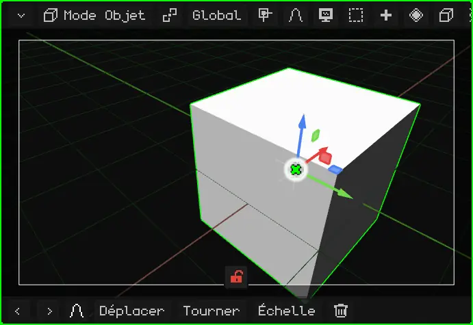

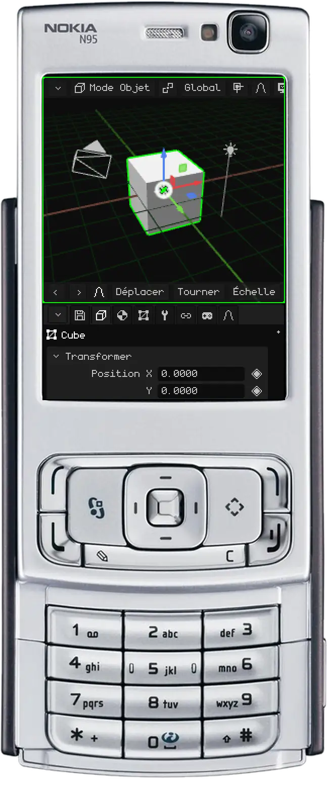

Pour qu'une autre caméra devienne la caméra active : sélectionnez-la et appuyez sur <kbd>Ctrl</kbd> + <kbd>Num 0</kbd> (ou Vue → Caméras → Objet actif comme caméra).

## Autres options de la vue

| Option | Ce qu'elle fait |  PC |  Nokia N95 | Menu |
|---|---|---|---|---|
| Faire pivoter la vue | La fait tourner de 15° autour de son propre axe, comme quand on penche la tête. | <kbd>Num 4</kbd> / <kbd>Num 6</kbd> | — | — |

Tous les raccourcis de l'éditeur se trouvent dans [Raccourcis clavier](atajos.md).

## Tous les contrôles en un coup d'œil

### À la souris (PC)

| Fonction | Description | Utilisation |
|---|---|---|
| Orbiter | Fait tourner la vue autour du point de pivot. | Bouton du milieu + glisser, ou <kbd>Alt</kbd> + bouton gauche + glisser. |
| Déplacer la vue (panoramique) | Déplace la vue latéralement. | <kbd>Shift</kbd> + bouton du milieu, ou <kbd>Alt+Shift</kbd> + bouton gauche + glisser. |
| Zoom | Rapproche ou éloigne. | Molette de la souris. |
| Sélectionner | Choisit ce qui se trouve sous le pointeur (le choix se fait au relâchement). | Clic gauche ; <kbd>Shift</kbd>+clic ajoute ou retire. |
| Sélection par boîte | Faire glisser sur le fond trace un rectangle. | Glisser avec le bouton gauche, ou <kbd>B</kbd>. |
| Menu contextuel | Ouvre le menu du mode sous le pointeur (pendant une transformation, l'annule). | Clic droit. |
| Verrouiller orbite | Ce qui faisait orbiter fait désormais défiler la vue : elle devient comme un plateau 2D. | Menu Vue → Verrouiller orbite. |
| Verrouiller la caméra à la vue | En regardant à travers la caméra active, naviguer déplace la caméra : c'est ainsi que l'on règle le plan. | Clic sur le cadenas (en bas, dans la vue caméra), ou menu Vue → Verrouiller la caméra à la vue. |

### Au clavier

| Fonction | Description | Raccourci |
|---|---|---|
| Vue de face / Vue arrière | Regarde de face ou de dos. | <kbd>Num1</kbd> / <kbd>Ctrl+Num1</kbd> |
| Vue de droite / Vue de gauche | Regarde de côté. | <kbd>Num3</kbd> / <kbd>Ctrl+Num3</kbd> |
| Vue de dessus / Vue de dessous | Regarde d'en haut ou d'en bas. | <kbd>Num7</kbd> / <kbd>Ctrl+Num7</kbd> |
| Perspective / Orthographique | Alterne entre les deux projections. | <kbd>Num5</kbd> |
| Faire pivoter la vue | Fait tourner la vue de 15° autour de son axe. | <kbd>Num4</kbd> / <kbd>Num6</kbd> |
| Vue caméra | Regarde à travers la caméra active (une seconde fois : en sort). | <kbd>Num0</kbd> |
| Définir caméra active | L'objet actif devient la caméra active. | <kbd>Ctrl+Num0</kbd> |
| Cadrer la sélection | Centre la vue sur la sélection et ajuste le zoom. | <kbd>Num.</kbd> (point du pavé numérique) |
| Vue locale | N'affiche que la sélection et la cadre ; une seconde fois, tout réapparaît. | <kbd>/</kbd> |
| Importer un modèle | Ouvre l'explorateur pour importer OBJ, FBX, glTF ou GLB (PC uniquement). | <kbd>Num9</kbd> |

### Au doigt (Android, Web tactile)

| Fonction | Description | Geste |
|---|---|---|
| Orbiter | Fait tourner la vue. | Glisser un doigt. |
| Zoom et déplacement | Pincer rapproche ou éloigne ; déplacer les deux doigts ensemble fait défiler la vue. | Deux doigts. |
| Sélectionner | Choisit ce qui se trouve sous le doigt. | Toucher et lever sans bouger. |
| Cadrer la sélection | Comme <kbd>Num.</kbd>. | Double toucher à deux doigts. |
| Modificateurs tactiles | Boutons Shift et Ctrl de la barre d'outils : ils restent activés (vert) pour ajouter à la sélection ou choisir des chemins. | Toucher Shift / Ctrl. |
| Vue (navigation) | En Mode Édition et dans les modes de peinture, le doigt navigue au lieu de sélectionner ou de peindre. | Bouton en forme d'écran de la barre d'outils. |

### Avec le clavier du Nokia N95

| Fonction | Touche |
|---|---|
| Orbiter | Flèches (maintenir) |
| Zoom / Cadrer la sélection | <kbd>0</kbd> + haut/bas / <kbd>0</kbd> seul |
| Déplacer la vue | <kbd>\*</kbd> + flèches |
| Vues (face, côté, dessus) / Perspective-Orthographique | <kbd>#</kbd> + flèches / <kbd>#</kbd> seul |
| Déplacer / Tourner / Échelle (pendant la transformation : axe X / Y / Z) | <kbd>1</kbd> / <kbd>2</kbd> / <kbd>3</kbd> |
| Confirmer / Annuler | OK (centre) / <kbd>C</kbd> |
| Supprimer (s'il n'y a rien à annuler) / Annuler et Rétablir | <kbd>C</kbd> / <kbd>C</kbd> + gauche ou droite |
| Changer l'ombrage | <kbd>6</kbd> |
| Extruder (Mode Édition) | <kbd>7</kbd> |
| Coupe en boucle (Mode Édition) / vue caméra (hors édition) | <kbd>8</kbd> |
| Verrouiller orbite | <kbd>9</kbd> |
| Verrouiller la caméra à la vue (en regardant à travers la caméra) | Touche de sélection gauche → menu Vue |
| Parcourir la sélection / ajouter, retirer, tout ou rien | Crayon / Crayon + flèches |
| Barre de menus / curseur virtuel | Touche de sélection gauche / droite |
| Changer de viewport, redimensionner, agrandir | Touche verte (seule, + flèches, + OK) |
| Mode jeu en plein écran | Touche verte + <kbd>0</kbd> (encore une fois : l'image couvre tout l'écran ; encore une fois : retour). Sans l'interface, sans le bord de la caméra ni la zone sombre autour (des bandes noires ne restent que si la caméra déclare un format différent de celui de l'écran, jusqu'au deuxième appui), et les flèches ne déplacent pas la vue : on voit le jeu tel quel |

Le N95 accepte aussi une souris et un clavier Bluetooth. Pour saisir du texte, on utilise le T9.
