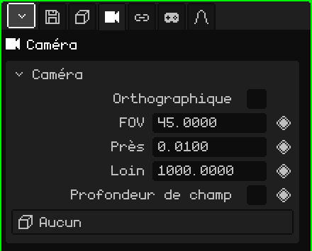

# Caméra

Une **caméra** est un point de vue placé dans la scène. La **caméra active** est celle qui sert pour le jeu et pour les rendus : ce qu'elle voit est ce que l'on voit en jouant et ce qui apparaît dans l'image ou la vidéo. Cet article est la référence de ses propriétés ; la façon d'ajouter et de déplacer les objets est expliquée dans le tutoriel [Le Mode Objet](../tutoriales/modo-objeto.md).

## Les onglets

| Onglet | Contenu |
|---|---|
| Objet | Position, rotation, nom et visibilité, comme pour tous les objets : voir [Maillage 3D](objeto-malla.md#longlet-objet). |
| Caméra | L'objectif de la caméra : la carte ci-dessous. |
| Contraintes | Voir [Contraintes](restricciones.md). |
| Scripts | Les scripts Lua de l'objet. Voir [Lua dans Whisk3D](../lua/README.md). |

## La carte Caméra

| Propriété | Ce qu'elle fait |
|---|---|
| Orthographique | Sans perspective : ce qui est loin ne rapetisse pas et les lignes parallèles ne se rejoignent pas. Voir [Perspective et orthographique](../tutoriales/navegacion.md#perspective-et-orthographique). |
| FOV ◆ | L'angle de vue, en degrés (de haut en bas). Plus petit, c'est comme un téléobjectif : le cadre contient moins de choses et on voit de plus près. Plus grand, c'est un grand-angle : le cadre contient plus de choses et la perspective est exagérée. Vaut 45 au départ. |
| Près ◆ | La distance minimale de dessin : ce qui est plus près de la caméra n'est pas dessiné. Vaut 0.01 au départ. |
| Loin ◆ | La distance maximale de dessin : ce qui est plus loin n'est pas dessiné. Vaut 1000 au départ. |
| Profondeur de champ | Active le flou : ce qui se trouve à la distance de mise au point est net et le reste, flou. Il est dessiné par le lancer de rayons ; le Post-traitement peut aussi utiliser la même mise au point. |
| Ouverture (f) | L'intensité du flou, comme sur un vrai appareil photo : plus le nombre est petit, plus le flou est fort. |
| Distance de mise au point ◆ | La distance, en mètres, à laquelle se fait la mise au point. La ligne et la croix dessinées sur la caméra indiquent où. |
| Objet de mise au point | Un objet que la mise au point suit toute seule, où qu'il soit. Avec un objet choisi, Distance de mise au point disparaît. **Aucun** revient à la distance réglée à la main. |
| Cible | Un objet que la caméra active regarde toujours : si l'objet bouge, la caméra tourne pour le suivre. **Aucun** la laisse regarder dans la direction où vous l'avez tournée. |

Ouverture (f), Distance de mise au point et Objet de mise au point apparaissent quand Profondeur de champ est cochée.

### Quand toucher à Près et Loin

Si un mur ou un personnage très proche de la caméra apparaît coupé, diminuez **Près**. Si le fond d'un grand décor disparaît, augmentez **Loin**. Mieux vaut ne pas étirer la plage plus que nécessaire : avec beaucoup de distance entre Près et Loin, les faces très proches les unes des autres peuvent scintiller, surtout sur le Nokia N95.

Près et Loin peuvent être animés : c'est utile, par exemple, pour repousser la limite de dessin quand la caméra monte et montre une plus grande partie du décor.

### Une caméra qui suit un personnage

Il y a deux façons de faire, selon le plan :

- **La caméra reste en place et tourne :** mettez le personnage dans **Cible**. La caméra active le garde au centre du plan même s'il court, comme quelqu'un qui le regarde passer.
- **La caméra voyage avec lui :** laissez Cible sur Aucun et ajoutez-lui une contrainte **Child Of** avec le personnage comme source et seulement **Position** cochée. Elle le suit à la même distance et avec le même angle, sans tourner quand il tourne (voir [Child Of](restricciones.md#child-of)).

## Choisir la caméra active

La scène peut avoir plusieurs caméras, mais une seule active. Pour la changer :

| | Comment la choisir |
|---|---|
|  PC | Sélectionner la caméra et <kbd>Ctrl</kbd> + <kbd>Num 0</kbd> |
| Menu | Vue → Caméras → Objet actif comme caméra |
| Propriétés | Onglet Animation → carte **Caméra active** |

Dans la carte Caméra active, le losange crée des **coupes de caméra** : passer d'une caméra à une autre d'une image à l'autre. Voir [Timeline](linea-de-tiempo.md).

Pour regarder à travers la caméra active et ajuster le plan en naviguant, voir [La caméra active](../tutoriales/navegacion.md#la-caméra-active) dans le tutoriel de navigation.
