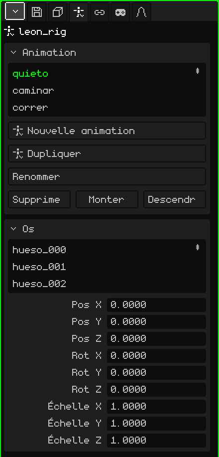

# Armature

Une **armature** est un objet fait d'**os** qui sert à animer des personnages et des choses qui se plient. Les os bougent et le maillage les suit en se déformant : on anime un bras en faisant pivoter deux ou trois os au lieu de déplacer des centaines de sommets. Cet article est la référence de ses propriétés ; la façon d'ajouter et de déplacer les objets est expliquée dans le tutoriel [Le Mode Objet](../tutoriales/modo-objeto.md).

Ajouter → Armature en crée une avec un seul os, prête à en recevoir d'autres. Dans la Vue 3D, chaque os est dessiné comme une ligne bleue par-dessus tout le reste, pour qu'on le voie même s'il est à l'intérieur du maillage.

## Repos et pose

Chaque os peut être dans deux états :

- **Repos :** là où on l'a placé en construisant l'armature. C'est la posture dans laquelle le maillage n'est pas déformé (un personnage les bras écartés, par exemple).
- **Pose :** son état à une image de l'animation : le bras levé, la tête tournée. Poser ne change pas le repos : on peut toujours y revenir.

## Les modes

Une armature a trois modes, que l'on choisit dans le menu **Mode** de la Vue 3D :

| Mode | À quoi il sert |
|---|---|
| Mode Objet | Déplacer, faire pivoter et mettre à l'échelle l'armature entière, comme n'importe quel objet. |
| Mode Édition | Construire l'armature : créer des os à partir des extrémités, les déplacer, les apparenter. Change le repos. |
| Mode Pose | Poser et animer : faire pivoter les os et enregistrer des images clés. |

 <kbd>Tab</kbd> alterne entre Mode Objet et Mode Pose (et depuis le Mode Édition, passe en Mode Pose).

Les outils et les raccourcis de chaque mode se trouvent dans [Armatures](esqueletos.md), dans le manuel.

## Les onglets

| Onglet | Contenu |
|---|---|
| Objet | Position, rotation, échelle, nom et visibilité de l'armature entière, comme pour tous les objets : voir [Maillage 3D](objeto-malla.md#longlet-objet). |
| Armature | Les animations et les os : les deux cartes ci-dessous. |
| Contraintes | Voir [Contraintes](restricciones.md). |
| Scripts | Les scripts Lua de l'objet. Voir [Lua dans Whisk3D](../lua/README.md). |

## L'onglet Armature

### Animation

Les animations de l'armature (les **clips**) : marcher, courir, sauter. Chaque clip enregistre les poses des os dans le temps.

| Propriété | Ce qu'elle fait |
|---|---|
| La liste | Les clips de l'armature. Celui qui est choisi est celui que l'on modifie et que l'on lit. |
| Nouvelle animation | Crée un clip vide, avec les os au repos. |
| Dupliquer | Copie le clip choisi, pour en faire une variante sans toucher à l'original (apparaît s'il y a des clips). |
| Renommer | Change le nom du clip. Il ne peut pas être répété dans la même armature. |
| Supprimer / Monter / Descendre | Supprime le clip ou le déplace dans la liste. |

Comment animer : [Timeline](linea-de-tiempo.md).

### Os

La liste des os de l'armature. Quand vous en choisissez un, la carte affiche ses données :

| Propriété | Ce qu'elle fait |
|---|---|
| Nom | Le nom de l'os. Quand vous le changez, son groupe de sommets est aussi renommé dans les maillages de l'armature, pour que le maillage continue de le suivre. |
| Parent | L'os auquel il est rattaché (**Aucun** s'il est la racine). Quand on déplace le parent, ses enfants bougent. Le menu ne propose ni l'os lui-même ni ceux qui en dépendent, pour éviter qu'une boucle se forme. |
| Connecté | Uniquement s'il a un parent. Coché, le début de l'os reste soudé à l'extrémité du parent : déplacer l'un déplace l'autre. Le cocher alors que l'os est séparé le déplace pour le coller. Décoché, il reste enfant mais avec l'extrémité libre (on voit une ligne pointillée). |
| Pos X, Y, Z | L'endroit où se trouve l'os dans la pose actuelle, mesuré depuis son parent. |
| Rot X, Y, Z | De combien il est tourné dans la pose actuelle, en degrés. |
| Échelle X, Y, Z | Sa taille dans la pose actuelle : 1 est l'originale. |

Pos, Rot et Échelle modifient la **pose** et se voient immédiatement, mais ne sont pas enregistrées dans l'animation tant que l'on n'insère pas une image clé (Insérer image clé, en Mode Pose).

## Pour qu'un maillage suive l'armature

Pour qu'un maillage se déforme avec les os, il faut deux choses :

1. **Le modificateur Armature** sur le maillage (Propriétés → onglet Modificateurs → Ajouter → Armature), avec l'armature choisie dans **Cible**. Voir [Armature (modificateur)](modificador-esqueleto.md).
2. **Des groupes de sommets** portant les noms des os (Propriétés → onglet Maillage 3D → [Groupes de sommets](objeto-malla.md#groupes-de-sommets)). Chaque groupe indique quels sommets son os déplace et dans quelle mesure ; les poids se peignent avec la [Peinture de poids](pintura.md#peinture-de-poids).

Pour un objet rigide, comme une épée dans la main ou un chapeau, rien de tout cela n'est nécessaire : une contrainte [Child Of](restricciones.md#child-of) avec l'armature comme source et l'os de la main ou de la tête suffit. C'est beaucoup plus léger que de déformer un maillage, et sur le Nokia N95, ça se sent.

## Importer un personnage

Ajouter → Imports → glTF ou GLB apporte un personnage complet d'un coup. Par exemple, Leon :

- le **maillage**, comme enfant de l'armature ;
- l'**armature**, avec le nom du fichier et `_rig` à la fin ;
- les **groupes de sommets**, un pour chaque os qui déplace le maillage, avec les poids que contenait le fichier ;
- les **animations**, comme clips dans la carte Animation ;
- et, s'il contient des animations, le **modificateur Armature** déjà en place sur le maillage, pointant vers son armature.

Choisissez un clip dans la liste, lancez la lecture dans la Timeline et le personnage bouge.
