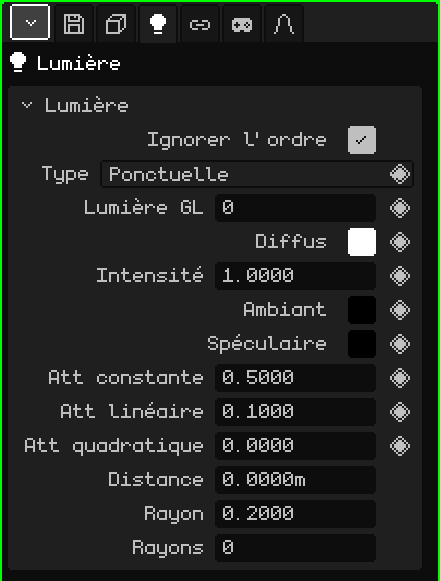

# Lumière

Une **lumière** éclaire la scène : les matériaux qui ont l'Éclairage activé paraissent plus clairs ou plus sombres selon les lumières qui les atteignent. Cet article est la référence de ses propriétés ; la façon d'ajouter et de déplacer les objets est expliquée dans le tutoriel [Le Mode Objet](../tutoriales/modo-objeto.md).

## Les trois types

| Type | Comment elle éclaire | Pour quoi faire |
|---|---|---|
| **Ponctuelle** | Depuis un point, dans toutes les directions, comme une ampoule. | Lampes, bougies, feux de camp, la lueur d'un objet. |
| **Soleil** | Avec des rayons parallèles qui viennent tous du même côté. Ce qui compte, c'est la direction vers laquelle il pointe, pas l'endroit où il se trouve. | La lumière du jour en extérieur. |
| **Spot** | En cône, comme une lampe torche. | Lampes torches, phares de voiture, projecteurs de scène. |

Ajouter → Lumière crée une lumière Ponctuelle ; Ajouter → Soleil et Ajouter → Spot créent directement les deux autres. Le type peut être changé ensuite avec la propriété **Type**.

Le soleil et le spot s'orientent en faisant pivoter l'objet. Le soleil dessine toujours une ligne jusqu'au sol, dans la direction où il éclaire ; avec la lumière sélectionnée, le spot montre son cône et la ponctuelle une sphère de la taille de sa **Distance**.

## Les onglets

| Onglet | Contenu |
|---|---|
| Objet | Position, rotation, nom et visibilité, comme pour tous les objets : voir [Maillage 3D](objeto-malla.md#longlet-objet). |
| Lumière | La carte ci-dessous. |
| Contraintes | Voir [Contraintes](restricciones.md). |
| Scripts | Les scripts Lua de l'objet. Voir [Lua dans Whisk3D](../lua/README.md). |

## La carte Lumière

| Propriété | Ce qu'elle fait |
|---|---|
| Ignorer l'ordre | Coché (par défaut), la lumière éclaire toute la scène, quelle que soit sa place dans l'Outliner. Décoché, elle n'éclaire que ce qui est dessiné **après** elle dans l'Outliner : utile pour éclairer certaines choses avec certaines lumières. |
| Type | Ponctuelle, Soleil ou Spot. |
| Lumière GL ◆ | Laquelle des 8 lumières d'OpenGL elle utilise (de 0 à 7). Voir [Plus de 8 lumières](#plus-de-8-lumières). |
| Diffus ◆ | La couleur de la lumière. |
| Intensité ◆ | La force de l'éclairage. 1 donne la couleur telle quelle ; au-dessus, c'est plus fort. |
| Ambiant ◆ | Une lumière uniforme qui arrive partout, y compris sur les faces qui ne regardent pas la lumière. Noire au départ (sans ambiance). Augmentez-la un peu pour que les ombres ne restent pas noires. |
| Spéculaire ◆ | La couleur du reflet brillant que la lumière laisse sur les matériaux. Noire au départ (sans brillance). |
| Att constante, Att linéaire, Att quadratique ◆ | L'**atténuation** : comment la lumière s'éteint avec la distance. Constante l'affaiblit uniformément partout ; Linéaire l'éteint peu à peu en s'éloignant ; Quadratique l'éteint beaucoup plus vite au loin. N'apparaissent pas pour le Soleil. |
| Angle spot ◆ | Uniquement pour le Spot : l'ouverture du cône, en degrés, du centre jusqu'au bord. Avec 45, le cône s'ouvre de 90° au total. |
| Exposant spot ◆ | Uniquement pour le Spot : la répartition de la lumière dans le cône. 0 éclaire uniformément ; plus haut, la lumière se concentre au centre et les bords s'assombrissent. |
| Distance | Jusqu'où éclaire une lumière Ponctuelle ou un Spot dans le lancer de rayons, en mètres ; c'est aussi la longueur du cône dessiné. 0 signifie sans limite. N'apparaît pas pour le Soleil. |
| Rayon | Pour le lancer de rayons : la taille de la lampe. 0 donne des ombres dures, aux bords nets ; plus grand donne des ombres aux bords doux. Pour le Soleil, ce sont des degrés. |
| Rayons | Pour le lancer de rayons : le nombre de rayons d'ombre qu'envoie cette lumière. Plus il y a de rayons, plus les ombres douces sont propres, mais plus c'est lent. 0 utilise ceux de l'onglet Fichier / Rendu. |

### Distance et atténuation

Les deux changent la portée d'une lumière, mais pas de la même façon :

- L'**atténuation** s'applique toujours, dans la Vue 3D, dans le jeu et dans le lancer de rayons : la lumière s'éteint peu à peu avec la distance, mais ne s'arrête jamais complètement.
- La **Distance** est une coupure pour le lancer de rayons : la lumière s'éteint en douceur jusqu'à atteindre zéro exactement là, et au-delà elle n'éclaire plus. Dans OpenGL, elle ne coupe pas : c'est l'atténuation qui commande. Elle sert aussi de repère, car la sphère ou le cône montrent où elle se termine.

## Plus de 8 lumières

OpenGL dessine jusqu'à **8 lumières à la fois**, numérotées de 0 à 7 : c'est la propriété **Lumière GL**. La scène peut en avoir beaucoup plus ; au-delà de 8, les nouvelles partagent leur numéro avec l'une des précédentes. Le lancer de rayons, en revanche, les utilise toutes.

Avec **Ignorer l'ordre** décoché, on peut réutiliser un numéro exprès : une lumière avec la Lumière GL 0 éclaire ce qui est dessiné après elle dans l'Outliner, et une autre lumière plus bas avec la même Lumière GL 0 la remplace pour la suite. Ainsi, un long décor peut avoir des lumières différentes dans chaque zone sans dépasser 8.

## Exemples

| Scène | Comment la construire |
|---|---|
| Un extérieur de jour | Un Soleil, avec un Diffus à peine jaune, et un peu d'Ambiant bleu ciel pour que les ombres ne restent pas noires. |
| Une pièce avec une lampe | Une Ponctuelle dans la lampe, avec Att linéaire un peu plus haute pour qu'elle s'éteigne vers les murs. Pour le lancer de rayons, une Distance de la taille de la pièce. |
| Une lampe torche | Un Spot avec un petit Angle spot et un Exposant spot élevé, collé à la main du personnage avec une contrainte [Child Of](restricciones.md#child-of). |
| Une lumière qui vacille | Des images clés sur l'Intensité (◆), avec des valeurs qui montent et descendent. |
