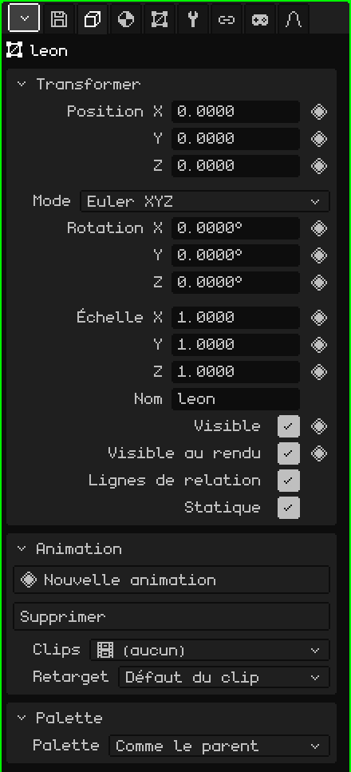
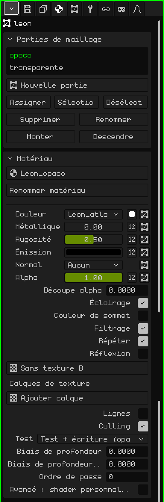
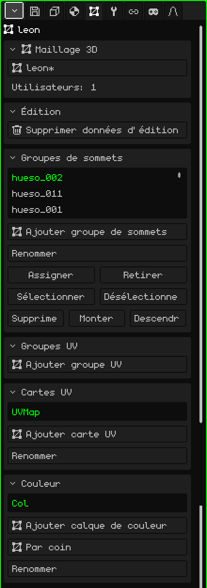
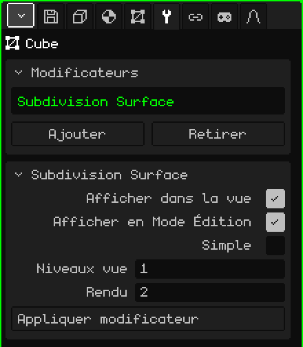

# Maillage 3D

Un **maillage 3D** est l'objet qui a une forme : il est fait de sommets, d'arêtes et de faces, et c'est ce que l'on modélise, peint et anime. Un cube, un personnage ou un décor entier sont des maillages. Cet article est la référence de ses propriétés ; la façon de créer, déplacer et apparenter les objets est expliquée dans le tutoriel [Le Mode Objet](../tutoriales/modo-objeto.md).

## Les onglets

Avec un maillage sélectionné, Propriétés affiche ces onglets, en plus de Fichier / Rendu et Animation, qui sont toujours là :

| Onglet | Contenu |
|---|---|
| Objet | Ce qui est commun à tous les objets : position, rotation, échelle, nom et visibilité. |
| Matériau | Les parties du maillage et le matériau de chacune. |
| Maillage 3D | Les données du maillage : lequel il utilise, ses groupes de sommets, ses cartes UV et ses calques de couleur. |
| Modificateurs | Les modificateurs, qui changent la forme sans la détruire. |
| Transformer | Uniquement en Mode Édition : le centre de la sélection, pour le saisir en chiffres. |
| Contraintes | Voir [Contraintes](restricciones.md). |
| Scripts | Les scripts Lua de l'objet. Voir [Lua dans Whisk3D](../lua/README.md). |

## L'onglet Objet

Il est le même pour tous les types d'objet : les caméras, les lumières, les armatures et les sons l'ont aussi.

### Transformer

| Propriété | Ce qu'elle fait |
|---|---|
| Position X, Y, Z ◆ | L'endroit où se trouve l'objet, en mètres. Z est la hauteur. |
| Mode | La façon d'écrire la rotation : **Euler XYZ** (trois angles en degrés, le plus facile à lire), **Quaternion (WXYZ)** ou **Axe-angle**. Avec les deux derniers apparaît **Rotation W**. Changer de mode ne fait pas tourner l'objet : cela change seulement la façon dont les nombres sont affichés. |
| Rotation X, Y, Z ◆ | La rotation autour de chaque axe. |
| Échelle X, Y, Z ◆ | La taille sur chaque axe : 1 est la taille d'origine, 2 le double et 0.5 la moitié. |
| Nom | Le nom de l'objet, le même que celui qu'affiche l'Outliner. Il ne peut pas être répété : s'il existe déjà, un numéro est ajouté (`.001`). |
| Visible ◆ | Si l'objet est visible. C'est le même œil que dans l'Outliner. |
| Visible au rendu ◆ | S'il apparaît dans les rendus. Décoché, il reste visible dans la Vue 3D mais n'apparaît ni dans l'image ni dans la vidéo. |
| Lignes de relation | La ligne qui relie l'objet à son parent. Il est utile de la désactiver quand un objet a beaucoup d'enfants et que les lignes encombrent la vue. |
| Statique | Indique que l'objet ne bouge jamais. N'a d'importance qu'à l'intérieur d'un objet Culling avec la méthode de grille : un objet statique est placé dans sa cellule une seule fois, au lieu d'être mesuré à chaque image. |

### Animation et Palette

- **Animation :** les animations propres à l'objet, comme une animation de sommets, et leurs clips. Voir [Timeline](linea-de-tiempo.md).
- **Palette :** la palette de couleurs qu'utilise l'objet. Avec **Comme le parent** (par défaut), il en hérite ; choisir une palette du projet le repeint, lui et tout ce qui en dépend.

## L'onglet Matériau

### Parties de maillage

Un maillage peut être divisé en **parties**, et chaque partie a son matériau. Une maison, par exemple, peut avoir les murs dans une partie et le verre des fenêtres dans une autre.

| Propriété | Ce qu'elle fait |
|---|---|
| La liste | Les parties du maillage. Celle qui est choisie est celle qu'affiche la carte Matériau en dessous. |
| Nouvelle partie | Crée une partie vide. |
| Assigner | Fait passer dans la partie choisie les faces sélectionnées en Mode Édition. |
| Sélectionner / Désélectionner | Sélectionne ou désélectionne les faces de cette partie. Si nécessaire, Sélectionner passe en Mode Édition pour les montrer. |
| Supprimer / Renommer | Supprime la partie (ses faces passent à la précédente) ou la renomme. Supprimer apparaît s'il y en a plus d'une. |
| Monter / Descendre | Changent l'ordre. Les parties sont dessinées dans cet ordre : mieux vaut laisser ce qui est transparent à la fin. |

### Matériau

Le matériau décide de l'apparence de la partie : sa couleur, sa texture et la façon dont la lumière l'éclaire. Le matériau par défaut ne se modifie pas : pour changer quelque chose, il faut d'abord en créer un avec le sélecteur du haut (**Nouveau matériau**), qui sert aussi à choisir un autre matériau du projet. Les options les plus utilisées :

| Propriété | Ce qu'elle fait |
|---|---|
| Renommer matériau | Change le nom du matériau. |
| Couleur | La texture de la partie, le petit carré de la **Couleur de base** et la carte UV qu'utilise la texture. |
| Métallique, Rugosité, Émission, Normal, Alpha | Chacun peut être un nombre ou une texture (le bouton **Nombre / texture**). Alpha est la transparence : en dessous de 1, ou avec une texture d'alpha, le matériau devient transparent. |
| Découpe alpha | Coupe ce qui a un alpha faible, sans mélange : pour les grilles, les grillages ou les feuilles. 0 la désactive. |
| Transmission, IOR | Verre et réfraction. Uniquement avec le **Lancer de rayons** activé (onglet Fichier / Rendu). |
| Éclairage | Si les lumières de la scène l'éclairent. Désactivé, la couleur paraît plate, toujours identique. Si le backend graphique a des shaders, **Ombrage** apparaît : Par sommet ou Par pixel. |
| Couleur de sommet | Utilise les couleurs peintes sur le maillage (voir [Peinture de sommets](pintura.md#peinture-de-sommets)) au lieu de la couleur de base. |
| Filtrage / Répéter | Lisse la texture vue de près (décoché, on voit les pixels) / la répète comme une mosaïque. |
| Réflexion | Un reflet de l'environnement, comme du chrome. |
| Calques de texture | Jusqu'à quatre textures de plus par-dessus la première, chacune avec sa carte UV et son mélange. |
| Lignes / Épaisseur de ligne | Dessine les arêtes de la partie, avec l'épaisseur en pixels. |
| Culling | Ne dessine pas les faces arrière. |
| Test, Biais de profondeur, Ordre de passe | Options avancées de profondeur, pour les décalcomanies et les choses posées sur d'autres. |
| Avancé : shader personnalisé | Un fichier qui dessine le matériau sur mesure : voir [Shaders écrits](shaders.md). |

Si l'objet a de la physique (Ajouter → Physique), sa carte **Physique** apparaît aussi dans cet onglet.

## L'onglet Maillage 3D

### Maillage 3D

La forme de l'objet est une ressource du projet, et plusieurs objets peuvent **partager** le même maillage (c'est ce que fait Dupliquer lié) : en modifier un les modifie tous.

| Propriété | Ce qu'elle fait |
|---|---|
| Le sélecteur | Le maillage qu'utilise l'objet (avec un `*` s'il a des modifications non enregistrées). C'est là qu'on choisit un autre maillage du projet ou **Nouvelle copie**. |
| Utilisateurs | Le nombre d'objets de la scène qui utilisent ce maillage. |
| Rendre unique | Apparaît si le maillage est partagé : donne à l'objet sa propre copie, pour la modifier sans toucher aux autres. |

Si le maillage provient d'une bibliothèque, l'avertissement "Il appartient à une bibliothèque (lecture seule) : ouvrez la bibliothèque pour l'éditer" apparaît, et ce qui le modifierait disparaît du panneau.

### Édition

**Supprimer données d'édition** sert pour un décor que l'on ne va plus modéliser : il retire du maillage les données qu'utilise le Mode Édition, pour qu'il se charge plus vite et occupe moins de mémoire (cela compte sur le Nokia N95). En attendant, on ne peut pas entrer en Mode Édition. **Convertir en maillage éditable** les recalcule.

La case **Verrouiller normales** fait qu'en Mode Édition, quand on déplace des sommets, les normales de ce maillage ne sont pas recalculées. On conserve ainsi celles qui venaient avec un modèle importé ou celles qui ont été corrigées à la main. Elle est désactivée par défaut, et chaque maillage a la sienne.

### Groupes de sommets

Un **groupe de sommets** est une liste de sommets avec un poids chacun. C'est ce qu'utilise une [armature](objeto-esqueleto.md) pour savoir quels sommets déplace chaque os : le groupe porte le même nom que l'os. Les poids se peignent avec la [Peinture de poids](pintura.md#peinture-de-poids).

| Propriété | Ce qu'elle fait |
|---|---|
| Ajouter groupe de sommets / Renommer | Crée un groupe ou le renomme. |
| Assigner / Retirer | Met dans le groupe (avec un poids de 1) ou en retire les sommets sélectionnés en Mode Édition. |
| Sélectionner / Désélectionner | Sélectionne ou désélectionne les sommets du groupe, pour voir ce qu'il prend. |
| Supprimer / Monter / Descendre | Supprime le groupe ou le déplace dans la liste. |

**Groupes UV** fonctionne de la même façon, mais ses poids sont destinés aux armatures 2D de l'[Éditeur UV](editor-uv.md).

### Cartes UV

Une **carte UV** indique comment la texture se pose sur le maillage. Un maillage peut en avoir plusieurs : par exemple, une pour la texture de couleur et une autre pour un calque de texture qui se répète différemment. Chaque texture du matériau choisit celle qu'elle utilise.

**Ajouter carte UV** en crée une, **Renommer** la renomme, et Supprimer, Monter et Descendre apparaissent quand il y en a plus d'une.

### Couleur

Les **calques de couleur** gardent les couleurs peintes sur le maillage avec la Peinture de sommets. **Ajouter calque de couleur** en crée un ; **Mode de couleur** alterne entre **Par sommet** (les faces qui partagent un sommet partagent sa couleur) et **Par coin** (chaque face peut avoir la sienne, pour des bords nets). Renommer, Supprimer, Monter et Descendre, comme pour les cartes UV.

## L'onglet Modificateurs

Un **modificateur** change le maillage sans le détruire : on peut le désactiver, le réordonner ou le supprimer quand on veut, et le maillage d'origine reste là.

La carte **Modificateurs** contient la liste (ils s'appliquent dans l'ordre, de haut en bas), **Ajouter** (le menu avec les types), **Retirer** et **Monter / Descendre**. En dessous, la carte du modificateur choisi (avec son nom comme titre) propose **Afficher dans la vue** (désactivé, il n'est pas calculé), **Afficher en Mode Édition** (désactivé, l'édition est plus rapide et il est recalculé en sortant), ses propriétés et **Appliquer modificateur**, qui l'intègre définitivement au maillage et le retire de la liste.

Chaque modificateur a son article :

| Modificateur | À quoi il sert |
|---|---|
| [Vis](modificador-screw.md) | Fait tourner un profil autour d'un axe : vis, vases, ressorts. |
| [Miroir](modificador-espejo.md) | Reflète le maillage : on modélise une moitié et l'autre apparaît toute seule. |
| [Array](modificador-array.md) | Des copies en rangée : escaliers, clôtures, chaînes. |
| [Surface de subdivision](modificador-subdivision.md) | Lisse le maillage en le subdivisant. |
| [Booléen](modificador-booleano.md) | Unit, intersecte ou soustrait un autre objet. |
| [Culling](modificador-culling.md) | Optimisation : ne dessine pas ce qui n'est pas visible depuis la caméra. |
| [Armature](modificador-esqueleto.md) | Déforme le maillage avec une armature. |
