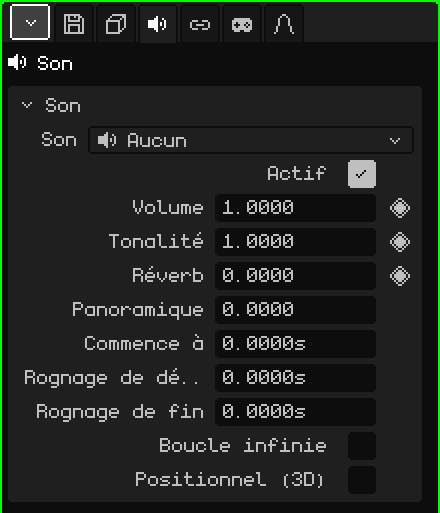

# Son

Un objet **Son** est un audio placé dans la scène : une musique, un effet, le bruit d'une machine. Dans la Vue 3D, il apparaît comme un haut-parleur. Il peut sonner pareil partout, comme une musique, ou depuis l'endroit où il se trouve, plus fort quand on s'en approche. Cet article est la référence de ses propriétés ; la façon d'ajouter et de déplacer les objets est expliquée dans le tutoriel [Le Mode Objet](../tutoriales/modo-objeto.md).

Un nouvel objet Son démarre sans audio : **Aucun**. Le fichier se choisit dans la carte Son.

## Avec le son déjà choisi

-  Faire glisser un son depuis la [Bibliothèque](outliner.md#vue-bibliothèque) vers la Vue 3D crée un objet Son là où il tombe, avec ce son.
-  Déposer un fichier son (par exemple un `.wav`) sur la Vue 3D l'ajoute au projet et y crée l'objet.

## Les onglets

| Onglet | Contenu |
|---|---|
| Objet | Position, nom et visibilité, comme pour tous les objets : voir [Maillage 3D](objeto-malla.md#longlet-objet). Un son masqué ne sonne pas, et masquer une collection fait taire les sons qu'elle contient. |
| Son | La carte ci-dessous. |
| Contraintes | Voir [Contraintes](restricciones.md). |
| Scripts | Les scripts Lua de l'objet, qui peuvent le faire sonner ou le faire taire dans un jeu. Voir [Lua dans Whisk3D](../lua/README.md). |

## La carte Son

| Propriété | Ce qu'elle fait |
|---|---|
| Son | Le fichier joué, avec sa durée. Le menu liste les sons du projet, **Aucun** et **Charger son depuis l'explorateur...**, qui en apporte un du disque vers le projet. |
| Actif | Décoché, il ne sonne pas. Sert à le couper sans le supprimer. |
| Volume ◆ | Le niveau sonore : 1 est le volume du fichier, 0 est muet et 2 le double. |
| Tonalité ◆ | Plus aigu ou plus grave. 1 est l'original ; 2 sonne une octave plus aigu et deux fois plus vite, 0.5 une octave plus grave et à moitié vitesse. C'est pourquoi changer la tonalité change aussi la durée. |
| Réverb ◆ | La part de ce son qui va dans l'écho de la réverbération : 0 rien, 1 tout. Donne une impression de grotte, d'église ou de couloir. |
| Panoramique | Le côté d'où il sonne : -1 à gauche, 0 au milieu, 1 à droite. Uniquement sans Positionnel (3D) : avec lui, c'est sa position qui décide du côté. |
| Commence à | La seconde de la scène à laquelle il démarre. |
| Rognage de début | Le nombre de secondes coupées au début du fichier. |
| Rognage de fin | Le nombre de secondes coupées à la fin du fichier. |
| Boucle infinie | Le passage compris entre les deux rognages se répète sans arrêt, sans coupure. Pour les musiques de fond et les bruits continus. |
| Positionnel (3D) | Sonne depuis l'endroit où se trouve l'objet. Voir plus bas. |
| Rayon à plein volume | Uniquement avec Positionnel (3D) : jusqu'à cette distance, en mètres, il sonne à plein volume. |
| Portée audible | Uniquement avec Positionnel (3D) : à partir de cette distance, en mètres, on ne l'entend plus. |

## Les temps sont en secondes

Les temps du son se mesurent en **secondes**, pas en images. Ainsi, si la scène passe de 30 à 60 images par seconde, les sons restent calés sur le même moment et il n'y a rien à réajuster.

Dans la [Timeline](linea-de-tiempo.md#sons), chaque son sélectionné a sa **bande** : où il démarre et combien de temps il dure. Faire glisser la bande change **Commence à**, et attraper l'une de ses extrémités change les rognages. Il sonne avec la lecture de la timeline et se tait à l'arrêt.

Dans un jeu, le son démarre quand il apparaît (par exemple, celui d'une explosion qui fait partie d'un prefab), plus ce qu'indique **Commence à**.

## Positionnel (3D)

Décoché, le son s'entend pareil où qu'il soit, comme une musique. Coché, il s'entend **depuis l'endroit où il se trouve**, par rapport à celui qui écoute :

- Plus près, plus fort : jusqu'au **Rayon à plein volume**, il sonne à plein volume, puis il baisse jusqu'à s'éteindre à la **Portée audible**.
- S'il est à droite, il sonne à droite ; s'il est à gauche, à gauche.
- S'il est derrière, il sonne plus bas et plus au centre.

Celui qui écoute est la caméra active dans le jeu et la Vue 3D active dans l'éditeur (ou la caméra, si l'on regarde à travers elle). Avec le son sélectionné, la Vue 3D dessine deux sphères : celle du rayon à plein volume et celle de la portée audible.

## Exemples

| Son | Comment le construire |
|---|---|
| Musique de fond | Sans Positionnel (3D), avec Boucle infinie. |
| Une cascade | Positionnel (3D) et Boucle infinie, avec un petit Rayon à plein volume et une grande Portée audible : on commence à l'entendre de loin et il grandit quand on s'approche. |
| Un coup à 4 secondes d'une animation | Commence à 4, ou la bande déplacée jusque-là dans la Timeline. À 30 FPS, c'est l'image 121 : l'image 1 correspond à la seconde 0. |
| Une musique qui s'éteint à la fin | Des images clés sur le Volume (◆) : 1 un peu avant la fin et 0 à la fin. |
