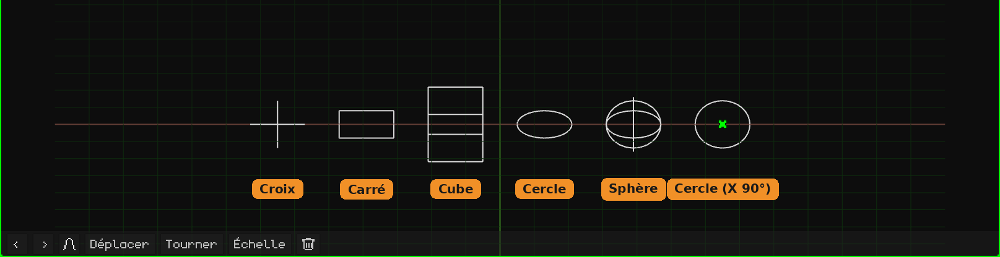

# Vide

Un **Vide** est un objet sans maillage : il n'apparaît ni au rendu ni dans le jeu. Il sert de point de référence : un pivot pour faire pivoter ou mettre à l'échelle d'autres objets qui en dépendent, un endroit vers lequel pointer une caméra ou une contrainte, un contrôleur pour animer. Il s'ajoute avec **Ajouter → Vide**, au curseur 3D. La façon d'ajouter et de déplacer les objets est expliquée dans le tutoriel [Le Mode Objet](../tutoriales/modo-objeto.md).

Dans la Vue 3D, il est dessiné avec des lignes. Un nouveau Vide est un **cercle couché sur le sol**, facile à voir et à attraper. La forme, la taille et la rotation du dessin se changent dans sa carte. Ce n'est **que son apparence** : cela ne change ni l'objet, ni sa transformation, ni ses enfants.

## Les onglets

| Onglet | Contenu |
|---|---|
| Objet | Position, rotation, échelle, nom et visibilité, comme pour tous les objets : voir [Maillage 3D](objeto-malla.md#longlet-objet). Mettre le Vide à l'échelle met aussi ses enfants à l'échelle. |
| Vide (la croix) | La carte ci-dessous. |
| Contraintes | Voir [Contraintes](restricciones.md). |
| Scripts | Les scripts Lua de l'objet. Voir [Lua dans Whisk3D](../lua/README.md). |

## La carte Vide

| Propriété | Ce qu'elle fait |
|---|---|
| Forme | La façon dont il est dessiné, chacune avec son icône : **Croix** (les trois axes), **Carré**, **Cube**, **Cercle** ou **Sphère** (trois cercles, un par axe). Le carré et le cercle naissent couchés sur le sol. Sur les petits écrans (le Nokia N95, la PSP, la 3DS et la Dreamcast), le cercle et la sphère sont dessinés avec moitié moins de lignes : la différence ne s'y voit pas et le téléphone dessine moins. |
| Taille | La dimension du dessin, en mètres, d'un bout à l'autre. 1 correspond à un mètre. |
| Rotation X, Y, Z | Fait pivoter le dessin, en degrés. Par exemple, le cercle avec **X** à 90 se retrouve debout. |

Rien de tout cela ne déplace ni ne fait pivoter l'objet : le Vide reste au même endroit et ses enfants ne s'en aperçoivent pas. C'est enregistré avec le projet.

## À quoi il sert

- **Un pivot :** un objet enfant d'un Vide pivote et se met à l'échelle depuis le Vide. Par exemple, une balle apparentée à un Vide placé à son point le plus bas s'écrase contre le sol quand on met le Vide à l'échelle.
- **Organiser la scène :** plusieurs objets rattachés à un Vide se déplacent ensemble en déplaçant seulement le Vide.
- **Une cible :** les [contraintes](restricciones.md) peuvent pointer vers un Vide, par exemple pour qu'une caméra continue de le regarder.
