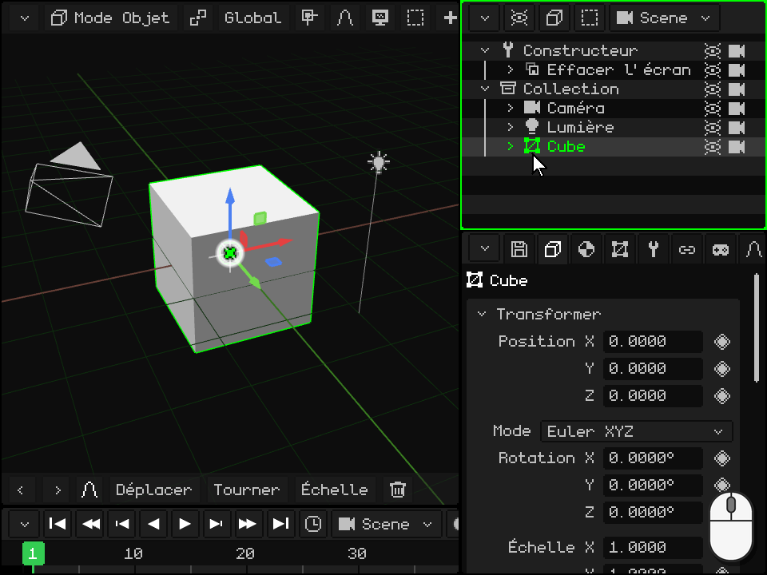
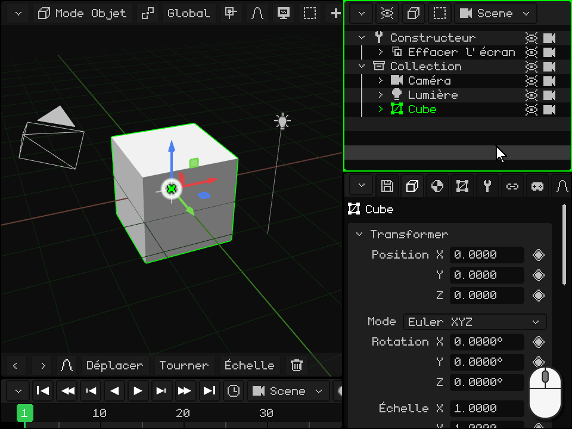
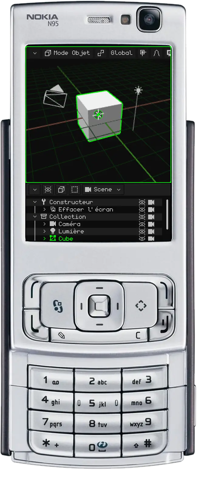
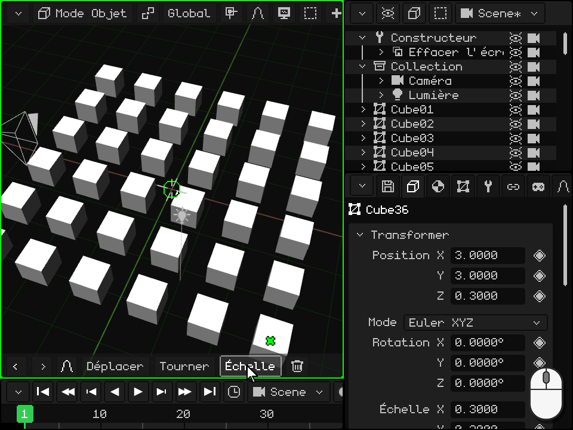

# L'Outliner

> [!NOTE]
>  Le Nokia N95 prend en charge une souris et un clavier (en Bluetooth). Les parties de cette page consacrées au Nokia expliquent comment l'utiliser sans souris ni clavier, uniquement avec les touches du téléphone.

L'**Outliner** est la liste de tout ce que contient la scène : objets, caméras, lumières et collections. C'est l'un des viewports présentés dans [Les viewports](interfaz.md) ; sur PC, il se trouve en haut à droite. C'est ici que l'on sélectionne les objets, qu'on les masque, qu'on les ordonne, qu'on les place les uns dans les autres et qu'on les renomme.

Ce que vous sélectionnez dans l'Outliner est aussi sélectionné dans la Vue 3D, et inversement. Le dernier que vous avez sélectionné est l'**objet actif** : celui qu'affiche Propriétés.

 **Sur Android**, l'Outliner n'est pas affiché à l'écran : la place est réservée à la Vue 3D et à Propriétés. Pour l'utiliser, transformez un viewport en Outliner (ou divisez-en un) avec le bouton du coin, comme dans [Changer le type](interfaz.md#changer-le-type). On peut aussi travailler sans l'Outliner : les objets se sélectionnent en les touchant dans la Vue 3D, et Propriétés contient le nom et les cases **Visible** et **Visible au rendu**.

 **Sur le Nokia N95**, l'Outliner n'est pas affiché à l'écran : seuls deux viewports y tiennent. Le temps d'organiser la scène, transformez Propriétés en Outliner : avec la **touche de sélection gauche**, vous entrez dans ses onglets, et avec la flèche gauche, vous arrivez au menu du bouton du coin ; choisissez-y Outliner. Pour revenir, la touche de sélection gauche ouvre directement ce menu dans l'Outliner. Avec la **touche verte** , vous en faites le viewport actif : tout ce qui suit pour le N95 se fait avec la bordure verte sur l'Outliner.

## Ce qu'affiche chaque ligne

Chaque ligne est un objet. La **flèche** replie ou déplie ce qu'il contient ; l'**icône** indique son type (maillage, caméra, lumière, collection...) ; vient ensuite le **nom**, en vert s'il est actif et dans un vert plus foncé s'il est sélectionné ; et à droite, l'**œil** et la **caméra**. Un objet placé dans un autre apparaît plus à droite, suspendu à lui, et une ligne pâle est un objet masqué.

Dans un nouveau projet, on trouve en haut le **Constructeur**, une routine qui prépare l'écran, et en dessous la **Collection** avec la caméra, la lumière et le cube. Une collection est un dossier pour ranger.

## Sélectionner

| | Comment sélectionner |
|---|---|
|  PC | Un clic sur la ligne sélectionne uniquement cet objet. <kbd>Shift</kbd> + clic sélectionne toutes les lignes depuis l'actif jusqu'à celle-ci. <kbd>Ctrl</kbd> + clic en ajoute ou en retire une. Avec la souris au-dessus de l'Outliner, les flèches haut et bas passent à la ligne précédente ou à la suivante. |
|  Écran tactile | Un toucher sur la ligne. Avec **Shift** ou **Ctrl** activés dans la barre d'outils de la Vue 3D, le toucher fait la même chose qu'avec le clavier. Faire glisser le doigt fait défiler la liste. |
|  Nokia N95 | Les flèches haut et bas passent à la ligne précédente ou à la suivante, et la liste défile toute seule pour la suivre. |
| Menu | Sélectionner → Tout sélectionner, Tout désélectionner ou Inverser la sélection |

## Replier et déplier

Quand un objet en contient d'autres, sa flèche les affiche ou les cache. Replier ce que vous n'utilisez pas garde la liste courte.

| | Comment replier et déplier |
|---|---|
|  PC | Un clic sur la flèche. Avec la souris au-dessus de l'Outliner, la flèche droite du clavier déplie l'actif et la gauche le replie ; s'il était déjà replié, la gauche remonte à celui qui le contient et le replie. |
|  Écran tactile | Un toucher sur la flèche. |
|  Nokia N95 | Droite déplie l'actif et gauche le replie ; s'il était déjà replié, gauche remonte à celui qui le contient et le replie. |

## Masquer : l'œil et la caméra

- L'**œil** affiche ou masque l'objet dans la Vue 3D. Un objet masqué n'apparaît pas non plus au rendu. S'il en contient d'autres, ils sont masqués avec lui et leurs lignes deviennent pâles.
- La **caméra** décide s'il apparaît au **rendu**. Désactivée, l'objet reste visible pendant que vous travaillez, mais n'apparaît pas dans les images ni dans les vidéos dont vous faites le rendu.

Cliquer ou toucher dessus ne change pas la sélection.

| | L'œil | La caméra |
|---|---|---|
|  PC | Clic sur l'œil, ou <kbd>H</kbd> (avec la souris au-dessus de l'Outliner) pour l'actif | Clic sur la caméra |
|  Écran tactile | Un toucher sur l'œil | Un toucher sur la caméra |
|  Nokia N95 | <kbd>2</kbd>, celui de l'actif | <kbd>3</kbd>, celle de l'actif |
| Menu | Élément → Masquer/Afficher (celui de l'actif) | — |

Les deux se trouvent aussi dans Propriétés, dans la carte Transformer : **Visible** et **Visible au rendu**. Elles ont leur losange, elles peuvent donc être animées : par exemple, pour que quelque chose apparaisse à un moment de la vidéo.

## Ordonner et placer un objet dans un autre

L'ordre de la liste peut être modifié, et un objet peut être placé **dans** un autre : il devient son **enfant**, et quand le parent se déplace, pivote ou change d'échelle, l'enfant le suit. C'est ce que [Le Mode Objet](../tutoriales/modo-objeto.md#loutliner--les-objets-de-la-scène) appelle **apparenter**. L'objet ne bouge pas de sa place dans la scène : seule sa place dans la liste change.

 **À la souris :** saisissez la ligne et faites-la glisser. Sur le bord supérieur ou inférieur d'une autre ligne apparaît une **ligne verte** : quand vous relâchez, l'objet se place avant ou après cette ligne, au même niveau. Au milieu d'une autre ligne, celle-ci est mise en surbrillance : quand vous relâchez, l'objet se place **dans** celle-ci. Relâché sous la dernière ligne, il sort de tout ce qui le contenait. Près du bord supérieur ou inférieur, la liste défile toute seule : vous pouvez ainsi atteindre n'importe quelle ligne d'une longue liste.

 **Au doigt :** gardez le doigt immobile sur la ligne pendant une seconde, jusqu'à ce que le téléphone vibre : la ligne est saisie. Faites-la ensuite glisser et relâchez-la comme à la souris. Si vous la relâchez sans la déplacer, le menu de l'objet s'ouvre. Sans cette attente, faire glisser le doigt fait défiler la liste.

 **Sur le Nokia N95 :** choisissez la ligne avec les flèches et appuyez sur <kbd>1</kbd>. La ligne devient verte, et les flèches la déplacent désormais :

-  **Haut** et **bas** la montent ou la descendent parmi celles qui sont au même niveau.
-  **Droite** la place dans celle qui se trouve au-dessus, au même niveau.
-  **Gauche** la sort de celle qui la contient : elle se place juste après, à son niveau.
-  <kbd>1</kbd> une seconde fois (ou <kbd>OK</kbd>) la laisse là. <kbd>C</kbd> annule et la remet où elle était.

 Tout le trajet s'annule d'un coup, avec <kbd>C</kbd> + gauche. Cela sert, par exemple, à placer une lumière avant les objets qu'elle éclaire.

## Trouver l'actif et le cadrer

Dans une grande scène, la liste est longue, et sélectionner quelque chose dans la Vue 3D ne la fait pas défiler : sa ligne peut rester hors de vue. Pour la retrouver dans la liste, ou pour voir l'objet dans la Vue 3D (le **cadrer**, comme dans [Cadrer la sélection](../tutoriales/navegacion.md#cadrer-la-sélection)) :

| | Dans l'Outliner | Dans la Vue 3D |
|---|---|---|
|  PC | <kbd>Num .</kbd> avec la souris au-dessus de l'Outliner (**Afficher l'actif**) : la liste défile jusqu'à ce que la sélection se retrouve au milieu. S'il se trouve dans quelque chose de replié, il n'a pas de ligne : dépliez-le d'abord. | <kbd>Num .</kbd> avec la souris au-dessus de la Vue 3D |
|  Écran tactile | Faites glisser la liste avec le doigt | Double toucher à deux doigts sur la Vue 3D |
|  Nokia N95 | La liste suit toute seule la ligne que vous choisissez avec les flèches | Un appui bref sur le <kbd>0</kbd>, même si le viewport actif est l'Outliner |
| Menu | — | Vue → Cadrer la sélection, dans la barre de la Vue 3D |

## Renommer

| | Comment renommer |
|---|---|
|  PC | Double-clic sur le nom, ou <kbd>F2</kbd> pour l'actif : la ligne devient un champ de texte. Écrivez le nouveau nom et confirmez avec <kbd>Enter</kbd> ou avec un clic à l'extérieur ; <kbd>Esc</kbd> le laisse tel qu'il était. |
|  Écran tactile | Double toucher sur le nom : le clavier de l'écran s'ouvre. |
|  Nokia N95 | Avec la touche de sélection gauche, vous entrez dans la barre, et avec la flèche droite, vous arrivez à Élément → Renommer. Écrivez avec le T9 et confirmez avec <kbd>OK</kbd>. |
| Menu | Élément → Renommer |

Deux objets d'une même scène ne peuvent pas porter le même nom : si le nom est déjà pris, Whisk3D lui ajoute un numéro et vous prévient. Si un script désignait l'objet par son nom, il est mis à jour tout seul.

## Dupliquer et supprimer

| | Dupliquer | Supprimer |
|---|---|---|
|  PC | <kbd>Shift</kbd> + <kbd>D</kbd> ; <kbd>Alt</kbd> + <kbd>D</kbd> pour Dupliquer lié | <kbd>X</kbd> ou <kbd>Delete</kbd> |
|  Nokia N95 | Élément → Dupliquer | <kbd>C</kbd> |
| Menu | Élément → Dupliquer ou Dupliquer lié | Élément → Supprimer |

Depuis l'Outliner, la copie se place juste au-dessus de l'original, sans suivre la souris comme dans la Vue 3D : déplacez-la ensuite. Supprimer demande une confirmation, et les deux opérations peuvent être annulées.

## La barre de menus de l'Outliner

| Bouton | Contenu |
|---|---|
| **Options de vue** (l'œil) | Ce qui est affiché : le Constructeur, les autres routines, et les colonnes de l'œil et de la caméra (**Icônes de visibilité** et **Icônes de rendu**). |
| **Élément** (le cube) | Supprimer, Renommer, Déplacer, Masquer/Afficher, Dupliquer, Dupliquer lié, Créer prefab et Dépaqueter prefab. |
| **Sélectionner** | Tout sélectionner, Tout désélectionner et Inverser la sélection. |
| La scène | La scène, le jeu ou le prefab du projet en cours de modification ([Scènes, jeux et prefabs](outliner.md#scènes-jeux-et-prefabs)). |

 Un clic droit sur une ligne la sélectionne et ouvre le même menu à cet endroit, sous le pointeur.

 Au doigt, maintenez la ligne jusqu'à ce que le téléphone vibre et relâchez-la sans la déplacer : le même menu s'ouvre.

## La Bibliothèque

Les **ressources** du projet (maillages, matériaux, textures, animations, sons, scripts, prefabs...) ne sont pas dans l'Outliner : elles ont leur propre viewport, la **Bibliothèque**, que l'on choisit avec le bouton du coin. Elle affiche des miniatures dans des dossiers, indique quelles ressources sont utilisées et lesquelles ne le sont pas, et une ressource peut être glissée dans la Vue 3D : un maillage crée un objet, et un matériau s'applique à ce qui se trouve dessous. Elle est expliquée dans [Vue Bibliothèque](outliner.md#vue-bibliothèque) ; le reste de l'Outliner, dans son [manuel](outliner.md) et dans [Raccourcis](atajos.md#outliner).

## Vue Bibliothèque

| Fonction | Description |
|---|---|
| Ressources | Maillages, matériaux, textures, animations, prefabs, scènes, sons, scripts, [shaders](shaders.md), polices et vidéos, dans des dossiers. Un matériau ou un shader glissé sur un maillage de la 3D s'affiche sur la partie située sous le pointeur avant d'être relâché. Coche verte = utilisé ; croix rouge = orphelin ; `*` = non enregistré. |
| Filtre / Liste ou grille | Afficher un seul type ; voir les miniatures. |
| Faire glisser une ressource | Vers un dossier (la déplace), vers la Vue 3D (maillage = nouvel objet, matériau ou texture = assigné à ce qui est touché, prefab = instance) ou vers une liste déroulante de Propriétés. |
| Nouveau dossier / Déplacer vers dossier | Organiser (les dossiers ne servent qu'à ranger). |
| Dupliquer ressource / Sélectionner utilisateurs / Purger les orphelins | Copier, trouver qui l'utilise, supprimer ce que personne n'utilise. |
| Dans le .w3d / Externe | Depuis Propriétés (carte Ressource) : déplace la ressource dans le projet ou en dehors. |

## Scènes, jeux et prefabs

Le bouton qui porte le nom de la scène (dans l'Outliner et dans la Vue 3D) liste les scènes, les jeux et les prefabs du projet. C'est là qu'on en crée de nouveaux, qu'on choisit la scène de départ et qu'on transforme une scène en jeu (ou l'inverse).
