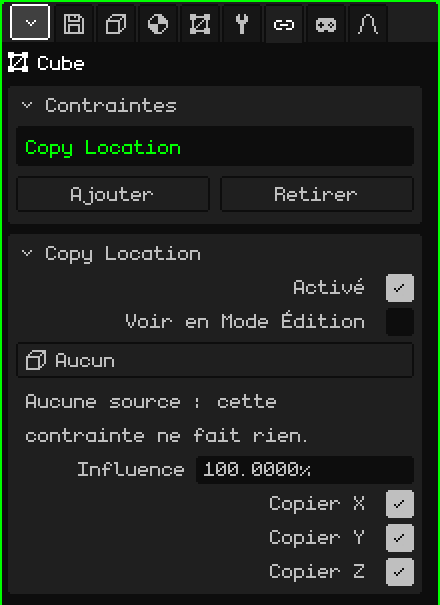
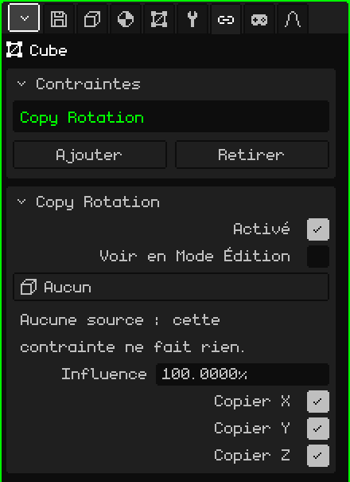
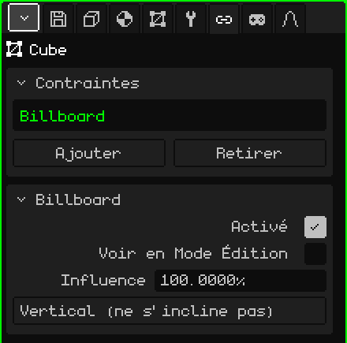
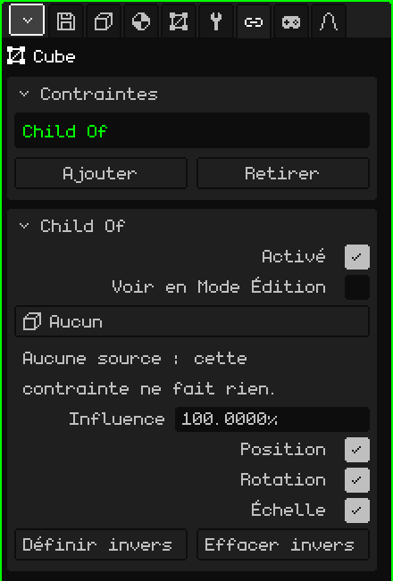

# Contraintes

Une **contrainte** (en anglais, *constraint*) fait qu'un objet prend quelque chose à un autre : sa position, sa rotation, le fait de toujours regarder la caméra ou de le suivre comme s'il était son enfant. Elle sert à ce que les choses se placent toutes seules, sans les animer à la main : une ombre qui reste sous le personnage, un arbre plat qui fait toujours face, une épée collée à la main. Cet article explique chacune d'elles et tous leurs paramètres ; la façon d'ajouter et de déplacer les objets est expliquée dans le tutoriel [Le Mode Objet](../tutoriales/modo-objeto.md).

## Où elles se trouvent

Dans Propriétés → onglet **Contraintes**. Tous les objets 3D l'ont : maillages, caméras, lumières, armatures, sons, vides. Les éléments 2D d'une interface ne l'ont pas.

Avant de voir chacune d'elles, trois choses valables pour toutes :

- **Elles ne changent pas les nombres de l'objet.** La contrainte s'applique par-dessus, au moment du dessin. La carte Transformer de l'onglet Objet continue d'afficher la position et la rotation propres de l'objet, et si la contrainte est désactivée ou supprimée, l'objet revient exactement là.
- **Elles sont calculées pour chaque vue.** Celles qui dépendent de la caméra (Billboard, ou une source **Vue**) utilisent la caméra qui est en train de dessiner : avec deux Vues 3D ouvertes, chacune voit le résultat depuis son propre point de vue. Dans le jeu, c'est la caméra active.
- **Elles fonctionnent pareil partout :** dans l'éditeur, dans le jeu compilé, sur Android et sur le Nokia N95.

## La carte Contraintes

| Propriété | Ce qu'elle fait |
|---|---|
| La liste | Les contraintes de l'objet. Celle qui est choisie est celle qu'affiche la carte du dessous. |
| Ajouter | Le menu avec les quatre types : **Copy Location**, **Copy Rotation**, **Billboard** et **Child Of**. |
| Retirer | Supprime la contrainte choisie. |
| Monter / Descendre | Changent l'ordre (apparaissent à partir de deux). |

L'**ordre** compte : elles s'appliquent de haut en bas, et chacune travaille sur ce qu'ont laissé celles du dessus. Si deux agissent sur la même chose, c'est celle du bas qui l'emporte.

## Ce qui est commun à toutes

En dessous apparaît la carte de la contrainte choisie, avec son nom comme titre. Ces trois lignes se trouvent dans tous les types :

| Propriété | Ce qu'elle fait |
|---|---|
| Activé | Active ou désactive la contrainte sans la supprimer. Utile pour comparer le résultat avec et sans elle. |
| Voir en Mode Édition | Désactivé (par défaut), pendant que l'on modifie les sommets de l'objet, la contrainte ne s'applique pas : le maillage est vu et modifié là où il se trouve réellement. Activé, elle s'applique aussi en Mode Édition. |
| Influence | Son poids, de 0 à 100 %. Avec 100, elle s'applique entièrement ; avec 0, elle ne fait rien ; entre les deux, l'objet se retrouve entre l'endroit où il serait seul et celui où l'amène la contrainte (avec 50, à mi-chemin). |

**Voir en Mode Édition** est désactivé exprès : modifier un arbre qui tourne pour suivre la caméra, ou un maillage qui s'échappe ailleurs, est très inconfortable.

## Copy Location

**Copie la position** d'un autre objet : l'objet se place exactement là où se trouve la source, sur les axes choisis.

| Propriété | Ce qu'elle fait |
|---|---|
| Source | D'où elle copie. **Aucun**, **Vue** (la caméra qui est en train de dessiner) ou n'importe quel objet de la scène, sauf l'objet lui-même et ceux qui en dépendent. |
| Copier X, Copier Y, Copier Z | Les axes copiés. Ce sont les mêmes axes que ceux de la carte Transformer : Z est la hauteur. Un axe non coché garde la valeur propre de l'objet. |

Elle copie la position telle quelle, sans laisser de distance : avec les trois axes, l'objet se retrouve sur la source. Pour qu'il soit décalé, on décoche l'axe qu'il ne doit pas suivre, ou on décale le maillage en Mode Édition (voir [Child Of](#child-of) pour suivre quelque chose en gardant la distance).

Avertissements de la carte :

- "Aucune source : cette contrainte ne fait rien." Apparaît avec la source sur Aucun, et aussi si l'objet source est supprimé : le bouton passe tout seul à Aucun.
- "Aucun axe : cette contrainte ne fait rien." Apparaît quand les trois axes sont décochés.

**Exemples :**

- **Une ombre ronde sous le personnage :** un plan avec une tache sombre, avec Copier X et Copier Y cochés et Copier Z non coché. Elle reste sous le personnage partout sur le sol, et quand il saute, l'ombre reste par terre.
- **Un ciel qu'on n'atteint jamais :** une grande sphère avec le ciel peint et la source sur **Vue**. Le ciel reste toujours centré sur la caméra, donc on a beau marcher, on n'en atteint jamais le bord.
- **Une lumière qui accompagne le personnage :** une lumière avec le personnage comme source et seulement Copier X et Copier Y. Elle le suit d'en haut, à la hauteur propre de la lumière.

## Copy Rotation

**Copie la rotation** d'un autre objet : l'objet tourne comme la source, sans bouger de sa place.

| Propriété | Ce qu'elle fait |
|---|---|
| Source | D'où elle copie : **Aucun**, **Vue** (la caméra qui est en train de dessiner) ou un objet de la scène, sauf l'objet lui-même et ceux qui en dépendent. |
| Copier X, Copier Y, Copier Z | Les rotations copiées, avec les mêmes axes que la rotation de la carte Transformer. Avec les trois, l'objet prend exactement la même orientation que la source ; avec un ou deux, il ne copie que ces angles et les autres restent les siens. |

Elle a les mêmes avertissements que Copy Location ("Aucune source…" et "Aucun axe…"). Avec une influence intermédiaire, la rotation prend toujours le chemin le plus court.

**Exemples :**

- **Les ventilateurs de plafond d'un bar :** on anime la rotation des pales d'un seul, et les pales des autres copient sa rotation. Comme ils pendent tous droit, les trois axes cochés suffisent. Pour changer la vitesse de tous, on change l'animation d'un seul.
- **Quelque chose collé à l'écran en vue à la première personne** (les mains et l'arme d'un jeu, le cockpit d'un vaisseau) : deux contraintes sur le même objet, Copy Location et Copy Rotation, toutes deux avec la source sur **Vue**. L'objet va là où va la caméra et tourne avec elle. Le maillage est décalé en Mode Édition pour qu'il se trouve devant, en bas et à droite.

## Billboard

Fait que l'objet **fasse face à la caméra** : il tourne tout seul pour se placer face à l'écran. Il n'a pas de source : c'est toujours la caméra qui est en train de dessiner.

| Propriété | Ce qu'elle fait |
|---|---|
| Mode | **Vertical (ne s'incline pas)** : ne tourne que sur le côté, comme une personne qui se retourne, et reste toujours droit. **Face à la caméra** : s'incline en plus pour regarder la caméra quand elle est au-dessus ou en dessous. |

Le billboard s'aligne sur le **plan** de l'écran, pas sur le point où se trouve la caméra : tous les billboards de la vue restent parallèles à l'écran.

Avec une influence de 100, c'est le billboard qui décide de la rotation, et celle de la carte Transformer ne compte pas. Si le plan se retrouve de profil, on le fait pivoter en Mode Édition (comme Voir en Mode Édition est désactivé par défaut, on l'y voit sans la contrainte).

Avertissement de la carte : "Avec une influence entre 0 et 100, le billboard peut pivoter de 180 degrés en croisant la caméra. Pour l'éviter, utilisez 100%." C'est dû à la façon dont il se mélange avec une orientation qui tourne : si cette rotation gêne, on utilise 100 %.

**Exemples :**

- **Des arbres économiques :** un plan avec la photo d'un arbre (avec transparence) et le mode Vertical (ne s'incline pas). De n'importe quel côté, il ressemble à un arbre entier, et ce n'est qu'un seul plan : idéal pour remplir une forêt sur le Nokia N95.
- **De la fumée, des étincelles, la lueur d'une lampe, un soleil en arrière-plan :** un plan avec la texture et le mode Face à la caméra, pour qu'il se voie de face même d'en haut.
- **Un panneau avec le nom d'un personnage ou une barre de vie** au-dessus de la tête : Face à la caméra, et apparenté au personnage pour qu'il le suive.

## Child Of

Fait que l'objet se comporte comme l'**enfant** d'un autre objet, ou d'un **os** d'une armature, même si dans l'Outliner il dépend d'autre chose. Il le suit quand il se déplace, tourne ou change d'échelle, comme s'il y était collé.

| Propriété | Ce qu'elle fait |
|---|---|
| Source | L'objet qui sert de parent : **Aucun** ou un objet de la scène, sauf l'objet lui-même et ceux qui en dépendent. L'option Vue n'existe pas ici. |
| Os | Uniquement si la source est une armature : l'os auquel il est rattaché. **Aucun** suit l'armature entière. |
| Position | S'il suit les déplacements de la source. |
| Rotation | S'il tourne quand la source tourne. |
| Échelle | S'il grandit ou rapetisse avec la source. |
| Définir inverse | Laisse l'objet là où il était avant la contrainte et, à partir de ce moment, lui fait suivre la source. |
| Effacer inverse | Mesure de nouveau la position de l'objet depuis la source : avec Position 0, 0, 0, il se retrouve exactement sur la source (ou à la base de l'os). |

Si la source est supprimée, l'avertissement "Aucune source : cette contrainte ne fait rien." apparaît, comme pour les autres.

### Définir ou effacer l'inverse

Quand on choisit la source, l'objet saute : sa position se mesure désormais depuis la source. Il y a deux façons de travailler :

- **Le placer d'abord, puis définir :** placez l'objet là où il doit aller (l'épée dans la main, par exemple), choisissez la source et l'os, et touchez **Définir inverse** : il revient là où vous l'aviez mis et, à partir de là, suit la source.
- **Effacer et saisir :** avec **Effacer inverse**, la carte Transformer de l'objet devient la distance à la source. C'est utile quand on connaît la valeur exacte : Position 0, 0, 0 le place exactement sur l'os.

La contrainte est créée avec l'inverse effacée, d'où le saut quand on choisit la source.

### L'influence dans Child Of

Avec 0, c'est le vrai parent de l'objet (celui de l'Outliner) qui commande, et avec 100, c'est la source. C'est pourquoi une épée peut être l'enfant du personnage dans l'Outliner (elle se déplace ainsi avec lui quand on l'emmène ailleurs) et avoir en plus un Child Of vers la main : elle la suit sans se déplacer deux fois.

**Exemples :**

- **Une arme dans la main de Leon :** Child Of avec l'armature de Leon comme source et l'os de la main droite dans Os ; on place l'arme dans la main et on touche Définir inverse. Pour un objet rigide, c'est beaucoup plus léger que de déformer un maillage avec l'armature, et sur le Nokia N95, ça se sent.
- **Un chapeau ou des lunettes :** pareil, avec l'os de la tête.
- **Une caméra qui accompagne sans tourner :** seulement Position cochée. La caméra suit le personnage à la même distance, mais ne tourne pas quand il se retourne.
- **Un objet sur une plateforme mobile :** Child Of vers la plateforme, avec Position et Rotation, pour qu'il voyage avec elle sans changer sa place dans l'Outliner.

## Quand utiliser chacune

| Pour que l'objet… | Contrainte |
|---|---|
| aille là où se trouve un autre objet, ou la caméra | Copy Location |
| tourne comme un autre objet, ou comme la caméra | Copy Rotation |
| fasse toujours face à la caméra | Billboard |
| suive un autre objet ou un os, en gardant la distance | Child Of |

Si deux objets se copient mutuellement (A copie B et B copie A), Whisk3D coupe la boucle pour ne pas se bloquer et le signale dans la [Console](consola.md) : l'un des deux garde sa propre position. La solution est de retirer l'une des deux contraintes.
