# La barre de menus de la Vue 3D

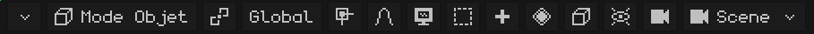

Si la barre de menus ne tient pas en entier, on peut la faire défiler : voir [Quand toutes les options de la barre de menus ne sont pas visibles](interfaz.md#quand-toutes-les-options-de-la-barre-de-menus-ne-sont-pas-visibles).

## Le mode

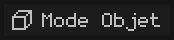 Affiche le mode dans lequel vous travaillez ; en le touchant, vous en choisissez un autre. Les modes proposés dépendent de l'objet actif : un maillage a le Mode Édition et les trois peintures ; une armature, le Mode Édition et le Mode Pose. Avec un autre type d'objet (une lumière, une caméra), le bouton n'apparaît pas, car le seul mode est le Mode Objet. Chaque mode est expliqué dans [Les modes](vista-3d.md#les-modes).

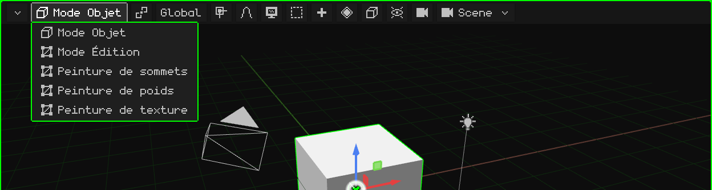

 <kbd>Tab</kbd> passe du Mode Objet au Mode Édition et inversement.  Sur le N95, <kbd>OK</kbd>.

En **Mode Édition** d'un maillage apparaît à côté le bouton **Sommet / Arête / Face** : ce que l'on sélectionne d'un clic (voir [Mode Édition](modo-edicion.md)).

## Le pivot

 Le **point de pivot** est l'endroit à partir duquel se fait la transformation : ce autour de quoi la sélection tourne et à partir d'où elle est mise à l'échelle. L'icône du bouton change selon le pivot choisi, ce qui permet de voir d'un coup d'œil lequel est en place.

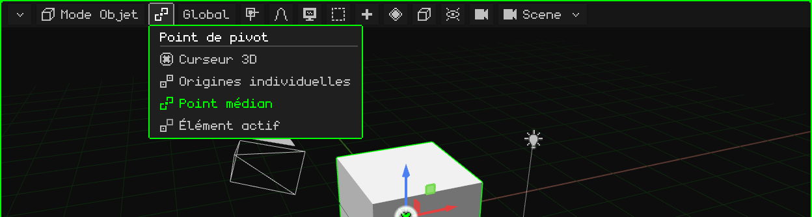

| Pivot | À partir d'où il fait pivoter et met à l'échelle |
|---|---|
|  **Curseur 3D** | À partir du curseur 3D. Sert à faire tourner des choses autour de n'importe quel point : on place le curseur à cet endroit (avec le [menu Aimantation](#laimantation)) et on fait pivoter. |
|  **Origines individuelles** | Chaque objet à partir de sa propre origine : ils tournent tous en même temps, chacun sur place. |
|  **Point médian** | À partir du centre de toute la sélection. C'est celui par défaut. |
|  **Élément actif** | À partir de l'origine de l'objet actif (le dernier sélectionné) : les autres tournent autour de lui. |

Un exemple de chacun, en vidéo, se trouve dans le tutoriel [Le Mode Objet](../tutoriales/modo-objeto.md#le-point-de-pivot).

## L'orientation

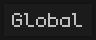 Les axes utilisés pour déplacer, faire pivoter ou mettre à l'échelle sur un axe (avec <kbd>X</kbd>, <kbd>Y</kbd>, <kbd>Z</kbd>, avec le gizmo ou avec les touches du N95). Le bouton affiche l'orientation choisie.

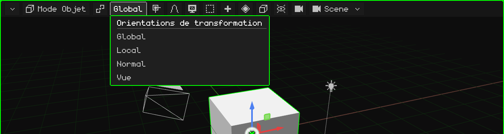

| Orientation | Les axes |
|---|---|
| **Global** | Ceux du monde : toujours les mêmes, avec le Z vers le haut. C'est celle par défaut. |
| **Local** | Ceux de l'objet lui-même : ils tournent avec lui. Une voiture tournée avance sur son axe Local. |
| **Normal** | En Mode Édition : la direction vers laquelle regarde la face choisie (c'est celle qu'utilise Extruder). |
| **Vue** | Ceux de l'écran : X vers le côté, Y vers le haut. |

 Pendant une transformation, appuyer une deuxième fois sur la lettre de l'axe passe de Global à Local : <kbd>G</kbd> <kbd>Y</kbd> <kbd>Y</kbd>.

## L'aimantation

 Avec l'**aimantation** activée, ce que l'on déplace se colle à quelque chose : aux sommets, aux arêtes ou aux faces d'autres objets, ou à leurs centres. Le bouton devient vert quand elle est activée.

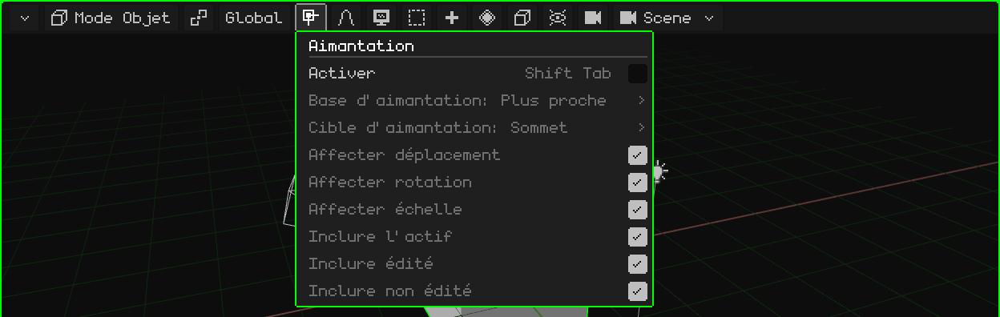

| Option | Ce qu'elle fait | Raccourci |
|---|---|---|
| Activer | Active ou désactive l'aimantation. | <kbd>Shift+Tab</kbd> |
| Base d'aimantation | Le point de ce que l'on déplace qui se colle : le plus proche, le centre, la médiane ou l'actif. | Menu |
| Cible d'aimantation | Ce à quoi il se colle : sommet, arête, face, leurs centres. Avec Projeter sur face / Face la plus proche, les sommets se posent sur une autre surface (pour la retopologie). | Menu |
| Affecter déplacement / rotation / échelle | Les opérations sur lesquelles elle agit. | Menu |
| Inclure l'actif / édité / non édité | Les objets auxquels on peut se coller. | Menu |

Le **curseur 3D** se déplace avec un autre menu, celui de l'aimantation du curseur : <kbd>Shift</kbd> + <kbd>S</kbd> ou menu Objet → Aimantation (Curseur sur le sélectionné, Sélection au curseur...). C'est expliqué dans [Le Mode Objet](../tutoriales/modo-objeto.md#le-curseur-3d).

## L'édition proportionnelle

 Avec l'**édition proportionnelle**, quand vous déplacez, faites pivoter ou mettez à l'échelle quelque chose, ce qui est proche suit en douceur : d'autant plus que c'est proche. Elle sert à modéliser des formes organiques (un terrain, un visage) sans déplacer sommet par sommet. Le bouton devient vert quand elle est activée.

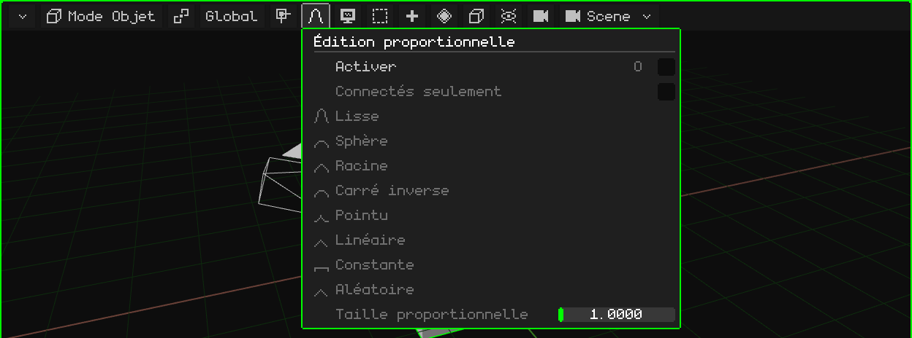

| Option | Ce qu'elle fait | Raccourci |
|---|---|---|
| Activer | Active ou désactive l'édition proportionnelle. | <kbd>O</kbd> |
| Connectés seulement | Mesure la distance le long des arêtes : n'entraîne pas les pièces séparées qui sont proches. | Menu |
| L'atténuation | La façon dont l'influence se répartit avec la distance : Lisse, Sphère, Racine, Carré inverse, Pointu, Linéaire, Constante ou Aléatoire. | Menu |
| Taille proportionnelle | Le rayon d'influence. Pendant la transformation, il se change avec la molette ou avec <kbd>PageUp</kbd> / <kbd>PageDown</kbd>. | Menu / molette |

## Vue

 Tout ce qui concerne la **navigation** : depuis où l'on regarde la scène. Chaque option, avec sa vidéo, se trouve dans le tutoriel [Naviguer dans la Vue 3D](../tutoriales/navegacion.md).

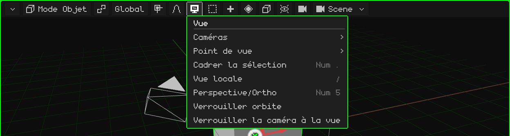

| Option | Ce qu'elle fait |  Raccourci |
|---|---|---|
| Caméras | Regarder à travers la caméra active, ou faire de l'objet sélectionné la caméra active. | <kbd>Num 0</kbd> / <kbd>Ctrl+Num 0</kbd> |
| Point de vue | Avant, Arrière, Droite, Gauche, Haut, Bas. | <kbd>Num 1</kbd>, <kbd>Num 3</kbd>, <kbd>Num 7</kbd> (avec <kbd>Ctrl</kbd>, l'opposée) |
| Cadrer la sélection | Centre la vue sur la sélection et la rapproche pour qu'elle tienne tout juste. | <kbd>Num .</kbd> |
| Vue locale | Ne laisse visible que la sélection, et revient. | <kbd>/</kbd> |
| Perspective/Ortho | Passe de perspective à orthographique et inversement. | <kbd>Num 5</kbd> |
| Verrouiller orbite | Ce qui faisait orbiter déplace désormais la vue. | — |
| Verrouiller la caméra à la vue | En regardant à travers la caméra : naviguer déplace la caméra. | — |

## Sélectionner

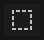 Sélectionner d'un coup tout, rien, l'inverse de ce qui l'est, ou ce qui se trouve à l'intérieur d'une boîte.

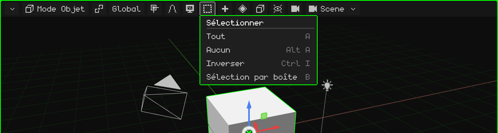

| Option | Ce qu'elle fait | Raccourci |
|---|---|---|
| Tout | Sélectionne tout. | <kbd>A</kbd> |
| Aucun | Ne laisse rien de sélectionné. | <kbd>Alt+A</kbd> |
| Inverser | Ce qui était sélectionné ne l'est plus, et inversement. | <kbd>Ctrl+I</kbd> |
| Sélection par boîte | Une boîte que l'on fait glisser : de gauche à droite (vert), elle ne prend que ce qui est entièrement à l'intérieur ; de droite à gauche (bleu), il suffit d'effleurer. <kbd>Shift</kbd> ajoute. | <kbd>B</kbd>, ou glisser sur le fond |

En Mode Édition, il ajoute Sélectionner lié, les boucles et les chemins (voir [Mode Édition](modo-edicion.md)).

## Ajouter

 Crée de nouveaux objets, qui apparaissent au curseur 3D et restent sélectionnés. N'existe qu'en Mode Objet.

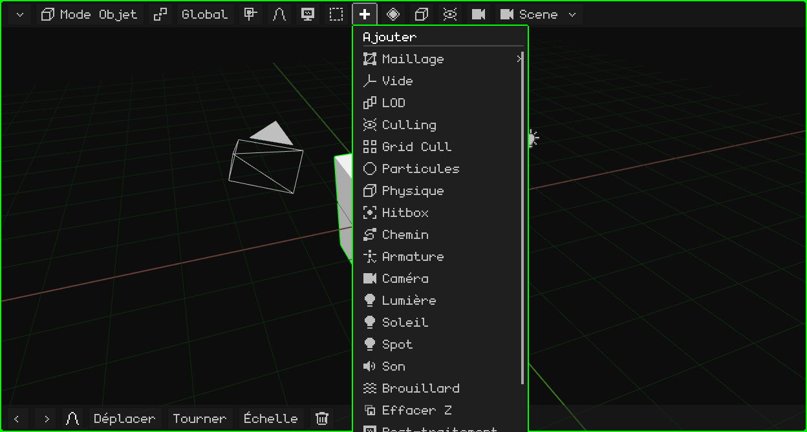

Chaque type se trouve dans [Mode Objet → Menu Ajouter](modo-objeto.md#menu-ajouter).  <kbd>Shift</kbd> + <kbd>A</kbd> l'ouvre là où se trouve la souris.

En Mode Édition apparaissent à sa place **Maillage** (les opérations de modélisation, voir [Mode Édition](modo-edicion.md)) et **UV** (déplier et projeter les UV, voir [Éditeur UV](editor-uv.md)). En Peinture de texture apparaît une **disquette**, qui enregistre la texture peinte ; elle devient verte quand il y a de la peinture non enregistrée.

## Animation

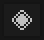 Les **images clés** de la sélection : enregistrer la valeur de la position, de la rotation ou de l'échelle à l'image actuelle, pour que l'animation aille d'une image clé à l'autre. Apparaît quand quelque chose est sélectionné, en Mode Objet et en Mode Pose, et ses options dépendent de la sélection.

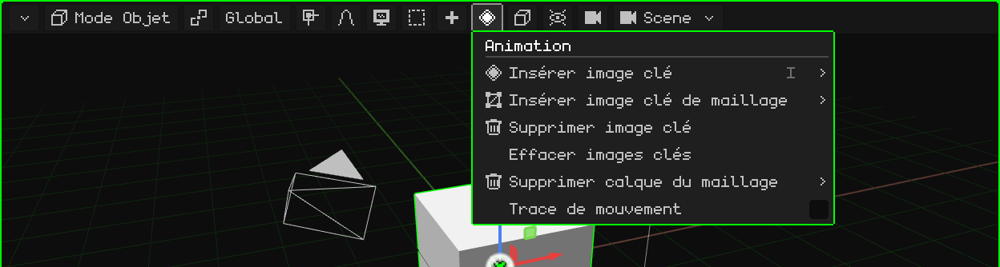

| Option | Ce qu'elle fait | Raccourci |
|---|---|---|
| Insérer image clé | Un menu pour choisir ce qui est enregistré : position, rotation, échelle ou tout. | <kbd>I</kbd> (<kbd>Shift+I</kbd> : tout, sans demander) |
| Insérer image clé de maillage | Uniquement avec un maillage 3D : choisit ce qui est enregistré dans l'animation du maillage, les sommets, les normales ou les UV. | Menu |
| Supprimer image clé | Supprime l'image clé de l'image actuelle. | Menu |
| Effacer images clés | Supprime toute l'animation de la sélection. | Menu |
| Supprimer calque du maillage | Uniquement avec un maillage 3D : supprime entièrement un calque de l'animation du maillage, celui des **sommets**, celui des **normales** (par exemple, sur un modèle sans éclairage) ou celui des **UV**. Il reste toujours au moins une image clé. | Menu |
| Trace de mouvement | Dessine dans la vue le chemin que parcourent les objets animés. | Menu |

### En Mode Pose

Quand vous posez une armature, le menu travaille avec les images clés des os sélectionnés (et de l'os actif) :

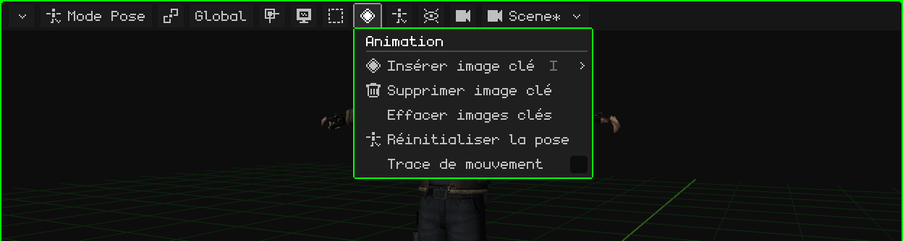

| Option | Ce qu'elle fait | Raccourci |
|---|---|---|
| Insérer image clé | Enregistre la pose des os sélectionnés à l'image actuelle : position, rotation, échelle ou tout. | <kbd>I</kbd> |
| Supprimer image clé | Supprime l'image clé de l'image actuelle pour ces os. S'annule avec <kbd>Ctrl+Z</kbd>. | Menu |
| Effacer images clés | Supprime toutes les images clés de ces os dans l'animation active. S'annule avec <kbd>Ctrl+Z</kbd>. | Menu |
| Réinitialiser la pose | Les os sélectionnés (ou tous, si aucun n'est sélectionné) reviennent à la position, à la rotation et à l'échelle qu'ils ont en Mode Édition. S'annule avec <kbd>Ctrl+Z</kbd>. | Menu |
| Trace de mouvement | Dessine dans la vue le chemin que parcourent les objets animés. | Menu |

L'animation a son propre tutoriel et son chapitre, [Timeline](linea-de-tiempo.md).

## Objet

 Ce que l'on peut faire à la sélection. C'est le même menu que celui qui s'ouvre avec le clic droit dans la vue (ou, sur un écran tactile, en gardant un doigt immobile). Apparaît quand quelque chose est sélectionné.

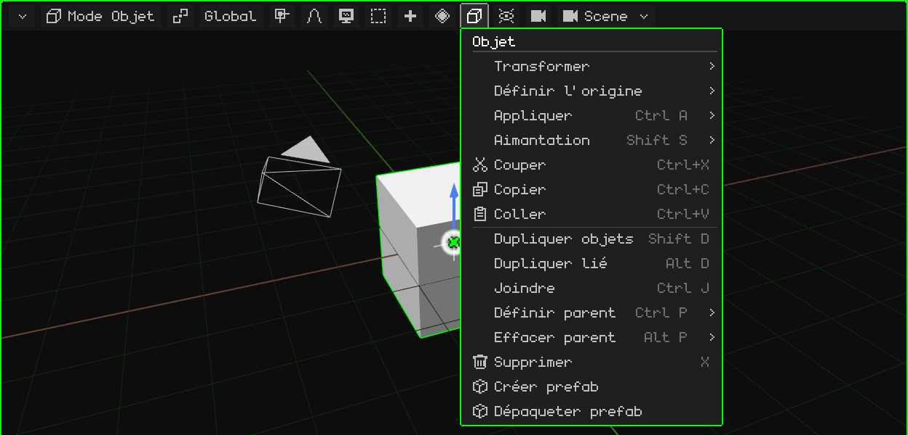

Chaque option se trouve dans [Mode Objet](modo-objeto.md). En Mode Édition, ce bouton devient le menu de ce que l'on sélectionne (Sommet, Arête ou Face) ; en Mode Pose, celui de Pose ; dans l'édition d'une armature, celui d'Armature.

## Superpositions

 Les **superpositions** sont les aides dessinées par-dessus la scène pour travailler et qui n'apparaissent pas au rendu : le sol, les axes, le gizmo, le curseur 3D. C'est ici qu'on les active et désactive, toutes ensemble ou une par une.

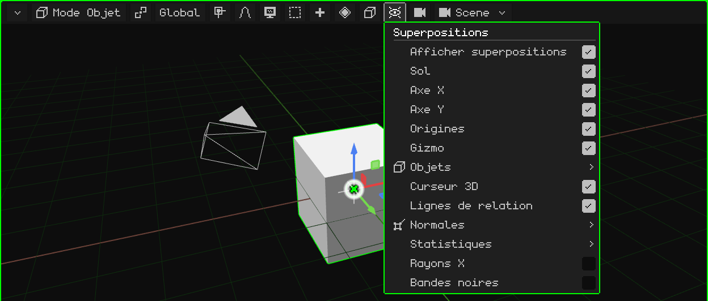

| Option | Ce qu'elle fait | Raccourci |
|---|---|---|
| Afficher superpositions | Active ou désactive toutes les aides d'un coup. | <kbd>K</kbd> |
| Sol, Axe X, Axe Y, Origines, Curseur 3D, Lignes de relation | Chaque aide séparément. Les lignes de relation relient chaque enfant à son parent. | Menu |
| Gizmo | Le gizmo pour déplacer, faire pivoter et mettre à l'échelle. Sur le Nokia N95, il est désactivé par défaut. | Menu |
| Objets | Les types d'objet dessinés : armatures, lumières, caméras, vides, particules, courbes, hitbox. | Menu |
| Normales | Dessine les normales des sommets ou des faces, avec leur taille. | Menu |
| Statistiques | Les images par seconde, les sommets, les faces, les appels de dessin et les temps. | Menu |
| Rayons X | En Mode Édition, le maillage apparaît semi-transparent et l'on peut sélectionner les éléments situés derrière. | Menu |
| Bandes noires | En regardant à travers une caméra dont les proportions diffèrent de celles de l'écran, masque ce qui est en dehors du cadre. | Menu |

## Rendu

 Le **mode d'ombrage** : la façon dont la scène est dessinée dans la vue. Il ne change pas le projet, seulement l'apparence pendant que vous travaillez.

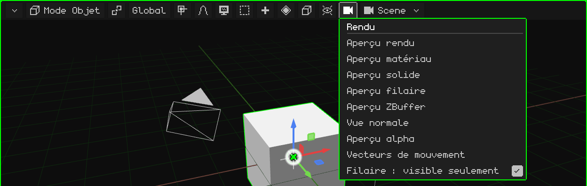

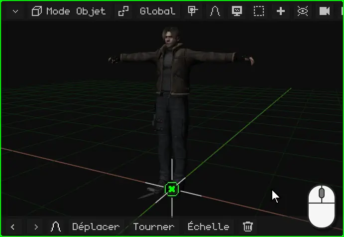

| Mode | Apparence |
|---|---|
| Aperçu rendu | Avec les lumières de la scène. Si le lancer de rayons est activé, affiche l'image tracée petit à petit. |
| Aperçu matériau | Celui par défaut : les matériaux et les textures avec une lumière neutre venant de la vue, sans dépendre des lumières de la scène. |
| Aperçu solide | Tout en gris, pour voir la forme. |
| Aperçu filaire | Seulement les arêtes. Avec **Filaire : visible seulement**, seulement celles de ce qui est vu de face. |
| Aperçu ZBuffer | La profondeur : clair de près, sombre de loin. |
| Vue normale | Les normales, en couleurs. |
| Aperçu alpha | La transparence, en noir et blanc. |
| Vecteurs de mouvement | De combien chaque pixel a bougé depuis l'image précédente (rouge = X, vert = Y). C'est la même image que la passe `_vectores` du rendu. |

 <kbd>Z</kbd> passe au mode suivant.  Sur le N95, le <kbd>6</kbd>.

## La scène

 Le nom de ce que vous êtes en train de modifier : une **scène**, un **jeu** ou un **prefab** du projet. En le touchant, vous en choisissez un autre, en créez un nouveau ou convertissez la scène en jeu.

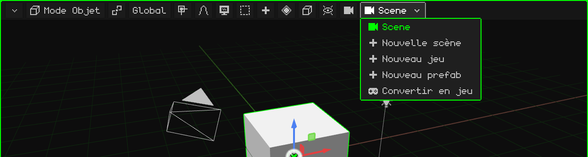

Les scènes, les jeux et les prefabs sont expliqués dans [Le projet](proyecto.md).
