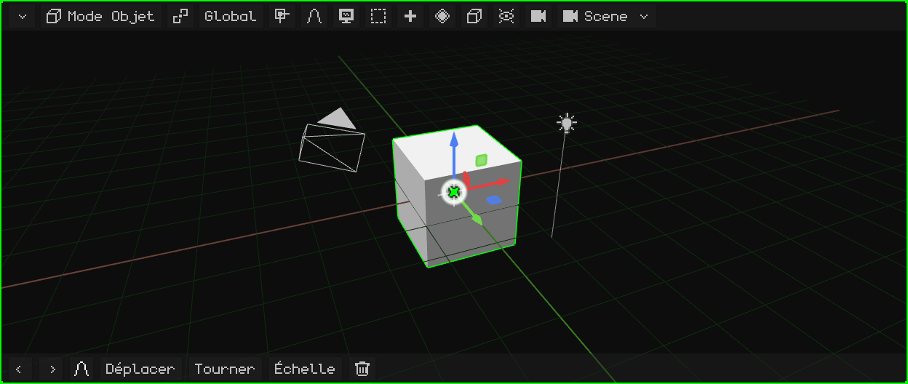
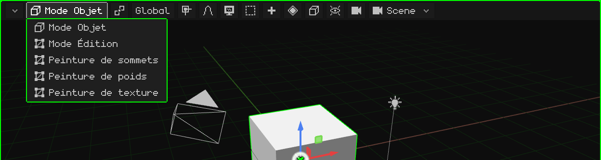
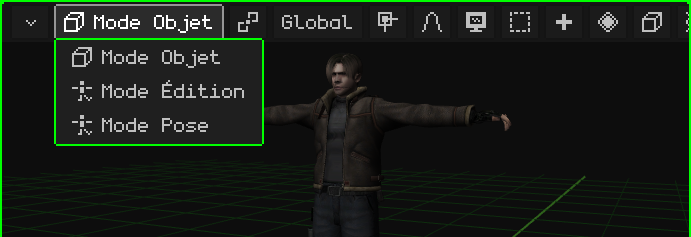
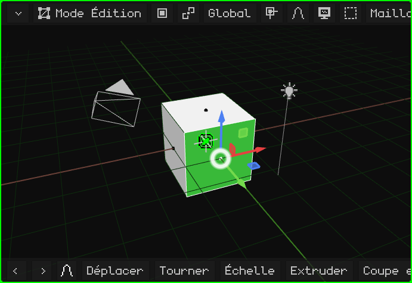
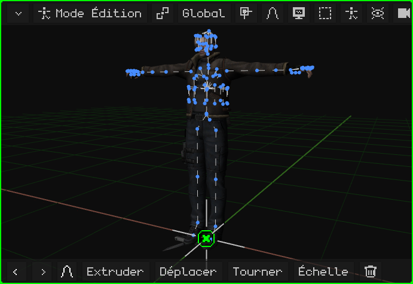
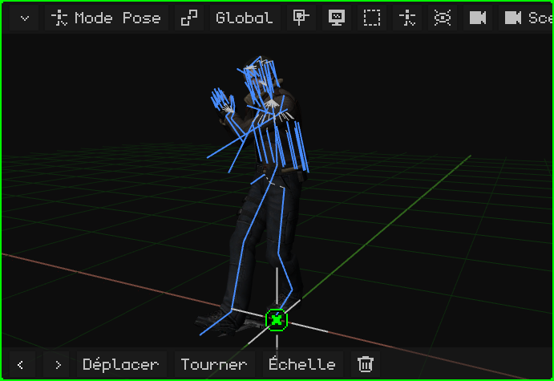
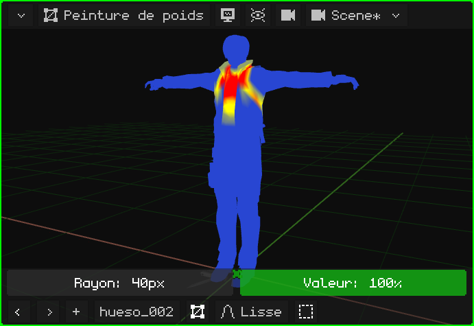
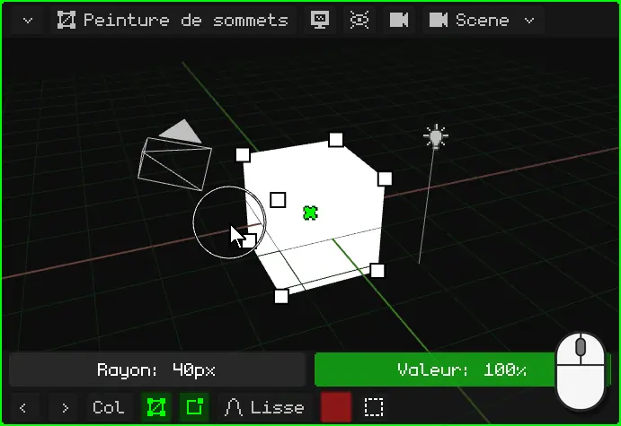
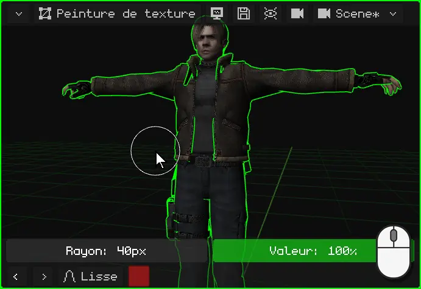
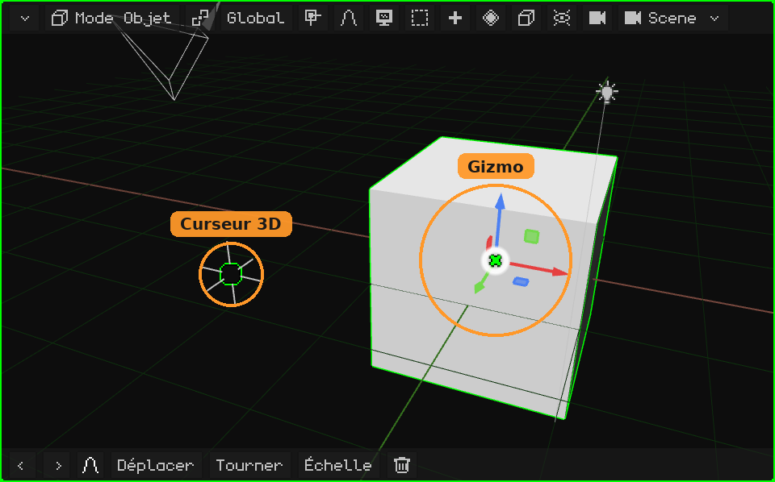

# Vue 3D

La **Vue 3D** est le viewport où l'on voit et modifie la scène : c'est là que l'on modélise, que l'on déplace les objets, que l'on peint, que l'on pose et que l'on anime. Comme tous les viewports, elle a en haut sa **barre de menus** et en bas sa **barre d'outils**.

- **La barre de menus**, bouton par bouton, avec ses menus : [La barre de menus de la Vue 3D](vista-3d-barra.md).
- **Naviguer** (orbiter, déplacer la vue, zoomer, les vues, la caméra) : [Navigation dans la Vue 3D](navegacion.md) et le tutoriel [Naviguer dans la Vue 3D](../tutoriales/navegacion.md).
- **Déplacer, faire pivoter et mettre à l'échelle**, le gizmo, le pivot et l'orientation : [Déplacer, faire pivoter et mettre à l'échelle](transformar.md).

## Les modes

La Vue 3D fonctionne selon différents **modes** : l'effet des clics, des touches et des menus dépend du mode actuel. Le mode se choisit avec le premier bouton de la barre de menus, qui affiche le mode actuel, ou avec <kbd>Tab</kbd> (Objet ↔ Édition ; sur le Nokia N95, <kbd>OK</kbd>).

Les modes que l'on peut choisir dépendent de l'**objet actif**. Tous les objets ont le **Mode Objet**. Un maillage 3D y ajoute le Mode Édition et les trois peintures ; une armature, le Mode Édition et le Mode Pose. Avec n'importe quel autre objet (une lumière, une caméra, un son), le seul mode est le Mode Objet, et le bouton n'apparaît pas.

| Mode | Pour quels objets | À quoi il sert |
|---|---|---|
| [Mode Objet](modo-objeto.md) | Tous | Travailler avec les objets entiers : les créer, les déplacer, les faire pivoter, les mettre à l'échelle, les dupliquer, les apparenter et les supprimer. |
| [Mode Édition](modo-edicion.md) | Maillages 3D et courbes | Modéliser : déplacer, ajouter et supprimer les sommets, les arêtes et les faces du maillage. |
| [Mode Édition](esqueletos.md#mode-édition-armature) | Armatures | Construire l'armature : créer des os et les placer dans leur position de repos. |
| [Mode Pose](esqueletos.md#mode-pose) | Armatures | Poser les os et enregistrer les poses : c'est ainsi que l'on anime un personnage. |
| [Peinture de poids](pintura.md#peinture-de-poids) | Maillages 3D | Peindre de combien chaque os déplace chaque sommet. |
| [Peinture de sommets](pintura.md#peinture-de-sommets) | Maillages 3D | Peindre des couleurs directement sur les sommets. |
| [Peinture de texture](pintura.md#peinture-de-texture) | Maillages 3D | Peindre sur la texture, directement sur l'objet. |

### Mode Objet

C'est le mode dans lequel Whisk3D démarre, et le seul que possèdent tous les objets. On travaille avec les objets entiers : on les sélectionne, on les déplace, on les fait pivoter, on les met à l'échelle, on les ajoute et on les supprime. Voir [Mode Objet](modo-objeto.md) et le tutoriel [Le Mode Objet](../tutoriales/modo-objeto.md).

### Mode Édition d'un maillage

On modélise la **forme** du maillage : les sommets, les arêtes et les faces. Dans la barre de menus apparaissent le bouton **Sommet / Arête / Face** (ce que l'on sélectionne d'un clic) et les menus **Maillage** et **UV**. Le reste de la scène reste visible, mais on ne peut pas y toucher.

### Mode Édition d'une armature

On construit l'**armature** : on crée les os (en les extrudant depuis la pointe d'un autre), on les déplace et on les apparente. C'est sa position de **repos**, celle qu'elle a quand elle n'est pas animée.

### Mode Pose

On **pose** l'armature : les os tournent et se déplacent sans modifier l'armature elle-même, et le maillage les suit. Les poses enregistrées à différentes images forment l'animation du personnage.

### Peinture de poids

On peint **de combien chaque os déplace chaque partie du maillage** : en rouge, ce que l'os sélectionné déplace entièrement ; en bleu, ce qu'il ne déplace pas. C'est ce qui fait que, quand on plie le bras, c'est le bras qui se plie et non la taille.

### Peinture de sommets

On peint des **couleurs sur les sommets** du maillage, sans texture. Cela sert à colorer des modèles simples, à peindre des ombres à la main et à créer des effets dans les shaders.

### Peinture de texture

On peint **directement sur la texture**, sur l'objet lui-même, comme sur une figurine. Ce qui a été peint s'enregistre avec la disquette qui apparaît dans la barre de menus.

Dans les modes de peinture, la rangée du pinceau (le **Rayon** et la **Valeur**) apparaît au-dessus de la barre d'outils. Voir [Modes de peinture](pintura.md).

## La barre d'outils

En bas de la Vue 3D se trouvent **Annuler** et **Rétablir** (les flèches), les **dernières commandes utilisées** (au départ, Déplacer, Tourner, Échelle et Supprimer ; celle que l'on utilise passe devant) et l'**édition proportionnelle**. Pendant que l'on déplace, fait pivoter ou met à l'échelle, la barre d'outils change : la coche verte confirme, la croix rouge annule, puis viennent l'orientation et **X**, **Y** et **Z**, qui limitent le mouvement à ces axes. Voir [Déplacer, faire pivoter et mettre à l'échelle](transformar.md#barre-doutils).

 Sur un écran tactile, elle ajoute **Shift** et **Ctrl**, qui restent activés (en vert) et font office de ces touches, ainsi que le bouton **Vue** (l'écran), pour qu'en Mode Édition et dans les peintures le doigt navigue au lieu de sélectionner ou de peindre.

 Sur le Nokia N95, elle est masquée pour laisser l'écran à la scène, et elle apparaît quand il le faut : dans les modes de peinture apparaît la rangée du pinceau (le **Rayon** et la **Valeur**), et pendant que l'on déplace, fait pivoter ou met à l'échelle avec l'édition proportionnelle activée, la barre de son rayon. Ses boutons s'utilisent avec la **souris virtuelle** : elle s'active avec la touche de sélection droite, les flèches la déplacent et <kbd>OK</kbd> fait un clic.

## Le gizmo et le curseur 3D

- Le **gizmo**, ce sont les flèches de couleur sur la sélection : on les attrape pour déplacer, faire pivoter et mettre à l'échelle. Un clic sur le gizmo passe d'un mode à l'autre. Voir [Le gizmo](transformar.md#le-gizmo).
- Le **curseur 3D** est le cercle avec une croix : c'est là qu'apparaît ce que l'on ajoute avec Ajouter, et il peut servir de point de pivot. Voir [Le curseur 3D](../tutoriales/modo-objeto.md#le-curseur-3d).

 Sur le Nokia N95, le gizmo est désactivé, car l'écran est petit et l'on y déplace avec les touches. Il s'active dans **Superpositions → Gizmo**, et on l'attrape avec la souris virtuelle.
