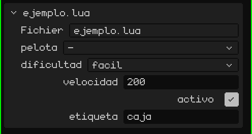
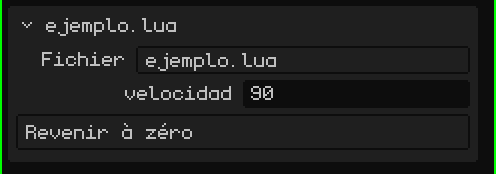

# Un script est un composant d'un objet

Dans Whisk3D, un script appartient toujours à un **objet** de la scène (un maillage, un empty, un bouton 2D…). Un objet peut avoir plusieurs scripts ; chacun s'exécute séparément, avec ses propres variables, dans l'ordre où ils apparaissent.

Depuis le script, `yo()` renvoie l'objet propriétaire. Pour utiliser *d'autres* objets, le script déclare une table globale nommée `propiedades`. L'éditeur la lit et affiche un champ pour chaque entrée dans la carte du script, dans le panneau Propriétés :

```lua
propiedades = {
  pelota     = "objeto",                          -- un champ pour choisir un objet de la scène
  dificultad = { "facil", "normal", "dificil" },  -- une liste déroulante (la première est celle par défaut)
  velocidad  = 200,                               -- un nombre propre à chaque objet qui utilise le script
  activo     = true,                              -- un oui/non
  etiqueta   = "caja",                            -- un texte
}

function inicio()
  local p   = objeto("pelota")         -- l'objet choisi dans le champ "pelota"
  local dif = opcion("dificultad")     -- "facil", "normal" ou "dificil"
  local v   = propiedad("velocidad")   -- 200, ou la valeur saisie sur cet objet
end
```

> [!NOTE]
> Pour lire `propiedades`, l'éditeur **exécute le fichier** même si le jeu ne tourne pas. C'est pourquoi, en dehors des fonctions, ne mettez que des déclarations (tables, constantes, `local`), jamais du code qui agit.

Voici ce que cela donne dans la carte du script, dans Propriétés : un champ par propriété, dans le même ordre que dans le code.



Ainsi, le même script sert pour de nombreux objets avec des valeurs différentes : le champ `velocidad` d'un ennemi peut valoir 200 et celui d'un autre 350.

## Changer les propriétés en temps réel

`propiedad("velocidad")` lit la valeur au moment même. Si vous la changez dans Propriétés pendant que le jeu tourne, le script la voit à l'image suivante, mais seulement s'il la relit avec `propiedad()`. Si vous l'avez gardée dans une variable (`local v = propiedad("velocidad")` dans `inicio()`), la variable conserve la valeur du début.

```lua
function actualizar(dt)
  -- lue à chaque image : voit ce que vous changez dans Propriétés pendant que le jeu tourne
  mover(yo(), propiedad("velocidad") * dt, 0, 0)
end
```

Lire `propiedad()` à chaque image est plus lent qu'utiliser une variable. Mieux vaut ne pas travailler ainsi dans tout le jeu : utilisez-le pendant que vous réglez les valeurs et, une fois qu'elles sont au point, gardez-les dans des variables dans `inicio()`.

## Boutons

Si une propriété est une **fonction**, un **bouton** apparaît dans la carte : le toucher appelle cette fonction. Pour que le bouton affiche autre chose que le nom, mettez le texte et la fonction dans une table :

```lua
propiedades = {
  velocidad = 90,
  cero = { "Revenir à zéro", function()
    setRotacion(yo(), 0, 0, 0)
  end },
}
```



Pendant que le jeu tourne, la fonction s'exécute dans le script en cours de jeu. Sans le jeu, le script est chargé uniquement pour cet appel : ainsi, un bouton sert de **module complémentaire de l'éditeur**, qui agit sur la scène. Par exemple, avec `seleccionados()`, les objets sélectionnés dans l'éditeur :

```lua
propiedades = {
  subir = { "Monter la sélection", function()
    for _, o in ipairs(seleccionados()) do
      mover(o, 0, 0, 1)   -- un mètre vers le haut
    end
  end },
}
```

> [!NOTE]
> Ce que fait un bouton quand le jeu est arrêté reste dans la scène, comme si vous l'aviez fait à la main, et s'annule de la même façon : <kbd>Ctrl</kbd> + <kbd>Z</kbd> annule d'un coup tout ce qu'a fait le bouton. Pendant que le jeu tourne, rien ne va dans l'historique : quand vous touchez **Arrêter**, tout redevient comme avant.

Les scripts ne partagent pas de variables entre eux. Pour se transmettre des données (les points, si le joueur a gagné…), ils utilisent un espace partagé : `setCompartido("puntos", 10)` écrit et `compartido("puntos")` lit. Il stocke des nombres, des oui/non et des textes, et il est vidé à l'arrêt du jeu.
