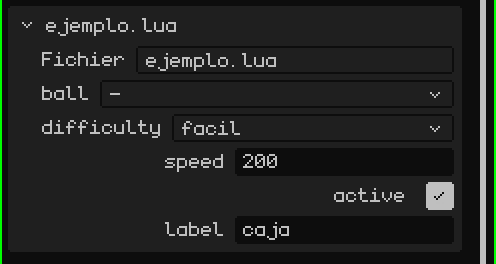
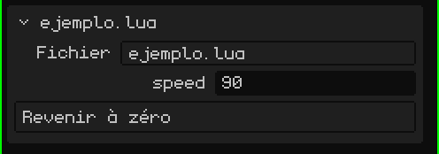

# Un script est un composant d'un objet

Dans Whisk3D, un script appartient toujours à un **objet** de la scène (un maillage, un empty, un bouton 2D…). Un objet peut avoir plusieurs scripts ; chacun s'exécute séparément, avec ses propres variables, dans l'ordre où ils apparaissent.

Depuis le script, `self()` renvoie l'objet propriétaire. Pour utiliser *d'autres* objets, le script déclare une table globale nommée `properties`. L'éditeur la lit et affiche un champ pour chaque entrée dans la carte du script, dans le panneau Propriétés :

```lua
properties = {
  ball       = "object",                          -- un champ pour choisir un objet de la scène
  difficulty = { "facil", "normal", "dificil" },  -- une liste déroulante (la première est celle par défaut)
  speed      = 200,                               -- un nombre propre à chaque objet qui utilise le script
  active     = true,                              -- un oui/non
  label      = "caja",                            -- un texte
}

function start()
  local p   = object("ball")         -- l'objet choisi dans le champ "pelota"
  local dif = option("difficulty")   -- "facil", "normal" ou "dificil"
  local v   = property("speed")      -- 200, ou la valeur saisie sur cet objet
end
```

**Par son nom :** une propriété se lit aussi en écrivant simplement son nom : `speed` équivaut à `property("speed")`, `difficulty` à `option("difficulty")` et `ball` à `object("ball")`. Elle est lue sur le moment, donc elle voit ce que vous changez dans Propriétés pendant que le jeu tourne. Deux exceptions : si le script a une variable de ce nom (`speed = 5`), c'est la variable qui compte ; et si la propriété porte le nom d'une fonction de Whisk3D (par exemple `target` ou `view`), le nom désigne la fonction : lisez alors cette propriété avec `property()`, `option()` ou `object()`.

> [!NOTE]
> Pour lire `properties`, l'éditeur **exécute le fichier** même si le jeu ne tourne pas. C'est pourquoi, en dehors des fonctions, ne mettez que des déclarations (tables, constantes, `local`), jamais du code qui agit.

Voici ce que cela donne dans la carte du script, dans Propriétés : un champ par propriété, dans le même ordre que dans le code.



Ainsi, le même script sert pour de nombreux objets avec des valeurs différentes : le champ `speed` d'un ennemi peut valoir 200 et celui d'un autre 350.

## Changer les propriétés en temps réel

`property("speed")` lit la valeur au moment même. Si vous la changez dans Propriétés pendant que le jeu tourne, le script la voit à l'image suivante, mais seulement s'il la relit avec `property()`. Si vous l'avez gardée dans une variable (`local v = property("speed")` dans `start()`), la variable conserve la valeur du début.

```lua
function update(dt)
  -- lue à chaque image : voit ce que vous changez dans Propriétés pendant que le jeu tourne
  move(self(), property("speed") * dt, 0, 0)
end
```

Lire `property()` à chaque image est plus lent qu'utiliser une variable. Mieux vaut ne pas travailler ainsi dans tout le jeu : utilisez-le pendant que vous réglez les valeurs et, une fois qu'elles sont au point, gardez-les dans des variables dans `start()`.

## Boutons

Si une propriété est une **fonction**, un **bouton** apparaît dans la carte : le toucher appelle cette fonction. Pour que le bouton affiche autre chose que le nom, mettez le texte et la fonction dans une table :

```lua
properties = {
  speed    = 90,
  zero = { "Revenir à zéro", function()
    setRotation(self(), 0, 0, 0)
  end },
}
```



Pendant que le jeu tourne, la fonction s'exécute dans le script en cours de jeu. Sans le jeu, le script est chargé uniquement pour cet appel : ainsi, un bouton sert de **module complémentaire de l'éditeur**, qui agit sur la scène. Par exemple, avec `selected()`, les objets sélectionnés dans l'éditeur :

```lua
properties = {
  upload = { "Monter la sélection", function()
    for _, o in ipairs(selected()) do
      move(o, 0, 0, 1)   -- un mètre vers le haut
    end
  end },
}
```

> [!NOTE]
> Ce que fait un bouton quand le jeu est arrêté reste dans la scène, comme si vous l'aviez fait à la main, et s'annule de la même façon : <kbd>Ctrl</kbd> + <kbd>Z</kbd> annule d'un coup tout ce qu'a fait le bouton. Pendant que le jeu tourne, rien ne va dans l'historique : quand vous touchez **Arrêter**, tout redevient comme avant.

Les scripts ne partagent pas de variables entre eux. Pour se transmettre des données (les points, si le joueur a gagné…), ils utilisent un espace partagé : `setShared("puntos", 10)` écrit et `getShared("puntos")` lit. Il stocke des nombres, des oui/non et des textes, et il est vidé à l'arrêt du jeu.
