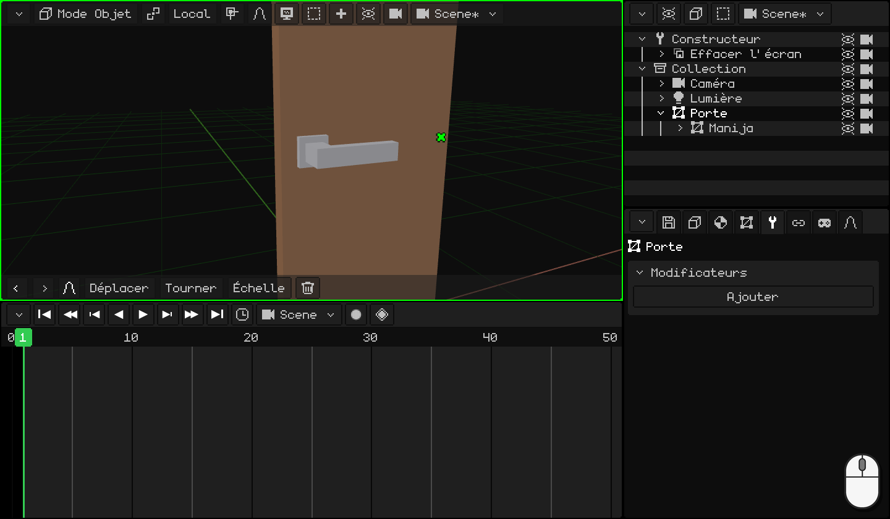
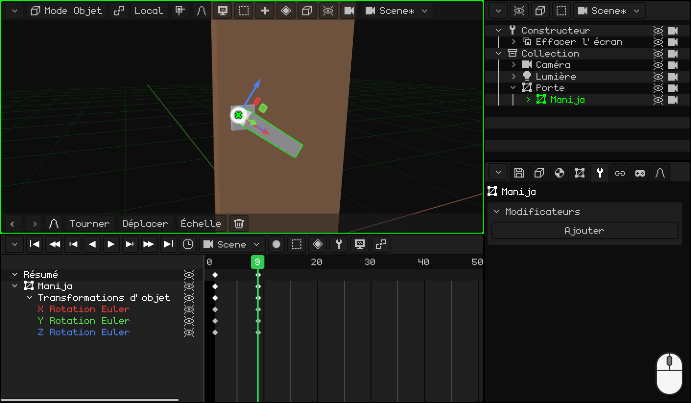
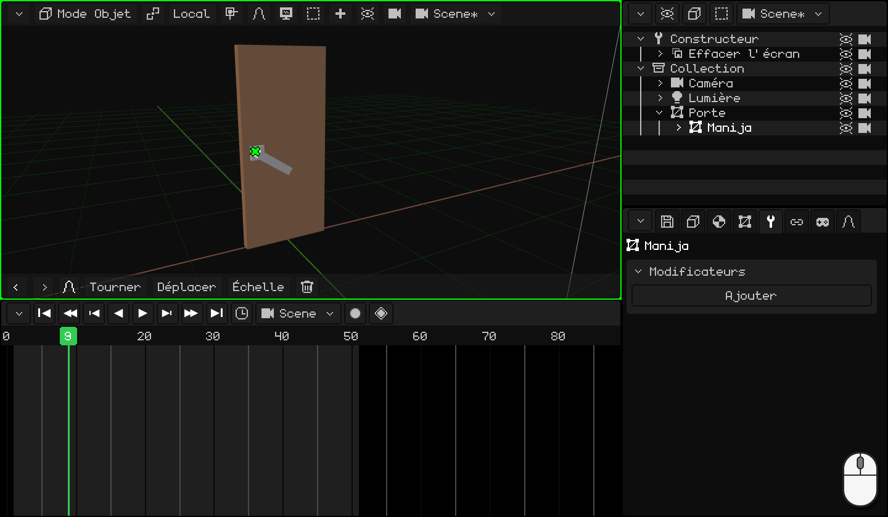
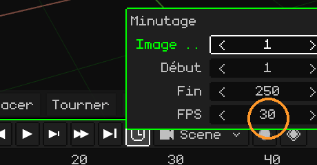
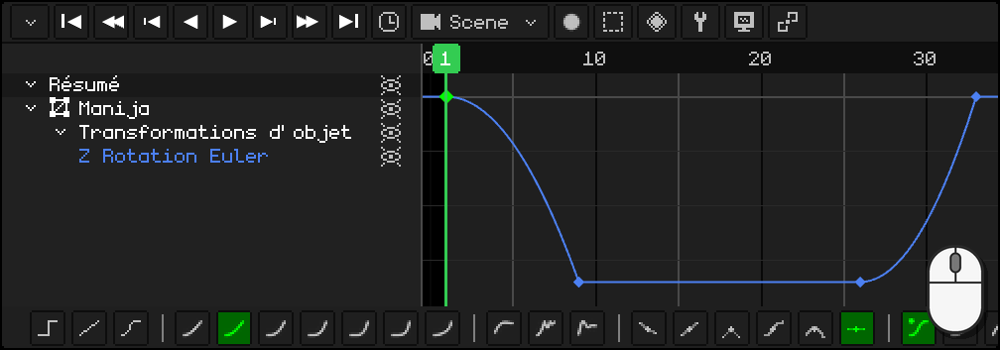

# Animer la porte

Nous partons de la porte avec sa poignée du tutoriel précédent, [Modéliser la poignée](modelar-picaporte.md) : la porte a son origine sur la charnière, le levier a la sienne là où il tourne et il est l'enfant de la porte. Nous allons maintenant l'animer comme une vraie porte : d'abord on baisse la poignée, la porte ne commence à s'ouvrir qu'une fois la poignée en bas, et à la fin la poignée revient à sa place.

En chemin, vous allez apprendre à :

- poser des **keyframes** : la pose d'un objet sur une image ;
- **dupliquer** des keyframes qui sont déjà comme vous le voulez ;
- ajuster le **timing** de l'animation et choisir ses **images par seconde** ;
- utiliser l'**éditeur de courbes** : ce qu'est une courbe et comment la modifier d'un clic et avec la barre d'outils.

## 1. La poignée

Une **keyframe** enregistre l'état d'un objet sur une image : sa position, sa rotation ou son échelle. Avec deux keyframes, le logiciel calcule toutes les images intermédiaires : c'est cela, l'animation.

1. Cliquez sur le **levier** pour le sélectionner. Dans la **Timeline**, allez à l'image **1** : la poignée est en haut.
2. Avec la souris au-dessus de la Vue 3D, appuyez sur <kbd>I</kbd> et choisissez **Rotation seulement** : un losange apparaît dans la Timeline, à l'image 1.
3. Allez à l'image **9** (un clic sur les numéros de la Timeline) et baissez la poignée : <kbd>R</kbd> <kbd>Y</kbd> `-34` <kbd>Enter</kbd>. Elle tourne autour de son origine, celle que nous lui avons donnée dans le tutoriel précédent.
4. De nouveau <kbd>I</kbd> → **Rotation seulement** : un autre losange, à l'image 9.

 Sur un écran tactile : la keyframe se pose avec le bouton du losange de la barre de menus de la Vue 3D, **Animation → Insérer image clé → Rotation seulement**, et l'image se change d'un toucher sur les numéros de la Timeline. La poignée se baisse avec **Tourner** **Y** `-34` dans la barre d'outils, avec les nombres sur le pavé de la barre du haut.

 Sur le Nokia N95 : <kbd>2</kbd> (faire pivoter), <kbd>2</kbd> (l'axe Y), le crayon + `-34` et <kbd>OK</kbd>. La keyframe, avec **Animation → Insérer image clé → Rotation seulement**.

## 2. Dupliquer des keyframes

La poignée doit rester en bas pendant que la porte s'ouvre et, à la fin, revenir en haut. Ces deux poses, vous les avez déjà : inutile de la faire tourner de nouveau.

1. Dans la Timeline, cliquez sur le losange de l'image **9** (en bas), <kbd>Shift</kbd> + <kbd>D</kbd>, amenez la copie à l'image **26** et cliquez. De l'image 9 à l'image 26, la poignée reste en bas.
2. Cliquez sur le losange de l'image **1** (en haut), <kbd>Shift</kbd> + <kbd>D</kbd>, et amenez la copie à l'image **33** : la poignée revient en haut.

Regardez le losange de la copie, pas le pointeur : il apparaît une image à droite de la souris. Quand la copie passe au-dessus d'une autre keyframe, il ne lui arrive rien : elle ne la **remplace** que si vous la relâchez exactement dessus.

  Sur écran tactile et sur le N95 (avec la souris virtuelle), au lieu de dupliquer, on copie et on colle : un toucher sur la keyframe de l'image 9 et, dans le menu **Clé** de la Timeline (le bouton du losange), **Copier** ; un toucher sur les numéros pour aller à l'image 26 et **Clé → Coller**. La même chose pour celle de l'image 1 vers l'image 33.

## 3. La porte

1. Cliquez sur la **porte**, pour la sélectionner seule. Allez à l'image **11** et <kbd>I</kbd> → **Rotation seulement** : jusqu'ici, la porte est fermée. Elle ne commence à s'ouvrir qu'à l'image 11, quand la poignée est déjà en bas.
2. Allez à l'image **26** et ouvrez-la : <kbd>R</kbd> <kbd>Z</kbd> `-80` <kbd>Enter</kbd>, puis de nouveau <kbd>I</kbd> → **Rotation seulement**.

Appuyez sur **Play** (<kbd>Space</kbd>, ou le bouton ▶ de la Timeline) : la poignée descend, la porte s'ouvre et la poignée remonte. Pendant ce temps, le levier suit la porte, parce qu'il est son enfant.

 Sur un écran tactile : **Tourner** **Z** `-80` et **Animation → Insérer image clé → Rotation seulement**.

 Sur le Nokia N95 : <kbd>2</kbd>, <kbd>3</kbd> (l'axe Z), le crayon + `-80` et <kbd>OK</kbd> ; puis **Animation → Insérer image clé → Rotation seulement**.

## 4. Le timing

Tout se passe trop vite, ou trop lentement ? Il faut déplacer les keyframes :

- <kbd>G</kbd> déplace dans le temps les keyframes sélectionnées (par exemple, la poignée qui remonte, de l'image 33 à l'image 36).
- <kbd>S</kbd> les met à l'échelle : avec toutes sélectionnées, `2` fait durer l'animation deux fois plus longtemps.

L'animation se termine à l'image **50** : dans l'**horloge** de la Timeline, **Fin** `50` <kbd>Enter</kbd>.

### Les images par seconde

Le temps d'une animation se compte en **images**, et le nombre d'images contenues dans une seconde est donné par les **FPS** (*frames per second* : images par seconde). Ils se changent dans la même **horloge**, dans **FPS**. Chaque animation a les siens : celle de la scène et chaque clip peuvent tourner à des FPS différents.

Whisk3D démarre à **30** : les 50 images de la porte durent un peu plus d'une seconde et demie.

| FPS | Pour quoi faire |
|---|---|
| **24** | Le cinéma. Donne à l'animation un style plus cinématographique et, si vous allez en faire le rendu, cela fait beaucoup moins d'images : une minute à 24, ce sont 1440 images ; à 30, 1800. |
| **30** ou **60** | Séries et jeux vidéo. |

Inutile d'animer à 60. Dans le jeu, le moteur calcule tout seul les images intermédiaires : une animation faite à 30 reste fluide sur un écran à 60 et occupe moins de mémoire.

Choisissez les FPS **avant** d'animer. Les keyframes restent sur leur image : si vous augmentez les FPS ensuite, l'animation va plus vite, et si vous les baissez, plus lentement.

## 5. Les courbes

Passez la Timeline en **éditeur de courbes** (**Vue → Courbes**). Là, chaque valeur animée est une **courbe** : elle vous indique à quelle position, rotation ou échelle se trouve l'objet à chaque instant. De gauche à droite, c'est le **temps** ; de bas en haut, la **valeur**.

**Rotation seulement** enregistre les trois axes, mais la poignée et la porte ne tournent que sur un seul : les deux autres courbes sont des lignes plates qui ne font rien. Supprimez-les : sélectionnez ces lignes et <kbd>X</kbd>. Il ne reste que les courbes qui changent, et l'on travaille plus confortablement.

### La forme de la courbe

Si la courbe est une **ligne droite**, l'objet se déplace toujours à la même vitesse : il démarre et s'arrête d'un coup. Cela paraît **robotique**. Parfois, c'est justement ce que l'on veut, mais presque rien ne bouge ainsi dans la vie réelle : les choses **accélèrent** au démarrage et **freinent** à l'arrivée.

Regardez six balles qui vont de gauche à droite dans **le même temps**, chacune avec une courbe différente. À côté de chacune se trouve sa courbe, avec un point qui avance avec elle :

| Courbe | Comment elle bouge | Pour quoi faire |
|---|---|---|
| **Linéaire** | Toujours à la même vitesse. | Une machine, un tapis roulant, quelque chose de robotique. |
| **Accélère et freine** (au démarrage et à l'arrivée) | Démarre lentement, va vite au milieu et arrive lentement. | Presque tout : une personne qui marche, une porte, une caméra. |
| **Accélère et s'arrête net** (au démarrage) | Démarre lentement et arrive à toute vitesse. | Quelque chose qui tombe et heurte, une poignée qui arrive en butée. |
| **Part vite et freine peu à peu** (à l'arrivée) | Démarre à toute vitesse et freine progressivement. | Quelque chose que l'on lance, un tiroir qui se ferme tout seul. |
| **Rebond** | Arrive, rebondit quelques fois contre la fin et s'immobilise. | Quelque chose qui tombe et rebondit, un couvercle qui se ferme. |
| **Élastique** | Dépasse, revient et oscille comme un ressort jusqu'à s'immobiliser. | Un ressort, une antenne, quelque chose qui apparaît à l'écran avec élégance. |

Les courbes rendent l'animation **naturelle**.

### La barre d'outils

Avec une keyframe ou un segment sélectionné, la barre d'outils de la Timeline change sa courbe d'un clic :

- **Mode d'interpolation :** **Constante**, **Linéaire** et **Bézier** ; puis les courbes calculées, de la plus douce à la plus brusque (**Sinusoïdale**, **Quadratique**, **Cubique**, **Quartique**, **Quintique**, **Exponentielle** et **Circulaire**), et les courbes à effet (**Recul**, **Rebond** et **Élastique**).
- **Type de poignée :** la façon dont sont construites les poignées d'une courbe **Bézier**.
- **Type d'amorti :** dans les courbes calculées, où se place l'effet : **Automatique**, **Amorti en entrée**, **Amorti en sortie** ou **Amorti entrée et sortie**.

Au clavier : <kbd>E</kbd> ouvre le **Mode d'interpolation** et <kbd>Ctrl</kbd> + <kbd>E</kbd>, le **Type d'amorti**.

### La poignée : CLAC !

Une vraie poignée, vous la baissez, elle prend de la vitesse et s'arrête net contre la butée : CLAC ! Quand vous la lâchez, le ressort la remonte et elle s'arrête de nouveau net en haut. Les deux fois, elle **accélère et s'arrête net**.

1. Avec le **levier** sélectionné, dans l'éditeur de courbes, cliquez sur la ligne de la courbe qui reste : la Timeline la cadre en entier.
2. Cliquez sur le segment de la courbe qui descend, entre l'image 1 et l'image 9 : un clic sur la ligne sélectionne ce segment.
3. Dans la barre d'outils, **Quadratique**. Son type d'amorti **Automatique** équivaut à **Amorti en entrée** : elle accélère et s'arrête net.
4. La même chose avec le segment qui remonte, entre l'image 26 et l'image 33.

  Sur écran tactile et sur le N95 : un toucher (ou la souris virtuelle) sur le segment et un autre sur **Quadratique** : la barre d'outils est la même.

### La porte

La porte fonctionne bien avec la courbe habituelle, **Bézier** : elle **accélère et freine**. Vous la poussez, elle prend de la vitesse et freine peu à peu jusqu'à rester ouverte. Inutile d'y changer quoi que ce soit.

Dans le prochain tutoriel, [Faire rebondir une balle](pelota.md), nous allons utiliser les courbes pour donner du poids à une balle, avec un autre principe de l'animation : l'étirement et l'écrasement.
