# Modéliser la poignée

Nous partons de la porte du tutoriel précédent, [Changer l'origine : une porte](puerta.md) : elle mesure 0,90 × 0,10 × 2 mètres et son origine est sur la charnière. Nous allons lui faire une poignée en deux parties : une **plaque** collée à la porte et un **levier** qui tourne.

En chemin, vous allez apprendre à :

- dupliquer une face et construire une nouvelle pièce à partir d'elle ;
- **séparer** une partie d'un maillage dans un autre objet (<kbd>P</kbd>) et la **joindre** de nouveau (<kbd>Ctrl</kbd> + <kbd>J</kbd>) ;
- donner un **matériau** différent à chaque partie d'un maillage ;
- utiliser le modificateur **Miroir** pour avoir la poignée des deux côtés de la porte ;
- voir avec les **Rayons X** les faces qui ne se voient jamais, et les supprimer ;
- placer l'**origine** là où le levier va tourner, avec le curseur 3D ;
- **apparenter** le levier à la porte, pour qu'ils bougent ensemble.

## 1. La plaque

1. Avec la porte sélectionnée, passez en **Mode Édition** (<kbd>Tab</kbd>) et, dans le bouton **Sommet / Arête / Face**, choisissez **Face**.
2. Cliquez sur la grande face avant de la porte.
3. **Dupliquez-la :** <kbd>Shift</kbd> + <kbd>D</kbd>. La copie reste attachée à la souris ; un clic droit (ou <kbd>Esc</kbd>) la laisse là où elle était, juste au-dessus de l'originale.
4. **Rétrécissez-la** jusqu'à obtenir un petit carré. À l'œil : <kbd>S</kbd> et déplacez la souris ; puis <kbd>S</kbd> <kbd>Z</kbd> pour ajuster uniquement la hauteur. Avec des nombres : <kbd>S</kbd> `0.15` <kbd>Enter</kbd> et <kbd>S</kbd> <kbd>Z</kbd> `0.45` <kbd>Enter</kbd> donnent un carré de 13,5 cm.
5. **Amenez-la** du côté opposé à la charnière, là où va la poignée : <kbd>G</kbd> <kbd>X</kbd> `-0.31` <kbd>Enter</kbd>.
6. **Extrudez-la** un tout petit peu, pour lui donner de l'épaisseur : <kbd>E</kbd> `0.03` <kbd>Enter</kbd> (3 cm).

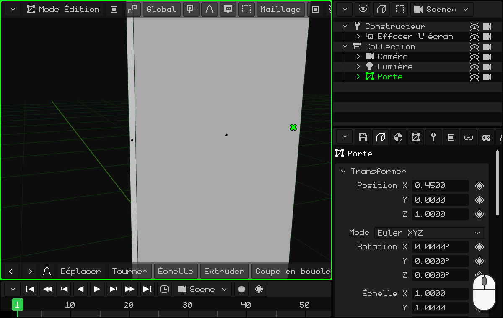

 Sur un écran tactile : un toucher sur la face et **Maillage → Dupliquer** (la copie reste au-dessus). Ensuite **Échelle**, **Déplacer** et **Extruder** dans la barre d'outils, avec les nombres sur le pavé de la barre du haut, et la coche.

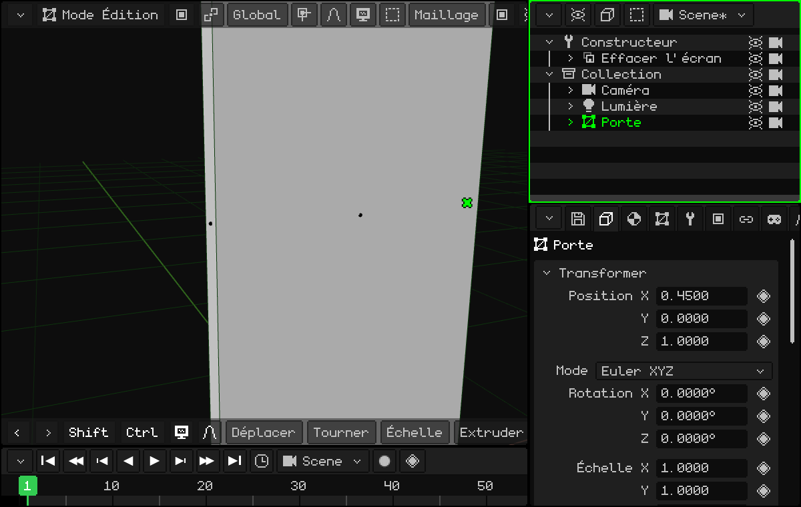

 Sur le Nokia N95 : **Maillage → Dupliquer** avec la touche de sélection gauche ; ensuite <kbd>3</kbd> (mise à l'échelle), <kbd>1</kbd> (déplacement) et <kbd>7</kbd> (extrusion), avec le crayon maintenu pour les nombres et <kbd>OK</kbd>.

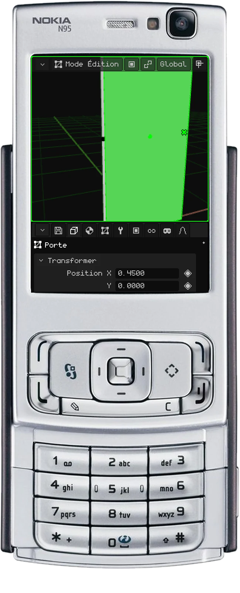

## 2. Séparer la plaque

La plaque fait encore partie du maillage de la porte. Nous la transformons en objet à part :

1. Avec la plaque sélectionnée, <kbd>L</kbd> (**Sélectionner lié**) sélectionne toute la pièce : les 6 faces de la plaque, sans la porte.
2. <kbd>P</kbd> (**Séparer**) : la plaque devient un nouvel objet, **Porte.001**. Vous le voyez dans l'Outliner.

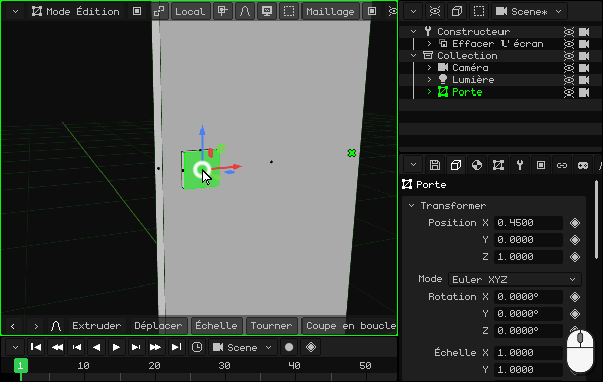

  Sur écran tactile et sur le N95 : **Sélectionner → Sélectionner lié** et un toucher sur la plaque ; ensuite **Maillage → Séparer**.

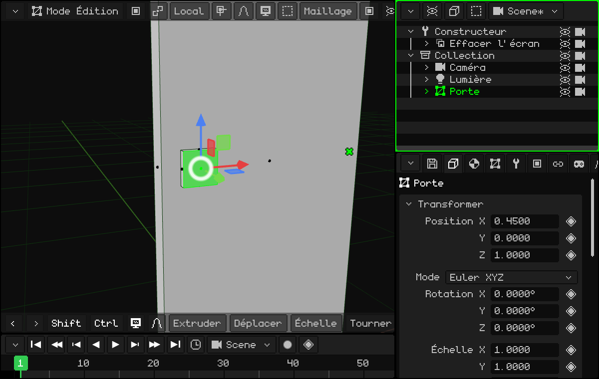

Après la séparation, il ne reste rien de la plaque dans la porte : ni ses faces ni ses lignes.

## 3. Les matériaux : bois et métal

Désormais, chaque partie peut avoir son matériau. Dans **Propriétés**, dans l'onglet **Matériau** :

1. Sélectionnez la porte. Dans **Renommer matériau**, écrivez `Bois`, et dans **Couleur**, choisissez un marron.
2. Sélectionnez la plaque (Porte.001). Comme elle vient de la porte, elle a aussi le matériau Bois : touchez **Nouveau matériau**, nommez-le `Métal` et donnez-lui un gris.

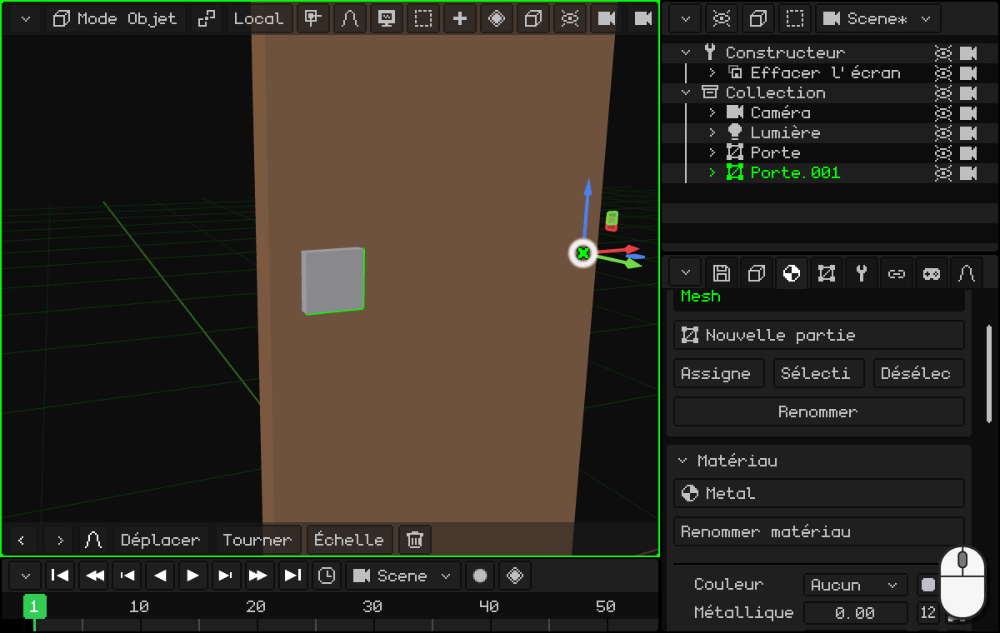

## 4. De l'autre côté de la porte : le Miroir

Une poignée se trouve des deux côtés. Au lieu de faire une autre plaque, nous utilisons le modificateur **Miroir** :

1. Avec la plaque sélectionnée, dans **Propriétés → Modificateurs**, ajoutez **Miroir**.
2. Désactivez **Miroir X** et activez **Miroir Y** : l'autre plaque apparaît, de l'autre côté de la porte.

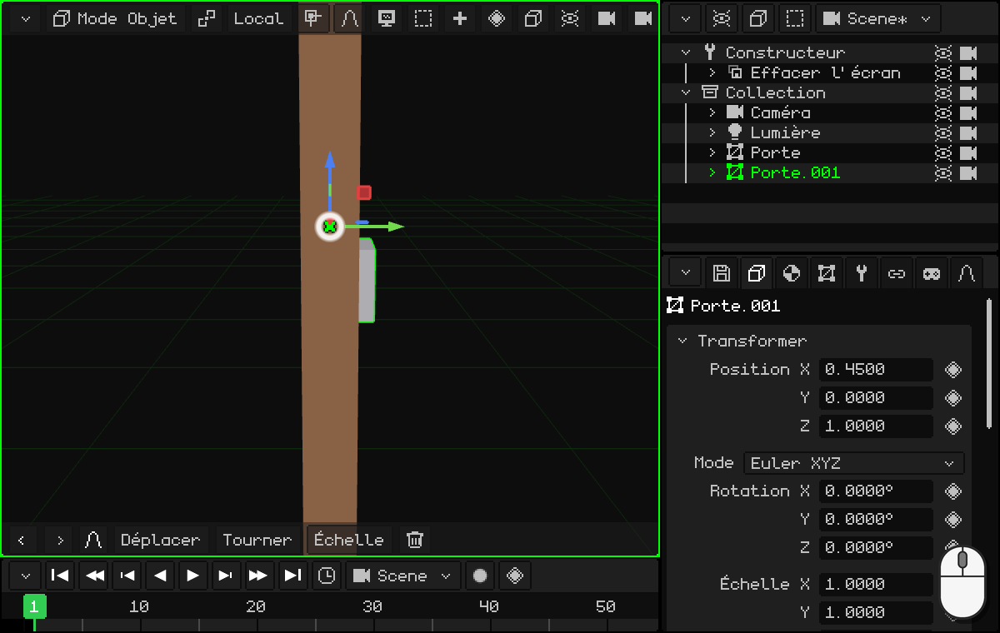

Le miroir se fait par rapport à l'**origine** de l'objet. La plaque vient de la porte, elle a donc la même origine : la charnière, exactement au milieu de l'épaisseur de la porte. C'est pourquoi la copie se retrouve exactement de l'autre côté. Voir [Miroir](../editor/modificador-espejo.md).

## 5. Le levier

Le levier se construit à partir de la plaque, avec la même astuce :

1. Avec la plaque sélectionnée, appuyez sur <kbd>/</kbd> sur le pavé numérique (**Vue locale**) : seule la plaque est affichée, c'est plus facile pour travailler. Passez en **Mode Édition**.
2. Sélectionnez la face avant de la plaque, **dupliquez-la** (<kbd>Shift</kbd> + <kbd>D</kbd> et clic droit) et rétrécissez-la : <kbd>S</kbd> `0.6` <kbd>Enter</kbd>.
3. **Extrudez-la** vers l'extérieur : <kbd>E</kbd> `0.08` <kbd>Enter</kbd>. C'est l'axe du levier.

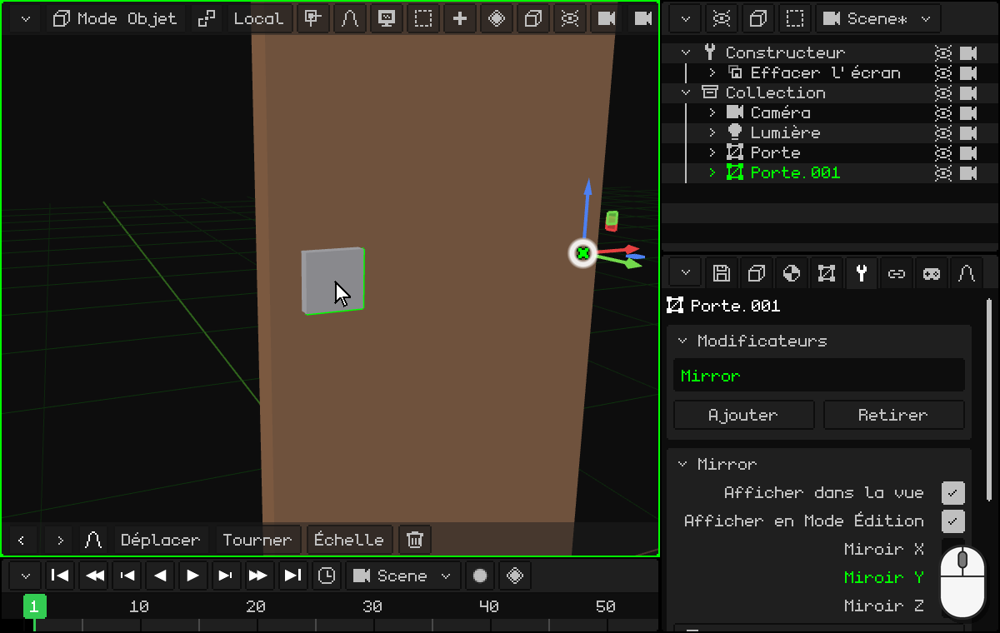
4. Passez à **Arête** et sélectionnez l'arête extérieure, du côté du bord de la porte. Déplacez-la vers l'extérieur : <kbd>G</kbd> <kbd>Y</kbd> `0.05` <kbd>Enter</kbd>. La face avant se retrouve inclinée.
5. Passez à **Face** et sélectionnez cette face inclinée. Extrudez-la **en X**, et non selon sa normale : <kbd>E</kbd>, <kbd>X</kbd>, `0.34` et <kbd>Enter</kbd>. Le bras du levier apparaît.
6. Le bout est resté incliné. Pour le redresser, mettez-le à l'échelle zéro en X : <kbd>S</kbd> <kbd>X</kbd> `0` <kbd>Enter</kbd>. Tous ses sommets se retrouvent à la même coordonnée X : le bout devient plat.

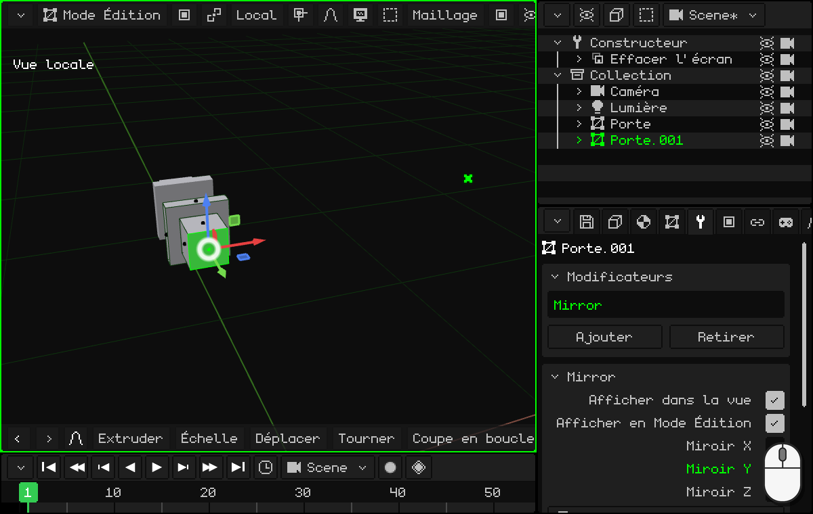
7. <kbd>L</kbd> sélectionne tout le levier et <kbd>P</kbd> le sépare : il devient **Porte.002**. Donnez-lui un nom : double-clic dans l'Outliner et écrivez `Levier`.

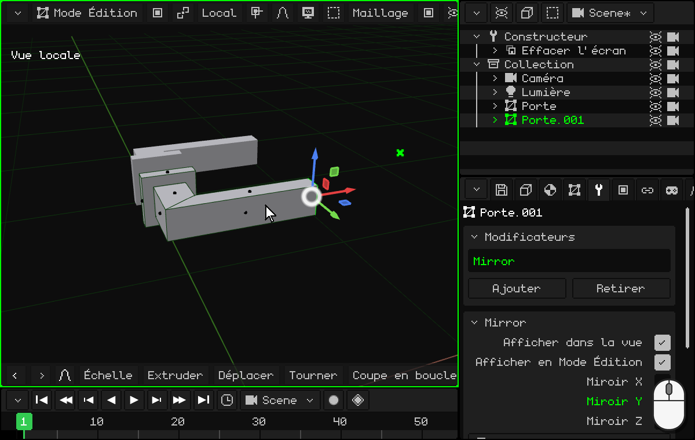

 Sur un écran tactile : un toucher sur la face, **Maillage → Dupliquer**, **Échelle** `0.6` et **Extruder** `0.08` ; **Arête**, un toucher sur l'arête extérieure et **Déplacer** **Y** `0.05` ; **Face**, un toucher sur la face inclinée, **Extruder** **X** `0.34` et **Échelle** **X** `0`. Pour séparer, **Sélectionner → Sélectionner lié** et **Maillage → Séparer**.

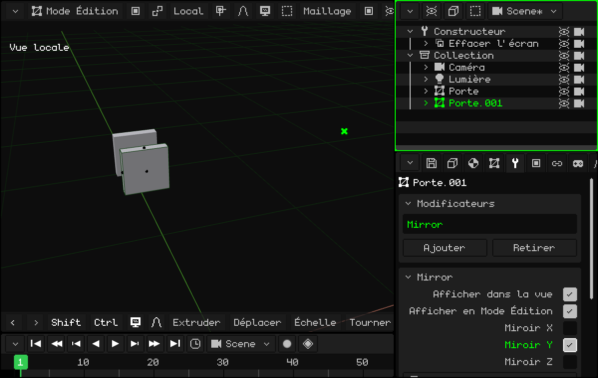

 Sur le Nokia N95 : <kbd>3</kbd> et `0.6`, <kbd>7</kbd> et `0.08` ; l'arête (avec la souris virtuelle), <kbd>1</kbd>, <kbd>2</kbd> (l'axe Y) et `0.05` ; la face inclinée, <kbd>7</kbd>, <kbd>1</kbd> (l'axe X) et `0.34` ; <kbd>3</kbd>, <kbd>1</kbd> et `0`.

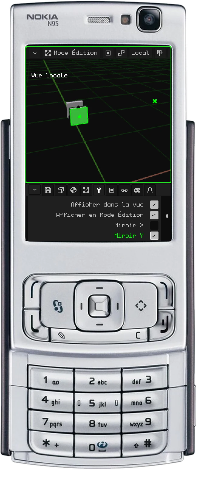

Le levier vient de la plaque : il a donc son matériau (Métal) et son modificateur Miroir.

## 6. Joindre la plaque à la porte

La plaque ne bouge pas toute seule : elle fait partie de la porte. Nous la joignons de nouveau :

1. Sélectionnez la plaque et, dans **Modificateurs**, touchez **Appliquer modificateur** : le miroir devient une véritable géométrie.
2. Sélectionnez la plaque, puis la porte avec <kbd>Shift</kbd> + clic (la porte devient l'objet actif) et <kbd>Ctrl</kbd> + <kbd>J</kbd> (**Joindre**). Elles forment maintenant un seul maillage, avec ses deux matériaux.

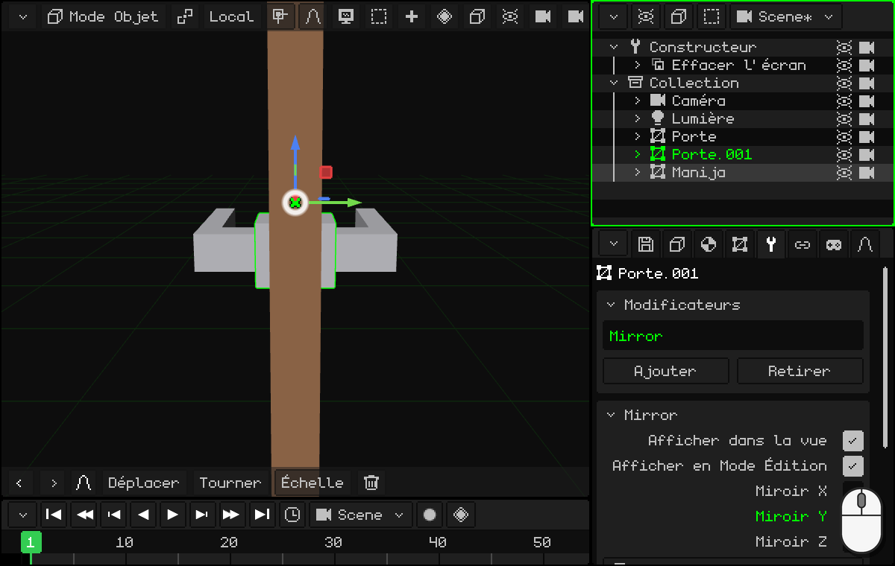

  Sur écran tactile et sur le N95 : **Objet → Joindre**.

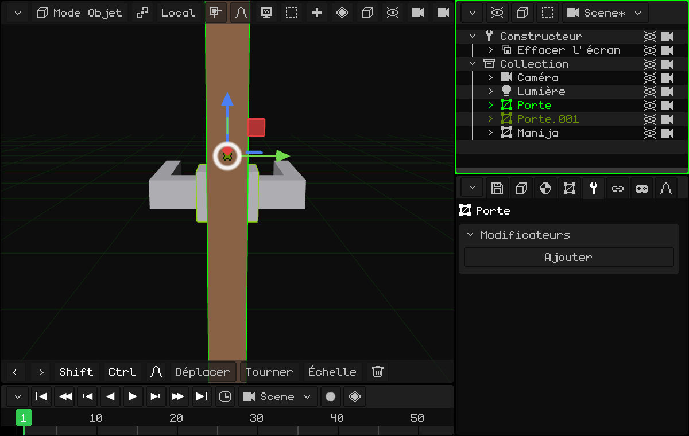

Voilà comment on sépare et on joint des parties d'un maillage : <kbd>P</kbd> pour séparer, <kbd>Ctrl</kbd> + <kbd>J</kbd> pour joindre.

## 7. Les faces qui ne se voient jamais

La plaque est appuyée contre la porte. La face arrière de chaque plaque est cachée : elle ne se verra jamais, mais le logiciel la dessine quand même. Pour la voir :

1. Sélectionnez la porte et passez en **Mode Édition**.
2. Dans **Superpositions**, activez **Rayons X** : le maillage devient transparent et les faces arrière apparaissent.
3. Sélectionnez la face arrière de chaque plaque (celle qui touche la porte) et supprimez-les : <kbd>X</kbd> → **Faces**.

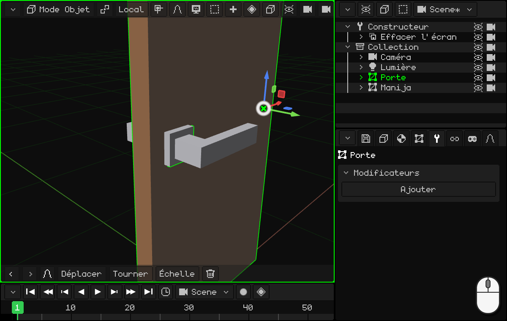

Il vaut mieux supprimer la géométrie qui ne se voit pas : ce sont des faces dessinées pour rien. Dans un petit modèle, cela ne se remarque pas, mais dans une grande scène, ou sur un téléphone, ce sont des performances gagnées.

## 8. Où tourne le levier : l'origine

Le levier doit tourner sur son axe, et non sur la charnière de la porte.

1. Sélectionnez le levier et appliquez son Miroir (**Modificateurs → Appliquer modificateur**).
2. Passez en **Mode Édition**, avec les **Rayons X**. Sélectionnez les deux faces arrière du levier, celles qui touchent les plaques (une de chaque côté).
3. <kbd>Shift</kbd> + <kbd>S</kbd> → **Curseur sur le sélectionné** : le curseur 3D se place au milieu des deux, exactement sur l'axe du levier.
4. Ces deux faces ne se voient pas non plus : supprimez-les (<kbd>X</kbd> → **Faces**).
5. Revenez en **Mode Objet** et amenez l'origine au curseur : <kbd>W</kbd> (ou clic droit) → **Définir l'origine → Origine au curseur 3D**.

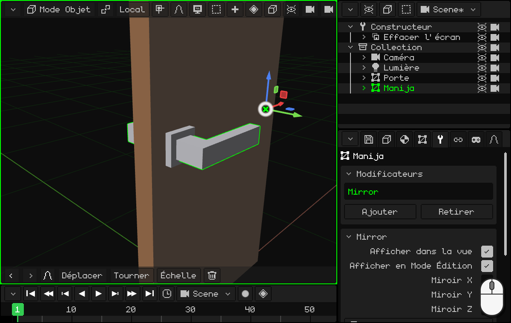

C'est la même chose que ce que nous avons fait avec la charnière dans [Changer l'origine : une porte](puerta.md#placer-lorigine-sur-la-charnière).

## 9. Que le levier suive la porte

Essayez de faire tourner la porte : le levier reste flottant en l'air. Ce sont deux objets indépendants. Annulez la rotation (<kbd>Ctrl</kbd> + <kbd>Z</kbd>).

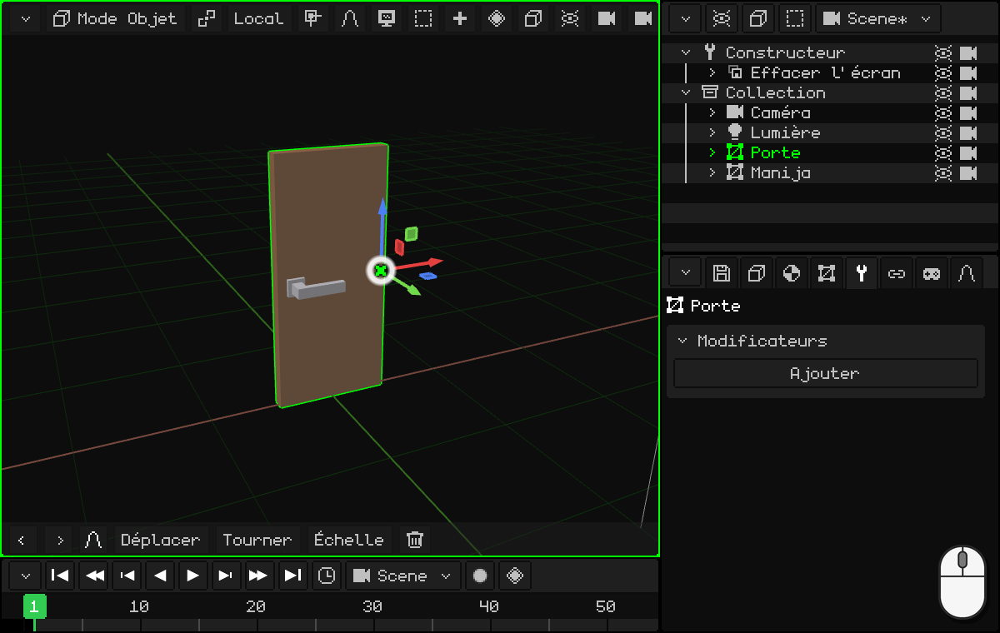

Pour que le levier bouge avec la porte, il faut l'**apparenter** : le levier devient l'**enfant** de la porte.

1. Sélectionnez le levier, puis la porte avec <kbd>Shift</kbd> + clic (la porte, le parent, devient l'objet actif).
2. <kbd>Ctrl</kbd> + <kbd>P</kbd> → **Objet (garder transf.)**. Dans l'Outliner, le levier se retrouve dans la porte.

Sélectionnez uniquement la porte (un clic dessus) et faites-la tourner de nouveau : maintenant, le levier la suit. Et le levier continue de tourner sur son propre axe, comme une vraie poignée. Si les deux sont sélectionnés, seule la porte tourne, et le levier la suit parce qu'il est son enfant.

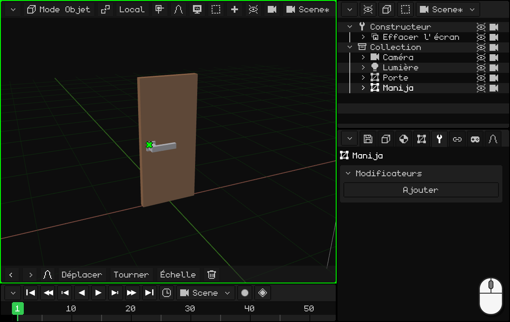

  Sur écran tactile et sur le N95 : **Objet → Définir parent → Objet (garder transf.)**.

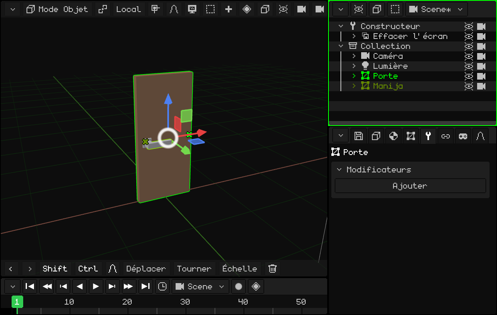

Dans le prochain tutoriel, nous allons animer la porte : [Animer la porte](animar-puerta.md).
