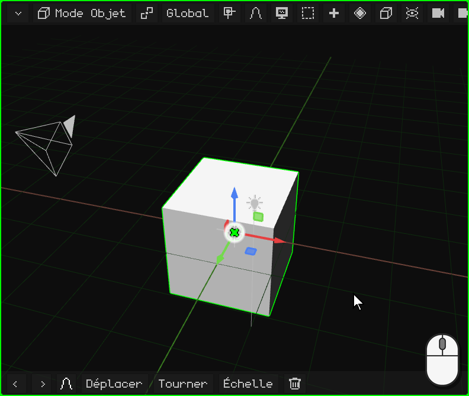
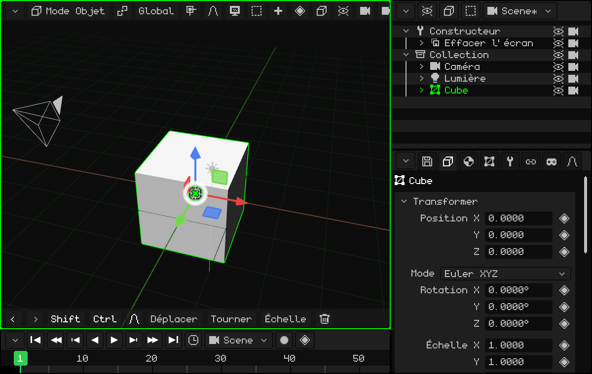
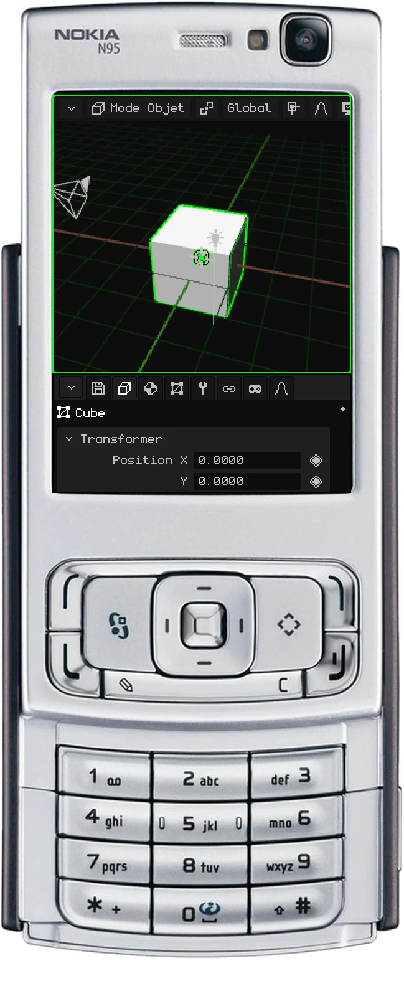
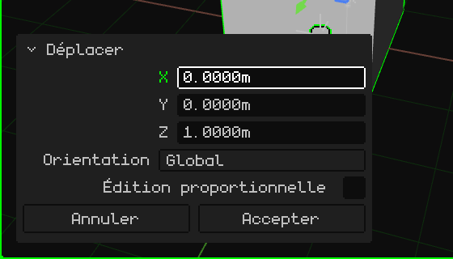
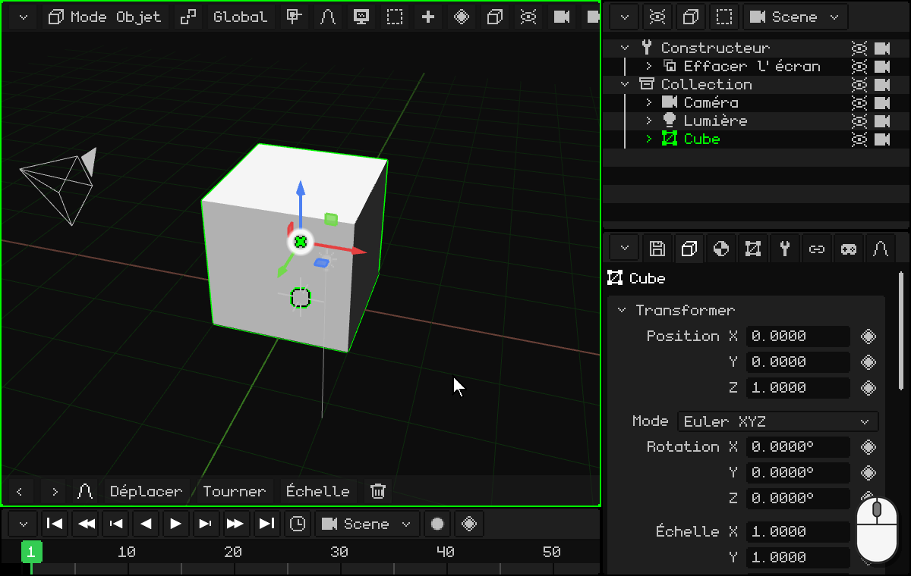
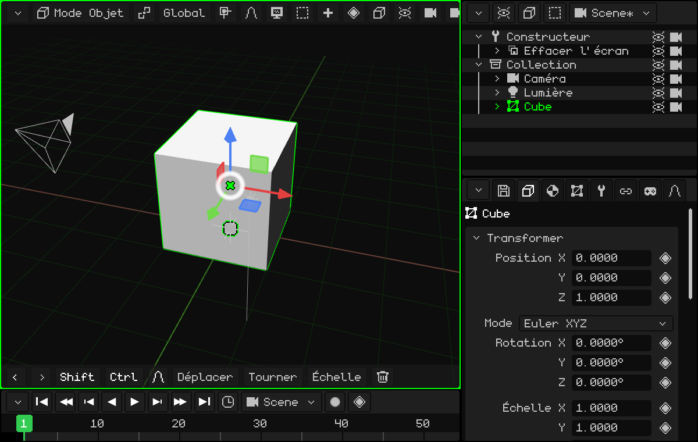
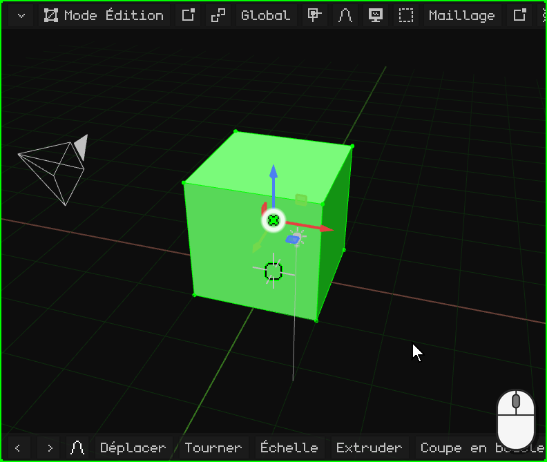
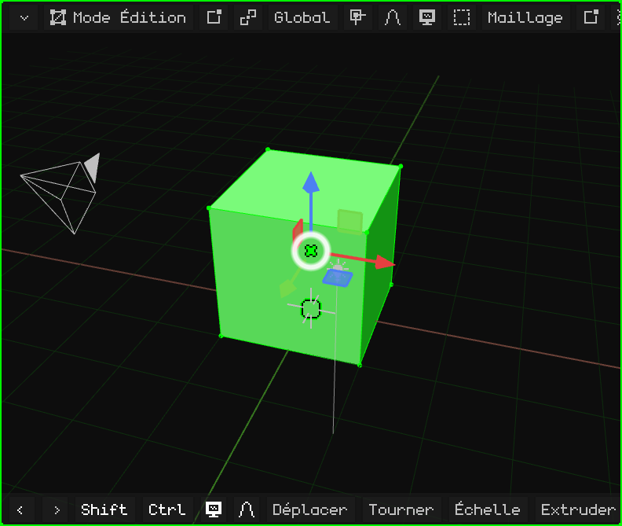
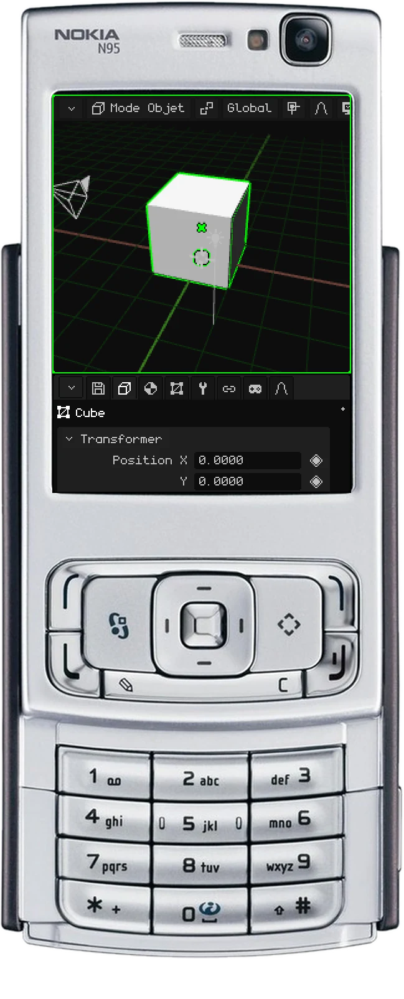
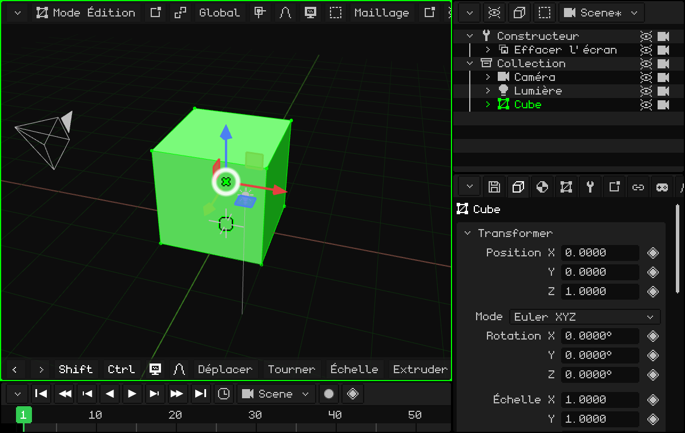

# Modéliser une porte

Nous allons créer notre premier modèle simple : une porte ! Pour commencer, le cube présent dans la scène fait l'affaire : il mesure 2 × 2 × 2 mètres.

Moi (Dante), j'utilise beaucoup les portes pour créer des espaces : c'est quelque chose que j'ai appris en étudiant la construction. Les portes mesurent presque toujours 2 mètres de haut, et une personne est (normalement) moins grande qu'une porte. Avec une porte dans la scène, vous avez tout de suite l'échelle de tout le reste.

## La poser sur le sol

Le cube a son centre sur le sol, donc sa moitié se trouve en dessous. Nous le montons de 1 mètre sur l'axe Z pour qu'il repose sur le sol. Avec le cube sélectionné :

 Appuyez sur <kbd>G</kbd> : le cube suit la souris. Puis sur <kbd>Z</kbd> : il reste attaché à l'axe Z (la ligne bleue apparaît). Tapez `1` et appuyez sur <kbd>Enter</kbd>.

 Touchez **Déplacer** dans la barre d'outils, puis **Z**, un toucher sur la barre du haut pour le pavé numérique, `1`, **OK** et la coche verte.

 <kbd>1</kbd> (déplacer), <kbd>3</kbd> (l'axe Z), le **crayon** maintenu et <kbd>1</kbd>, puis <kbd>OK</kbd>.

La façon de taper les nombres sur chaque appareil est expliquée dans [Avec des valeurs exactes](modo-objeto.md#avec-des-valeurs-exactes).

### Corriger la dernière opération

Après un déplacement, une rotation ou une mise à l'échelle, un petit panneau apparaît en bas à gauche, **Ajuster la dernière opération**, à la place de la barre d'outils. Replié, il indique seulement ce que vous avez fait (par exemple, **Déplacer**) ; un toucher ou un clic sur son titre le déplie :

Chaque valeur peut être corrigée : si au lieu de 1 mètre vous vouliez 1,2, touchez Z, tapez `1.2` et l'opération est refaite avec la nouvelle valeur. **Accepter** le ferme et la barre d'outils revient ; **Annuler** annule l'opération.

## Lui donner sa forme

Il y a deux façons de modéliser la porte.

### La plus facile, que je ne recommande pas : mettre l'objet à l'échelle

En Mode Objet, mettez le cube à l'échelle sur l'axe X et sur l'axe Y jusqu'à ce qu'il ait la forme de la porte. Par exemple, <kbd>S</kbd> <kbd>X</kbd> `0.45` <kbd>Enter</kbd> (90 cm de large) et <kbd>S</kbd> <kbd>Y</kbd> `0.05` <kbd>Enter</kbd> (10 cm d'épaisseur).

Je ne la recommande pas, car l'objet se retrouve avec une échelle différente sur chaque axe (0,45, 0,05 et 1), alors que l'idéal est qu'il ait une échelle de **1** sur ses trois axes (voir [Mieux vaut une échelle à 1](modo-objeto.md#mieux-vaut-une-échelle-à-1)). Si vous procédez quand même ainsi, **appliquez toujours la transformation** : <kbd>Ctrl</kbd> + <kbd>A</kbd> → **Échelle** (ou Objet → Appliquer → Échelle). La forme ne change pas et l'échelle revient à 1.

 Sur un écran tactile : **Échelle**, **X**, la barre du haut, `0.45` et OK, puis la même chose avec **Y** et `0.05`. Ensuite, **Objet → Appliquer → Échelle**.

### Celle que je recommande : le Mode Édition

Avec le cube sélectionné, passez en Mode Édition : appuyez sur <kbd>Tab</kbd> ou choisissez **Mode Édition** dans le bouton du mode de la Vue 3D. En entrant, tous les sommets sont sélectionnés.

En Mode Édition, on sélectionne des **sommets**, des **arêtes** et des **faces** : c'est la base. Et, comme en Mode Objet, on peut les déplacer, les faire pivoter et les mettre à l'échelle (voir [Mode Édition](../editor/modo-edicion.md)).

Avec tout sélectionné, rétrécissez en X et en Y jusqu'à obtenir la porte que vous voulez. En Z, ce n'est pas nécessaire : elle mesure déjà 2 mètres ! Comme c'est le maillage qui change et non l'objet, l'échelle reste à 1.

**À l'œil, avec le gizmo :** un clic (ou un toucher) au centre du gizmo le fait passer en rotation, et un autre en **mise à l'échelle**. Saisissez la pointe rouge (X) et faites-la glisser vers le centre jusqu'à la largeur voulue ; puis la verte (Y), jusqu'à ce qu'elle soit fine comme une porte.

**Avec des nombres :** <kbd>S</kbd>, <kbd>X</kbd>, `0.45`, <kbd>Enter</kbd> et <kbd>S</kbd>, <kbd>Y</kbd>, `0.05`, <kbd>Enter</kbd>.

 Sur un écran tactile : le bouton du mode → **Mode Édition** ; ensuite **Échelle**, **X**, un toucher sur la barre du haut, `0.45`, **OK** et la coche, puis la même chose avec **Y** et `0.05`.

 Sur le Nokia N95 : <kbd>OK</kbd> passe en Mode Édition. <kbd>3</kbd> (mise à l'échelle), <kbd>1</kbd> (l'axe X), le crayon maintenu et `0` <kbd>*</kbd> `45` (la touche <kbd>*</kbd> est le point), puis <kbd>OK</kbd>. La même chose avec <kbd>2</kbd> (l'axe Y) et `0.05`.

## Avec des mesures exactes

Si au lieu de faire à l'œil vous voulez, par exemple, une porte d'exactement **90 cm de large** : dans le bouton **Sommet / Arête / Face**, choisissez **Face** et cliquez sur l'un des côtés. Nous savons que le cube mesure 2 mètres : il faut donc retirer ce qui dépasse pour arriver à 0,9 ; il faut décaler ce côté de **1,1 mètre**. <kbd>G</kbd> <kbd>X</kbd> `-1.1` <kbd>Enter</kbd>.

Pendant le déplacement, l'axe **X** limite le mouvement à un seul axe, pour que le cube ne se déforme pas :

-  Avec la touche <kbd>X</kbd>.
-  Avec un toucher sur **X** dans la barre d'outils. Le `-1.1` se tape avec le pavé numérique, en touchant la barre du haut.
-  Avec <kbd>1</kbd> pendant le déplacement. Le nombre se tape en maintenant le crayon : <kbd>#</kbd> change son signe et <kbd>*</kbd> est le point. La face se sélectionne avec la souris virtuelle (la touche de sélection droite, les flèches et <kbd>OK</kbd>).

Pour l'épaisseur, avec tout sélectionné, <kbd>S</kbd> <kbd>Y</kbd> `0.05` <kbd>Enter</kbd>, comme avant.

Et voilà notre premier modèle 3D ! Félicitations.

Dans le prochain tutoriel, nous allons faire en sorte que la porte s'ouvre depuis la charnière : [Changer l'origine : une porte](puerta.md).
