# Le Mode Objet

En **Mode Objet**, on travaille avec les objets entiers : on les sélectionne, on les déplace, on les fait pivoter, on les met à l'échelle, on les ajoute, on les supprime et on les place les uns dans les autres. C'est le mode dans lequel démarre Whisk3D, comme l'indique le bouton en haut à gauche de la Vue 3D. Pour changer la forme d'un maillage (ses sommets, ses arêtes et ses faces), il y a le Mode Édition, qui a son propre tutoriel.

## Qu'est-ce qu'un objet ?

Tout ce qui se trouve dans la scène est un **objet** : le cube avec lequel démarre un projet, la caméra, la lumière, un personnage. Chaque objet a :

- un **nom**, visible dans l'Outliner ;
- sa **transformation** : où il se trouve (position), comment il est tourné (rotation) et quelle taille il a (échelle) ;
- des **propriétés**, qui dépendent de son type : une lumière a une couleur et une intensité, une caméra a son objectif, un maillage a son matériau.

Il existe des objets de nombreux types, mais tous se sélectionnent, se déplacent, pivotent et se mettent à l'échelle de la même façon.

## Sélectionner un objet

| | Comment sélectionner |
|---|---|
|  PC | Un clic sur l'objet. <kbd>Shift</kbd> + clic en ajoute ou en retire un autre. Un clic dans le vide ne laisse rien de sélectionné. |
|  Écran tactile | Un toucher sur l'objet. Avec **Shift** activé dans la barre d'outils de la Vue 3D, chaque toucher en ajoute ou en retire un autre. |
|  Nokia N95 | La touche **crayon** passe d'un objet au suivant. Avec le crayon et les flèches, on ajoute, on retire, on sélectionne tout ou rien. |

La sélection se reconnaît à un contour, et le dernier objet que vous avez sélectionné est l'**objet actif** : celui qu'affiche Propriétés.

### Sélectionner plusieurs objets avec une boîte

 Faites glisser la souris avec le clic principal sur la Vue 3D, en commençant sur le fond : une **boîte** se dessine et, quand vous relâchez, les objets qu'elle a attrapés sont sélectionnés. Vous pouvez aussi la lancer avec <kbd>B</kbd>.

 Sur un écran tactile, faire glisser un doigt fait orbiter la vue : la boîte se demande dans le menu **Sélectionner → Sélection par boîte**, puis on fait glisser le doigt.

Le sens du glissement change ce qui est sélectionné, et la boîte l'indique par sa couleur :

| Glissement | Couleur de la boîte | Ce qui est sélectionné |
|---|---|---|
| De gauche à droite | Vert | Uniquement ce qui se trouve **entièrement à l'intérieur** de la boîte. |
| De droite à gauche | Bleu | Tout ce que la boîte **touche**, même à peine. |

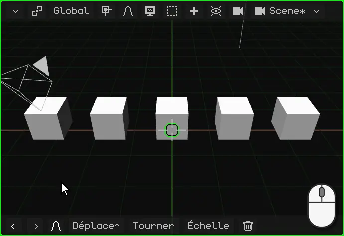

## Le menu contextuel

Comme dans n'importe quel logiciel, le **menu contextuel** met à portée de main ce que l'on peut faire avec la sélection. En Mode Objet, c'est le menu **Objet**, qui s'ouvre là où se trouve le pointeur :

| | Comment l'ouvrir |
|---|---|
|  PC | Clic droit sur la Vue 3D |
|  Écran tactile | Garder un doigt immobile sur la Vue 3D pendant une demi-seconde |
|  Nokia N95 | La touche de sélection gauche ouvre la barre de menus ; là, le menu Objet |

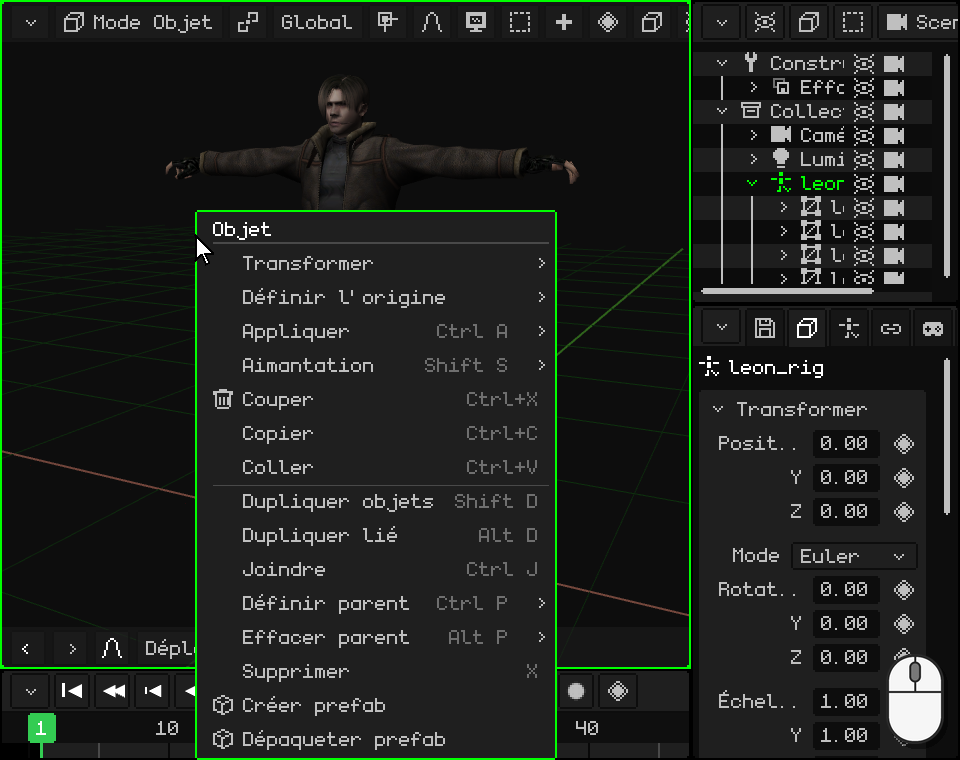

 Avec Leon sélectionné, un doigt immobile sur la Vue 3D : au bout d'une demi-seconde, le téléphone vibre et le menu s'ouvre. Quand vous levez le doigt, rien n'est choisi : l'option se touche ensuite.

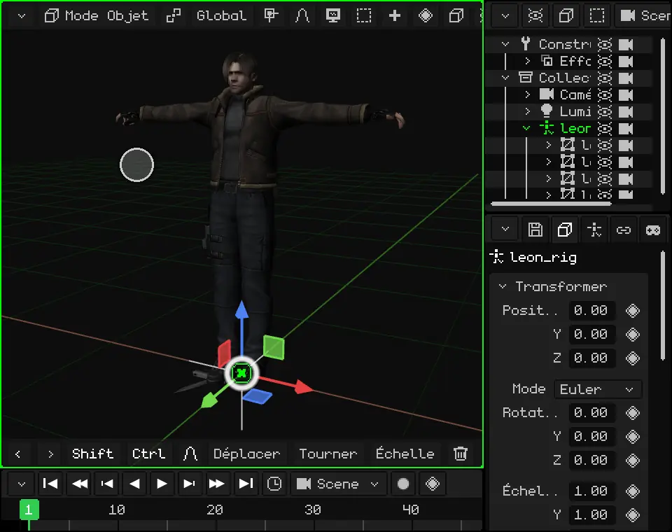

| Option | Ce qu'elle fait |  Raccourci |
|---|---|---|
| **Couper** | Garde la sélection pour la coller plus tard et la retire de la scène. | <kbd>Ctrl</kbd> + <kbd>X</kbd> |
| **Copier** | Garde une copie de la sélection, avec ses enfants, pour la coller plus tard : dans cette scène, dans un autre projet ou dans une autre fenêtre de Whisk3D ouverte. | <kbd>Ctrl</kbd> + <kbd>C</kbd> |
| **Coller** | Place dans la scène ce qui a été copié ou coupé en dernier, au même endroit, et le laisse sélectionné. | <kbd>Ctrl</kbd> + <kbd>V</kbd> |
| **Dupliquer objets** | Fait une copie de la sélection, indépendante de l'original, et la laisse attachée au pointeur pour que vous la déplaciez : un clic (ou <kbd>OK</kbd>) la pose là où elle est. | <kbd>Shift</kbd> + <kbd>D</kbd> |
| **Dupliquer lié** | Comme Dupliquer, mais la copie **partage le maillage** avec l'original : si vous changez la forme de l'un, les deux changent. La position, la rotation et l'échelle restent propres à chacun. Utile pour beaucoup d'objets identiques, comme les arbres d'une forêt ou les chaises d'une salle : on les modifie tous d'un coup et ils occupent moins de mémoire. | <kbd>Alt</kbd> + <kbd>D</kbd> |
| **Supprimer** | Supprime la sélection. Demande une confirmation. | <kbd>X</kbd> ou <kbd>Delete</kbd> |

Les autres options du menu sont présentées dans ce même tutoriel : Transformer (déplacer, faire pivoter et mettre à l'échelle), [Définir l'origine et Aimantation](#depuis-quel-point-on-déplace-fait-pivoter-et-met-à-léchelle), [Appliquer](#mieux-vaut-une-échelle-à-1), [Définir parent et Effacer parent](#loutliner--les-objets-de-la-scène). **Joindre** réunit plusieurs maillages en un seul, et les **prefabs** (des objets assemblés pour être réutilisés) ont leur propre tutoriel.

## Déplacer, faire pivoter et mettre à l'échelle

Les trois opérations de base sur un objet sont **déplacer**, **faire pivoter** et **mettre à l'échelle**. Chacune peut se faire avec le gizmo, au clavier ou, sur un écran tactile, avec les commandes de la barre d'outils. Si quelque chose tourne mal, **Annuler** (<kbd>Ctrl</kbd> + <kbd>Z</kbd> sur PC) revient en arrière.

### Le gizmo

Le **gizmo**, ce sont les flèches de couleur qui apparaissent sur l'objet sélectionné. Chaque couleur est un axe : le **rouge** est X, le **vert** est Y et le **bleu** est Z, celui qui pointe vers le haut.

Le gizmo a trois modes, un pour chaque opération. **Un clic sur le gizmo, sans faire glisser, passe au mode suivant** : du déplacement à la rotation, de la rotation à la mise à l'échelle, puis de la mise à l'échelle de nouveau au déplacement.

 Un clic de souris sur le gizmo change de mode.

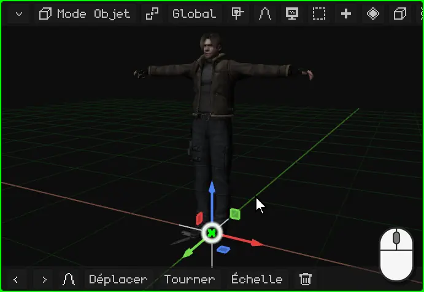

 Un toucher sur le gizmo change de mode.

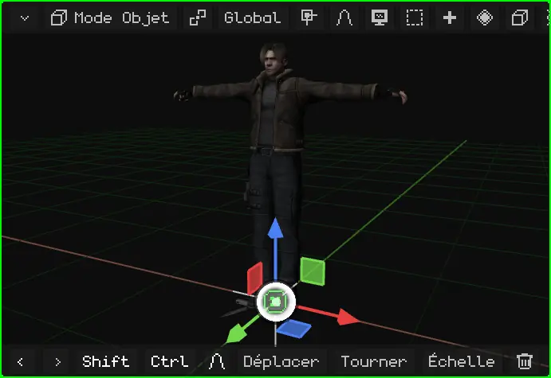

Pour l'utiliser, on saisit une partie du gizmo et on la fait glisser. Quand on relâche, c'est fait.

| Mode | Ce que l'on saisit | Ce que cela fait |
|---|---|---|
| Déplacement | Une flèche | Déplace uniquement sur cet axe. |
| Déplacement | Un petit carré | Déplace dans un plan : le petit carré bleu déplace en X et en Y, sans changer la hauteur. |
| Déplacement | Le cercle du centre | Déplace librement, en suivant le pointeur. |
| Rotation | Un demi-cercle de couleur | Fait tourner autour de cet axe. |
| Rotation | L'anneau blanc | Fait tourner face à la vue. |
| Mise à l'échelle | Une pointe carrée | Étire ou rétrécit sur cet axe. |
| Mise à l'échelle | Le cercle du centre | Agrandit ou rétrécit uniformément, sur les trois axes. |

 À la souris : clic sur une partie du gizmo et glisser.

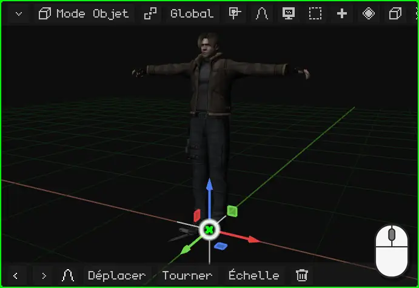

 Au doigt : posez-le sur une partie du gizmo et faites glisser. Si vous le posez sur le fond, vous faites orbiter la vue.

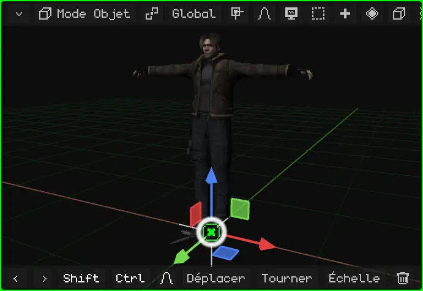

 Sur le Nokia N95, le gizmo est désactivé au départ : on déplace, on fait pivoter et on met à l'échelle avec les touches, comme expliqué plus bas. On peut l'activer dans Superpositions → Gizmo, pour l'utiliser avec une souris Bluetooth.

### Au clavier ou avec les commandes

Au clavier, inutile de viser quoi que ce soit : on appuie sur la touche et l'objet suit la souris (ou les flèches, sur le téléphone) jusqu'à ce que vous confirmiez.

| | Déplacer | Faire pivoter | Mettre à l'échelle | Sur un seul axe | Confirmer | Annuler |
|---|---|---|---|---|---|---|
|  PC | <kbd>G</kbd> | <kbd>R</kbd> | <kbd>S</kbd> | <kbd>X</kbd> / <kbd>Y</kbd> / <kbd>Z</kbd> | Clic ou <kbd>Enter</kbd> | <kbd>Esc</kbd> ou clic droit |
|  Nokia N95 | <kbd>1</kbd> | <kbd>2</kbd> | <kbd>3</kbd> | <kbd>1</kbd> / <kbd>2</kbd> / <kbd>3</kbd> | <kbd>OK</kbd> (le centre du pavé) | <kbd>C</kbd> |

 Vous appuyez sur <kbd>G</kbd> et vous déplacez la souris : l'objet la suit. Si vous appuyez sur <kbd>X</kbd>, il ne se déplace qu'en X ; un second <kbd>X</kbd> passe de Global à Local. Même chose pour la rotation : <kbd>R</kbd> puis <kbd>Z</kbd> fait tourner autour de l'axe Z, l'axe vertical ; sans axe, la rotation se fait face à la vue. Vous pouvez aussi taper un nombre : <kbd>G</kbd>, <kbd>X</kbd>, <kbd>2</kbd> et <kbd>Enter</kbd> le décalent de 2 mètres en X.

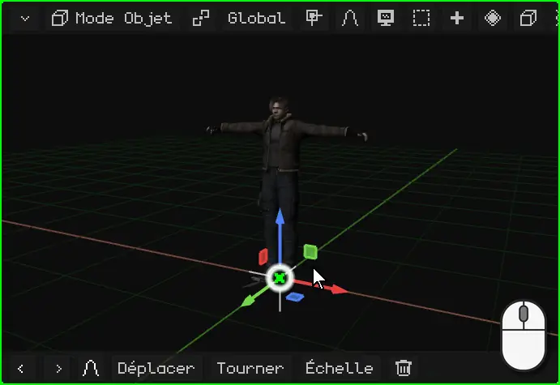

 Sur le Nokia N95 : <kbd>1</kbd> pour déplacer, <kbd>2</kbd> pour faire pivoter et <kbd>3</kbd> pour mettre à l'échelle, et les **flèches** font le mouvement. Pendant l'opération, <kbd>1</kbd>, <kbd>2</kbd> et <kbd>3</kbd> ne changent plus d'opération : ils choisissent l'axe X, Y ou Z. Par exemple, <kbd>2</kbd> puis <kbd>3</kbd> fait tourner autour de l'axe Z, l'axe vertical. <kbd>OK</kbd> confirme et <kbd>C</kbd> annule.

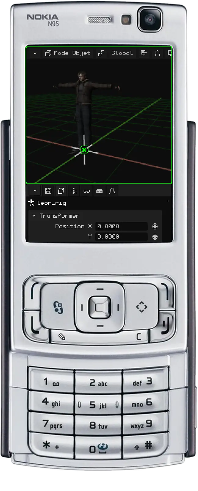

 **Sur un écran tactile**, sans clavier, on peut utiliser le gizmo, comme vu plus haut, ou les **commandes** de la barre d'outils de la Vue 3D. Touchez **Déplacer**, **Tourner** ou **Échelle** et faites glisser le doigt n'importe où dans la vue : l'objet suit le doigt. La barre change : la **coche verte** confirme, la **croix rouge** annule, et les boutons **X**, **Y** et **Z** limitent le mouvement à ces axes.

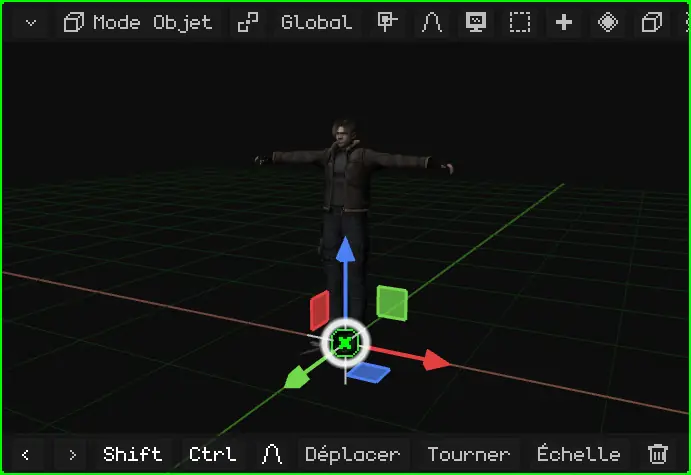

### Avec des valeurs exactes

Pour travailler avec précision, le mouvement se tape sous forme de nombre : faire tourner quelque chose d'exactement 90°, le réduire de moitié avec `0.5` ou le doubler exactement avec `2`, ou le déplacer de 1,5 mètre. **Une unité de Whisk3D vaut un mètre.**

Pendant l'opération, la barre de menus de la Vue 3D affiche ce qui est en cours et la valeur.

 **Au clavier :** après <kbd>G</kbd>, <kbd>R</kbd> ou <kbd>S</kbd>, tapez le nombre et appuyez sur <kbd>Enter</kbd>. <kbd>R</kbd> <kbd>Z</kbd> <kbd>9</kbd> <kbd>0</kbd> <kbd>Enter</kbd> le fait tourner de 90° autour de l'axe vertical ; <kbd>S</kbd> <kbd>0</kbd> <kbd>.</kbd> <kbd>5</kbd> <kbd>Enter</kbd> le réduit de moitié et <kbd>S</kbd> <kbd>2</kbd> <kbd>Enter</kbd> le double ; <kbd>G</kbd> <kbd>X</kbd> <kbd>1</kbd> <kbd>.</kbd> <kbd>5</kbd> <kbd>Enter</kbd> le décale de 1,5 mètre en X.

 **Sur un écran tactile :** commencez l'opération avec **Déplacer**, **Tourner** ou **Échelle** dans la barre d'outils et touchez la barre du haut, celle qui affiche la valeur : le pavé numérique de Whisk3D s'ouvre. Tapez le nombre et touchez **OK** ; la coche verte valide l'opération. Le pavé fait aussi des calculs, comme `90/2`.

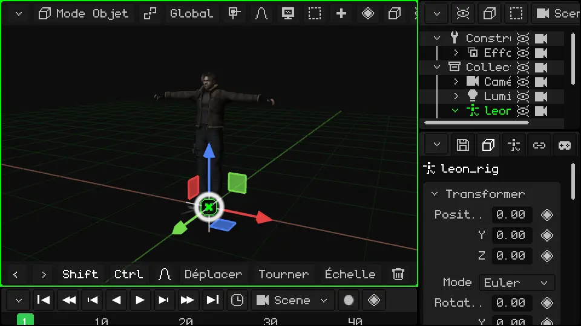

Tous les raccourcis du Mode Objet se trouvent dans le manuel : [Déplacer, faire pivoter et mettre à l'échelle](../editor/transformar.md) et [Mode Objet](../editor/modo-objeto.md).

### La barre d'outils : les dernières commandes

  Dans la **barre d'outils** de la Vue 3D (celle du bas), il y a Annuler et Rétablir (les flèches), puis **les dernières commandes que vous avez utilisées**, la plus récente en premier. Au départ, ce sont Déplacer, Tourner, Échelle et Supprimer. Si vous mettez un objet à l'échelle, Échelle passe en tête : ce que vous utilisez le plus reste toujours à portée de main.

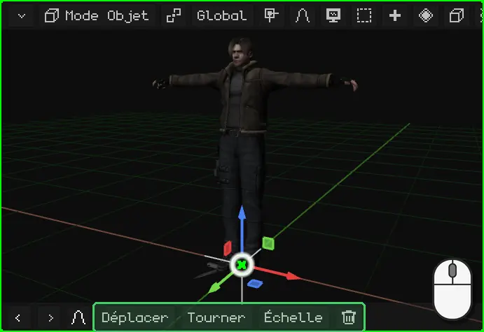

 Sur le Nokia N95, la barre d'outils est masquée au départ, pour laisser l'écran à la scène : on déplace, on fait pivoter et on met à l'échelle avec les touches du téléphone. Quand elle apparaît (par exemple celle de l'édition proportionnelle pendant une transformation), ses boutons s'utilisent avec la **souris virtuelle** : elle s'active avec la touche de sélection droite, les flèches la déplacent et <kbd>OK</kbd> fait un clic.

## Depuis quel point on déplace, fait pivoter et met à l'échelle

### L'origine

Chaque objet a une **origine** : le point d'où part le gizmo. C'est le point à partir duquel l'objet se transforme : il tourne autour de son origine, et s'agrandit ou rétrécit à partir d'elle. La **position** qu'affiche Propriétés est celle de son origine.

Dans les primitives, l'origine est au centre. Dans un modèle importé, elle se trouve là où l'a laissée le logiciel qui a servi à le créer : chez Leon, à ses pieds.

### Le curseur 3D

Le **curseur 3D** est le cercle avec une croix de la Vue 3D. Au départ, il se trouve au centre du monde.

 Il sert à deux choses :

- tout ce qui est ajouté avec **Ajouter** apparaît à cet endroit ;
- il peut être le centre à partir duquel on fait pivoter et on met à l'échelle, comme on le voit dans [Le point de pivot](#le-point-de-pivot).

Le curseur 3D se déplace avec le menu **Aimantation**, qui amène aussi les objets jusqu'au curseur :

| | Comment ouvrir le menu Aimantation |
|---|---|
|  PC | <kbd>Shift</kbd> + <kbd>S</kbd> |
| Menu | Objet → Aimantation (en Mode Édition, Maillage → Aimantation) |

| Option | Ce qu'elle fait |
|---|---|
| Curseur sur le sélectionné | Amène le curseur 3D au centre de la sélection. En Mode Édition, au centre des sommets, arêtes ou faces sélectionnés. |
| Curseur sur l'actif | Amène le curseur 3D à l'origine de l'objet actif. |
| Curseur à l'origine du monde | Le ramène au centre du monde. |
| Curseur sur la grille | L'amène au point de la grille le plus proche. |
| Sélection au curseur | Amène la sélection jusqu'au curseur 3D. |
| Sélection au curseur (garder décalage) | Pareil, mais avec plusieurs objets, garde la distance entre eux : le groupe arrive entier. |
| Sélection sur l'actif | Amène la sélection jusqu'à l'objet actif. |
| Sélection sur la grille | Colle chaque objet sélectionné au point de la grille le plus proche. |

Par exemple, pour mettre une boîte dans la main de quelqu'un, ou un objet exactement là où se trouve un autre : sélectionnez l'objet de destination, **Curseur sur le sélectionné** ; ensuite, sélectionnez celui que vous voulez amener et **Sélection au curseur**.

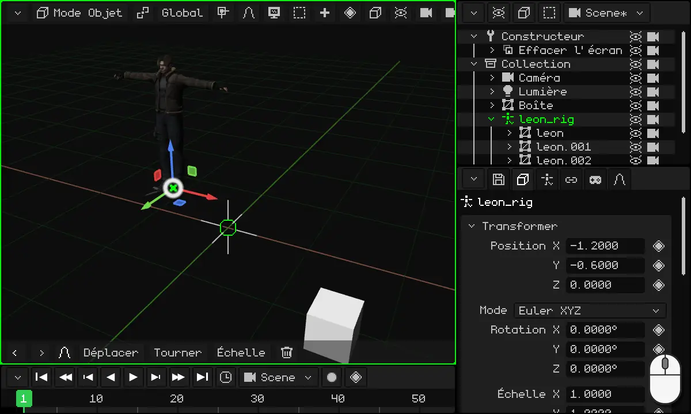

### Le point de pivot

Le **point de pivot** est le centre à partir duquel on fait pivoter et on met à l'échelle la sélection. Il se choisit avec le bouton du pivot dans la barre de la Vue 3D, à gauche de **Global** (son icône change selon le pivot choisi) :

| Pivot | À partir d'où l'on fait pivoter et met à l'échelle |
|---|---|
| **Point médian** | À partir du centre de toute la sélection. C'est celui par défaut. Avec un seul objet, c'est son origine. |
| **Élément actif** | À partir de l'origine de l'objet actif (le dernier que vous avez sélectionné) : les autres tournent autour de lui. |
| **Origines individuelles** | Chaque objet à partir de sa propre origine : ils tournent tous en même temps, chacun à sa place. |
| **Curseur 3D** | À partir du curseur 3D. |

Avec **Curseur 3D**, on peut faire tourner n'importe quoi autour de n'importe quel point : placez le curseur à cet endroit (avec le menu Aimantation) et faites pivoter. C'est utile pour disposer des chaises autour d'une table, les aiguilles d'une horloge ou tout ce qui doit tourner autour de quelque chose.

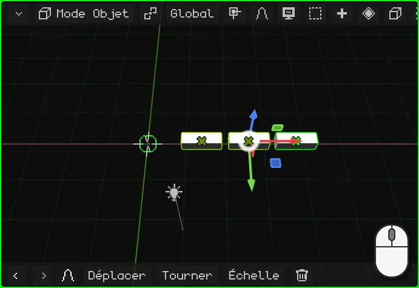

### Global et Local

Quand vous déplacez, faites pivoter ou mettez à l'échelle sur un axe, cet axe peut être celui du **monde** ou celui de l'**objet**. On le choisit avec le bouton **Global** de la barre de la Vue 3D :

| Orientation | Les axes |
|---|---|
| **Global** | Ceux du monde : toujours les mêmes, avec Z vers le haut. C'est celle par défaut. |
| **Local** | Ceux de l'objet lui-même, qui tournent avec lui. |
| **Vue** | Ceux de l'écran : X vers le côté, Y vers le haut. |
| **Normal** | En Mode Édition, la direction vers laquelle regarde la face sélectionnée. |

La différence se voit quand l'objet est tourné. Par exemple, Leon tourné de 40° : en **Global**, son axe Y est celui du monde et il se déplace en diagonale par rapport à la direction dans laquelle il regarde ; en **Local**, l'axe Y tourne avec lui et il avance tout droit. Même chose pour une voiture qui a tourné à un coin de rue : pour qu'elle avance, on la déplace sur son axe Local.

 Au clavier, la seconde lettre de l'axe passe de Global à Local : <kbd>G</kbd> <kbd>Y</kbd> déplace sur le Y du monde et <kbd>G</kbd> <kbd>Y</kbd> <kbd>Y</kbd>, sur le Y de l'objet. Sur le Nokia N95, même chose avec <kbd>2</kbd> <kbd>2</kbd> pendant le déplacement.

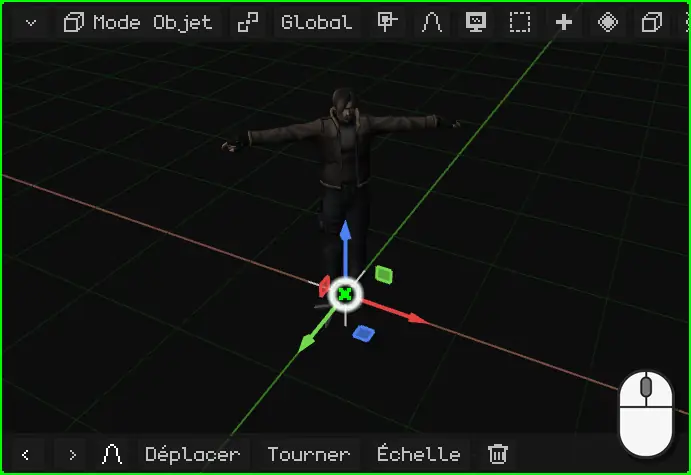

### Changer l'origine

L'origine d'un maillage 3D peut être déplacée sans bouger le maillage, avec **Objet → Définir l'origine**. La marche à suivre, avec l'exemple d'une porte qui doit s'ouvrir depuis la charnière, se trouve dans le tutoriel [Changer l'origine : une porte](puerta.md).

## Les propriétés

Les **propriétés** de l'objet actif se trouvent dans le viewport Propriétés. L'onglet **Objet** (celui du cube) est le même pour tous les objets : en haut se trouve la carte **Transformer**, avec la position, la rotation et l'échelle. Les nombres peuvent être saisis à la main : un clic (ou un toucher) sur le nombre, puis on tape. Déplacer l'objet dans la Vue 3D change ces nombres, et changer les nombres le déplace.

Les autres onglets dépendent du type d'objet : une lumière a l'onglet de la lumière, un maillage a celui du matériau et celui des modificateurs.

### Le losange : ce qui peut être animé

À côté de nombreuses propriétés, il y a un **losange**. Le losange signifie que cette propriété **peut être animée** : un clic sur le losange enregistre sa valeur à la frame actuelle (une *keyframe*), et un autre clic sur le losange vert la retire. Avec plusieurs keyframes, la propriété change toute seule au fil du temps.

La couleur du losange indique l'état de la propriété : **gris**, elle n'est pas encore animée ; **vert** vif, elle est déjà animée et a une keyframe sur cette frame ; **vert pâle**, elle est animée, mais n'a pas de keyframe sur cette frame.

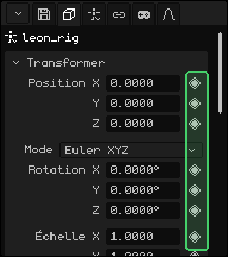

L'animation aura son propre tutoriel plus loin.

### Mieux vaut une échelle à 1

Un conseil : **laissez l'échelle des objets à 1**. Agrandir ou rétrécir un objet avec Échelle est pratique, mais un objet mis à l'échelle peut poser des problèmes plus tard : les enfants héritent de l'échelle et se déforment en tournant, et la physique, les collisions et certains modificateurs peuvent mal calculer.

Si vous avez mis un objet à l'échelle, **appliquez l'échelle** : la taille qu'il a devient sa taille réelle et l'échelle revient à 1, sans que ce que l'on voit ne change.

| | Comment appliquer l'échelle |
|---|---|
|  PC | <kbd>Ctrl</kbd> + <kbd>A</kbd> → Échelle |
| Menu | Objet → Appliquer → Échelle |

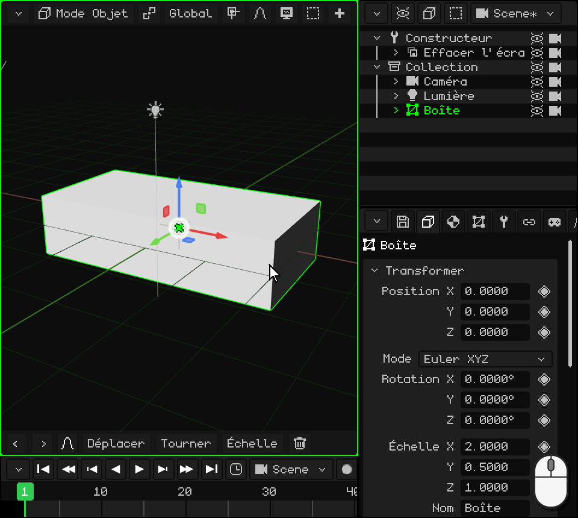

Dans le même menu, **Position** et **Rotation** font la même chose avec la position et la rotation, et **Toutes les transformations** applique les trois.

## L'Outliner : les objets de la scène

L'**Outliner** est la liste de tous les objets de la scène. Un clic (ou un toucher) sur une ligne sélectionne cet objet, comme dans la Vue 3D. Sur PC, il se trouve en haut à droite.

Un objet peut se trouver **dans un autre** : il apparaît plus décalé vers la droite, suspendu à lui. Celui de l'extérieur est le **parent** et celui de l'intérieur est l'**enfant**. L'enfant **hérite des transformations** du parent : si vous déplacez, faites pivoter ou mettez à l'échelle le parent, l'enfant le suit. L'enfant peut toujours être déplacé seul, mais toujours par rapport au parent.

Leon en est un exemple : ses maillages, les quatre parties visibles, sont les enfants de son armature, `leon_rig`. Déplacer l'armature déplace Leon tout entier.

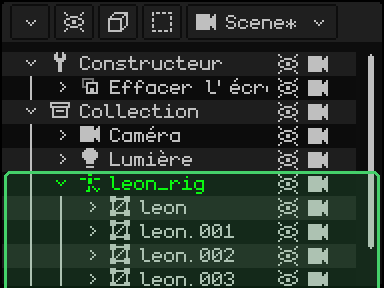

Placer un objet dans un autre s'appelle **apparenter** :

| | Comment apparenter |
|---|---|
|  PC | Dans l'Outliner, faire glisser la ligne de l'enfant et la relâcher sur celle du parent. Ou sélectionner l'enfant, puis le parent (avec <kbd>Shift</kbd>) et <kbd>Ctrl</kbd> + <kbd>P</kbd>. |
|  Écran tactile | Sélectionner l'enfant ; activer **Shift** dans la barre d'outils et toucher le parent ; ensuite, menu Objet → Définir parent. |
|  Nokia N95 | Avec l'Outliner actif et l'enfant sélectionné : <kbd>1</kbd>, la flèche **droite** le place dans celui du dessus et la flèche **gauche** l'en sort ; <kbd>1</kbd> une seconde fois confirme. |
| Menu | Objet → Définir parent ; pour l'en sortir, Objet → Effacer parent |

 Dans la vidéo, une boîte est glissée dans l'Outliner jusqu'à `leon_rig` : elle devient son enfant, et quand on déplace Leon, la boîte le suit.

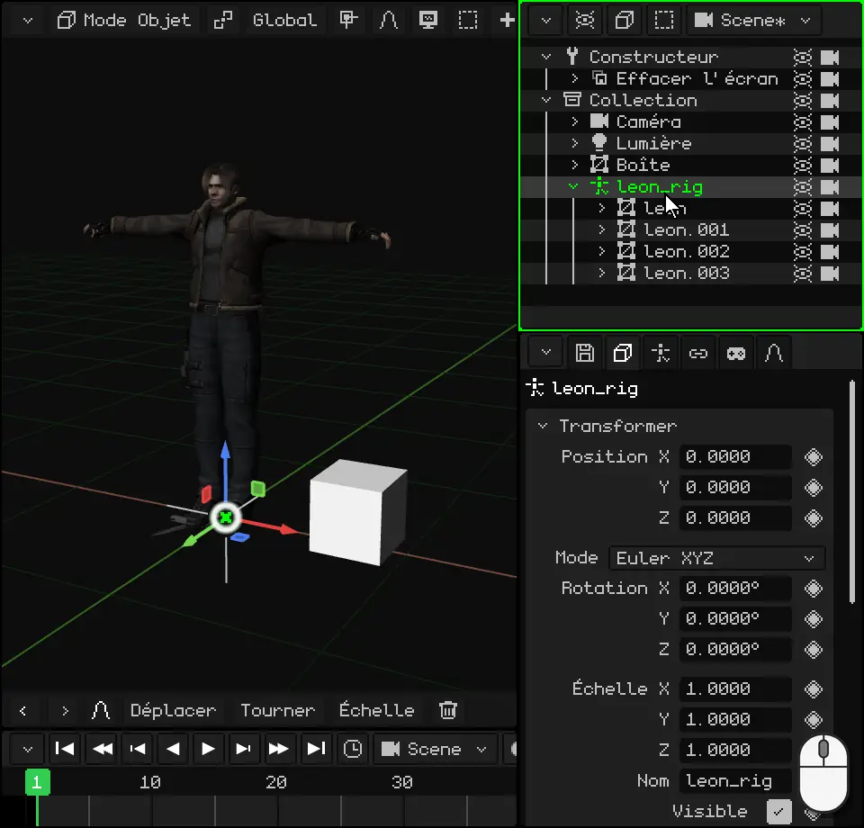

## Les types d'objets

Tous les objets s'ajoutent depuis le menu **Ajouter** (le bouton **+** de la barre de la Vue 3D, ou <kbd>Shift</kbd> + <kbd>A</kbd> sur PC). Le nouvel objet apparaît sur le curseur 3D et reste sélectionné.

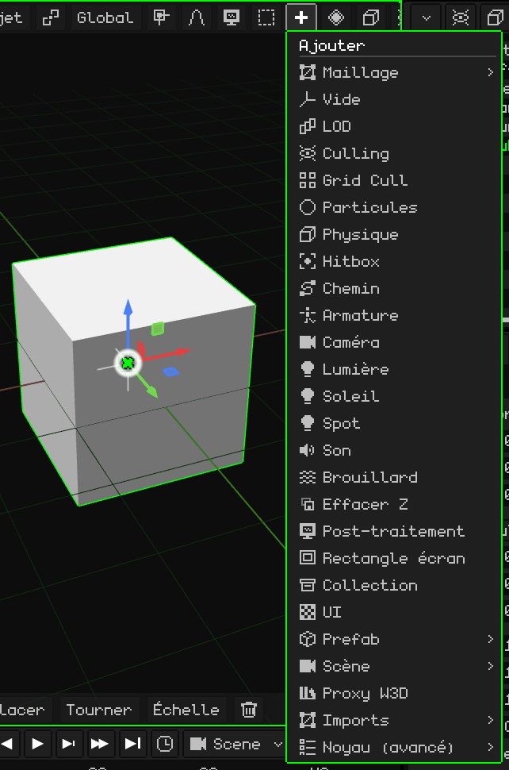

Voici les types de base :

| Objet | Ce que c'est |
|---|---|
| [Maillage 3D](../editor/objeto-malla.md) | Un modèle 3D : un personnage, une maison, une pierre. Il est fait de sommets, d'arêtes et de faces, et s'affiche avec son matériau et ses textures. Les primitives de Ajouter → Maillage (cube, sphère, cylindre...) sont des maillages pour commencer à modéliser. |
| [Caméra](../editor/objeto-camara.md) | Le point de vue du jeu et des rendus. Ce que voit la caméra active, c'est ce que l'on voit en jouant et ce qui sort dans une image ou une vidéo. |
| [Lumière](../editor/objeto-luz.md) | Éclaire la scène. Il en existe trois types : Ponctuelle (une ampoule), Soleil (la lumière du jour, aux rayons parallèles) et Spot (un cône, comme une lampe torche). |
| [Armature](../editor/objeto-esqueleto.md) | Une chaîne d'os qui fait bouger un maillage, pour animer des personnages. Leon en a une : quand l'armature marche, le maillage la suit. |
| [Son](../editor/objeto-sonido.md) | Un son placé dans la scène. Il peut être joué en fond, comme une musique, ou depuis l'endroit où se trouve l'objet. |
| Vide | Un objet sans forme : un point dans la scène. Il sert de parent pour regrouper d'autres objets ou de repère. |
| Collection | Un dossier pour ranger les objets dans l'Outliner. |

Il y en a d'autres : chemins, brouillard, particules, hitbox pour les collisions, interfaces 2D pour les jeux et objets d'optimisation. Et beaucoup d'autres s'ajouteront à l'avenir. Ce tutoriel parle des objets en général ; chacun a son article, où ses propriétés sont expliquées une par une.

## Ce que tous les objets ont en commun

En plus de leur transformation et de leurs propriétés, tous les objets peuvent avoir :

- des **scripts** Lua, qui leur donnent un comportement dans le jeu : bouger tout seuls, réagir aux touches, entrer en collision. On les verra plus loin ;
- des **animations** : toute propriété qui a un losange peut être animée. Elles ont leur propre tutoriel ;
- des **contraintes** : des règles qui les attachent à un autre objet, comme copier sa position ou toujours regarder la caméra. Elles sont expliquées dans [Contraintes](../editor/restricciones.md).

Certains types ont en plus des éléments qui leur sont propres. Les maillages 3D, par exemple, ont des **modificateurs**, qui changent la forme sans la détruire : la refléter comme dans un miroir, la répéter, la lisser. Ils sont présentés dans [Maillage 3D](../editor/objeto-malla.md).

## Importer des modèles 3D

En plus de modéliser dans Whisk3D, on peut importer des modèles créés dans d'autres logiciels. Les formats acceptés sont :

| Format | Ce qu'il apporte |
|---|---|
| **GLB** et **glTF** | Le maillage, les matériaux et les textures, l'armature et les animations. C'est le format le plus complet : Leon est fourni en .glb. |
| **OBJ** | Le maillage, les matériaux et les textures (avec son .mtl). Sans armature ni animations. |
| **FBX** | Le maillage, les matériaux, l'armature et les animations. |
| **STL** | Uniquement la forme : les triangles, sans matériaux ni couleurs. C'est le format de l'impression 3D et des logiciels de CAO. |

On les importe depuis **Ajouter → Imports**, en choisissant le format puis le fichier.

 Sur PC, on peut aussi faire glisser le fichier depuis le dossier et le déposer sur la Vue 3D.

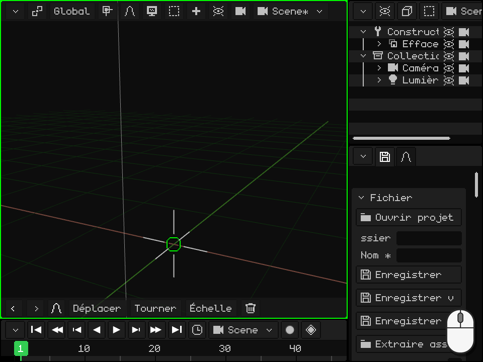

Un modèle avec armature arrive sous la forme d'une **armature avec les maillages à l'intérieur** : l'armature est le parent et les maillages sont ses enfants, comme on l'a vu dans l'[Outliner](#loutliner--les-objets-de-la-scène). Les animations sont enregistrées dans l'armature, prêtes à l'emploi.

Pour envoyer un modèle vers un autre logiciel ou vers une imprimante 3D, il y a le chemin inverse : Propriétés → l'onglet de la disquette → **Exporter**, avec OBJ, glTF, GLB ou STL.
