# Naviguer dans le 3D Viewport

> [!NOTE]
> Le Nokia N95 prend en charge une souris et un clavier (en Bluetooth). Les parties de ce tutoriel consacrées au Nokia expliquent comment l'utiliser sans souris ni clavier, uniquement avec les touches du téléphone.

Ce tutoriel explique comment naviguer dans le 3D Viewport. Naviguer, c'est déplacer votre point de vue : tourner autour de la scène, vous décaler sur le côté, vous rapprocher ou vous éloigner.

Savoir naviguer est important : pour créer des modèles 3D et des animations de façon confortable et rapide, il faut savoir se déplacer dans la scène et se placer dans une position confortable pour travailler.

Comme expliqué dans le [tutoriel précédent](viewports.md#le-viewport-actif), pour utiliser les commandes qui suivent, le 3D Viewport doit être le viewport actif, celui qui a la bordure verte.

Les trois gestes que vous utiliserez le plus sont **orbiter**, **déplacer la vue** et **zoomer**. Chacun se fait à la souris, avec les doigts sur un écran tactile ou avec le clavier du Nokia N95. Dans les vidéos sur PC, la souris en bas à droite montre en vert le bouton enfoncé.

## Orbiter

Orbiter, c'est faire tourner la vue autour de la scène, comme si vous faisiez le tour d'une table pour voir sous tous les angles ce qu'il y a dessus.

**À la souris :** maintenez enfoncé le **bouton du milieu** (on l'actionne en appuyant sur la molette) et faites glisser. Sur un trackpad, ou avec une souris sans bouton du milieu, maintenez <kbd>Alt</kbd> et faites glisser avec le **clic principal** (le gauche).

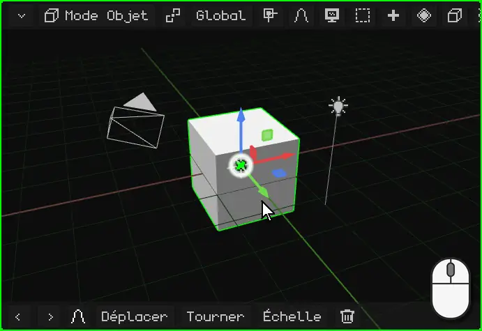

**Au doigt :** faites glisser un doigt sur le 3D Viewport. Commencez sur le fond : si vous le posez sur le gizmo (les flèches de couleur de l'objet), c'est le gizmo que vous allez déplacer.

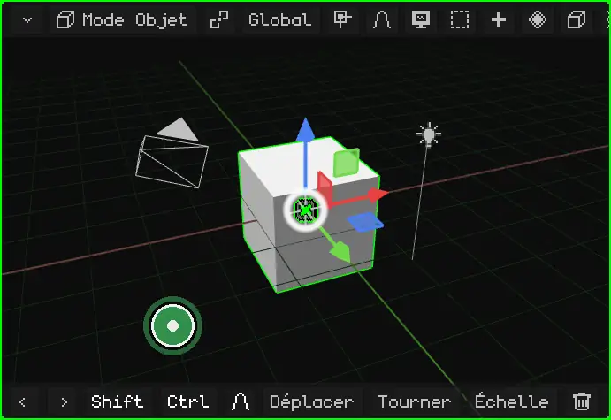

**Sur le Nokia N95 :** maintenez enfoncée une **flèche** du pavé directionnel. La vue tourne de ce côté tant que vous la maintenez.

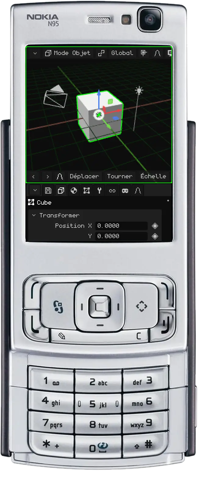

## Déplacer la vue

Déplacer la vue (ou faire un *panoramique*), c'est la faire glisser sur le côté, vers le haut ou vers le bas, sans la faire tourner.

**À la souris :** maintenez <kbd>Shift</kbd> et faites glisser avec le **bouton du milieu**. Sur un trackpad : <kbd>Alt</kbd> + <kbd>Shift</kbd> et faites glisser avec le clic principal.

**Avec les doigts :** posez **deux doigts** et déplacez-les ensemble dans la même direction.

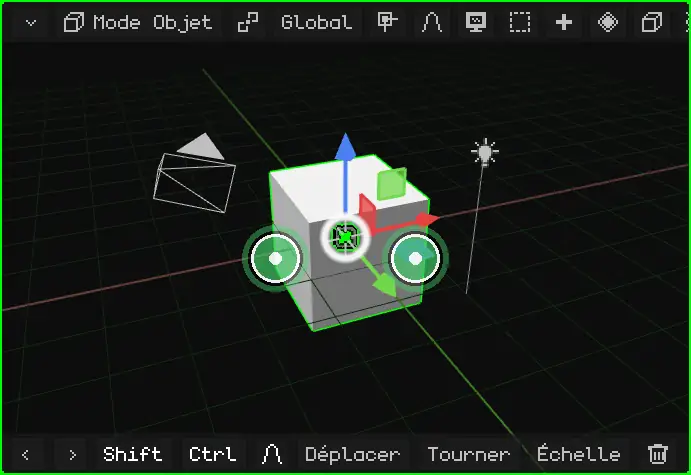

**Sur le Nokia N95 :** maintenez enfoncée la touche <kbd>\*</kbd> et utilisez les flèches.

## Zoom

Le zoom vous rapproche ou vous éloigne. Le pas s'adapte à la distance : près d'un petit objet, il avance lentement, et de loin, il avance vite. Il convient donc aussi bien pour regarder toute la scène que pour regarder un sommet.

**À la souris :** tournez la **molette**. Vers l'avant, elle rapproche ; vers l'arrière, elle éloigne. Sur un trackpad, faites glisser deux doigts vers le haut ou vers le bas.

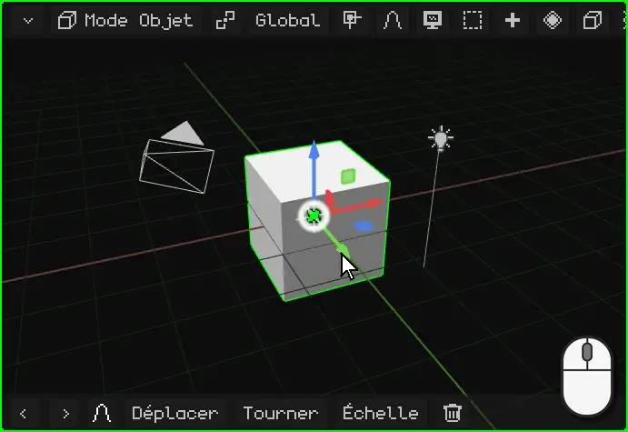

**Avec les doigts :** pincez. Écarter les doigts rapproche, les resserrer éloigne.

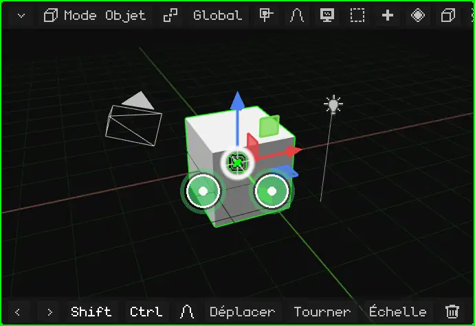

**Sur le Nokia N95 :** maintenez enfoncé le <kbd>0</kbd> et utilisez la flèche **haut** pour vous rapprocher ou la flèche **bas** pour vous éloigner.

## Cadrer la sélection

Si vous êtes perdu, ou si vous voulez travailler sur quelque chose en particulier, **cadrez-le** : la vue se centre sur ce qui est sélectionné et ajuste le zoom pour que cela tienne tout juste. À partir de là, orbiter fait tourner la vue autour.

| | Comment cadrer |
|---|---|
| PC | <kbd>Num .</kbd> (le point du pavé numérique) |
| Nokia N95 | Un appui bref sur le <kbd>0</kbd>, sans flèche (maintenu avec une flèche, c'est le zoom) |
| Écran tactile | Double toucher à deux doigts |
| Menu | View → Frame Selected |

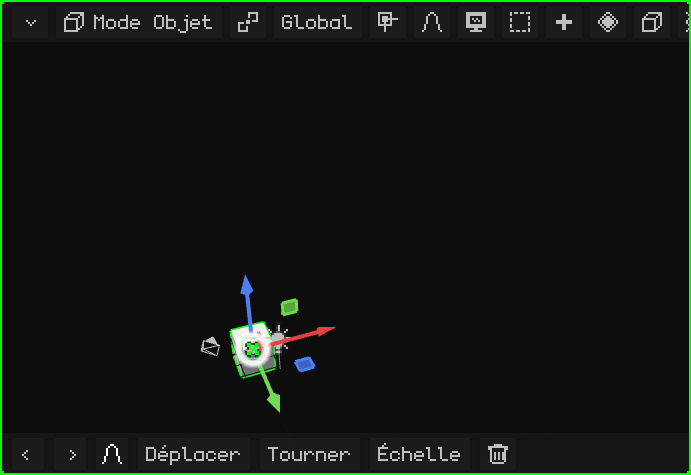

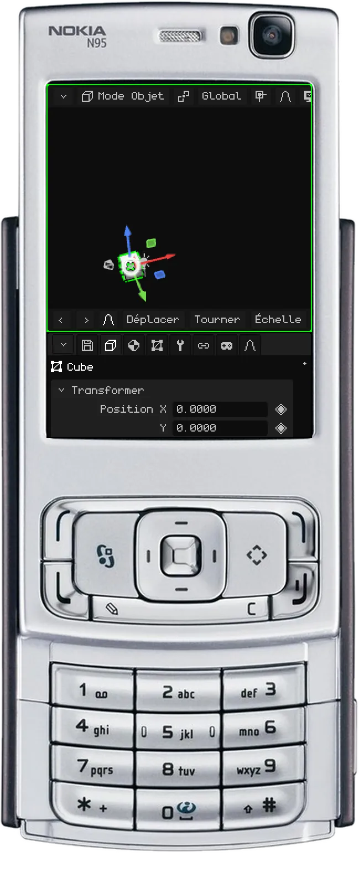

### En Edit Mode

En [Edit Mode](../editor/modo-edicion.md), c'est la partie sélectionnée du maillage qui est cadrée : les sommets, arêtes ou faces que vous avez choisis, pas l'objet entier. C'est utile pour travailler sur un détail d'un grand modèle : vous le sélectionnez, vous le cadrez et vous orbitez autour.

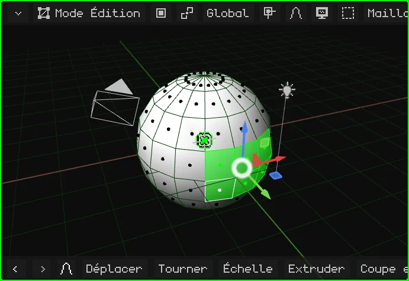

## La vue locale

Quand la scène contient beaucoup de choses, travailler sur l'une d'elles n'est pas pratique : celles de devant gênent, et quand vous orbitez, elles passent devant. La **vue locale** n'affiche que ce qui est sélectionné (un ou plusieurs objets) et le cadre. Le reste n'est ni supprimé ni masqué dans la scène : il n'est simplement plus affiché dans ce viewport. En haut à gauche apparaît l'étiquette « Local View ».

Pour revenir, refaites la même chose : tout réapparaît et la vue redevient comme vous l'aviez laissée.

| | Comment entrer et sortir |
|---|---|
| PC | <kbd>/</kbd> |
| Nokia N95 et écran tactile | Menu View → Local View |

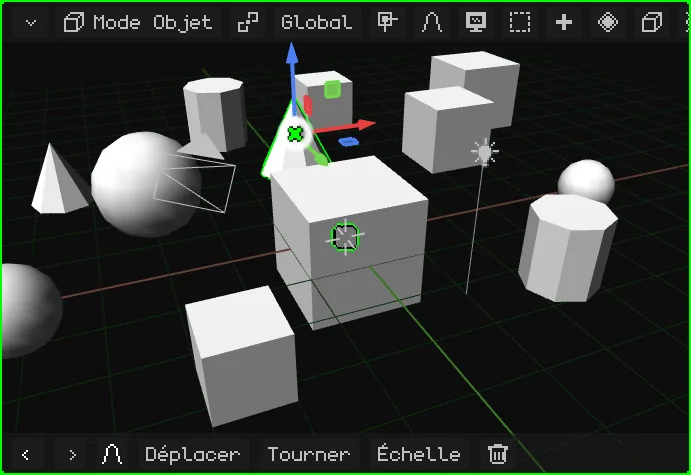

## Les vues de face, de côté et de dessus

Pour regarder la scène bien en face depuis l'un de ses côtés, sans régler l'orbite à la main :

| Vue | PC | Menu |
|---|---|---|
| Face / Arrière | <kbd>Num 1</kbd> / <kbd>Ctrl</kbd> + <kbd>Num 1</kbd> | View → Viewpoint → Front / Back |
| Droite / Gauche | <kbd>Num 3</kbd> / <kbd>Ctrl</kbd> + <kbd>Num 3</kbd> | View → Viewpoint → Right / Left |
| Dessus / Dessous | <kbd>Num 7</kbd> / <kbd>Ctrl</kbd> + <kbd>Num 7</kbd> | View → Viewpoint → Top / Bottom |

Avec <kbd>Ctrl</kbd>, chaque touche donne la vue opposée.

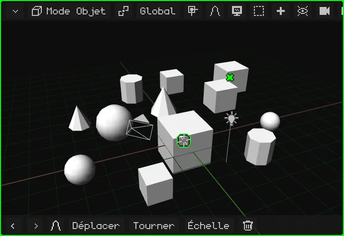

**Sur le Nokia N95 :** maintenez enfoncée la touche <kbd>#</kbd> et appuyez sur une flèche. Gauche et droite font tourner la vue de 90° en 90° autour de la scène. Haut passe à la vue de dessus ; bas revient à la vue de côté, et bas une seconde fois passe à la vue de dessous. Si vous orbitiez librement, la première flèche se contente de redresser la vue sur la plus proche.

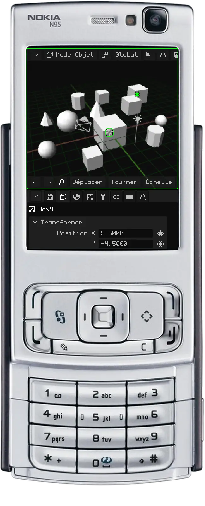

## Perspective et orthographique

Le 3D Viewport a deux façons d'afficher la scène :

- **Perspective :** comme la voit l'œil ou une caméra. Ce qui est loin paraît plus petit, et les lignes parallèles (les bords d'une rue, les rangées de boîtes de la vidéo) se rejoignent vers l'horizon. C'est ainsi que l'on voit vraiment, avec de la profondeur.
- **Orthographique :** sans perspective. Tout garde sa taille, que ce soit près ou loin, et les lignes parallèles restent parallèles. C'est comme un plan d'architecte ou un dessin technique.

La vue orthographique sert à modéliser avec précision : aligner des éléments, comparer des tailles et mesurer sans que la distance ne trompe. Combinée aux vues de face, de côté et de dessus, c'est comme travailler sur un plan. La perspective sert à voir à quoi ressemblera le résultat.

| | Comment basculer |
|---|---|
| PC | <kbd>Num 5</kbd> |
| Nokia N95 | Un appui bref sur le <kbd>#</kbd>, sans flèche |
| Menu | View → Perspective/Ortho |

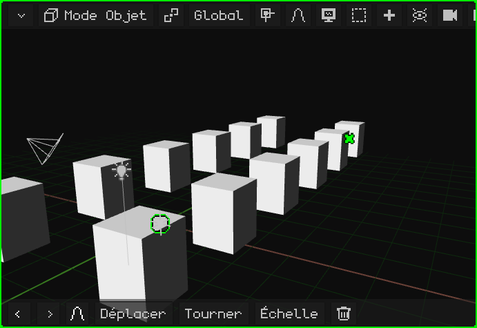

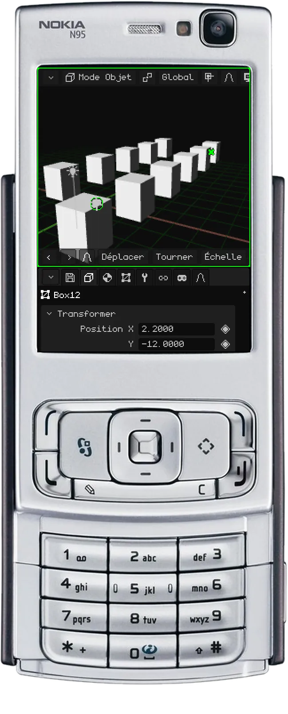

## La caméra active

La scène peut avoir plusieurs caméras, mais une seule est la **caméra active** : celle qui sert pour le jeu et pour les rendus. Ce que voit cette caméra, c'est ce que l'on voit en jouant et ce qui sort quand vous faites le rendu d'une image ou d'une vidéo. La vue avec laquelle vous naviguez ne sert qu'à travailler : elle n'apparaît ni dans le jeu ni dans les rendus.

Pour regarder à travers la caméra active :

| | Comment entrer et sortir |
|---|---|
| PC | <kbd>Num 0</kbd> |
| Nokia N95 | <kbd>8</kbd> (hors Edit Mode : là, le 8 est Loop Cut) |
| Menu | View → Cameras → Active Camera |

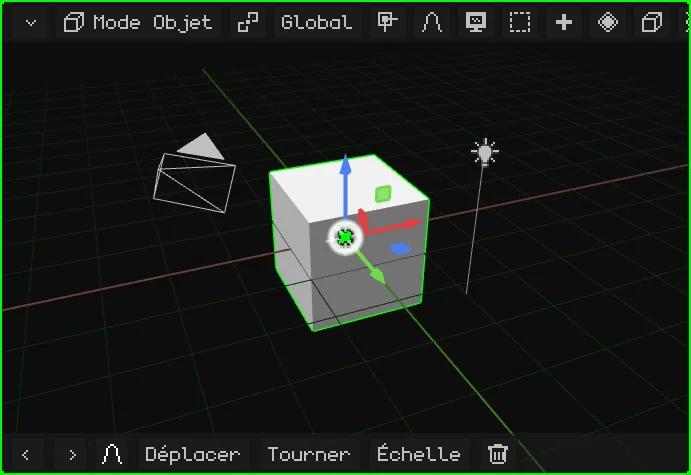

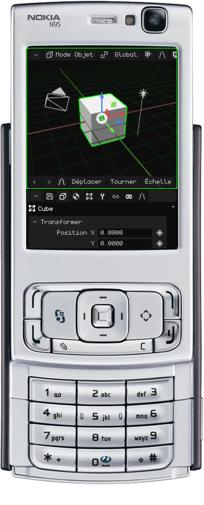

Le rectangle est le cadrage : ce qui est à l'intérieur, c'est ce qui sort. En bas au centre, il y a un **cadenas** :

- **Ouvert** (au départ) : le zoom et le déplacement de la vue ne font que vous rapprocher pour vérifier le cadrage, sans toucher à la caméra. Orbiter vous fait sortir de la vue caméra, et vous continuez à naviguer depuis l'endroit où elle se trouvait.
- **Fermé :** orbiter, déplacer la vue et zoomer déplacent la **caméra**. C'est ainsi que l'on règle le plan.

Il s'ouvre et se ferme d'un toucher ou d'un clic.

Pour qu'une autre caméra devienne la caméra active : sélectionnez-la et appuyez sur <kbd>Ctrl</kbd> + <kbd>Num 0</kbd> (ou View → Cameras → Set Active Object as Camera).

## Autres options de la vue

| Option | Ce qu'elle fait | PC | Nokia N95 |
|---|---|---|---|
| Faire pivoter la vue | La fait tourner de 15° autour de son propre axe, comme quand on penche la tête. | <kbd>Num 4</kbd> / <kbd>Num 6</kbd> | — |
| Lock Orbit | La vue ne tourne plus : ce qui la faisait orbiter la déplace désormais, comme sur un plateau 2D. | View → Lock Orbit | <kbd>9</kbd> |

Tous les raccourcis de l'éditeur se trouvent dans [Raccourcis clavier](../editor/atajos.md), et la page [Navigation](../editor/navegacion.md) du manuel les résume dans des tableaux.
