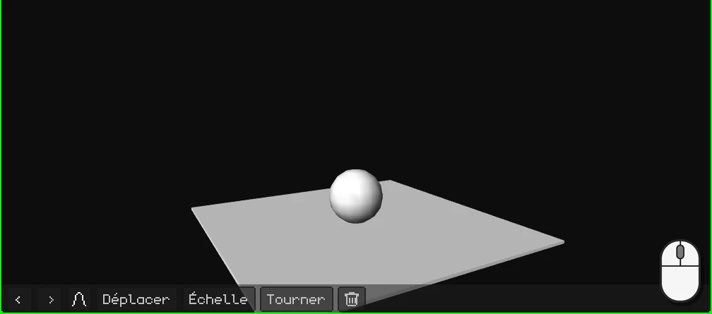
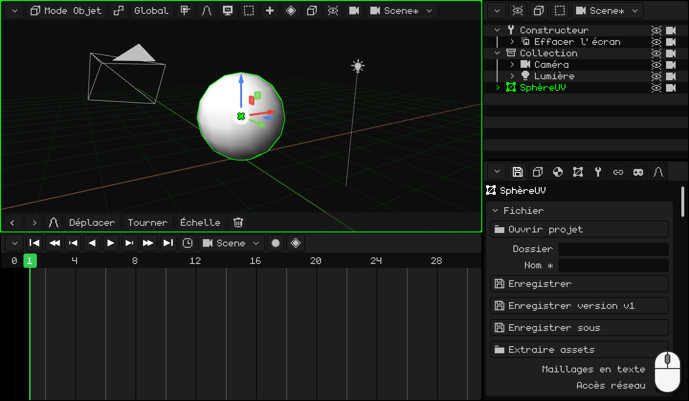
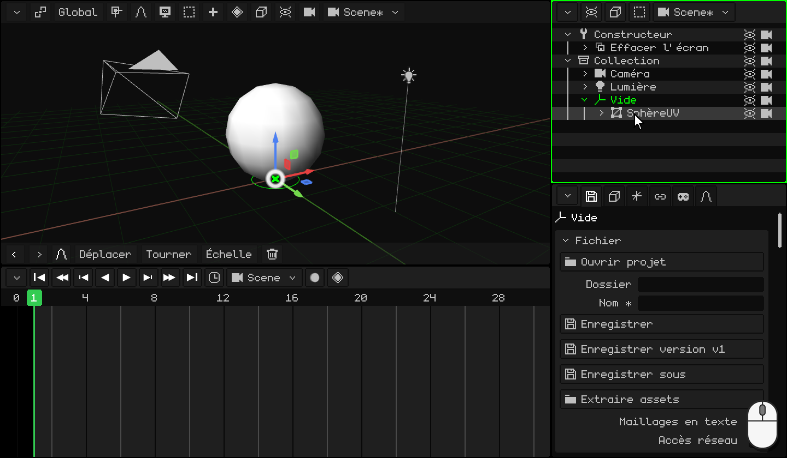
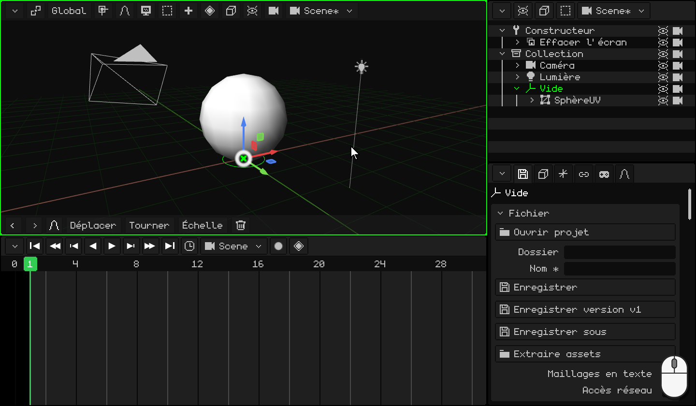
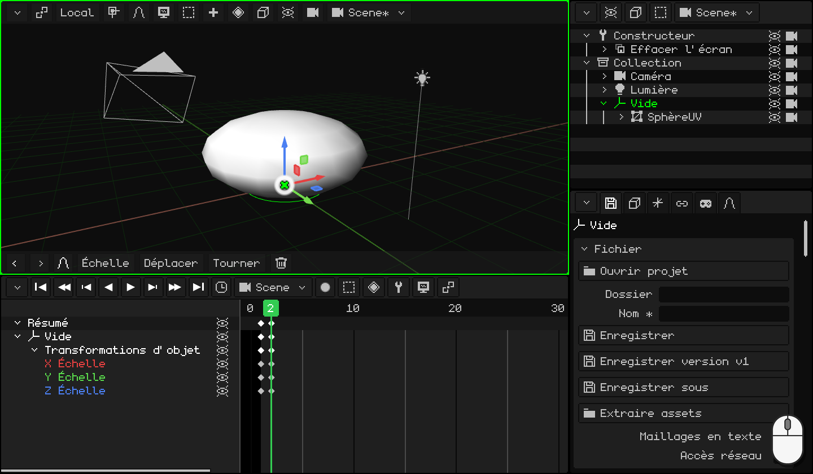
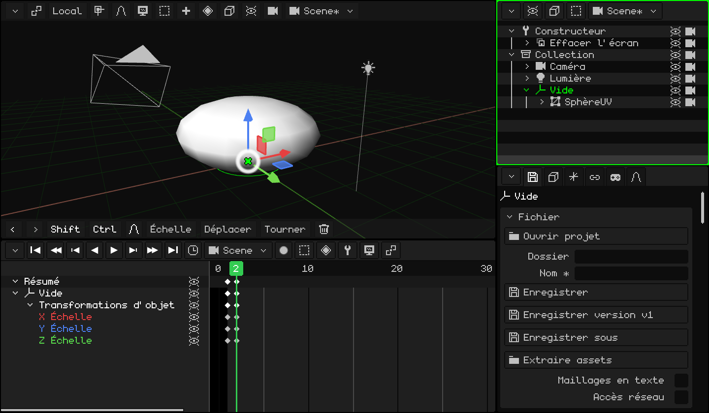
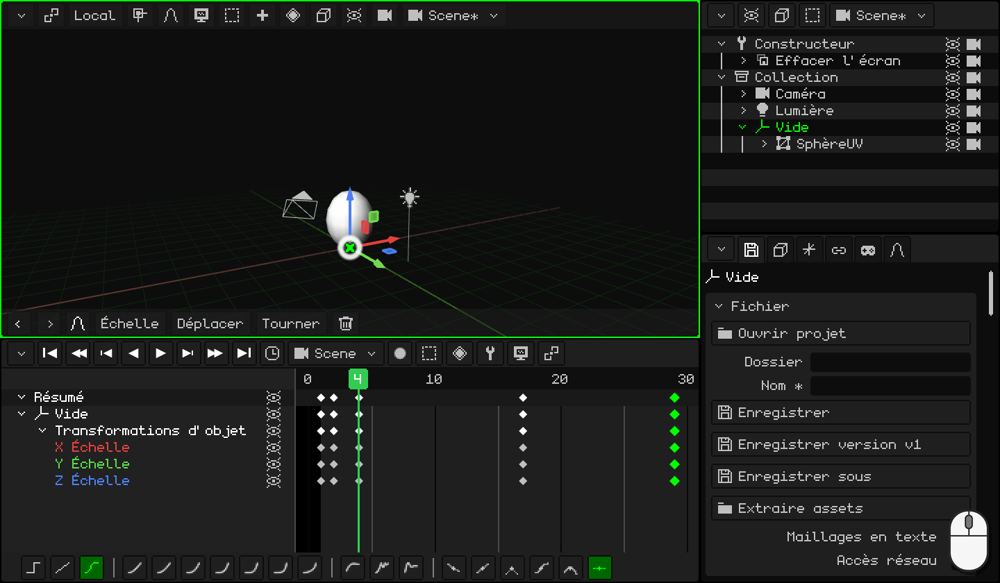
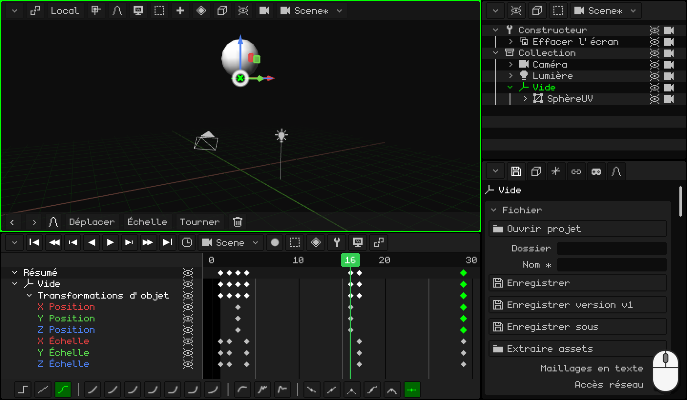
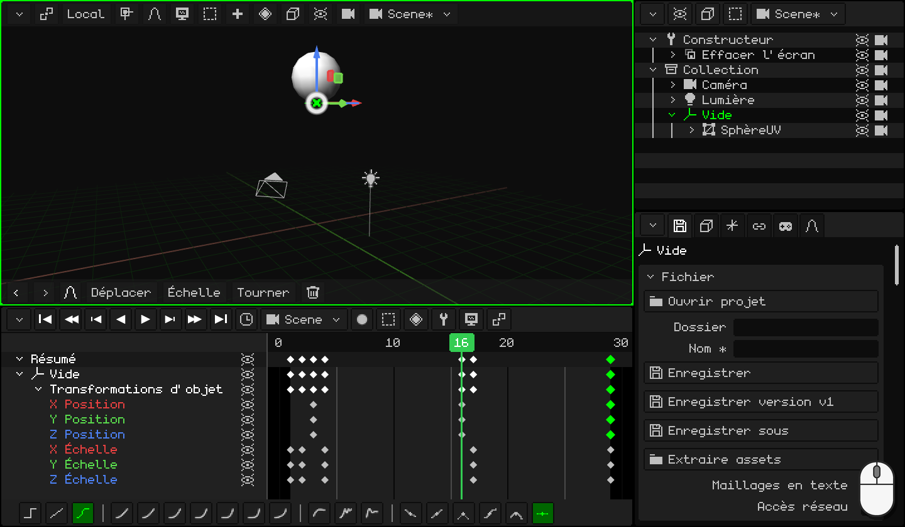

# Faire rebondir une balle

Une balle qui rebondit encore et encore, sans fin : c'est l'exercice par lequel commence tout animateur. Cela paraît facile, mais pour que le résultat soit réussi, il faut deux des principes les plus importants de l'animation :

- **l'écrasement et l'étirement** : la balle s'écrase contre le sol et s'étire en repartant. Cela lui donne du poids et de l'élasticité ;
- **l'accélération et le freinage** : elle monte de plus en plus lentement et tombe de plus en plus vite, comme sous l'effet de la gravité.

En chemin, vous allez apprendre à :

- placer un **Vide** sur le sol pour écraser la balle contre le sol et non vers son centre ;
- **dupliquer** des keyframes pour revenir à une pose que vous avez déjà ;
- faire une **boucle** : une animation qui se répète sans que la coupure se remarque ;
- utiliser les **courbes** pour que la balle ait du poids.

Si vous n'avez encore rien animé, commencez par [Animer la porte](animar-puerta.md) : vous y trouverez les keyframes, la Timeline et les courbes.

## 1. La balle et son Vide

1. Supprimez le cube et ajoutez une sphère : <kbd>Shift</kbd> + <kbd>A</kbd> → **Maillage → Sphère UV**. Elle mesure 2 mètres de haut et apparaît avec son centre sur le sol : montez-la pour qu'elle repose dessus, <kbd>G</kbd> <kbd>Z</kbd> `1` <kbd>Enter</kbd>.
2. Passez en **Mode Édition** (<kbd>Tab</kbd>) et choisissez **Sommet** dans le bouton **Sommet / Arête / Face**. Le sommet tout en bas est caché par la sphère : activez **Superpositions → Rayons X** pour le voir à travers elle et cliquez dessus.
3. <kbd>Shift</kbd> + <kbd>S</kbd> → **Curseur sur le sélectionné** : le curseur 3D va au point le plus bas de la balle, sur le sol.
4. Revenez en **Mode Objet** (<kbd>Tab</kbd>) et désactivez les **Rayons X**.
5. <kbd>Shift</kbd> + <kbd>A</kbd> → **Vide**. Il apparaît là où se trouve le curseur 3D : sur le sol, juste sous la balle.
6. **Apparentez** la balle au Vide. Dans l'**Outliner**, clic sur **SphèreUV** et <kbd>Ctrl</kbd> + clic sur **Vide** (le dernier que vous sélectionnez est le parent). Avec la souris au-dessus de la Vue 3D, <kbd>Ctrl</kbd> + <kbd>P</kbd> → **Objet (garder transf.)**. Dans l'Outliner, la sphère se retrouve dans le Vide.

### Pourquoi un Vide ?

La mise à l'échelle rétrécit ou agrandit à partir de l'**origine**. Celle de la sphère est en son centre : si vous l'écrasez, elle rétrécit vers son centre et reste flottante. Le Vide est sur le sol : si c'est lui que vous écrasez, la balle s'écrase **contre le sol**, comme quand elle rebondit.

À partir de maintenant, on anime **le Vide**, jamais la sphère.

  Sur écran tactile et sur le N95 : le sommet, d'un toucher (ou avec la souris virtuelle) ; le curseur, avec **Maillage → Aimantation → Curseur sur le sélectionné** ; le Vide, avec **Ajouter → Vide** ; et pour apparenter, la sphère et le Vide sélectionnés (le Vide actif), **Objet → Définir parent → Objet (garder transf.)**.

## 2. Écraser

Quand la balle touche le sol, elle s'**écrase** : elle devient plus basse et plus large. Pour qu'elle ne semble pas rétrécir, ce qu'elle perd en hauteur, elle le gagne en largeur.

1. Sélectionnez le **Vide**. À l'image **1**, la balle est ronde et touche le sol : <kbd>I</kbd> → **Échelle seulement**.
2. <kbd>→</kbd> (la flèche droite) passe à l'image **2**. Écrasez-la : <kbd>S</kbd> <kbd>Z</kbd> `0.75` <kbd>Enter</kbd> la rend plus basse, et <kbd>S</kbd> <kbd>Shift</kbd> + <kbd>Z</kbd> `1.6` <kbd>Enter</kbd>, plus large. <kbd>Shift</kbd> + <kbd>Z</kbd> signifie *tous les axes sauf Z* : X et Y ensemble.
3. <kbd>I</kbd> → **Échelle seulement**.

 Sur un écran tactile : la keyframe se pose avec le bouton du losange de la barre de menus de la Vue 3D, **Animation → Insérer image clé → Échelle seulement** ; l'image se change d'un toucher sur les numéros de la Timeline. Pour l'écraser, **Échelle** **Z** `0.75`, **Échelle** **X** `1.6` et **Échelle** **Y** `1.6`, avec les nombres sur le pavé de la barre du haut.

 Sur le Nokia N95 : <kbd>3</kbd>, <kbd>3</kbd> (l'axe Z), le crayon + `0.75` et <kbd>OK</kbd> ; ensuite <kbd>3</kbd>, <kbd>1</kbd> (X) et `1.6`, puis <kbd>3</kbd>, <kbd>2</kbd> (Y) et `1.6`. La keyframe, avec **Animation → Insérer image clé → Échelle seulement**.

## 3. Étirer

En quittant le sol, la balle s'**étire** dans la direction où elle va : plus haute et plus fine. Et quand elle arrive en haut, elle est de nouveau ronde.

1. La balle ronde, vous l'avez déjà, dans la keyframe de l'image 1 : dupliquez-la. Dans la Timeline, clic sur le losange de l'image **1**, <kbd>Shift</kbd> + <kbd>D</kbd>, amenez la copie à l'image **4** et cliquez. Regardez le losange de la copie, pas le pointeur : il apparaît une image à droite de la souris.
2. Faites la même chose pour les images **17** et **29** : là, la balle est de nouveau ronde.
3. Allez à l'image **4** (un clic sur les numéros de la Timeline). Étirez-la : <kbd>S</kbd> <kbd>Z</kbd> `1.1` <kbd>Enter</kbd> et <kbd>S</kbd> <kbd>Shift</kbd> + <kbd>Z</kbd> `0.9` <kbd>Enter</kbd>.
4. <kbd>I</kbd> → **Échelle seulement**.

  Sur écran tactile et sur le N95 (avec la souris virtuelle), au lieu de dupliquer, on copie et on colle : un toucher sur la keyframe de l'image 1 et, dans le menu **Clé** de la Timeline (le bouton du losange), **Copier** ; un toucher sur les numéros pour aller à l'image 4 et **Clé → Coller**. La même chose pour les images 17 et 29. Pour l'étirer, **Échelle** **Z** `1.1`, **Échelle** **X** `0.9` et **Échelle** **Y** `0.9`.

## 4. Le saut

1. Allez à l'image **3** : la balle est encore au sol, c'est le moment où elle part. <kbd>I</kbd> → **Position seulement**.
2. Allez à l'image **16** et montez-la : <kbd>G</kbd> <kbd>Z</kbd> `5` <kbd>Enter</kbd> (5 mètres). <kbd>I</kbd> → **Position seulement**.
3. Pour qu'elle revienne au sol, dupliquez la keyframe de l'image **3** à l'image **29**.

Appuyez sur **Play** (<kbd>Space</kbd>) : la balle rebondit. Mais quelque chose ne va pas : elle freine avant de toucher le sol, comme si elle flottait. Les courbes vont arranger cela, dans la partie 6.

 Sur un écran tactile : **Déplacer** **Z** `5` et **Animation → Insérer image clé → Position seulement**. La keyframe de l'image 3 se copie à l'image 29 avec **Clé → Copier** et **Clé → Coller**, comme dans la partie 3.

 Sur le Nokia N95 : <kbd>1</kbd>, <kbd>3</kbd> (l'axe Z), le crayon + `5` et <kbd>OK</kbd> ; puis **Animation → Insérer image clé → Position seulement**.

## 5. La boucle

L'image **29** est identique à l'image **1** : la balle ronde, qui touche le sol. Si l'animation allait jusqu'à l'image 29, on verrait deux images identiques à la suite et la balle resterait immobile un instant : la coupure se remarquerait. C'est pourquoi elle se termine à l'image **28** : après l'image 28 vient l'image 1, qui est identique à l'image 29.

Cliquez sur l'**horloge** de la Timeline et, dans **Fin**, tapez `28` <kbd>Enter</kbd>.

Dans la même horloge se trouvent les **FPS** de cette animation. La balle tourne à 30 : chaque rebond dure 28 images, presque une seconde. Si vous la voulez avec un style cinéma, mettez-la à 24, mais **avant** d'animer : avec les mêmes images, à 24 elle irait plus lentement. Les FPS qui conviennent à chaque cas sont expliqués dans [Animer la porte](animar-puerta.md), dans la partie sur le timing.

## 6. Les courbes : la gravité

**Position seulement** a enregistré les trois axes, mais la balle ne bouge qu'en Z : les lignes **X Position** et **Y Position** sont des lignes plates. Supprimez-les : clic sur chacune et <kbd>X</kbd>.

Passez maintenant à l'éditeur de courbes (**Vue → Courbes**). La courbe de Z, c'est le saut : elle monte et descend. Pensez à une vraie balle :

- **En montant**, elle quitte le sol à toute vitesse et freine peu à peu jusqu'à s'immobiliser en haut : elle **part vite et freine peu à peu**. Sélectionnez la keyframe de l'image **3** et, dans la barre d'outils de la Timeline, **Cubique** et **Amorti en sortie**.
- **En descendant**, elle démarre lentement et tombe de plus en plus vite, jusqu'au choc contre le sol : elle **accélère et s'arrête net**. Sélectionnez la keyframe de l'image **16** : **Cubique** et **Amorti en entrée**.

(Au clavier : <kbd>E</kbd> pour le **Mode d'interpolation** et <kbd>Ctrl</kbd> + <kbd>E</kbd> pour le **Type d'amorti**.)

La courbe prend la forme des arcs d'une vraie balle : arrondie en haut et en pointe en bas, là où elle frappe le sol. Appuyez sur **Play** : maintenant, elle a du poids.

Vous voulez qu'elle rebondisse plus haut ou plus bas ? Dans l'éditeur de courbes, saisissez la keyframe du haut (celle de l'image 16) et déplacez-la.

## 7. Regardez-la

Pour la voir sans la grille ni le Vide, désactivez **Superpositions → Afficher superpositions** et appuyez sur **Play**.

Les trois balles ci-dessous rebondissent dans le même temps. La première a des courbes linéaires : elle monte et descend toujours à la même vitesse, comme une machine. La deuxième a les courbes de la gravité : elle freine en haut et frappe le sol. La troisième, en plus, s'étire et s'écrase : c'est celle de ce tutoriel.

