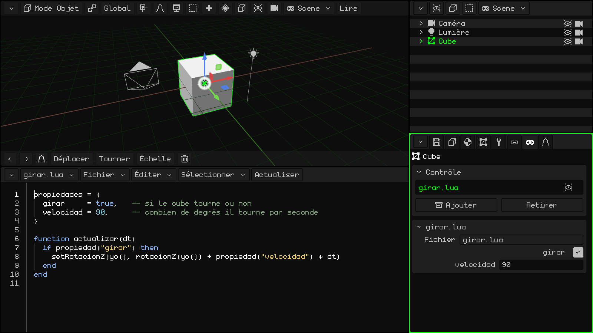
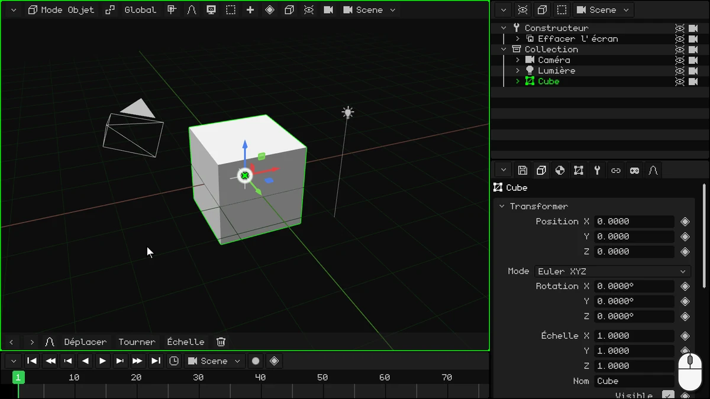
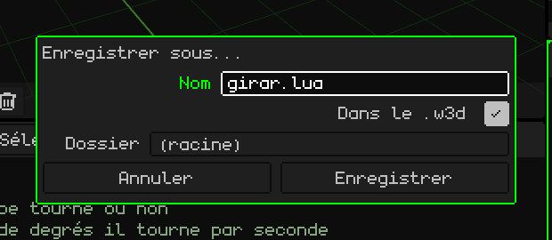
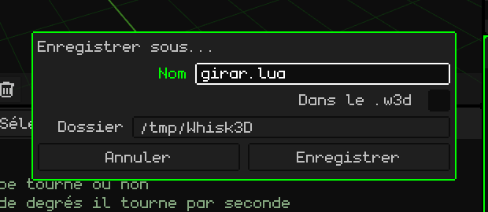
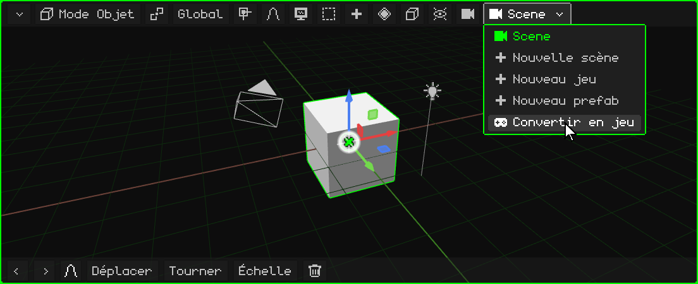
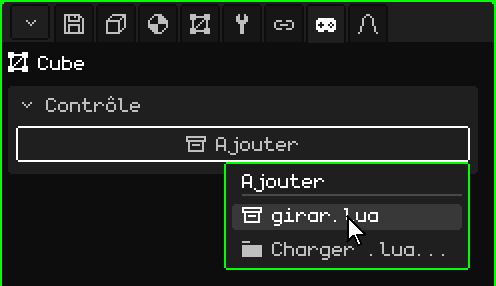
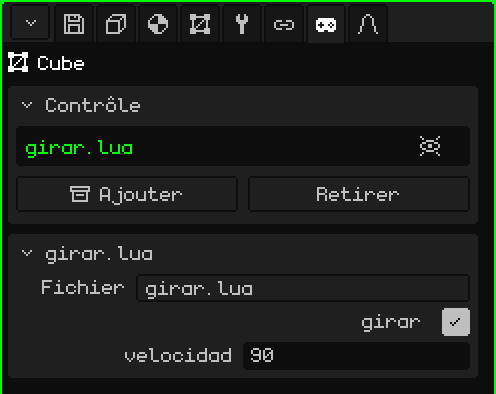
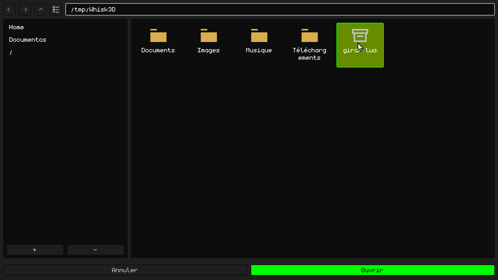
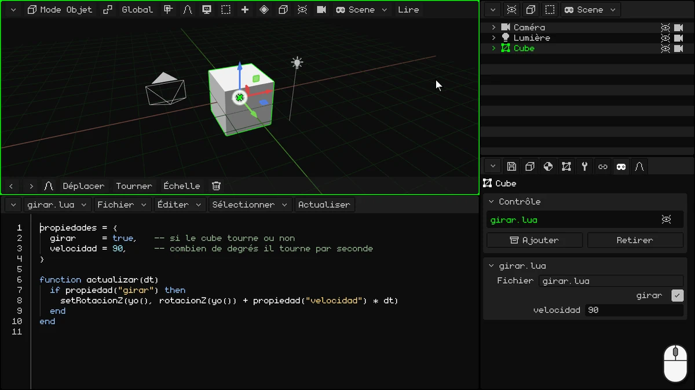

# Votre premier script : un cube qui tourne

Dans ce tutoriel, vous allez écrire votre premier script **Lua** : un script qui fait tourner le cube.



## 1. L'IDE

Dans ce tutoriel, vous n'allez pas utiliser la Timeline : transformez-la en IDE, l'éditeur de scripts. Touchez le bouton du coin de la Timeline (en haut à gauche) et choisissez **IDE**.

L'IDE démarre vide. Pour écrire plus confortablement, agrandissez-le : faites glisser ce même bouton du coin vers le haut.



> [!NOTE]
> On peut aussi utiliser d'autres éditeurs ou IDE externes et charger les scripts. Les scripts peuvent se trouver en dehors ou à l'intérieur des projets W3D.

## 2. Écrivez le script

Le script a deux parties : en haut, les **propriétés**, et en bas, la **fonction** qui fait tourner le cube.

### Les propriétés

```lua
propiedades = {
  girar     = true,   -- si le cube tourne ou non
  velocidad = 90,     -- combien de degrés il tourne par seconde
}
```

- **`propiedades`** sont les valeurs du script que l'on peut changer depuis le panneau Propriétés, une par ligne. `girar = true` est une valeur **booléenne** (vrai ou faux : `true` ou `false`), et dans le panneau elle apparaît comme une case à cocher. `velocidad = 90` est un nombre, et il apparaît comme un champ numérique. Ce que vous écrivez ici est la valeur **par défaut** : chaque objet qui utilise le script peut avoir la sienne.
- Ce qui vient après `--` est un **commentaire** : Lua ne le lit pas, c'est pour vous.

### La fonction

```lua
function actualizar(dt)
  if propiedad("girar") then
    setRotacionZ(yo(), rotacionZ(yo()) + propiedad("velocidad") * dt)
  end
end
```

Une **fonction** est un bloc de code qui porte un nom : elle commence par `function nom()` et se termine par `end`. Ce qu'elle contient ne s'exécute pas quand vous l'écrivez, mais chaque fois que quelqu'un **appelle** la fonction.

Whisk3D a des **fonctions réservées** : si votre script a une fonction avec l'un de ces noms, le moteur l'appelle tout seul, au bon moment. Par exemple :

- **`inicio()`** : une seule fois, quand vous lancez Play. Elle sert à préparer les choses.
- **`actualizar(dt)`** : à **chaque image**, pendant que le jeu est en cours.

Il y en a d'autres, comme celles qui préviennent quand un objet entre en collision avec un autre. Elles sont toutes dans le manuel Lua : [Quand le moteur appelle votre script](../lua/ciclo-del-script.md).

`actualizar` est idéale pour un jeu vidéo. Un jeu dessine l'écran de nombreuses fois par seconde, et chacun de ces dessins est une **image** : tout ce qui bouge bouge un tout petit peu à chaque image. Ici, à chaque image, le cube tourne un peu plus.

- Elle s'exécute tant que l'objet est **visible** : si vous le masquez, son script s'arrête jusqu'à ce qu'il redevienne visible.
- `dt` correspond aux secondes écoulées depuis l'image précédente. Multiplier la vitesse par `dt` fait tourner le cube de 90 degrés **par seconde**, que le jeu tourne à 30 ou à 60 images par seconde.

Ce qu'elle fait à l'intérieur :

**`if propiedad("girar") then` … `end`** est une **condition**. Un `if` (« si ») exécute le code qu'il contient seulement si ce qui se trouve entre `if` et `then` est vrai. Il peut avoir un `elseif` (« si ce n'est pas vrai, fais ceci si… »), qui teste une autre condition, et un `else` (« sinon »), qui s'exécute quand aucune n'a été remplie ; les deux sont facultatifs. Il se termine toujours par `end`. Par exemple :

```lua
if puntos >= 100 then
  premio = "or"
elseif puntos >= 50 then
  premio = "argent"
else
  premio = "rien"
end
```

Avec 120 points, la récompense est l'or ; avec 70, l'argent, et avec 10, rien. Seule la première partie remplie s'exécute. (En Lua, `elseif` s'écrit en un seul mot.)

Dans le script, le `if` n'a ni `elseif` ni `else` : si **girar** est vrai (la case est cochée), le cube tourne ; s'il est faux, il ne se passe rien et la fonction se termine. `propiedad("girar")` lit la valeur que cet objet a dans le panneau. Comme elle est lue à chaque image, si vous la changez pendant que le jeu est en cours, le script le sait aussitôt.

- **`yo()`** est l'objet qui a le script : le cube. **`rotacionZ(yo())`** donne sa rotation en degrés autour de Z (l'axe vertical, le même Z que vous voyez dans le panneau Propriétés), et **`setRotacionZ`** lui en donne une nouvelle : la même, un peu plus. Ainsi, le cube tourne comme une toupie.

`propiedad`, `yo`, `rotacionZ` et `setRotacionZ` sont aussi des fonctions, mais dans l'autre sens : c'est Whisk3D qui les fournit et c'est vous qui les appelez. Elles sont dans le [manuel Lua](../lua/README.md).

### Le script complet

Touchez l'intérieur de l'IDE et écrivez le tout :

```lua
propiedades = {
  girar     = true,   -- si le cube tourne ou non
  velocidad = 90,     -- combien de degrés il tourne par seconde
}

function actualizar(dt)
  if propiedad("girar") then
    setRotacionZ(yo(), rotacionZ(yo()) + propiedad("velocidad") * dt)
  end
end
```

## 3. Enregistrez-le

Enregistrez d'abord le projet, si vous ne l'avez pas encore fait : le script ne peut être enregistré dans le projet que si le projet est déjà enregistré. Dans Propriétés, dans l'onglet de la **disquette** (la carte **Fichier**), saisissez un **Nom**, par exemple `girar-cubo`, et touchez **Enregistrer**. Il est enregistré dans le **Dossier** qu'affiche la carte.

Ensuite, dans la barre de menus de l'IDE, **Fichier → Enregistrer sous...** :

1. Dans **Nom**, mettez `girar.lua`.
2. Cochez **Dans le .w3d** : le script est enregistré à l'intérieur du projet, dans le même fichier `.w3d`. Le **Dossier** devient un dossier interne au projet : **(racine)** est le dossier principal.
3. Touchez **Enregistrer**.



Si vous ne cochez pas **Dans le .w3d**, le script est enregistré comme un fichier séparé, en dehors du projet, dans le **Dossier** que vous choisissez. C'est utile, par exemple, pour le modifier avec un autre programme.



## 4. Transformez la scène en jeu

Une **scène** sert à modéliser et à animer ; les scripts s'exécutent dans un **jeu**. Un jeu n'a pas d'animations propres : les animations se font dans une scène ou dans un modèle 3D avec armature, et on les importe dans le jeu pour les y utiliser. Dans la barre de menus de la Vue 3D (ou de l'Outliner), touchez le bouton de la scène, celui qui affiche son nom, et choisissez **Convertir en jeu**.



**Convertir en jeu** ne modifie pas votre scène : il en fait une copie, qui est un jeu, avec tout tel qu'on le voit à l'image courante de la Timeline. Les animations de la scène ne passent pas dans le jeu : cette image est enregistrée comme la position et l'état de départ du jeu. La scène d'origine reste telle quelle, avec ses animations, et vous la retrouvez dans le menu du bouton de la scène.

Vous êtes maintenant dans le jeu : le bouton de la scène affiche un joystick, et **Lire** apparaît dans la barre de menus de la Vue 3D.

## 5. Ajoutez-le au cube

1. Sélectionnez le **Cube** du jeu (dans l'Outliner ou dans la Vue 3D).
2. Dans Propriétés, allez dans l'onglet du **joystick**.
3. Dans la carte **Contrôle**, touchez **Ajouter** : un menu se déroule avec les scripts du projet. Choisissez `girar.lua`.



Le script apparaît dans la liste de la carte Contrôle, et en dessous s'ajoute sa propre carte, **girar.lua**, avec les propriétés que vous avez écrites : la case **girar** (cochée) et **velocidad** (90).

Dans la liste, à droite du script, il y a un **œil** : en le touchant, vous désactivez le script (le moteur ne l'utilise pas) sans le retirer de l'objet ni masquer l'objet. Un autre toucher le réactive.



### Un script externe

Si vous avez écrit le script avec un autre éditeur, ou si vous l'avez enregistré en dehors du `.w3d`, touchez **Ajouter → Charger .lua...**. L'explorateur s'ouvre, **Charger script** : choisissez le fichier et touchez **Ouvrir**.



## 6. Appuyez sur Play

Touchez **Lire** : le cube tourne. Pendant que le jeu est en cours, la barre de menus de la Vue 3D affiche **Arrêter** et **Pause**.

Avec le jeu en cours, essayez de changer les propriétés dans la carte **girar.lua** :

- mettez **velocidad** à 360 : il tourne quatre fois plus vite ;
- décochez **girar** : il s'arrête. Cochez-la de nouveau et il repart.

Pour terminer, touchez **Arrêter** : le cube redevient comme il était avant le Play.



> [!NOTE]
> Tout ce qui se passe pendant que le jeu est en cours est perdu quand vous touchez **Arrêter** : le cube revient à sa place, et **girar** et **velocidad** reprennent les valeurs qu'elles avaient avant le Play. Pour les changer pour de bon, changez-les quand le jeu est arrêté.

## Pour aller plus loin

- [Lua dans Whisk3D](../lua/README.md) : le manuel Lua, avec toutes les fonctions.
- [Un script est un composant d'un objet](../lua/scripts-y-objetos.md) : les propriétés (aussi les listes, les textes et les objets de la scène).
- [Quand le moteur appelle votre script](../lua/ciclo-del-script.md) : `actualizar`, `inicio` et les autres.

## Téléchargez l'exemple

Voici le projet terminé, pour que vous puissiez l'essayer ou le comparer avec le vôtre : **[girar-cubo.w3d](ejemplos/girar-cubo.w3d)**. Ouvrez-le dans Whisk3D et touchez **Lire**. Le script est à l'intérieur du `.w3d` et on le voit dans l'IDE.
