# Propriétés

> [!NOTE]
>  Le Nokia N95 prend en charge une souris et un clavier (en Bluetooth). Les parties de cette page consacrées au Nokia expliquent comment l'utiliser sans souris ni clavier, uniquement avec les touches du téléphone.

**Propriétés** est le viewport qui affiche les données de l'**objet actif**, le dernier que vous avez sélectionné : sa position, son nom, son matériau, la couleur d'une lumière, les modificateurs d'un maillage. Il est organisé en **onglets**, et chaque onglet contient des **cartes** avec des lignes de valeurs. Presque tout ce que vous modifiez ici se voit immédiatement dans la Vue 3D.

Comme expliqué dans [Les viewports](viewports.md#le-viewport-actif), les touches vont au viewport actif, celui qui a la bordure verte.

 Sur le Nokia N95, Propriétés se trouve à droite de la Vue 3D : la **touche verte**  en fait le viewport actif. Quand vous y revenez, vous êtes toujours sur la ligne où vous l'aviez laissé.

## Les onglets

Les onglets sont les icônes de la barre de menus de Propriétés. Chacun affiche un groupe de cartes.

Les onglets **changent selon l'objet actif** : chaque type d'objet n'affiche que ceux qui lui servent. Un maillage a Matériau, Maillage 3D et Modificateurs ; une lumière a, à la place du matériau, l'onglet Lumière ; une caméra, l'onglet Caméra.

| Onglet | Quand il apparaît |
|---|---|
| Fichier / Rendu (la disquette) | Toujours, même si rien n'est sélectionné. |
| Objet | Avec n'importe quel objet 3D : position, rotation, échelle, nom et visibilité. |
| Celui du type d'objet | Matériau pour un maillage, Lumière pour une lumière, Caméra pour une caméra, et ainsi de suite pour chaque type. Son icône change avec le type. |
| Maillage 3D et Modificateurs | Uniquement avec un maillage. |
| Transformer | Uniquement avec un maillage en Mode Édition. |
| Contraintes | Avec n'importe quel objet 3D. |
| Scripts | Avec n'importe quel objet. |
| Animation | Toujours. |

L'onglet du type reste à sa place : si vous étiez sur le matériau d'un maillage et que vous sélectionnez une lumière, vous passez à l'onglet Lumière. Si l'onglet où vous étiez n'existe pas pour le nouvel objet (Modificateurs, quand vous sélectionnez une lumière), Propriétés revient à l'onglet Objet.

| | Comment changer d'onglet |
|---|---|
|  PC | Un clic sur l'onglet. S'ils ne tiennent pas tous, tournez la molette au-dessus de la barre. |
|  Écran tactile | Un toucher sur l'onglet. S'ils ne tiennent pas tous, faites glisser la barre sur le côté. |
|  Nokia N95 | Remontez avec la flèche **haut** jusqu'au titre de la première carte, puis une fois de plus : l'onglet actuel devient vert. **Gauche** et **droite** changent d'onglet, et **bas** revient aux cartes. Sur le premier onglet, la flèche gauche ouvre le menu du bouton du coin. |

## Les cartes

Les **cartes** sont les encadrés de chaque onglet : un titre et ses lignes. La flèche du titre indique si la carte est ouverte ou repliée. Replier celles que vous n'utilisez pas garde à portée de main celles qui vous servent.

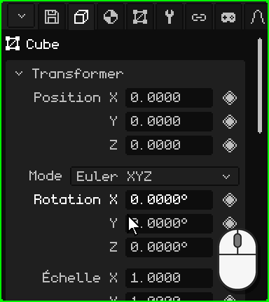

| | Comment replier et déplier |
|---|---|
|  PC | Un clic sur le titre. |
|  Écran tactile | Un toucher sur le titre. |
|  Nokia N95 | <kbd>OK</kbd> sur le titre. La flèche **gauche** replie la carte depuis n'importe laquelle de ses lignes, et la flèche **droite**, sur le titre, la déplie. |

Si les cartes ne tiennent pas dans le viewport, le panneau défile : avec la molette de la souris sur PC, ou en faisant glisser le doigt vers le haut ou vers le bas sur un écran tactile. Sur le Nokia, le panneau suit tout seul la ligne choisie.

### Se déplacer avec les touches

 Sur le Nokia N95, il y a une **ligne choisie** : son nom apparaît en vert et sa valeur, avec une bordure blanche. **Haut** et **bas** passent d'une ligne à l'autre et d'une carte à la suivante, et <kbd>OK</kbd> utilise la ligne : il modifie le nombre, coche la case, ouvre la liste déroulante. Pendant la modification, la bordure devient verte.

 Sur PC, avec la souris au-dessus de Propriétés, les flèches et <kbd>Enter</kbd> font la même chose, et <kbd>Esc</kbd> annule ce que vous êtes en train de modifier.

## Les nombres

La plupart des lignes sont des **nombres** : le nom à gauche et la valeur à droite, comme la Position, la Rotation et l'Échelle de la carte Transformer. Un nombre peut se **saisir** ou se **faire glisser**. Chacun a son propre rythme, et certains ont une limite : la Lumière GL d'une lumière va de 0 à 7.

### Saisir un nombre

 Un clic sur le nombre, sans bouger la souris : la valeur est sélectionnée et ce que vous tapez la remplace. <kbd>Enter</kbd> l'applique et <kbd>Esc</kbd> la laisse telle qu'elle était. Un clic n'importe où ailleurs l'applique aussi.

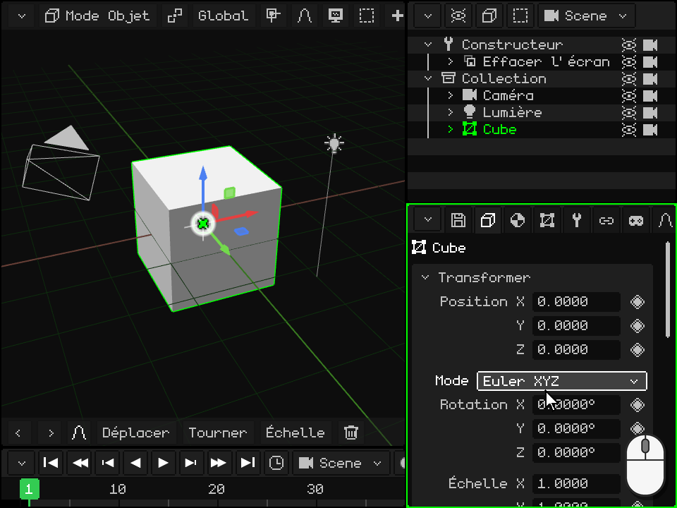

 Un toucher sur le nombre ouvre en bas le **pavé numérique** de Whisk3D, avec le nom de la ligne et sa valeur. Il a les chiffres, le point, **DEL** pour effacer et les flèches pour déplacer le curseur. **OK** applique la valeur et **X** l'annule ; toucher en dehors du pavé l'applique aussi.

 Le pavé numérique fait aussi des **calculs** : avec <kbd>+</kbd>, <kbd>-</kbd>, <kbd>\*</kbd>, <kbd>/</kbd> et les parenthèses, vous pouvez écrire `2*3` ou `1.5+0.25`, et en touchant OK, c'est le résultat qui reste. Le <kbd>-</kbd> sert aussi à écrire un nombre négatif.

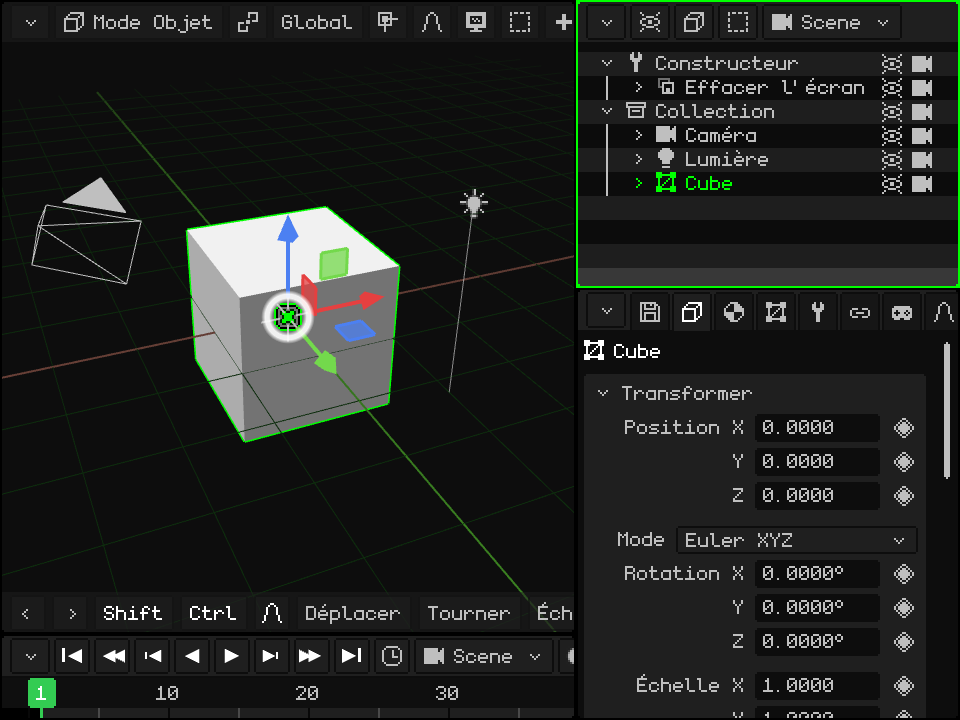

 Allez jusqu'à la ligne avec les flèches et appuyez sur <kbd>OK</kbd> : la valeur est sélectionnée et les touches du téléphone écrivent des chiffres (la barre de Propriétés affiche **123**). Le premier chiffre que vous tapez remplace la valeur précédente. La touche <kbd>\*</kbd> est le point décimal, <kbd>C</kbd> efface, **gauche** et **droite** déplacent le curseur, <kbd>OK</kbd> applique la valeur et la **touche de sélection gauche** l'annule.

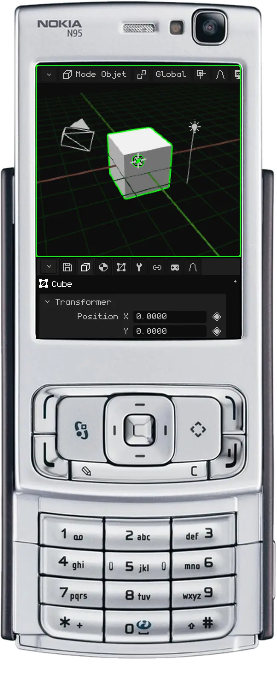

### Faire glisser un nombre

 Maintenez le clic sur le nombre et déplacez la souris sur le côté : vers la droite, la valeur augmente et vers la gauche, elle diminue. Si le pointeur atteint le bord du viewport, il réapparaît de l'autre côté et vous pouvez continuer à faire glisser. Quand vous relâchez, la valeur reste.

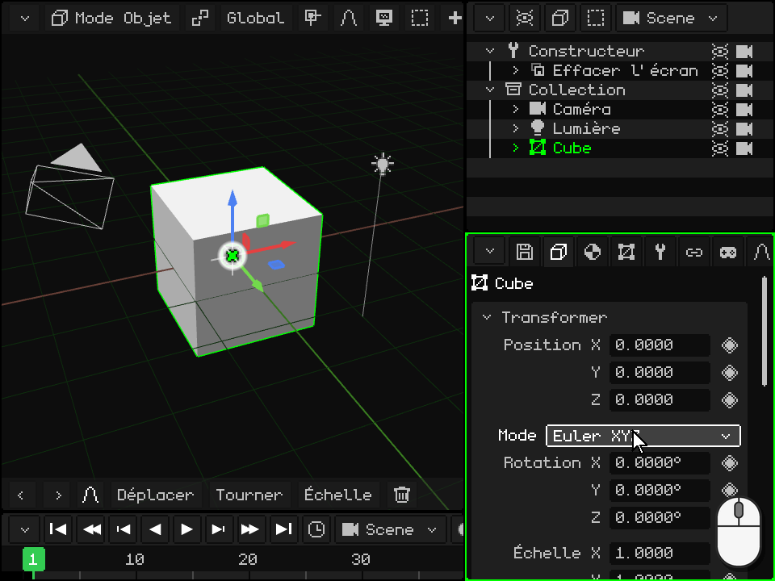

 Posez le doigt sur le nombre (pas sur son nom) et faites-le glisser sur le côté. Si vous le faites glisser vers le haut ou vers le bas, c'est le panneau qui défile au lieu de la valeur qui change.

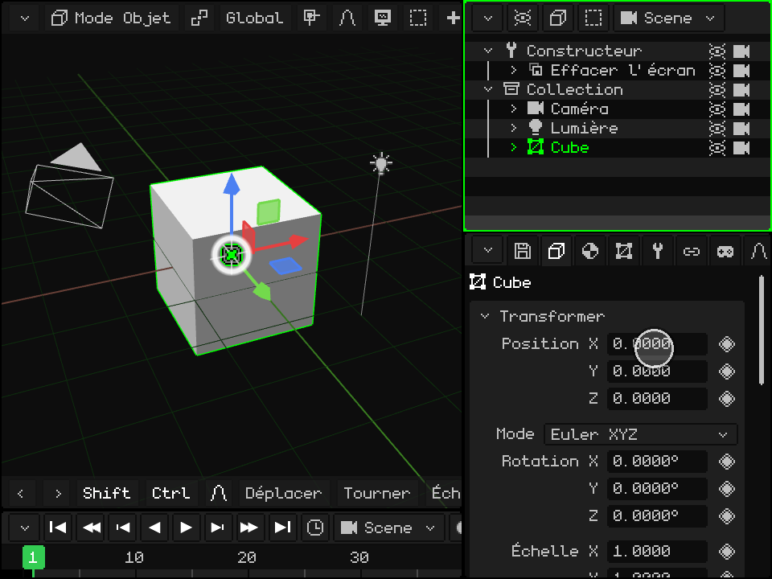

## Les listes déroulantes

Une **liste déroulante** est un bouton qui affiche l'option choisie, comme le **Type** d'une lumière (Ponctuelle, Soleil ou Spot) ou le **Mode** de la rotation. Quand vous l'activez, la liste des options s'ouvre, avec l'option actuelle en vert ; quand vous en choisissez une autre, la liste se ferme.

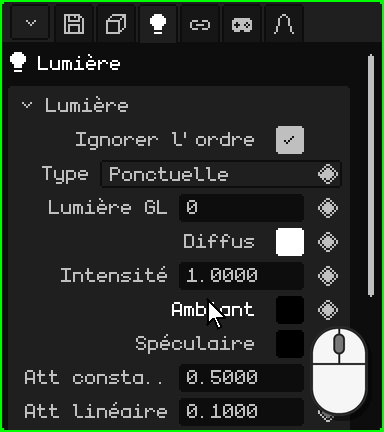

| | Comment l'ouvrir et choisir |
|---|---|
|  PC | Un clic sur le bouton, puis un autre sur l'option. |
|  Écran tactile | Un toucher sur le bouton, puis un autre sur l'option. |
|  Nokia N95 | <kbd>OK</kbd> l'ouvre, **haut** et **bas** parcourent les options et <kbd>OK</kbd> choisit. <kbd>C</kbd> la ferme sans rien changer. |

## Les cases à cocher

Une **case à cocher** s'active ou se désactive : cochée, c'est oui, et vide, c'est non. Elle se trouve à droite de la ligne, comme **Éclairage** dans le matériau : désactivée, l'objet ne reçoit pas les lumières et s'affiche dans sa couleur, à plat. Un clic ou un toucher sur la ligne (sur la case ou sur son nom) la change, et sur le Nokia, <kbd>OK</kbd>.

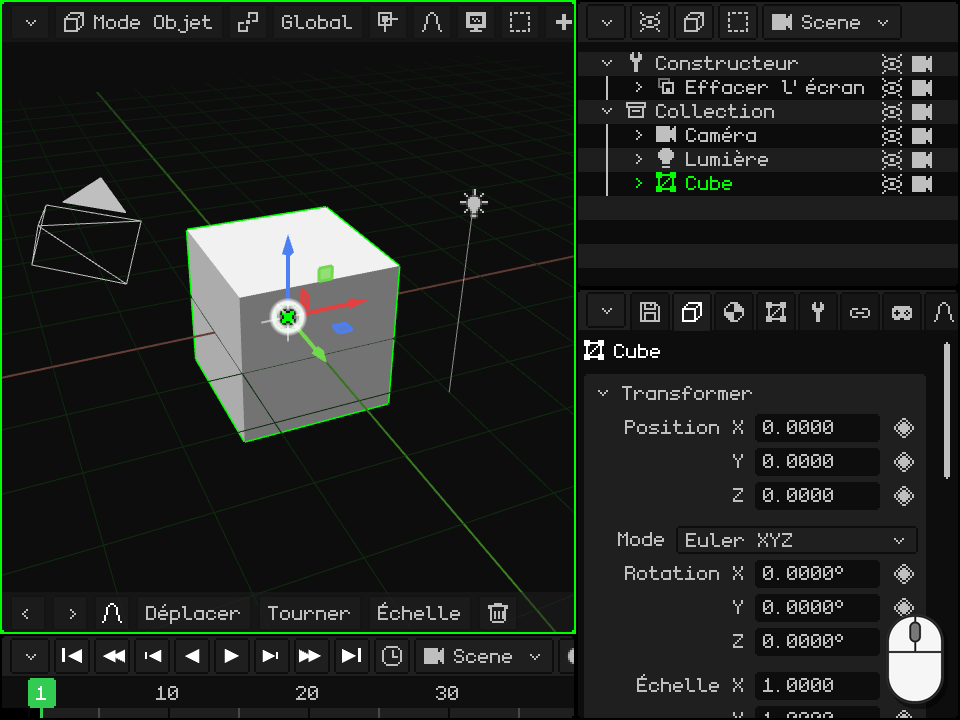

## Les textes

Un **champ de texte** contient un nom ou un chemin, comme le **Nom** de l'objet, en bas de la carte Transformer. Quand vous l'activez, le curseur apparaît à la fin du texte. Le nouveau nom apparaît aussi dans l'Outliner.

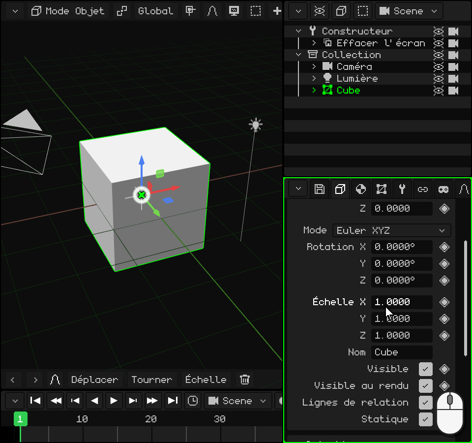

-  **Sur PC :** un clic dans le champ, puis tapez. <kbd>Enter</kbd> (ou un clic ailleurs) confirme et <kbd>Esc</kbd> revient au texte d'avant.
-  **Sur un écran tactile :** un toucher ouvre le clavier de Whisk3D, avec le ñ. **Aa** passe en majuscules, **123** aux chiffres et symboles, **DEL** efface et **OK** confirme. Dans la version web, c'est le clavier du téléphone qui s'ouvre.
-  **Sur le Nokia N95 :** <kbd>OK</kbd>, puis écrivez avec le clavier du téléphone, comme un SMS : chaque touche donne ses lettres quand vous l'appuyez plusieurs fois. <kbd>#</kbd> passe de Abc à abc et à ABC, et maintenue, passe à 123 (la barre de Propriétés affiche le mode). Le <kbd>0</kbd> est l'espace, le <kbd>1</kbd> les signes de ponctuation et la touche <kbd>\*</kbd> ouvre d'autres symboles. <kbd>C</kbd> efface, **gauche** et **droite** déplacent le curseur, <kbd>OK</kbd> confirme et la **touche de sélection gauche** annule.

## Les couleurs

Une ligne de **couleur** affiche à droite un petit carré avec la couleur, comme **Diffus**, **Ambiant** et **Spéculaire** dans la carte d'une lumière. Quand vous l'activez, le **sélecteur de couleur** s'ouvre :

- le **cercle** choisit la teinte et la saturation, et la barre à côté, la valeur (à quel point la couleur est claire) ;
- les onglets **RGB**, **HSV** et **Hex** affichent la couleur en nombres : Rouge, Vert et Bleu ; Teinte, Saturation et Valeur ; ou le code hexadécimal (`#FF8800`), avec Copier et Coller ;
- **Alpha** est la transparence ;
- **OK** garde la couleur et **Annuler** revient à celle d'avant.

La couleur change pendant que vous la modifiez : vous la voyez donc dans la scène avant de la confirmer. Un clic ou un toucher en dehors du sélecteur le ferme aussi et garde la couleur.

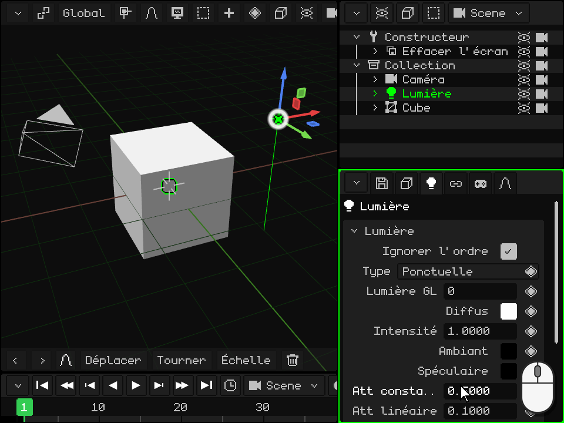

  À la souris ou au doigt, on fait glisser à l'intérieur du cercle et de la barre, et les nombres se font glisser sur le côté, comme dans Propriétés.

 Sur le Nokia N95, **haut** et **bas** passent par le cercle, la barre, les onglets, les lignes de nombres et OK / Annuler. Sur une ligne de nombres, **gauche** et **droite** la modifient (maintenues, de plus en plus vite). Sur le cercle, <kbd>OK</kbd> passe en modification : **gauche** et **droite** font tourner la teinte, **haut** et **bas** changent la saturation, et <kbd>OK</kbd> en sort. La barre se modifie de la même façon, avec haut et bas. <kbd>C</kbd> ferme le sélecteur et revient à la couleur d'avant.

## Les listes

Certaines cartes contiennent une **liste** : les modificateurs d'un maillage, ses parties, ses cartes UV. L'élément choisi est mis en évidence, et ce qui se trouve en dessous affiche ses données ou agit sur lui. Sous la liste, il y a des lignes de **boutons**.

**Monter** et **Descendre** changent la place de l'élément choisi. L'ordre compte : les modificateurs s'appliquent de haut en bas, et les parties d'un maillage se dessinent dans cet ordre. Ces deux boutons apparaissent quand la liste compte deux éléments ou plus.

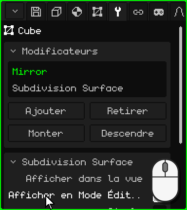

| | Comment utiliser la liste |
|---|---|
|  PC | Un clic choisit. S'ils ne tiennent pas tous, tournez la molette au-dessus de la liste. |
|  Écran tactile | Un toucher choisit. S'ils ne tiennent pas tous, faites glisser le doigt vers le haut ou vers le bas sur la liste. |
|  Nokia N95 | <kbd>OK</kbd> sur la liste, **haut** et **bas** choisissent et <kbd>OK</kbd> en sort. Sur une ligne de boutons, **gauche** et **droite** passent d'un bouton à l'autre (la bordure indique lequel) et <kbd>OK</kbd> l'actionne. |

## Le losange : animer une propriété

À droite des propriétés qui peuvent être animées, il y a un **losange** ; celles qui n'en ont pas ne s'animent pas. Un clic ou un toucher sur le losange pose une **keyframe** : elle enregistre la valeur de cette propriété à la frame actuelle de la Timeline. Avec des keyframes sur différentes frames, la propriété change toute seule quand l'animation est lue.

La couleur du losange indique l'état de la propriété **à la frame actuelle** :

| Losange | Ce que cela veut dire | Ce que fait un clic |
|---|---|---|
| Gris | La propriété n'est pas animée. | Pose la première keyframe, avec la valeur actuelle. |
| Vert pâle | Elle est animée, mais n'a pas de keyframe sur cette frame. | Pose une keyframe avec la valeur actuelle. |
| Vert | Elle a une keyframe sur cette frame. | La retire. |

Modifier une valeur ne change pas la couleur du losange : la nouvelle valeur n'entre dans l'animation que lorsque vous posez la keyframe, et si vous changez de frame avant, la propriété revient à ce que dit l'animation. Sur une frame qui a déjà une keyframe (losange vert), une nouvelle valeur s'enregistre en deux clics : le premier retire la keyframe et le second la remet avec la valeur actuelle.

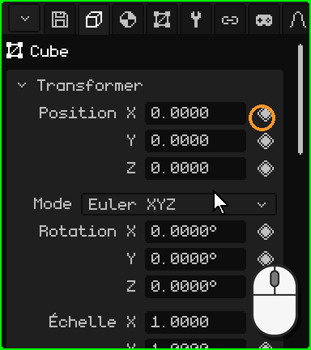

 Sur le Nokia N95, positionné sur la ligne, la flèche **droite** passe au losange (une bordure blanche le signale), <kbd>OK</kbd> pose ou retire la keyframe et **gauche** revient à la valeur.

Dans l'onglet Animation, la carte **Caméra active** choisit quelle caméra est utilisée à chaque moment de l'animation : les changements de plan d'une scène. Son losange a une couleur de plus, un **vert plus clair** : la caméra choisie n'est pas celle qu'indique l'animation sur cette frame, un changement qui n'a pas encore été enregistré. Un clic enregistre le changement de plan à la frame actuelle.

L'animation aura son propre tutoriel plus loin.

Tous les onglets et leurs cartes se trouvent dans le manuel : [Propriétés](propiedades.md). Revenir au tutoriel [Les viewports](viewports.md).

## Le contenu de chaque onglet

| Onglet | Contenu |
|---|---|
| Fichier / Rendu (disquette) | **Fichier** : ouvrir, enregistrer, enregistrer sous, enregistrer une version, extraire les assets. **Rendu** : chemin, taille, passes supplémentaires, fond, **Lancer de rayons** (rayons, échantillons, passes), Rendu image et Rendu animation. **Jeu** : plateforme (Windows, Symbian, Linux .deb, AppImage, WebGL, Android, Android 2.3), fenêtre, orientation, icône, physique, son, volume, **résolution** (le pourcentage de l'écran auquel le jeu dessine : sur Android 2.3, le système l'étire, et sur ces téléphones, dessiner moins de pixels donne plus d'images par seconde) et Compiler le jeu (avec un téléphone branché par adb, il l'installe et le lance). **Exporter** : OBJ, glTF, GLB, STL (uniquement les triangles, pour l'impression 3D ou pour passer à un logiciel de CAO). **Réglages** : langue, anticrénelage, graphismes, skin, journaux, échelle, **Raccourcis clavier…** et Enregistrer modifications. |
| Objet | Position, rotation (Euler, quaternion ou axe-angle), échelle, nom, visible, visible au rendu ; animations et palette de l'objet. |
| Contextuel | Dépend du type : parties du maillage et **matériau** (texture, éclairage, couleur de sommet, transparence, reflets, normal map, mélange, profondeur, couches de texture, **Avancé : shader personnalisé** — voir [Shaders écrits](../editor/shaders.md) ; Rugosité, Métallique, Transmission et IOR avec le lancer de rayons), lumière, caméra, brouillard, particules, physique, hitbox, armature et os, éléments 2D, prefabs, routines. |
| Maillage 3D | Le maillage utilisé (et le nombre d'objets qui le partagent), cartes UV, couches de couleur, groupes de sommets, groupes UV. Avec une ressource choisie dans la Bibliothèque : ses données et son emplacement (dans le .w3d ou en dehors). |
| Modificateurs | Voir [Modificateurs](../editor/objeto-malla.md#longlet-modificateurs). |
| Transformer | Uniquement en Mode Édition : centre de la sélection et de ses UV, modifiables. |
| Armature 2D | Armatures et os 2D du maillage. |
| Contraintes | Copier la position, Copier la rotation, Billboard (regarder la caméra), Child Of. |
| Scripts | Les scripts Lua de l'objet et leurs propriétés (voir le [document Lua](../lua/README.md)). |
| Animation | L'animation active, les couches de mélange (Mix), les valeurs exactes de la keyframe choisie et les changements de plan de la caméra. |

## Routines

Une routine est une liste d'étapes de dessin (translater, faire pivoter, lier une texture, dessiner un maillage, appeler une autre routine, Appeler Lua…) que l'on construit dans Propriétés. C'est la façon la plus rapide de dessiner sur le N95.

| Fonction | Description | Raccourci |
|---|---|---|
| Ajouter / retirer une étape | Ajoute des étapes regroupées par thème, ou retire celle qui est choisie. | Boutons ; <kbd>X</kbd> ou <kbd>Delete</kbd> la retire |
| Saisir étape | Réordonne l'étape avec les flèches ; <kbd>Enter</kbd> confirme. | <kbd>G</kbd> |
| Insérer image clé | Anime les valeurs de l'étape à la frame actuelle. | <kbd>I</kbd> |
| Répéter | Le nombre de fois que la liste s'exécute d'affilée (boucle de routine). 1 = routine normale. | Champ Répéter |
| Mode de rendu / Utilise | Une liste différente par mode d'ombrage, ou la même pour tous. | Listes déroulantes |
