# Changer l'origine : une porte

Dans ce tutoriel, vous allez faire en sorte qu'une porte s'ouvre depuis la charnière. Pour cela, il faut changer son **origine** : le point autour duquel l'objet tourne (voir [L'origine](modo-objeto.md#lorigine) dans le tutoriel du Mode Objet).

Nous partons de la porte du tutoriel précédent, [Modéliser une porte](modelar-puerta.md), avec l'origine au centre. Si vous l'avez faite en décalant un côté, l'origine s'est retrouvée décalée : **Objet → Définir l'origine → Origine à la géométrie** la ramène au centre.

## La porte tourne mal

Essayez de la faire tourner. La porte tourne sur son centre, comme une porte tambour, et non depuis la charnière :

 Avec le gizmo : un clic en son centre le fait passer en **rotation**, et l'anneau bleu fait tourner la porte autour de l'axe vertical.

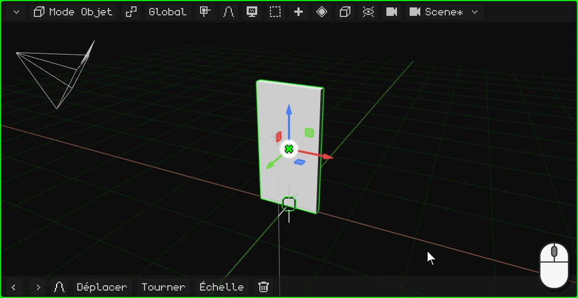

 Au doigt : un toucher au centre du gizmo le fait passer en **rotation**, et on fait glisser l'anneau bleu.

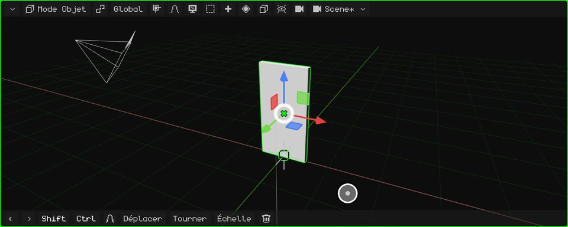

 Sur le Nokia N95, le gizmo est désactivé au départ : <kbd>2</kbd> (faire pivoter), <kbd>3</kbd> (l'axe Z, l'axe vertical) et les flèches ; <kbd>OK</kbd> confirme.

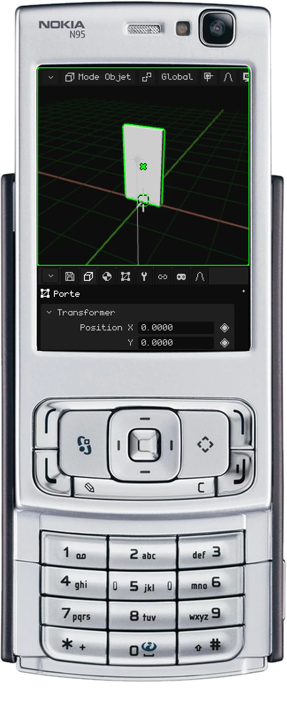

Elle tourne mal parce que son origine est au centre. Nous allons la placer sur la charnière.

## Placer l'origine sur la charnière

1. **Passez en Mode Édition.** Un clic sur le bouton du mode, puis un autre sur **Mode Édition** (sur PC, aussi avec <kbd>Tab</kbd>).

   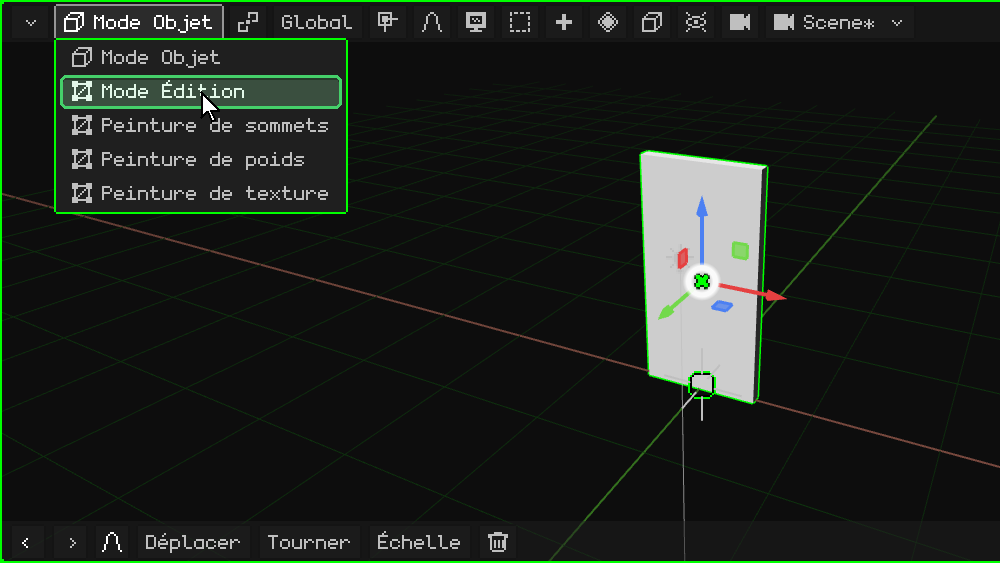

2. **Choisissez les faces.** En Mode Édition apparaît le bouton **Sommet / Arête / Face** : un clic, puis choisissez **Face**.

   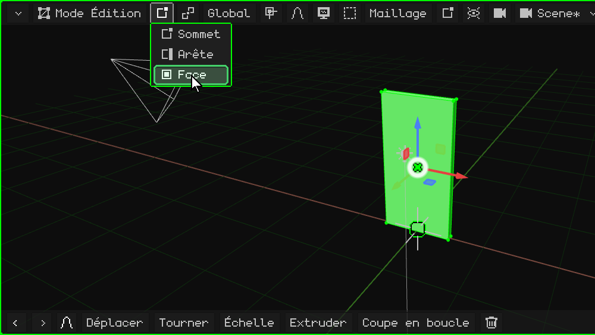

3. **Sélectionnez la face de la charnière.** Un clic sur la face étroite du côté de la porte, du côté où se trouve la charnière : elle devient verte.

   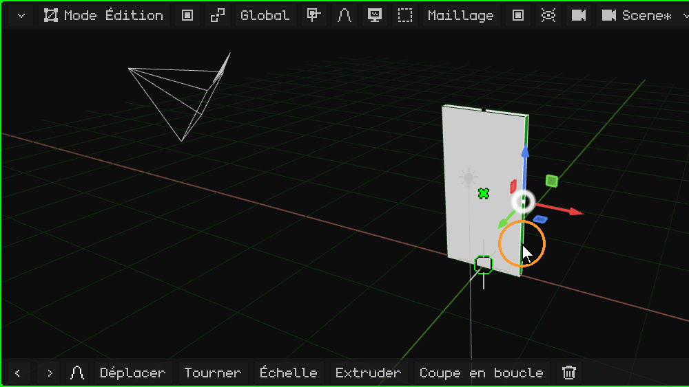

4. **Amenez-y le curseur 3D.** Dans le menu **Maillage**, **Aimantation** → **Curseur sur le sélectionné** : le curseur 3D se place sur la charnière.

   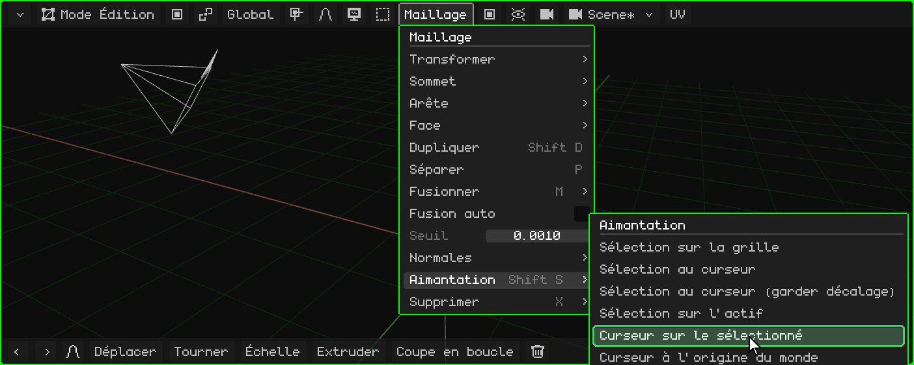

5. **Revenez en Mode Objet.** Un clic sur le bouton du mode, puis un autre sur **Mode Objet** (ou <kbd>Tab</kbd>).

   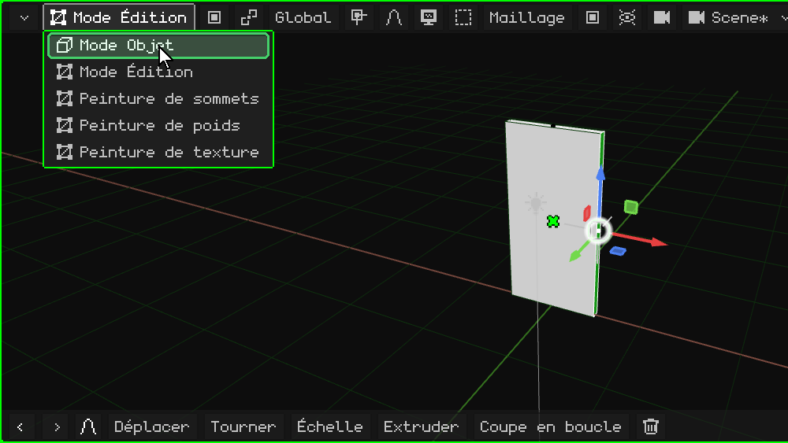

6. **Amenez l'origine au curseur 3D.** Dans le menu **Objet**, **Définir l'origine** → **Origine au curseur 3D**. La porte ne bouge pas : c'est son origine qui se déplace, et avec elle le gizmo, qui se retrouve sur la charnière.

   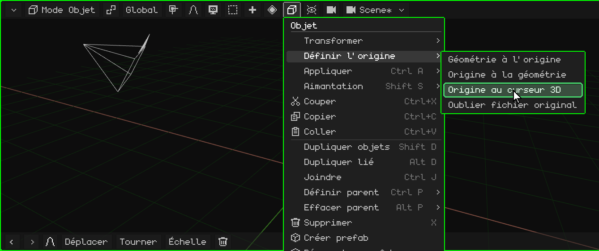

## Maintenant, elle tourne bien

Faites-la tourner de nouveau avec le gizmo : elle s'ouvre et se ferme maintenant depuis la charnière.

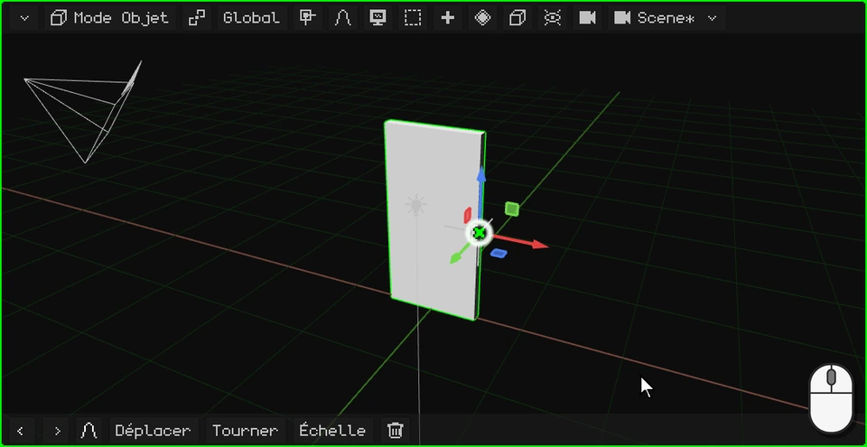

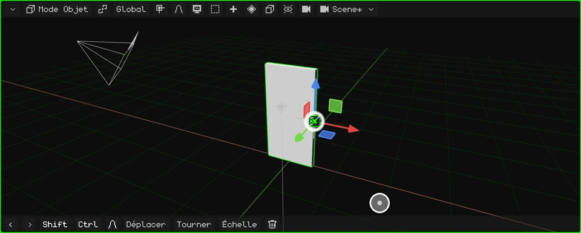

 Sur un écran tactile, les étapes ci-dessus sont les mêmes, avec des touchers : les menus s'ouvrent et les options se choisissent d'un toucher.

 Sur le Nokia N95, <kbd>OK</kbd> passe du Mode Objet au Mode Édition et les menus s'ouvrent avec la touche de sélection gauche.

## Les options de Définir l'origine

| Option | Ce qu'elle fait |
|---|---|
| **Origine à la géométrie** | Amène l'origine au centre du maillage. |
| **Origine au curseur 3D** | Amène l'origine là où se trouve le curseur 3D. |
| **Géométrie à l'origine** | L'inverse : laisse l'origine en place et déplace le maillage jusqu'à ce que son centre coïncide avec elle. |

Dans le prochain tutoriel, nous lui ajoutons la poignée : [Modéliser la poignée](modelar-picaporte.md).
