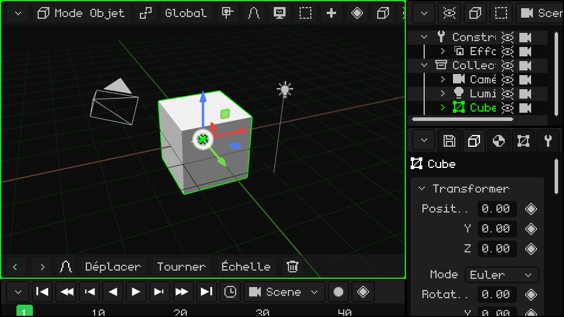
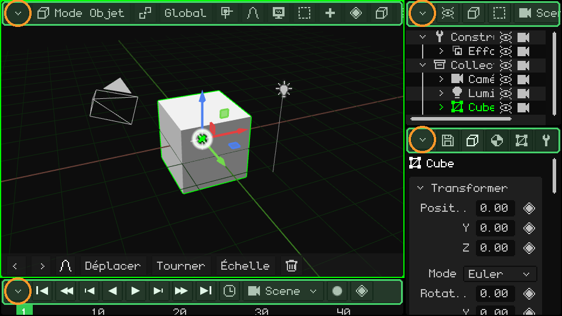
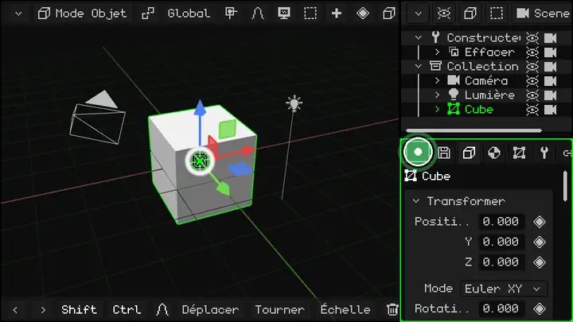
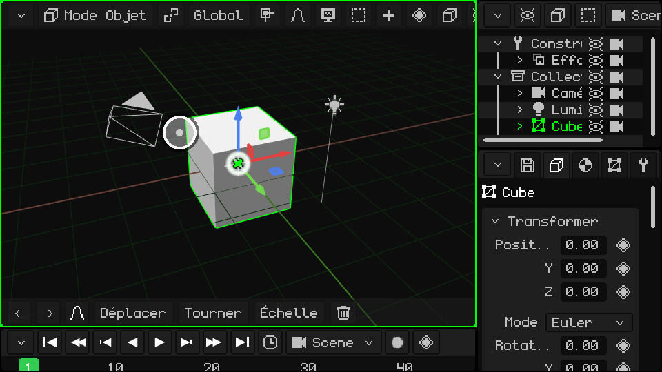
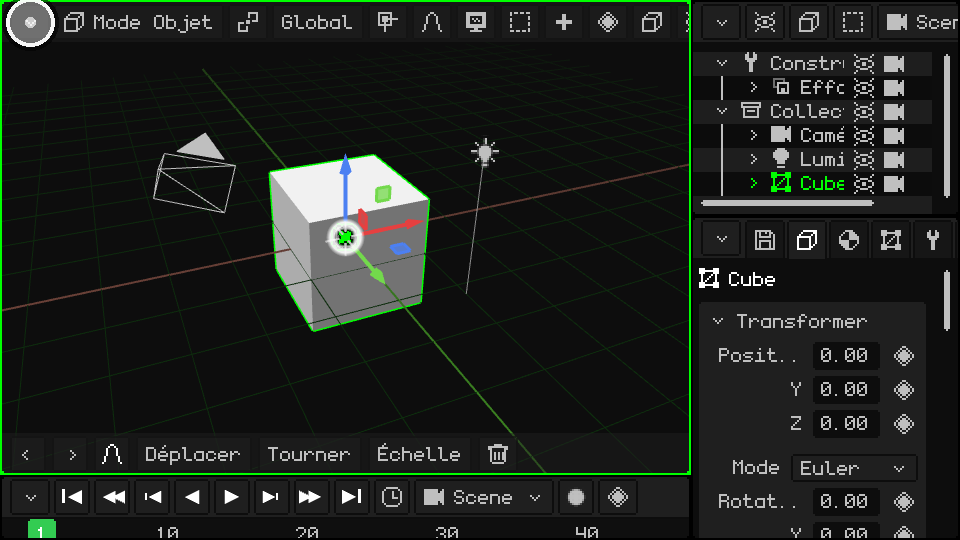
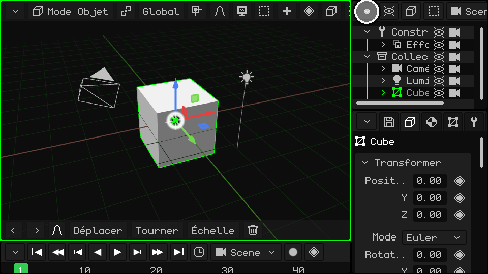
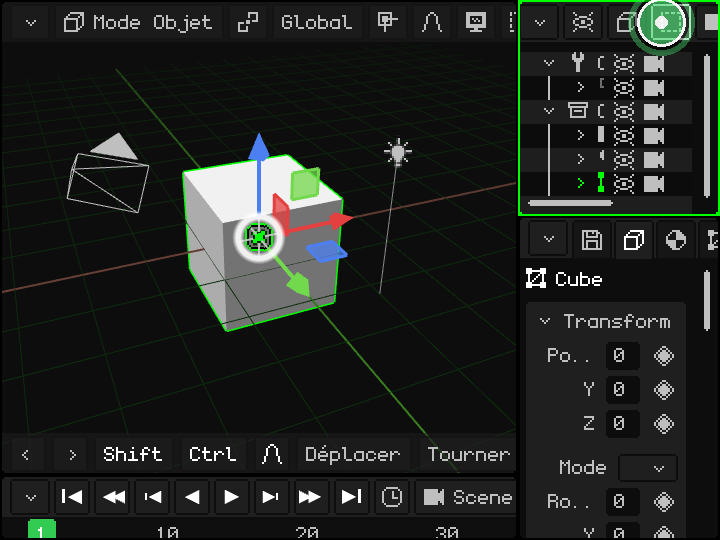
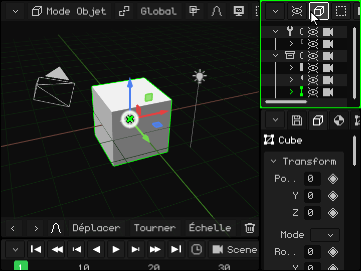
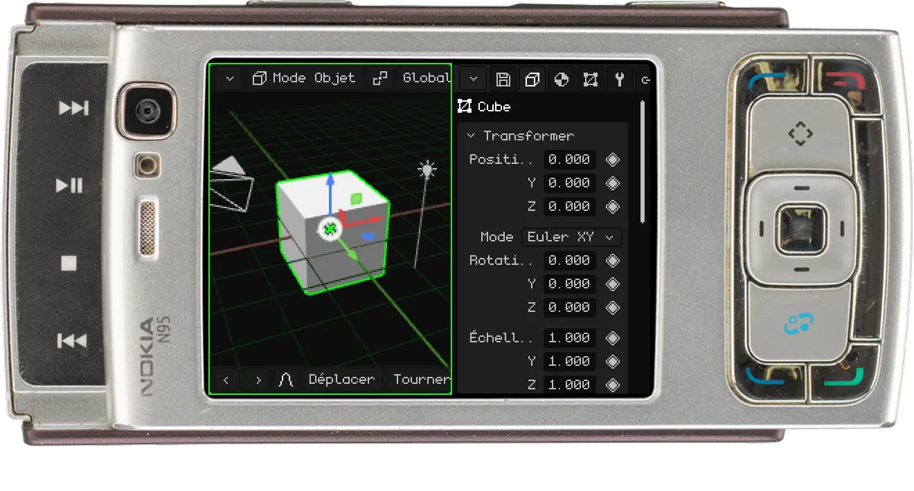

# Les viewports

La fenêtre de Whisk3D est divisée en **viewports** : des panneaux, chacun avec son éditeur (le 3D Viewport, l'Outliner, Properties...). Vous pouvez les diviser, changer leur taille et choisir ce que chacun affiche. Cela fonctionne de la même façon à la souris, au doigt sur un écran tactile et avec le clavier d'un Nokia.

Voici ce que l’on voit au premier lancement du programme :

## La barre de menus et le bouton du coin

Tous les viewports ont en haut une **barre de menus** (en vert sur l'image) avec les menus et les boutons de cet éditeur. En haut à gauche se trouve toujours le **bouton du coin** (en orange) : c'est lui qui change ou modifie le viewport.

## Redimensionner

Posez le doigt (ou la souris) sur le bouton du coin et **faites-le glisser**. Cela déplace la bordure gauche et la bordure du haut de ce viewport, et ses voisins s'ajustent. Ici, on fait glisser en cercles celui d'en bas à droite, et les trois changent de taille :

> [!TIP]
> Si vous touchez le bouton et le relâchez sans le faire glisser, son menu s'ouvre. Sur PC, vous pouvez aussi faire glisser la bordure qui sépare deux viewports.

## Le menu du coin

Quand vous touchez le bouton du coin, ce menu s'ouvre :

En haut se trouvent les **types de viewport** : en choisir un transforme le viewport en cet éditeur. Sous la ligne se trouve ce que vous pouvez en faire :

| Option | Ce qu'elle fait |
|---|---|
| Expand | Le viewport prend la place de son voisin, qui se ferme (si le voisin est divisé, tout ce groupe se ferme). |
| Split in Columns | Le coupe en deux, l'un à côté de l'autre. |
| Split in Rows | Le coupe en deux, l'un au-dessus de l'autre. |
| Maximize | L'agrandit à toute la fenêtre. Tant qu'il est agrandi, le menu ne propose que **Minimize**, qui le remet à sa place. |

### Changer le type

Le 3D Viewport transformé en UV Editor :

### Split in Columns et Split in Rows

### Expand

L'Outliner prend la place de Properties :

### Maximize et Minimize

## Quand la barre ne tient pas

Si le viewport est étroit, sa barre ne tient pas en entier. C'est pareil pour la barre d'outils en bas du 3D Viewport. Pour voir le reste :

- **Au doigt :** faites-la glisser sur le côté.
- **À la souris :** maintenez le clic sur la barre et faites glisser, ou tournez la **molette** au-dessus. Dans le 3D Viewport, la molette zoome : faites donc glisser sa barre.
- **Au clavier :** <kbd>M</kbd> sur PC, ou la **touche de sélection gauche** sur le Nokia, entre dans la barre du viewport actif. Parcourez-la avec les flèches gauche et droite : chaque menu s'ouvre quand vous l'atteignez. Avec haut et bas, vous vous déplacez dans le menu, et avec OK (<kbd>Enter</kbd> sur PC) vous choisissez. La barre défile toute seule pour montrer où vous êtes.

Sur un Nokia N95 : la touche de sélection gauche entre dans la barre et les flèches la parcourent.

## Les types de viewport

| Viewport | À quoi il sert |
|---|---|
| [3D Viewport](../editor/vista-3d.md) | Là où l'on voit et modifie la scène : modéliser, déplacer des objets, peindre, poser et animer. |
| [Outliner](../editor/outliner.md) | La liste de tout ce qui se trouve dans la scène. |
| [Library](../editor/outliner.md#vue-library) | Les ressources du projet : maillages, matériaux, textures, animations, sons, scripts et plus encore. |
| [Properties](../editor/propiedades.md) | Les données de l'objet actif, en onglets. |
| [UV Editor](../editor/editor-uv.md) | Comment la texture se pose sur le maillage. |
| [Timeline](../editor/linea-de-tiempo.md) | L'animation : les keyframes et les courbes. |
| [2D Editor](../editor/editor-2d.md) | Interfaces de jeu, HUD et jeux 2D. |
| [Console](../editor/consola.md) | Le journal du moteur : erreurs, avertissements et informations. |
| [IDE](../editor/editor-de-scripts.md) | L'éditeur de scripts Lua et de shaders. |

Chaque viewport aura son propre tutoriel, plus détaillé. En attendant, le [Manuel de Whisk3D](../editor/README.md) les explique un par un.

Whisk3D continue de grandir : avec le temps, de nouveaux viewports s'ajouteront et ceux d'aujourd'hui pourront changer. Ils fonctionneront tous de la même façon, avec la barre en haut et le bouton dans le coin.
