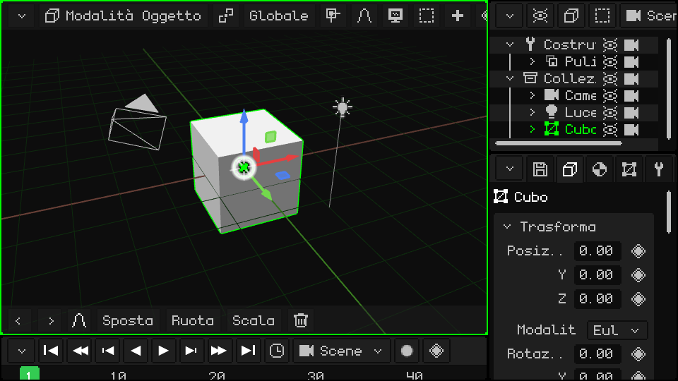
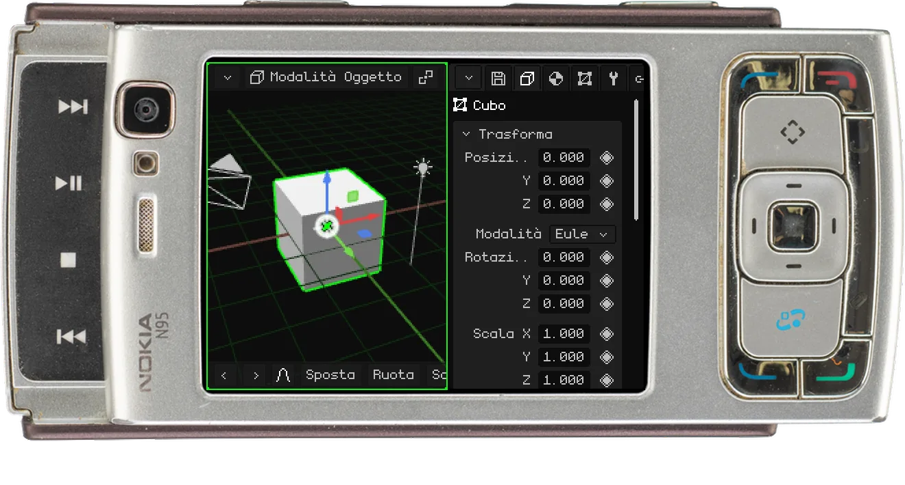
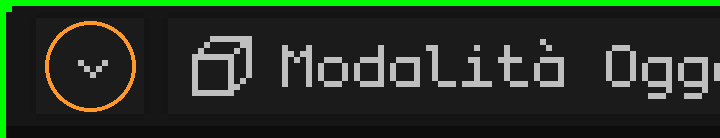
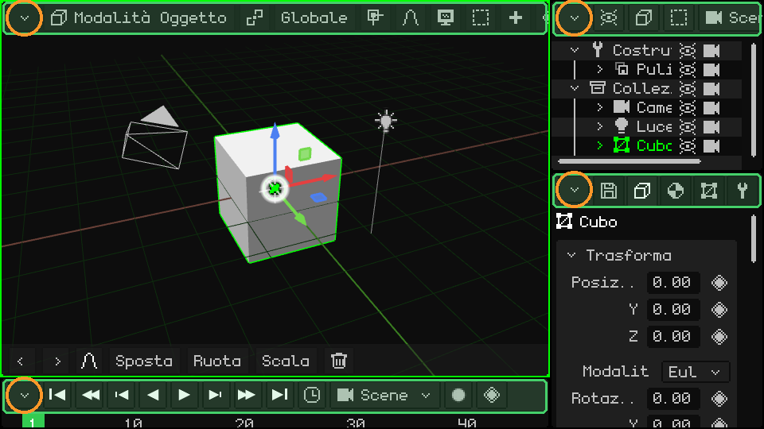
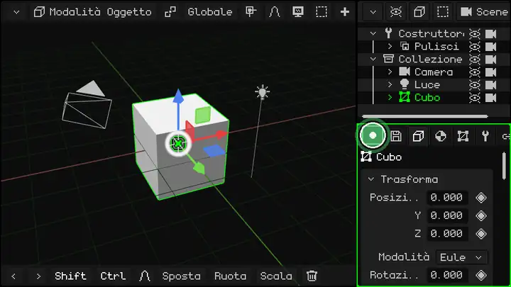
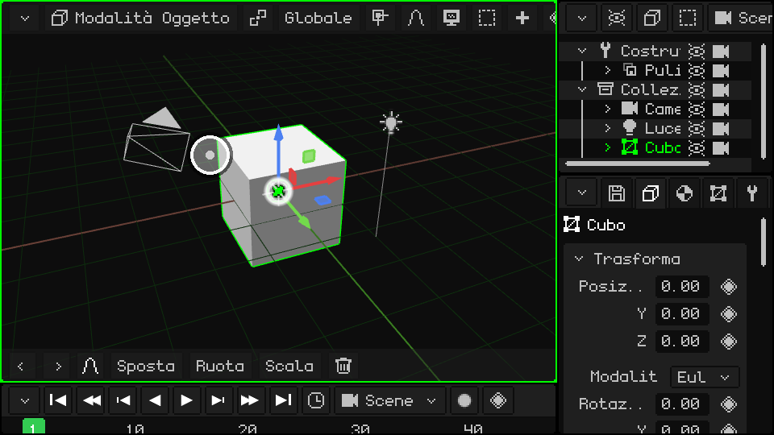
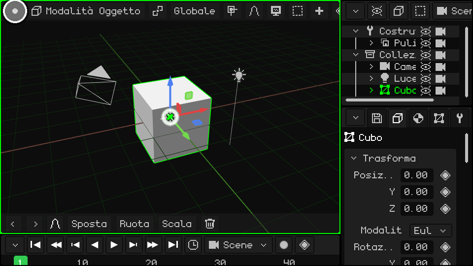
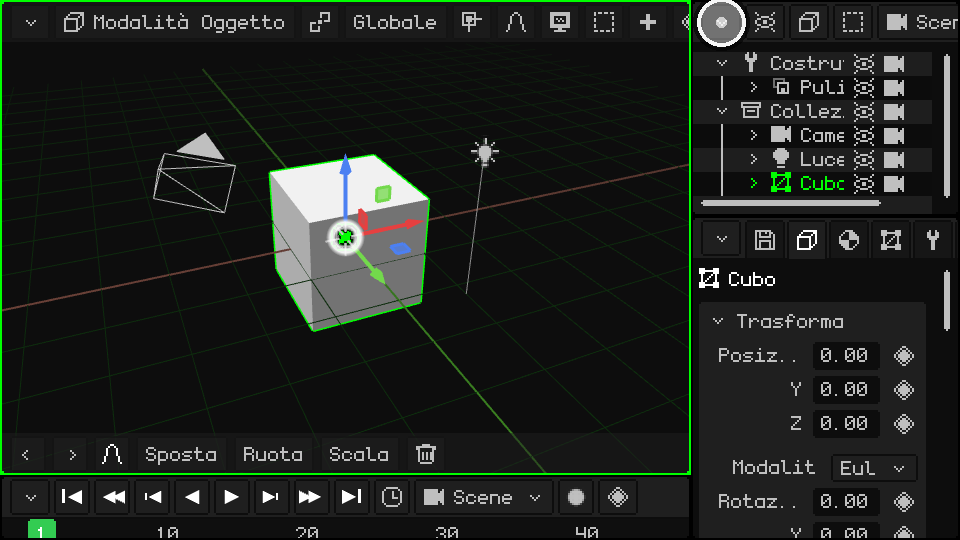
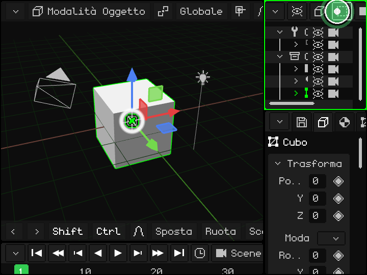
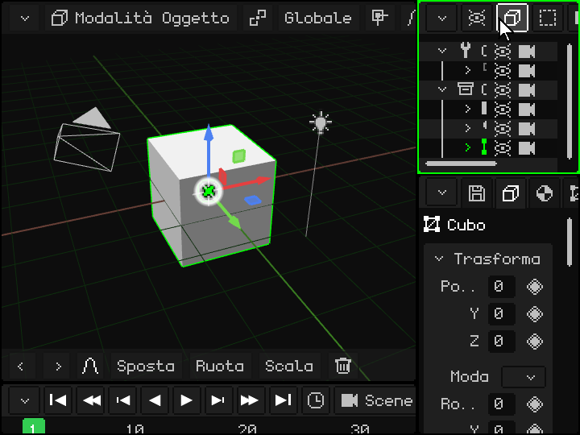

# L'interfaccia

> [!NOTE]
>  Il Nokia N95 supporta mouse e tastiera (via Bluetooth). Le parti di questa pagina dedicate al Nokia spiegano come usarlo senza mouse né tastiera, solo con i tasti del telefono.

La finestra di Whisk3D è divisa in **viewport**: pannelli, ognuno con il suo editor (la Vista 3D, l'Outliner, Proprietà...). Puoi dividerli, cambiarne la dimensione e scegliere cosa mostra ognuno. Funziona allo stesso modo con il mouse, con il dito su uno schermo touch e con la tastiera di un Nokia.

Questo è ciò che si vede quando il programma si avvia per la prima volta:

## Il viewport attivo

Il viewport che si trova sotto il mouse è il **viewport attivo** ed è segnato da un bordo verde. È quello che riceve i comandi della tastiera, i controller e qualsiasi altra periferica. Quando passi con il mouse da un viewport all'altro, il bordo verde lo segue:

 **Su un Nokia N95:** ogni pressione del **tasto verde** di chiamata  passa al viewport successivo. Sullo schermo del N95 ce ne stanno due: la Vista 3D a sinistra e Proprietà a destra.

## La barra dei menu e il pulsante dell'angolo

Tutti i viewport hanno in alto una **barra dei menu** (in verde nell'immagine) con i menu e i pulsanti di quell'editor. In alto a sinistra c'è sempre il **pulsante dell'angolo** (in arancione): è quello che cambia o modifica il viewport.

È uguale in tutti i viewport, ed è l'unico pulsante che hanno tutti.

## Cambiare la dimensione

  **Tieni premuto** il pulsante dell'angolo (con il dito o con il mouse) e trascinalo per cambiare la dimensione: questo sposta il bordo sinistro e quello superiore di quel viewport, e quelli accanto si adattano. Un **tocco singolo**, senza trascinare, apre il menu a tendina con le opzioni del viewport. Qui si trascina in cerchio quello in basso a destra e tutti e tre cambiano dimensione:

 **Su un Nokia:** tieni premuto il **tasto verde** di chiamata  e premi una freccia: il bordo del viewport attivo (quello con la cornice verde) si sposta da quel lato, e così lo ingrandisci o lo rimpicciolisci. Il tasto verde da solo, senza frecce, passa al viewport successivo.

## Le opzioni del viewport

Un tocco sul pulsante dell'angolo apre questo menu:

In alto ci sono i **tipi di viewport**: sceglierne uno trasforma il viewport in quell'editor. Sotto la linea c'è ciò che si può fare con il viewport:

| Opzione | Cosa fa |
|---|---|
| Espandi | Il viewport prende il posto di quello accanto, che si chiude (se quello accanto è diviso, si chiude tutto quel gruppo). |
| Dividi in colonne | Lo divide in due, uno accanto all'altro. |
| Dividi in righe | Lo divide in due, uno sopra l'altro. |
| Massimizza | Lo ingrandisce a tutta la finestra. Mentre è massimizzato, il menu ha solo **Minimizza**, che lo riporta al suo posto. |

### Cambiare il tipo

La Vista 3D trasformata in Editor UV:

### Dividere in colonne e in righe

### Espandere

L'Outliner prende il posto di Proprietà:

### Massimizzare e minimizzare

## Quando non si vedono tutte le opzioni della barra dei menu

Se il viewport è stretto, la sua barra dei menu non ci sta tutta. Lo stesso succede con la barra degli strumenti in basso nella Vista 3D. Per vedere il resto:

-  **Con il dito:** trascinala di lato.
-  **Con il mouse:** tieni premuto il pulsante del mouse sulla barra e trascina, oppure gira la **rotella** sopra la barra.
-   **Con la tastiera:** <kbd>M</kbd> sul PC, o il **tasto di selezione sinistro** sul Nokia, ti porta nella barra del viewport attivo. Con le frecce sinistra e destra la percorri, e ogni menu si apre quando ci arrivi. Con su e giù ti muovi nel menu, e con OK (<kbd>Enter</kbd> sul PC) scegli. La barra scorre da sola per mostrare dove sei.

 Su un Nokia N95: il tasto di selezione sinistro porta nella barra e le frecce la percorrono.

## I tipi di viewport

| Viewport | A cosa serve |
|---|---|
| [Vista 3D](vista-3d.md) | Dove si vede e si modifica la scena: modellare, spostare oggetti, dipingere, mettere in posa e animare. |
| [Outliner](outliner.md) | L'elenco di tutto ciò che c'è nella scena. |
| [Libreria](outliner.md#vista-libreria) | Le risorse del progetto: mesh, materiali, texture, animazioni, suoni, script e altro. |
| [Proprietà](propiedades.md) | I dati dell'oggetto attivo, in schede. |
| [Editor UV](editor-uv.md) | Come la texture si appoggia sulla mesh. |
| [Timeline](linea-de-tiempo.md) | L'animazione: i keyframe e le curve. |
| [Editor 2D](editor-2d.md) | Interfacce di gioco, HUD e giochi 2D. |
| [Console](consola.md) | Il registro del motore: errori, avvisi e informazioni. |
| [IDE](editor-de-scripts.md) | L'editor di script Lua e di shader. |

Whisk3D continua a crescere: col tempo si aggiungeranno nuovi viewport e quelli attuali potranno cambiare. Funzioneranno tutti allo stesso modo, con la barra dei menu in alto e il pulsante nell'angolo.

## Altro sull'interfaccia

| Funzione | Descrizione | Come si usa |
|---|---|---|
| Barra dei menu da tastiera | Apre la barra dei menu del viewport attivo per percorrerla con le frecce. | <kbd>M</kbd> (in Modalità Modifica, <kbd>M</kbd> è Fondi). |
| Annulla / Rifai | Annulla o ripristina l'ultima azione. | <kbd>Ctrl+Z</kbd> / <kbd>Ctrl+Y</kbd> o <kbd>Ctrl+Shift+Z</kbd>; frecce della barra degli strumenti. |
| Salva progetto | Salva il .w3d aperto (se è nuovo, chiede un nome). | <kbd>Ctrl+S</kbd>, o Proprietà → scheda File/Render → riquadro File (vedi [Il progetto](proyecto.md)). |
| Schermo intero | Entra ed esce dalla modalità a schermo intero. | <kbd>F11</kbd>. Su Android è automatico se il telefono non ha il notch. |
| Riproduci / Pausa | Riproduce l'animazione (o il gioco) da qualsiasi pannello. | <kbd>Space</kbd> o il pulsante Play della Timeline. |

 **Su Android**: in verticale il layout è Vista 3D sopra e Proprietà sotto; in orizzontale si aggiunge la Timeline. Quando si apre la tastiera sullo schermo (per esempio nell'editor di script), il viewport attivo si massimizza nella parte visibile e torna al suo posto quando la tastiera si chiude.
