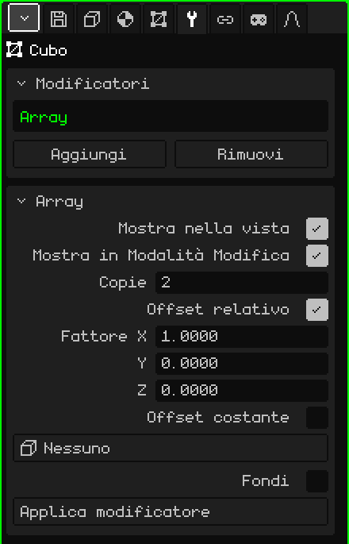

# Array

Il modificatore **Array** crea copie della mesh in fila, ognuna spostata rispetto alla precedente. Serve per tutto ciò che si ripete: i pali di una recinzione, i gradini di una scala, le colonne di un corridoio o gli anelli di una catena. Modelli un solo pezzo e l'Array costruisce il resto; se cambi il pezzo, cambiano tutte le copie.

## Come si aggiunge

1. Scegli la mesh.
2. In Proprietà, apri la scheda **Modificatori** (l'icona della chiave inglese).
3. Premi **Aggiungi** e scegli **Array**.

Nell'elenco appare come **Array**, e sotto si apre il riquadro con i suoi parametri. Come tutti i modificatori, non distrugge la mesh: si può disattivare, spostare con **Sposta su** e **Sposta giù**, togliere con **Rimuovi** o rendere definitivo con **Applica modificatore**.

## Parametri

| Parametro | Cosa fa |
|---|---|
| Mostra nella vista | Se è disattivato, le copie non vengono calcolate: né nella vista né nel render. |
| Mostra in Modalità Modifica | Se è disattivato, mentre modifichi si vede solo il pezzo originale. |
| Copie | Quanti pezzi ci sono in tutto, contando l'originale (2 di default). Con 1 resta solo l'originale. |
| Offset relativo | Sposta ogni copia in base alla **dimensione** del pezzo. È attivo di default, con Fattore X a 1: ogni copia resta attaccata alla precedente, senza spazi e senza sovrapporsi. |
| Fattore X / Y / Z | Di quante volte la propria dimensione si sposta ogni copia su quell'asse: 1 = attaccate, 2 = con uno spazio grande quanto un pezzo, 0.5 = sovrapposte per metà. Y è la profondità e Z l'altezza, come nella scheda Oggetto. Si vedono solo con l'Offset relativo attivo. |
| Offset costante | Sposta ogni copia di una distanza fissa, indipendentemente dalla dimensione del pezzo. È disattivato di default. Se entrambi gli offset sono attivi, si sommano. |
| Distanza X / Y / Z | I metri di cui si sposta ogni copia su ogni asse. Si vedono solo con l'Offset costante attivo. |
| Offset oggetto | Un oggetto della scena (la cosa più comoda è un Vuoto) che sposta, ruota e scala ogni copia un po' più della precedente. Vedi più sotto. Su **Nessuno**, non si usa. |
| Fondi | Salda i vertici che restano a contatto tra una copia e la successiva, perché formino un'unica superficie: una ringhiera continua invece di tratti separati. È disattivato di default. |
| Distanza di fusione | Quanto devono essere vicini due vertici per saldarsi (0.001 m di default). Si vede solo con Fondi attivo. |
| Applica modificatore | Rende definitive le copie nella mesh. Vedi la nota più sotto. |

## Esempi

- **Una recinzione:** un palo (un Cubo stretto e alto), Copie a 10 e Fattore X a 3: dieci pali con uno spazio di due pali tra uno e l'altro.
- **Una scala:** un gradino (un Cubo basso), Fattore X a 0, Fattore Y a 1 e Fattore Z a 1: ogni gradino resta un passo più indietro e un passo più in alto.

## L'Offset oggetto

Con un oggetto scelto, ogni copia ripete quanto quell'oggetto è **spostato, ruotato e scalato rispetto alla mesh**, e lo accumula: la seconda copia lo fa una volta, la terza due volte, e così via.

- Se il Vuoto è nello stesso punto della mesh e ruotato di 30° attorno alla verticale, ogni copia ruota di 30° più della precedente: con 12 copie si fa il giro completo.
- Se in più è un po' più in alto, ogni copia sale un po' di più: una scala a chiocciola.
- Se è scalato a 0.9, ogni copia è un po' più piccola della precedente: una spirale che si chiude.

Con il Vuoto nello stesso punto della mesh, le copie ruotano attorno all'origine della mesh. Perché formino un cerchio e non ruotino su se stesse, sposta il pezzo lontano dall'origine in Modalità Modifica e disattiva l'Offset relativo. Quando sposti o ruoti l'oggetto, le copie si aggiornano all'istante.

## L'ordine conta

L'Offset relativo misura la mesh **così come gli arriva** dal modificatore sopra: se sopra c'è uno [Specchio](modificador-espejo.md), misura l'oggetto già riflesso. Con una [Superficie di suddivisione](modificador-subdivision.md) sotto, le copie saldate con Fondi si ammorbidiscono come un unico pezzo; senza Fondi, ogni copia si ammorbidisce per conto suo.

> [!NOTE]
> Applica modificatore su un Array rende definitivi **tutti** i modificatori attivi dell'elenco, non solo l'Array (con i valori della vista), e svuota l'elenco: se ne vanno anche quelli disattivati e quelli che non generano geometria, come un'[Armatura](modificador-esqueleto.md). Si può annullare.

Torna a [Mesh 3D](objeto-malla.md)
