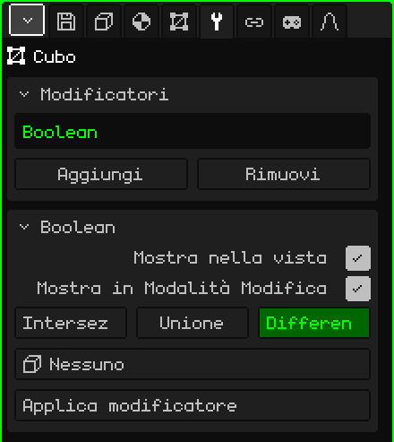

# Booleano

Il modificatore **Booleano** combina la mesh con un'altra: le sottrae il volume dell'altra, glielo aggiunge oppure tiene solo ciò che hanno in comune. Serve per ciò che costerebbe molta fatica modellare a mano: il foro di una finestra in un muro, l'incavo di una tazza, una scanalatura, o due pezzi fusi in uno solo.

## Come si aggiunge

1. Scegli la mesh che deve cambiare (per esempio, il muro).
2. In Proprietà, apri la scheda **Modificatori** (l'icona della chiave inglese).
3. Premi **Aggiungi** e scegli **Booleano**.

Nell'elenco appare con il suo nome interno, **Boolean**, e sotto si apre il riquadro con i suoi parametri. Come tutti i modificatori, non distrugge la mesh: il muro resta intero sotto, e se togli il modificatore il foro scompare. Si può disattivare, spostare con **Sposta su** e **Sposta giù**, togliere con **Rimuovi** o rendere definitivo con **Applica modificatore**.

## Parametri

| Parametro | Cosa fa |
|---|---|
| Mostra nella vista | Se è disattivato, l'operazione non viene eseguita: si vede la mesh originale, né nella vista né nel render. |
| Mostra in Modalità Modifica | Se è disattivato, mentre modifichi si vede la mesh senza l'operazione. |
| Intersezione | Lascia solo la parte che sta dentro entrambe le mesh contemporaneamente. |
| Unione | Unisce le due in un'unica superficie e toglie le facce rimaste dentro. |
| Differenza | Sottrae a questa mesh il volume dell'altra: è quella che fa i fori. È scelta di default. |
| Oggetto | L'altra mesh, il **taglierino**. Su **Nessuno** non fa nulla. L'elenco mostra tutti gli oggetti della scena, ma serve solo una mesh. |
| Applica modificatore | Rende definitivo il risultato nella mesh. Vedi la nota più sotto. |

L'operazione scelta appare in verde.

## Esempio: una finestra in un muro

1. Aggiungi un **Cubo** e scalalo perché diventi un muro: largo, alto e sottile.
2. Aggiungi un altro **Cubo** (o un **Cilindro**, per una finestra rotonda) e mettilo dove va la finestra, in modo che attraversi il muro da parte a parte.
3. Scegli il muro, aggiungigli un **Booleano**, lascia **Differenza** e in **Oggetto** scegli il taglierino.
4. Nascondi il taglierino (Nascondi / Mostra della [Modalità Oggetto](modo-objeto.md), o togli la spunta a **Visibile** nella scheda Oggetto). Resta il foro.

Il taglierino nascosto continua a tagliare. Per spostarlo, mostralo di nuovo o sceglilo nell'Outliner.

## Cosa conviene sapere

- Entrambe le mesh devono essere **chiuse**, senza buchi nella superficie: altrimenti il Booleano non può sapere cosa sta dentro e cosa fuori.
- Spostare, ruotare, scalare o modificare il taglierino aggiorna il taglio all'istante. Così puoi sistemare la finestra guardando il risultato.
- Le facce che il taglio non tocca restano com'erano: un quadrilatero resta un quadrilatero. Quelle tagliate diventano poligoni con più lati, non triangoli, così la mesh resta comoda da modificare dopo averlo applicato.
- Le facce aggiunte dal taglierino (per esempio, il bordo interno della finestra) prendono il primo materiale della mesh.
- Le UV e i colori dei vertici si conservano; dove si taglia, vengono interpolati.
- Le parti che restano sullo stesso piano non si uniscono: l'unione di due scatole appoggiate lascia la faccia superiore divisa in vari pezzi.

 Sul Nokia N95 il taglio viene ricalcolato ogni volta che sposti o modifichi il taglierino. Con mesh grandi, sistemalo, applica il modificatore e continua a lavorare con la mesh già tagliata.

> [!NOTE]
> Applica modificatore sul Booleano rende definitivi **tutti** i modificatori attivi dell'elenco, non solo questo, e svuota l'elenco: se ne vanno anche quelli disattivati e quelli che non generano geometria, come un'[Armatura](modificador-esqueleto.md). Si può annullare. Il taglierino non viene eliminato: resta come un oggetto qualsiasi.

Torna a [Mesh 3D](objeto-malla.md)
