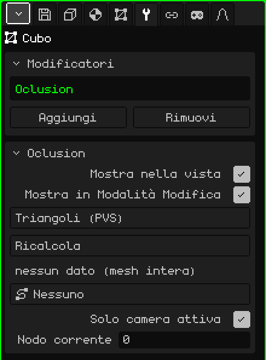

# Culling

Il modificatore **Culling** disegna solo i triangoli della mesh che si vedono dalla zona in cui si trova la camera. Usa elenchi di visibilità calcolati in anticipo, uno per zona, come facevano i giochi per PlayStation 1 (un **PVS**, *insieme potenzialmente visibile*). Serve per scenari grandi: di un livello intero, si disegna solo ciò che si vede dal corridoio in cui ti trovi.

 È pensato per il Nokia N95, dove ogni triangolo che non viene disegnato è velocità guadagnata. Cambiare zona non costa quasi nulla: gli elenchi si costruiscono una sola volta e, passando da una zona all'altra, cambia solo quale si usa. Non c'è nessun calcolo per fotogramma.



## Come si aggiunge

1. Scegli la mesh dello scenario.
2. In Proprietà, apri la scheda **Modificatori** (l'icona della chiave inglese).
3. Premi **Aggiungi** e scegli **Culling**.

Nell'elenco appare con il suo nome interno, **Oclusion**, e sotto si apre il riquadro con i suoi parametri. Non tocca la mesh: sceglie solo quali triangoli disegnare, quindi la mesh resta intera e modificabile. Per questo non ha Applica modificatore.

Non va confuso con l'oggetto **Culling** del menu Aggiungi della Vista 3D, che lavora con oggetti interi e non con i triangoli di una mesh.

## Da dove vengono i dati

Il modificatore non calcola cosa si vede: lo legge da un file che accompagna il modello. Per una mesh importata da `nivel.obj`, cerca `nivel.pvs.json` nella stessa cartella:

```json
{ "sectores": 2, "tris": [[0, 1], [2, 3]] }
```

`sectores` è il numero di zone, e `tris` contiene, per ogni zona, i triangoli da disegnare, numerati da 0 nell'ordine delle facce del `.obj`. Di solito proviene dal gioco originale o da uno strumento a parte. Ogni zona è un **nodo**: il nodo 1 è il primo elenco, e il nodo 0 disegna la mesh intera.

## Parametri

| Parametro | Cosa fa |
|---|---|
| Mostra nella vista | Se è disattivato, si disegna la mesh intera. |
| Mostra in Modalità Modifica | Non cambia nulla: in Modalità Modifica la mesh viene sempre disegnata intera. |
| Metodo | **Triangoli (PVS)** usa gli elenchi del `.pvs.json`. **BSP (in attesa)** appare in grigio: non si può ancora scegliere. |
| Ricalcola | Rilegge il `.pvs.json`, per esempio dopo averlo rigenerato. Avvisa "PVS ricalcolato" o, se non lo trova, "PVS: manca <modello>.pvs.json accanto al .obj sorgente". |
| (riga di stato) | Sotto Ricalcola: "4 nodi \| nodo attivo: 2", "nessun dato (mesh intera)" se non c'è il file, o "sidecar non caricato (Ricalcola)". |
| Percorso | Un percorso della scena (**Aggiungi → Percorso**), per esempio il binario lungo cui va la camera. Ogni nodo del percorso è una zona, e il motore sceglie da solo il nodo più vicino all'occhio. Su **Nessuno**, la zona si imposta a mano o da uno script. |
| Solo camera attiva | Se è attivo (di default), comanda la camera attiva mentre la scena viene riprodotta; in pausa non viene scelto nulla in automatico e il nodo si imposta a mano. Se è disattivato, comanda la vista del viewport: puoi volare liberamente nello scenario e vedere come appaiono e scompaiono i triangoli. |
| Rami | Appare solo se il percorso ha più di un ramo, per esempio il percorso principale e uno bonus. Sceglie quali rami contano per cercare il nodo più vicino; ogni ramo attivo appare in verde. Il pulsante dice, per esempio, "Rami: 3 (tutti)" o "Rami: 2/3". |
| Nodo corrente | La zona che viene disegnata; 0 = la mesh intera. Si può cambiare a mano per controllare ogni zona. Quando è il Percorso a scegliere il nodo, il motore lo sovrascrive. |

Da uno script, `setSector(objeto, n)` cambia il nodo attivo (0 = la mesh intera). Vedi [Particelle, nebbia e visibilità](../lua/api-particulas-niebla.md).

## Cosa conviene sapere

- Mentre la mesh è in Modalità Modifica viene disegnata intera, così puoi modificare tutto.
- Se nell'elenco c'è un altro modificatore attivo che genera geometria ([Specchio](modificador-espejo.md), [Array](modificador-array.md), [Superficie di suddivisione](modificador-subdivision.md)…), il Culling non viene usato e si disegna tutto: i numeri dei triangoli del `.pvs.json` sono quelli della mesh originale.
- Gli elenchi indicano i triangoli con il loro numero. Se modifichi la mesh e aggiungi o elimini facce, i numeri cambiano e gli elenchi possono finire per puntare ad altri triangoli: il Culling è per scenari finiti, non per quelli ancora in fase di modellazione.

Torna a [Mesh 3D](objeto-malla.md)
