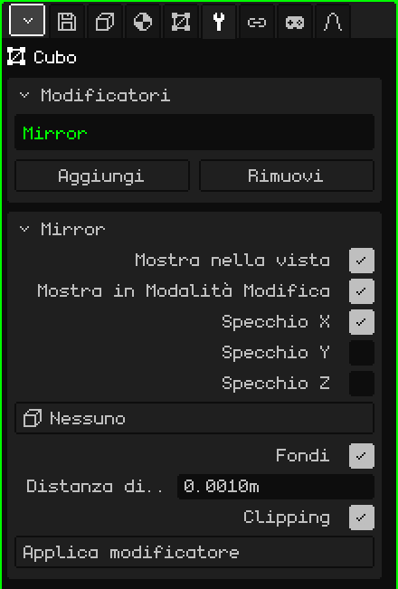

# Specchio

Il modificatore **Specchio** riflette la mesh dall'altra parte di un piano. Serve per tutto ciò che è simmetrico: modelli metà di un personaggio, di un volto o di un'auto, e l'altra metà appare da sola, riflessa. Ciò che cambi da un lato si ripete dall'altro mentre lavori.

## Come si aggiunge

1. Scegli la mesh.
2. In Proprietà, apri la scheda **Modificatori** (l'icona della chiave inglese). Appare solo quando l'oggetto attivo è una mesh.
3. Premi **Aggiungi** e scegli **Specchio**.

Nell'elenco del riquadro Modificatori appare con il suo nome interno, **Mirror**, e sotto si apre un riquadro con i suoi parametri.

Un modificatore non distrugge la mesh: l'originale resta intatta e continui a modificarla, e ciò che si vede è il risultato. Si può disattivare in qualsiasi momento, spostare nell'elenco con **Sposta su** e **Sposta giù** (appaiono quando ce ne sono due o più), togliere con **Rimuovi** o rendere definitivo nella mesh con **Applica modificatore**.

## Parametri

| Parametro | Cosa fa |
|---|---|
| Mostra nella vista | Se è disattivato, il riflesso non viene calcolato: né nella vista né nel render. Serve per confrontare con e senza. |
| Mostra in Modalità Modifica | Se è disattivato, mentre modifichi la mesh si vede solo la metà originale; tornando alla Modalità Oggetto appare il riflesso. |
| Specchio X | Riflette da sinistra a destra. È attivo di default: è quello che serve per un personaggio o un'auto. |
| Specchio Y | Riflette da davanti a dietro. |
| Specchio Z | Riflette dall'alto in basso. |
| Oggetto specchio | Su **Nessuno**, il piano dello specchio passa per l'origine della mesh. Se scegli un altro oggetto (per esempio un Vuoto), il piano passa per l'origine di quell'oggetto e ruota con lui; la sua scala non conta. Quando lo sposti o lo ruoti, il riflesso si aggiorna all'istante. |
| Fondi | Salda la cucitura: i vertici che stanno quasi sul piano si attaccano a esso e diventano condivisi dalle due metà. Così non resta una riga nel mezzo e l'ombreggiatura liscia passa da un lato all'altro senza interruzioni: mezza sfera si vede come una sfera intera. È attivo di default. |
| Distanza di fusione | Quanto deve essere vicino al piano un vertice per saldarsi (0.001 m di default). Se la cucitura resta aperta, aumentala un po'; se si attaccano vertici che non volevi, diminuiscila. È anche il margine del Clipping. |
| Clipping | Mentre sposti i vertici in Modalità Modifica, non li lascia passare dall'altra parte del piano: quello che arriva al piano resta attaccato e scivola solo su di esso. I vertici del centro non si staccano, così la cucitura non si apre per sbaglio. È attivo di default. |
| Applica modificatore | Rende definitivo il riflesso nella mesh: le due metà diventano vertici veri e il modificatore esce dall'elenco. Le facce a quattro lati restano a quattro lati. Si può annullare. |

Se attivi più di un asse, ogni riflesso viene fatto sul risultato del precedente. Con X e Y attivi, modelli un quarto dell'oggetto e ottieni le quattro parti.

## L'ordine conta

I modificatori si applicano dall'alto in basso: ognuno lavora su ciò che ha lasciato il precedente. Lo Specchio va quasi sempre per primo:

- **Specchio sopra la [Superficie di suddivisione](modificador-subdivision.md):** prima si costruisce il modello intero e poi si ammorbidisce tutto insieme, senza segni al centro. Al contrario, ogni metà si ammorbidisce per conto suo e nell'unione resta una piega.
- **Specchio sopra l'[Array](modificador-array.md):** l'Array copia l'oggetto già completo, e il suo Offset relativo usa la dimensione dell'oggetto intero.

Applica modificatore sullo Specchio rende definitivo solo lo Specchio, ovunque si trovi nell'elenco: gli altri modificatori restano lì.

## Consigli

- Lavora con l'origine della mesh al centro del modello, perché il piano dello specchio passa da lì. I vertici che vanno nel mezzo lasciali esattamente sul piano.
- Per modellare comodamente, guarda da davanti in vista ortografica (vedi [Navigare nella Vista 3D](../tutoriales/navegacion.md#le-viste-di-fronte-di-lato-e-dallalto)): il piano dello Specchio X diventa una linea verticale nel mezzo.
- Quando il modello è finito, applica lo Specchio se vuoi ritoccare ogni metà separatamente, per esempio perché un personaggio non sia perfettamente simmetrico.

Torna a [Mesh 3D](objeto-malla.md)
