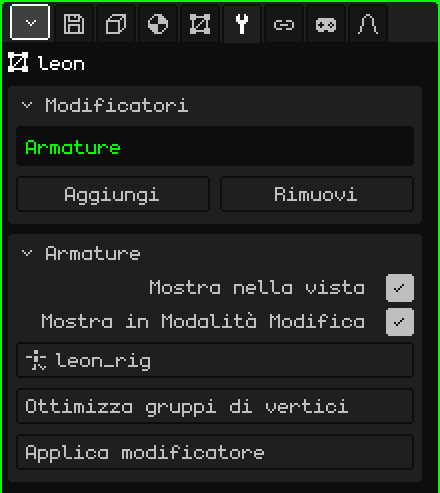

# Armatura

Il modificatore **Armatura** fa sì che la mesh segua le ossa di un'armatura: quando metti in posa o animi l'armatura, la mesh si piega con lei. È ciò che trasforma un modello fermo in un personaggio che cammina, salta o saluta.

## Come si aggiunge

1. Scegli la mesh.
2. In Proprietà, apri la scheda **Modificatori** (l'icona della chiave inglese).
3. Premi **Aggiungi** e scegli **Armatura**.

Nell'elenco appare con il suo nome interno, **Armature**, e sotto si apre il riquadro con i suoi parametri. Come tutti i modificatori, non distrugge la mesh: la posa di riposo resta intatta. Si può disattivare, togliere con **Rimuovi** o rendere definitivo con **Applica modificatore**.

Quando importi un FBX o un glTF con armatura, il modificatore è già presente e punta alla sua armatura.

## Parametri

| Parametro | Cosa fa |
|---|---|
| Mostra nella vista | Se è disattivato, la mesh non si deforma: resta nella sua posa di riposo. |
| Mostra in Modalità Modifica | Se è disattivato, mentre modifichi i vertici la mesh resta a riposo, senza deformarsi. |
| Obiettivo | L'armatura che la muove. L'elenco mostra solo le armature della scena. Su **Nessuno**, non si deforma. |
| Ottimizza gruppi di vertici | Lascia a ogni vertice un solo osso, quello che lo muoveva di più, con il peso pieno. Chiede conferma perché i pesi intermedi vanno persi. |
| Applica modificatore | Rende definitiva nella mesh la posa del fotogramma attuale e toglie il modificatore: la mesh resta congelata in quella posa. L'armatura non viene toccata. Si può annullare. |

## Come fa la mesh a sapere quale osso la muove

Con i **gruppi di vertici**. Ogni gruppo ha lo **stesso nome di un osso** e dice quali vertici muove quell'osso e quanto: il **peso**, da 0 (niente) a 1 (tutto). Un vertice può stare in più gruppi; in un gomito, metà nel braccio e metà nell'avambraccio, perché si pieghi in modo morbido.

I gruppi si trovano nella scheda **Mesh 3D**, riquadro **Gruppi di vertici**:

| Pulsante | Cosa fa |
|---|---|
| Aggiungi gruppo di vertici / Rinomina | Crea un gruppo e gli dà un nome. Deve essere uguale a quello dell'osso, lettera per lettera. |
| Assegna / Rimuovi | In Modalità Modifica, mette nel gruppo i vertici selezionati (con peso 1) o li toglie. |
| Seleziona / Deseleziona | Mostra quali vertici ha il gruppo. |

Per i pesi più fini, come le transizioni di spalle e ginocchia, usa la [Pittura pesi](pintura.md#pittura-pesi): dipinge il peso del gruppo scelto, dal blu (niente) al rosso (tutto).

## Passo dopo passo

1. Costruisci l'armatura (**Aggiungi → Armatura**) e sistema le ossa dentro il modello (vedi [Armature](esqueletos.md)).
2. Aggiungi alla mesh il modificatore **Armatura** e in **Obiettivo** scegli l'armatura.
3. Crea un gruppo per osso, con lo stesso nome, e assegna o dipingi i pesi.
4. Scegli l'armatura, passa alla **Modalità Posa** e muovi un osso: la mesh lo segue.

## Cosa conviene sapere

- La posizione dell'Armatura nell'elenco non cambia nulla: non viene calcolata insieme agli altri, ma deforma la mesh a ogni fotogramma, quando la disegna.
- Deforma la mesh originale. Se ci sono altri modificatori attivi che generano geometria ([Specchio](modificador-espejo.md), [Array](modificador-array.md), [Superficie di suddivisione](modificador-subdivision.md), [Vite](modificador-screw.md), [Booleano](modificador-booleano.md)), ciò che si vede è la mesh generata, che non segue le ossa. Applicali prima di animare.
- Applicare uno di quei modificatori (tranne lo Specchio) svuota l'intero elenco, e se ne va anche l'Armatura. I gruppi di vertici restano: aggiungi di nuovo l'Armatura e scegli ancora l'Obiettivo.

 Sul Nokia N95, deformare la mesh a ogni fotogramma ha un costo, tanto più alto quante più ossa influenzano ogni vertice. **Ottimizza gruppi di vertici** ne lascia uno solo per vertice e lo skinning diventa molto più veloce; in cambio, le articolazioni si piegano in modo più rigido. Fallo alla fine, quando i pesi sono già pronti.

Torna a [Mesh 3D](objeto-malla.md)
