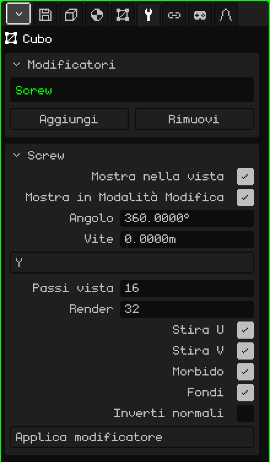

# Vite

Il modificatore **Vite** (*Screw*, in inglese) fa ruotare un profilo attorno a un asse e costruisce la superficie che lascia ruotando, come un tornio. Disegni metà della sagoma di un vaso, di un calice o di una bottiglia, e la Vite la trasforma nell'oggetto intero. Se inoltre il profilo sale mentre ruota, ottieni una filettatura o una molla.

## Come si aggiunge

1. Scegli la mesh con il profilo.
2. In Proprietà, apri la scheda **Modificatori** (l'icona della chiave inglese).
3. Premi **Aggiungi** e scegli **Vite**.

Nell'elenco appare con il suo nome interno, **Screw**, e sotto si apre il riquadro con i suoi parametri. Come tutti i modificatori, non distrugge la mesh: il profilo resta lì e puoi modificarlo mentre guardi il risultato. Si può disattivare, spostare con **Sposta su** e **Sposta giù**, togliere con **Rimuovi** o rendere definitivo con **Applica modificatore**.

## Il profilo

Il profilo è una linea: vertici uniti da spigoli, senza facce. L'asse di rotazione passa per l'**origine** della mesh, quindi la distanza di ogni vertice dall'origine è il raggio dell'oggetto a quell'altezza. Un modo per disegnarlo:

1. **Aggiungi → Mesh → Vertice** crea un vertice isolato nell'origine ed entra direttamente in Modalità Modifica.
2. Guarda da davanti (vedi [Navigare nella Vista 3D](../tutoriales/navegacion.md#le-viste-di-fronte-di-lato-e-dallalto)).
3. Con **Estrudi vertici** (menu Mesh → Vertice) tira fuori il vertice successivo verso il lato per fare il fondo, e poi verso l'alto per la parete, punto per punto.

I vertici che restano sull'asse chiudono l'oggetto: il primo, nell'origine, è il centro del fondo del vaso.

## Parametri

| Parametro | Cosa fa |
|---|---|
| Mostra nella vista | Se è disattivato, non ruota: si vede solo il profilo, né nella vista né nel render. |
| Mostra in Modalità Modifica | Se è disattivato, mentre modifichi il profilo si vede solo la linea. |
| Angolo | Di quanti gradi ruota il profilo, dal primo passo all'ultimo (360 di default, il giro completo). Con 180 ottieni mezzo oggetto. Un valore negativo ruota nell'altro senso. Può superare 360: con 1080 fa tre giri. |
| Vite | Di quanti metri sale il profilo lungo l'asse, dall'inizio alla fine della rotazione. A 0 è un tornio (vaso, calice, bottiglia); con un altro valore, una filettatura o una molla. |
| Asse | Attorno a quale asse ruota: X, Y o Z. Di default è **Z**, la verticale: un profilo disegnato nella vista frontale viene fuori in piedi, come un vaso sul tavolo. |
| Passi vista | Quante copie del profilo si fanno lungo la rotazione nella vista, da 2 a 512 (16 di default). Più passi, più rotondo e più pesante. |
| Render | I passi usati quando fai **Renderizza immagine** o **Renderizza animazione** (32 di default). |
| Stira U | Costruisce le coordinate UV attorno alla rotazione, perché una texture avvolga l'oggetto come un'etichetta. |
| Stira V | Costruisce le coordinate UV lungo il profilo, dall'alto in basso. Con entrambi disattivati non ci sono UV. |
| Morbido | Ombreggiatura liscia sulla superficie generata: si vede rotonda e non sfaccettata. È attivo di default. |
| Fondi | Salda i vertici che cadono nello stesso punto: quelli del profilo che toccano l'asse (il fondo, la bocca di una bottiglia chiusa) e la cucitura dove si chiude il giro. È attivo di default. |
| Inverti normali | Capovolge la direzione verso cui guardano le facce. Usalo se l'oggetto si vede al contrario, scuro o come visto da dentro. |
| Applica modificatore | Rende definitivo il risultato nella mesh con i **Passi vista**. Vedi la nota più sotto. |

Il giro si chiude da solo, senza cucitura, solo con l'Angolo a 360 e la Vite a 0. Con un altro angolo, o con il profilo che sale, l'inizio e la fine restano aperti.

## Esempi

- **Un vaso:** il profilo di mezza sagoma, Angolo 360, Vite 0 e tra 16 e 32 passi.
- **Una filettatura:** un profilo corto lontano dall'asse, Angolo 1080 e Vite a 3: tre giri che salgono di un metro ciascuno. Aumenta i passi perché la spirale non risulti spezzata.

 Sul Nokia N95 ogni passo è una copia in più del profilo da disegnare. Usa pochi Passi vista mentre modelli e lascia quelli alti per Render.

> [!NOTE]
> Applica modificatore sulla Vite rende definitivi **tutti** i modificatori attivi dell'elenco, non solo questo, e svuota l'elenco: se ne vanno anche quelli disattivati e quelli che non generano geometria, come un'[Armatura](modificador-esqueleto.md). Si può annullare.

Torna a [Mesh 3D](objeto-malla.md)
