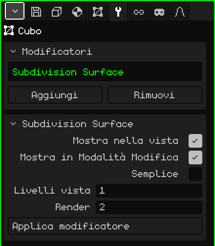

# Superficie di suddivisione

Il modificatore **Superficie di suddivisione** divide ogni faccia in facce più piccole e, di default, arrotonda la forma. Serve per modellare con pochi poligoni, che è veloce da modificare e leggero, e vedere il risultato morbido: da un cubo viene fuori qualcosa di simile a una sfera, e da un personaggio low-poly, uno dalle forme arrotondate.

## Come si aggiunge

1. Scegli la mesh.
2. In Proprietà, apri la scheda **Modificatori** (l'icona della chiave inglese).
3. Premi **Aggiungi** e scegli **Superficie di suddivisione**.

Nell'elenco appare con il suo nome interno, **Subdivision Surface**, e sotto si apre il riquadro con i suoi parametri. Come tutti i modificatori, non distrugge la mesh: si può disattivare, spostare con **Sposta su** e **Sposta giù**, togliere con **Rimuovi** o rendere definitivo con **Applica modificatore**.

## Parametri

| Parametro | Cosa fa |
|---|---|
| Mostra nella vista | Se è disattivato, non si suddivide: né nella vista né nel render. |
| Mostra in Modalità Modifica | Se è disattivato, mentre modifichi si vede la mesh non suddivisa e la modifica è più veloce; tornando alla Modalità Oggetto si vede di nuovo morbida. |
| Semplice | Se è disattivato (di default), ogni livello ammorbidisce la forma e arrotonda gli angoli. Se è attivo, divide solo le facce senza spostare i vertici: la forma resta uguale ma con più vertici, per esempio per dipingere i colori dei vertici con più dettaglio. |
| Livelli vista | Quante volte si suddivide nella vista, da 0 a 6 (1 di default). Ogni livello moltiplica le facce per 4: un cubo di 6 facce passa a 24 con 1 livello, a 96 con 2 e a 384 con 3. A 0 non si suddivide. |
| Render | I livelli usati quando fai **Renderizza immagine** o **Renderizza animazione** (2 di default). Così la vista resta leggera e l'immagine finale viene più morbida. |
| Applica modificatore | Rende definitiva la suddivisione nella mesh con i **Livelli vista** (non con quelli di Render). Vedi la nota più sotto. |

## Come lavorare con la suddivisione

- Funziona meglio con facce a quattro lati. Un triangolo si divide in 3 quadrilateri e una faccia a cinque lati, in 5.
- Suddividere non cambia l'ombreggiatura: una mesh piatta continua a vedersi sfaccettata. Per vederla liscia, in Modalità Modifica scegli le facce e usa il menu Faccia → **Ombreggiatura liscia**.
- Perché uno spigolo resti più marcato, aggiungi un taglio vicino con **Taglio ad anello e scorri** (vedi [Modalità Modifica](modo-edicion.md)): più è vicino allo spigolo, più resta netto.
- I bordi aperti, in una mesh che non è chiusa, si ammorbidiscono seguendo il bordo.

## L'ordine conta

I modificatori si applicano dall'alto in basso. Metti lo [Specchio](modificador-espejo.md) **sopra** la Suddivisione: così il modello intero si ammorbidisce in una volta sola. Se lo Specchio va sotto, ogni metà si ammorbidisce per conto suo e nel mezzo resta una piega. Con un [Array](modificador-array.md) succede lo stesso: le copie saldate con Fondi si ammorbidiscono insieme.

 Sul Nokia N95 ogni livello pesa: con 1 livello ci sono già quattro volte più facce da disegnare, e con 2, sedici volte di più. Lascia i Livelli vista a 0 o 1, disattiva Mostra in Modalità Modifica mentre modelli e tieni i livelli alti per Render.

> [!NOTE]
> Applica modificatore sulla Suddivisione rende definitivi **tutti** i modificatori attivi dell'elenco, non solo questo, e svuota l'elenco: se ne vanno anche quelli disattivati e quelli che non generano geometria, come un'[Armatura](modificador-esqueleto.md). Si può annullare.

Torna a [Mesh 3D](objeto-malla.md)
